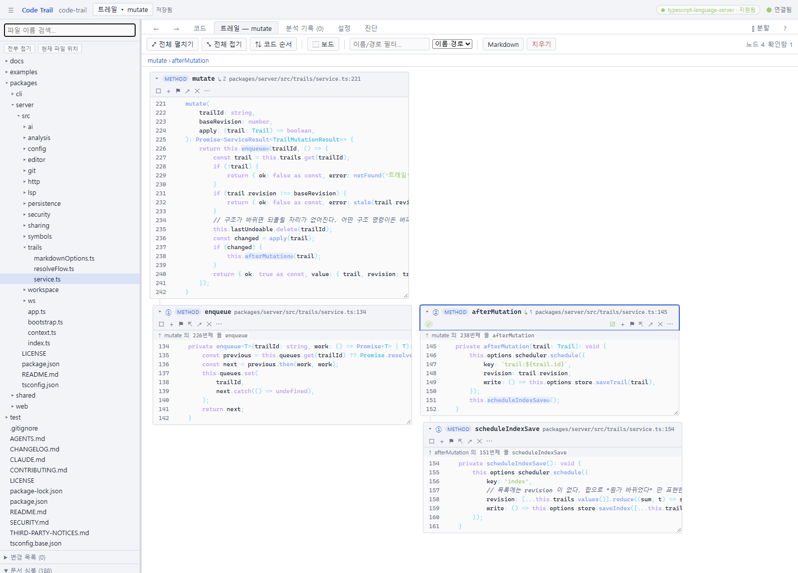
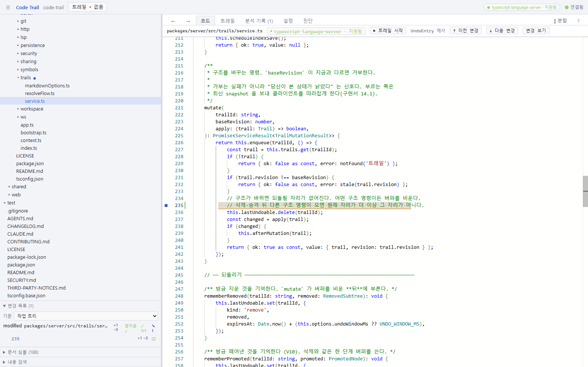
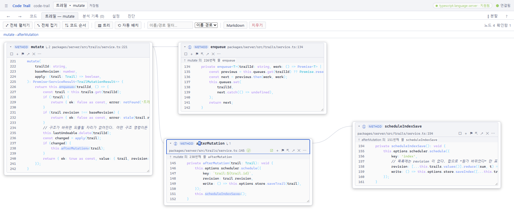

# Code Trail

**Code Trail records the path you take through code as a tree.** Point it at a project folder and it starts a local server and opens your browser: expand a function inline, click an identifier, and its definition nests underneath. Symbols come from your own language server (clangd, gopls, rust-analyzer, Roslyn, typescript-language-server).
Run `npx code-trail ./my-project` (Node.js 22.12 or later). It is a reader, not an editor. The UI and documentation are in Korean.

코드를 읽어 내려간 **경로 그 자체**를 트리로 남기는 로컬 도구다. **편집기가 아니다.**
코드는 읽기만 하고, 고칠 때는 `↗` 로 평소 쓰는 에디터를 연다.

[](https://www.npmjs.com/package/code-trail)
[](LICENSE)
[](https://nodejs.org)



*`mutate` 안에서 `enqueue` 와 `afterMutation` 을 클릭하면 둘 다 `mutate` 의 형제 자식이다. 다시 `afterMutation` 안에서 `scheduleIndexSave` 를 누르면 그 아래로 붙는다. 이 화면은 이 저장소 자체를 TypeScript 언어 서버로 연 것이다.*

## 왜 만들었나

함수를 따라 들어가면 에디터는 지금 위치만 보여 주고, 지나온 길은 머릿속에만 남는다.
열 단계쯤 들어가면 어디서 왔는지 잃는다. 에디터의 Call Hierarchy 는 트리를 보여주지만 코드 본문을 보여주지 않고,
Call Graph 계열 도구는 그래프만 그리고 코드는 에디터로 점프시킨다.
Code Trail 은 그 길을 트리로 남기고 각 단계의 코드 본문을 그 자리에 보여준다.
그래서 읽은 것을 설명하고, 남에게 넘겨주고, 나중에 다시 읽을 수 있다.

## 목차

- [30초 시작](#30초-시작)
- [이런 때 쓴다](#이런-때-쓴다)
- [지원 언어와 언어 서버](#지원-언어와-언어-서버)
- [동작 방식](#동작-방식)
- [트리 구조](#트리-구조)
- [사용법](#사용법)
- [설치와 실행](#설치와-실행)
- [설정](#설정)
- [데이터는 어디에 남나](#데이터는-어디에-남나)
- [안전에 관해](#안전에-관해)
- [문제 해결](#문제-해결)
- [개발](#개발)
- [구조](#구조)
- [문서 지도](#문서-지도)
- [지난 이야기](#지난-이야기)
- [라이선스](#라이선스)

## 30초 시작

```
npx code-trail ./my-project
```

1. 브라우저가 열리면 왼쪽 파일 탐색기에서 파일을 연다.
2. 함수 위에 커서를 두고 `Ctrl+Alt+T` 를 누른다(또는 문서 줄의 `▶ 트레일 시작`).
3. 본문의 식별자를 클릭한다. 그 정의가 자식 노드로 아래에 붙는다.

**언어 서버가 설치되어 있어야 한다.** 없다면 [지원 언어와 언어 서버](#지원-언어와-언어-서버) 를 본다.
언어 서버 없이 흐름만 보려면 저장소의 `examples/first-review.ctshare.json` 을 받아 `code-trail --read-share <파일>` 로 예제 공유 묶음을 읽는다.

## 이런 때 쓴다

**낯선 코드를 처음 읽을 때.** 진입점 함수에서 시작해 호출을 따라 내려간다. 가 본 길이 트리로 남고,
접었다 펼치며 큰 그림과 세부를 오간다. 구현이 여럿인 인터페이스는 자동으로 고르지 않고 후보를 보여준다.

**PR·변경을 리뷰할 때.** 파일 탐색기 아래 읽기 시작점의 변경 목록에서 바뀐 줄 덩어리(hunk)부터 연다.
변경 기준(작업 트리 · 커밋 · 브랜치)을 고르고, 본 덩어리에 `☐` 로 확인함을 남긴다. 코드가 바뀌면 `재검토` 로 내려간다.



**읽은 것을 남기고 넘겨줄 때.** 코드 범위·노드·트레일에 설명·질문·우려·결론을 남기고 안내 순서로 엮는다.
공유 묶음·Markdown·정적 HTML 로 내보내면 받는 사람은 프로젝트나 언어 서버 없이도 읽을 수 있다.
따라 하는 법은 [첫 분석과 공유 안내](docs/first-review-guide.md) 에 있다.

여러 함수를 나란히 놓고 비교하고 싶으면 툴바의 `⬚ 보드` 로 노드를 캔버스에 자유롭게 늘어놓는다.



## 지원 언어와 언어 서버

지금 지원하는 언어와 서버는 다섯이다.

| 언어 | 언어 서버 | 어디서 찾나 | 설치 안내 |
| --- | --- | --- | --- |
| C / C++ | clangd | 설정 → `PATH` → LLVM 설치 위치 | [clangd.llvm.org](https://clangd.llvm.org/installation) |
| C# | roslyn-language-server | 설정 → `PATH` | [Roslyn](https://learn.microsoft.com/dotnet/core/tools/dotnet-tool-install) |
| Go | gopls | 설정 → `PATH` → `GOBIN` → `GOPATH/bin` | [go.dev/gopls](https://go.dev/gopls) |
| Rust | rust-analyzer | 설정 → `PATH` → rustup(`CARGO_HOME`) | [rust-analyzer](https://rust-analyzer.github.io/book/installation.html) |
| TypeScript / JavaScript | typescript-language-server | 설정 → `PATH` → 전역 npm 패키지 진입점 | [typescript-language-server](https://github.com/typescript-language-server/typescript-language-server) |

**언어 서버를 대신 내려받지 않는다.** 이미 설치된 것을 찾거나 설정에 적힌 경로를 쓴다.
설치 명령은 `진단` 탭이 안내만 하고 우리가 실행하지 않는다 —
남의 기계에 도구를 몰래 설치하는 것은 그 자체로 놀랄 일이다.

지금 환경이 되는지는 **파일을 열기 전 첫 화면**에서 먼저 보인다. 언어별 파일 수 옆에
그 언어 서버의 상태가 붙고, 누르면 `진단` 탭의 그 카드로 간다. 파일을 열면 같은 표시가
앱 바와 문서 줄에도 남는다.

자세한 근거는 **`진단` 탭**에 있다. 실행 파일을 어디서 찾았는지, 프로세스가 떠 있는지,
어떤 capability 를 광고했는지, 마지막 요청이 언제 성공했는지가 언어별로 나온다.
`✓ 확인` 을 누르면 프로젝트 안의 실제 파일 하나로 요청을 보내보고,
응답이 오면 그때 `지원됨` 배지가 붙는다.

정의를 못 찾았을 때도 이유를 함께 알린다 — 서버가 뜨는 중인지, 멎었는지, 아직 확인 전인지,
C# 솔루션을 안 골랐는지에 따라 알림에 `다시 시도` · `진단 화면` · `솔루션 고르기` 같은
다음 행동 버튼이 붙는다. 심볼 해석을 지원하지 않는 파일 형식(`.py` 등)에서는 서버에
묻지도 않고 바로 알려준다.

### C# 참고

C# 독립 언어 서버는 배포 규약이 아직 안정되지 않았다. 직접 설치한 뒤
`.code-trail/local/settings.json` 의 `languages.csharp.executable` 에 경로를 적는다.

솔루션 후보(`.sln`, `.csproj`)가 여럿이면 **우리가 고르지 않는다.**
`진단` 탭의 **솔루션** 칸에서 고르면 `languages.csharp.solutionPath` 에
프로젝트 상대경로로 저장된다.

## 동작 방식

심볼 해석은 전부 **언어 서버(LSP)** 에 위임한다. 자체 파서를 두지 않는다.
쓰는 요청은 넷뿐이다.

```
textDocument/definition        식별자의 정의
textDocument/documentSymbol    심볼 목록과 본문 범위
textDocument/implementation    구현 찾기
textDocument/typeDefinition    정의를 못 찾았을 때의 폴백
```

전부 표준 LSP 기능이라, 이 넷에 답하는 언어 서버라면 붙는다.

## 트리 구조

`A` 안에서 `B` 를 클릭하고, 다시 `A` 안에서 `C` 를 클릭하면
**B 와 C 는 A 의 형제 자식으로 나란히** 붙는다. C 가 B 밑으로 들어가지 않는다.
클릭한 코드가 어느 노드에 속해 있느냐가 부모를 결정하기 때문이다.

```
                   A ↳2                    ← A에서 2군데를 펼쳐봤다
       auto h = reg.Find①(op);             ← 펼쳐본 호출부에 순번이 붙는다
       h->Invoke②(s, p);
                    │
           ┌────────┴────────┐
      ① B (Find) ↳1      ② C (Invoke)      ← 같은 깊이의 형제는 같은 행
            │
       ① map_.find
```

부모 코드의 `Find①` 을 다시 누르면 아래 ① 노드로 이동하고,
자식 헤더 밑의 `↑ A 의 127번째 줄 Find` 를 누르면 반대로 부모의 그 호출부로 돌아간다.

형제 순서는 툴바의 `⇅` 버튼으로 **코드 순서(= 호출 순서, 기본값)** 와
**클릭 순서** 사이를 오갈 수 있다.

화면 각 부분을 뭐라고 부르는지는 [docs/terms.md](docs/terms.md) 에 그림으로 정리해 두었다.

## 사용법

### 탐색 시작과 파고들기

함수 위에서 `Ctrl+Alt+T` 로 시작해 식별자를 클릭하며 내려간다. 구현체 찾기, 외부 에디터 열기, 읽던 위치 앞뒤로 가기도 여기 있다.

| 동작 | 방법 | 키 |
| --- | --- | --- |
| 파일 열기 | 왼쪽 **파일 탐색기**에서 고르거나 이름으로 검색 | `Ctrl+P` |
| 탐색 시작 | 함수 위에 커서를 두고, 또는 문서 줄의 `▶ 트레일 시작` · 우클릭 메뉴 | `Ctrl+Alt+T` |
| 한 단계 파고들기 | 노드 본문의 **식별자 클릭** | `Tab` → `Enter` |
| 구현체 찾기 | 호출부에서 **Alt + 클릭**, 또는 선언 노드 헤더의 **`⚑`** | `f` |
| 외부 에디터에서 열기 | **Ctrl/Cmd + 클릭**, 또는 노드 헤더의 `↗` | `o` |
| 경로 이동 | 상단 브레드크럼의 이름 클릭, 또는 자식 헤더 밑 `↑ …` 링크 | `p` |
| 읽던 위치 앞뒤로 | 탭 줄의 `←` `→` | `Alt+←` `Alt+→` |
| 노드에서 코드 화면으로 | 노드 헤더의 **`경로:줄`** | `g` |

### 트리 조작과 보기

트리를 접고 펼치고 지우고, 트리 모드와 보드 모드를 오가고, 노드 크기를 조절한다. 화면 배치는 서버에 남는다.

| 동작 | 방법 | 키 |
| --- | --- | --- |
| 노드 사이 이동 | 헤더 클릭 | `↑` `↓` `←` `→` `Home` `End` |
| 접기 / 펼치기 | 노드 헤더 클릭 | `Enter` · `Space` |
| 노드 삭제 | 노드 헤더의 `✕` (하위 노드까지 함께). 8초 안에 알림의 `되돌리기` | `Delete` |
| 트리 전체 지우기 | 툴바 `지우기` → 확인 팝오버 | |
| 형제 정렬 바꾸기 | 툴바 `⇅ 코드 순서` ↔ `⇅ 클릭 순서` (트레일마다 남는다) | |
| 탭 바꾸기 | 탭 줄 클릭 | `Ctrl+Alt+1`~`5` |
| 파일 탐색기 · 기록 열 | `☰` · 기록 열의 `×` | `Ctrl+Alt+B` · `Ctrl+Alt+N` |
| 코드와 트레일 나란히 | 탭 줄 오른쪽 `⫿ 분할` (1400px 이상) | `Ctrl+Alt+\` |
| 노드를 자유롭게 늘어놓기 | 툴바 `⬚ 보드` → 헤더를 끌어 이동. 다시 누르면 트리로 | |
| 본문 높이 조절 | 코드 상자 **오른쪽 아래 모서리를 드래그** | |
| 그 노드만 글자 크기 | 코드 위에서 **Ctrl + 휠** | |
| 크기 되돌리기 | **줄 번호 칸 더블클릭** | |
| 새 루트로 떼어내기 | 노드 헤더의 **`⇱`** (하위 노드도 함께 올라온다) | `r` |
| 트레일 여러 개 | 앱 바의 `트레일 ▾` 목록에서 만들고 고르고 이름 바꾸고 지운다 | |
| 노드 메뉴 | 노드 헤더 **우클릭** 또는 **`⋯`** | `m` · `Shift+F10` |

### 변경에서 시작하는 리뷰

파일 탐색기 아래 읽기 시작점에서 기준(`HEAD` 등) 대비 바뀐 줄 덩어리부터 읽고 `☐` 로 확인함을 남긴다.

| 동작 | 방법 | 키 |
| --- | --- | --- |
| 변경에서 시작하기 | 파일 탐색기 아래 `변경 목록`에서 파일을 펼쳐 **바뀐 줄 덩어리**를 고른다 | |
| 무엇과 비교할지 | 변경 목록 머리의 **변경 기준** — `작업 트리` · `<커밋> 이후` · `<브랜치> ← 갈라진 지점부터` | |
| hunk 를 봤다고 표시 | hunk 줄 오른쪽의 `☐`. 파일 줄에 `✓ n/m` 이 보인다 | |
| 바뀐 곳만 보기 | 문서 줄의 `이전 변경` · `다음 변경` · `변경 보기`(기준 대비 좌우 비교) | `Alt+↑` `Alt+↓` |
| 확인함으로 표시 | 노드 헤더의 **`☐`** (다시 누르면 되돌린다) | `v` |
| 트레일 노드로 건너뛰기 | 코드 화면 왼쪽 여백의 **표식** 클릭 | |
| 파일이 바뀐 노드 | 헤더의 `바뀜` 배지와 `↻` 로 현재 코드 다시 읽기 | |

### 기록 · 안내 순서 · 공유

읽은 것을 설명·질문·우려·결론으로 남기고, 안내 순서로 엮어 공유 묶음·Markdown·정적 HTML 로 넘긴다.

| 동작 | 방법 | 키 |
| --- | --- | --- |
| 분석 기록 남기기 | 코드를 드래그해 뜨는 **선택 칩**의 `＋ 기록`, 노드 헤더의 `＋`, 또는 `분석 기록` 탭 | `n` |
| 기록을 코드 옆에서 | 노드 헤더의 `✎ N` 배지, 또는 코드 화면에서 드래그 → `＋ 기록` → 오른쪽 **기록 열** | |
| 안내 순서 따라 읽기 | 분석 화면의 `따라 읽기` → 화면 아래 막대의 `다음` | `[` `]` |
| Markdown 으로 내보내기 | 툴바 `Markdown` → `기록 포함` · `Mermaid 포함` 을 고르고 내려받는다. 노드 하나만 필요하면 노드 메뉴의 `Markdown 복사` | |
| 공유하기 | `공유 내용 확인` 뒤 공유 묶음·Markdown·정적 HTML 내려받기 | |
| 프로젝트 없이 읽기 | `code-trail --read-share <공유 파일>` | |
| 회신 합치기 | 회신 공유 묶음을 가져와 추가·수정·삭제와 충돌을 확인한 뒤 `검토한 변경 합치기` | |
| AI 설명 초안 | 코드 범위를 선택하고 칩의 `AI 초안`. 검토 후 채택해야 기록이 된다 | |

### 설정 · 진단 · 단축키

대부분의 설정은 설정 탭에서 바꾼다. 언어 서버 상태는 앱 바의 서버 상태 표시와 진단 탭에서 본다.

| 동작 | 방법 | 키 |
| --- | --- | --- |
| 설정 바꾸기 | `설정` 탭 (테마·글자 크기·클릭 대상·언어 켜기·작성자) | |
| 언어 서버 상태 | 앱 바·문서 줄의 상태 표시, 자세히는 `진단` 탭 | |
| 단축키 전부 보기 | 탭 줄 오른쪽의 `?` | `?` |

트레일은 **자동으로 저장된다.** 저장·불러오기 버튼이 없다 —
브라우저를 닫았다 열어도, 서버를 다시 띄워도 마지막 상태 그대로다.
앱 바의 `저장됨` / `저장 중…` 이 디스크에 실제로 쓰였는지를 말한다.

**화면 배치도 남는다.** 사이드바 폭·접힘, 기록 열, 탭, 마지막에 보던 파일과 줄, 이동
이력, 변경 기준은 `.code-trail/local/ui-state.json` 에 이 기계의 것으로 남는다. 서버를
다른 포트로 다시 띄워도 어제 보던 자리에서 시작한다.

사이드바는 가장자리를 끌어 폭을 바꾸고 앱 바 왼쪽 `☰` 로 접는다.
파일 탐색기 머리의 `현재 파일 위치` 는 어떤 길로 연 파일이든 트리에서 그 자리를 펼쳐
보여주고, 변경된 파일은 색으로 구분된다.
알림은 화면 오른쪽 아래 한 자리에만 쌓이고, 모두 `×` 로 닫을 수 있다.

### 분석 기록과 공유

**분석을 미리 만들 필요는 없다.** 첫 기록을 저장하면 활성 트레일 이름으로 하나가 생기고
그 트레일과 짝지어진다. 다음에 같은 트레일을 고르면 그 분석이 따라온다.

대상은 트레일 전체, 현재 노드, 드래그한 정확한 코드 범위 중 하나다. 코드를 드래그하면
선택 끝에 **선택 칩**이 뜨고 `＋ 기록` 이 그 범위를 대상으로 잡는다 — **드래그만으로는
화면이 바뀌지 않는다.** 기록 종류와 태그를 정하고 `Ctrl/Cmd+Enter`로 저장한다.

저장한 기록은 트레일 패널에도, 코드 화면에도 보인다. 노드 헤더에 `✎ N` 배지가 붙고
(미해결 질문·우려가 있으면 주황), 그 줄 왼쪽에 종류별 색 띠가 생기고, 코드 화면 왼쪽
여백에는 표식이 찍힌다. 배지나 표식을 누르면 오른쪽에 **기록 열**이 열려 코드를 떠나지
않고 읽고 쓸 수 있다 — 코드 화면에서는 그 파일의 기록을, 트레일 패널에서는 활성 노드의
기록을 보여준다. 기록 헤더의 대상은 링크라서 그 코드나 노드로
한 번에 간다. **표시는 활성 분석 하나만 본다** — 여러 분석의 기록을 합치면 누구의 우려인지
흐려진다.
질문을 해결로 표시해도 코드 검토가 자동 완료되지는 않는다. 범위별 `미검토`·`확인 중`·
`확인함`·`재검토 필요`는 별도 상태다.

**기록이 많아지면 걸러서 본다.** 종류·처리 상태·작성자·대상 종류로 거르고, 최신·위치·
종류로 세우고, 파일별로 묶는다. `모든 분석에서 찾기` 는 지금 보고 있지 않은 분석의
기록까지 찾아 고르면 그 분석으로 옮겨 준다.

**안내 순서는 따라 읽을 수 있다.** 단계를 만든 뒤 `따라 읽기` 를 누르면 화면 아래에
막대가 뜨고 `다음` 만 눌러 끝까지 읽는다(`[` · `]` · `Esc`). 단계는 제목·설명을 고치고,
지우고(되돌리기 있음), `현재 위치를 단계로 추가` 나 노드 메뉴의 `안내 순서에 추가` 로
더한다. 대상이 지워진 단계는 건너뛰지 않고 "연결할 곳이 없다" 를 막대에 적는다.

코드가 바뀌면 그 파일을 기준으로 하는 기록 위치를 **몇 초 안에 자동으로 다시 판정한다.**
자리가 옮겨졌을 뿐이면 조용히 따라가고, 후보가 여럿이거나 대상이 사라졌을 때만 알린다 —
재연결은 사람이 한다. `위치 다시 확인` 으로 언제든 직접 돌릴 수도 있다. 범위 기록의 `코드 비교`는
기록 당시 코드와 현재 코드를 나란히 보여준다. 동일한 후보가 여러 곳이면 자동 연결하지 않으며,
확인했던 코드가 바뀌면 `재검토 필요`가 된다. 작성 중 입력은
브라우저와 `.code-trail/local/drafts/`에 정본과 분리해 남긴다.

공유 전에는 코드 본문 포함 여부, 트레일·노드·기록 수, 예상 크기와 자유 입력 경고를 먼저
보여준다. 기본값은 코드 미포함이다. 공유 묶음은 무결성 해시와 엄격한 참조 검사를 거쳐
별도 로컬 ID의 복사본으로 들어온다. Markdown과 정적 HTML은 일반 도구나 브라우저에서
읽을 수 있으며 외부 통신이나 사용자 코드 실행 기능이 없다.
안내 단계와 기록 링크는 공유 묶음의 원래 ID를 사용하므로 가져온 복사본에서도 같은 대상을
찾으며, 링크에는 세션 토큰이 들어가지 않는다.

가져온 복사본에서 기록·답글을 고쳐 다시 내보내면 원본 계보와 기준 내용이 함께 간다.
원 작성자는 추가·수정·삭제를 세 방향 비교로 확인하고 충돌 없는 변경만 합칠 수 있다.
양쪽이 같은 본문을 고쳤거나 삭제와 수정이 겹치면 자동으로 고르지 않고 두 내용을 모두
보여준다. 같은 회신을 다시 적용해도 기록이나 답글이 늘어나지 않는다.

### 선택적 AI 설명 초안

AI 기능은 기본으로 꺼져 있으며 로컬 Ollama만 지원한다. `.code-trail/local/settings.json`의
`ai.enabled`, `ai.model`을 사용자가 직접 정한 경우에만 현재 선택한 코드 범위를
Ollama 공식 [`POST /api/generate`](https://docs.ollama.com/api/generate) 계약으로 보낸다.
endpoint는 `localhost`, `127.0.0.1`, `[::1]`만 허용한다.
전체 저장소·다른 파일·분석 기록을 자동으로 보내지 않으며 비밀키 설정도 없다.

결과는 `AI 초안`으로 표시되고 모델이 만든 근거 ID는 믿지 않는다. 서버가 실제 선택 범위에
만든 기록 위치에만 근거를 연결한다. 사용자가 `검토하고 분석 기록으로 채택`을 눌러야 일반
분석 기록이 되며, 그때도 검토 상태를 자동으로 `확인함`으로 올리지 않는다. 생성 중 취소,
입력 바이트 상한, 제한 시간, 생성 중 코드 변경 검사를 적용한다. Ollama가 없어도 나머지
기능은 모두 동작한다.

언어 서버 없이 흐름을 확인하려면 [첫 분석과 공유 안내](docs/first-review-guide.md)를 따른다.

### 인터페이스 · 가상 함수 — 선언만 나올 때

`IFoo foo` 처럼 인터페이스 타입 변수의 메서드를 클릭하면 정의는 **인터페이스의 선언**으로 간다.
몸통이 없으니 시그니처만 보인다. 언어 서버가 제대로 답한 것이고, 실제로 도는 코드는 구현 클래스에 있다.

**구현이 딱 하나뿐이면 그 구현까지 자동으로 이어서 펼친다.** 고를 것이 없는데
한 번 더 누르게 할 이유가 없기 때문이다. 선언 노드는 지우지 않고 그대로 두므로
트리에는 `인터페이스 선언 → 구현` 두 단계가 남는다.
이 동작은 `ui.autoFollowSingleImplementation` 로 끌 수 있다.

**구현이 둘 이상이면 자동으로 고르지 않는다.** 호출부의 정적 타입만으로는 실제로 어느
구현이 도는지 알 수 없어서, 하나를 골라 보여주면 그게 실행되는 코드라고 오해하게 된다.
이때는 노드 헤더의 `선언만` 배지와 **`⚑` 버튼**이 그대로 남고, 그 헤더 바로 아래에
**후보 팝오버**가 떠서 구현 목록을 보여준다. 하나를 고르면 그것만 붙고, 맨 위의
`전부 붙이기` 를 고르면 `⚑` 와 같이 **형제 자식 노드로 전부 붙인다.**
고르는 주체는 언제나 사람이다.

호출부에서 곧장 구현으로 가고 싶으면 **Alt+클릭**을 쓴다.
`⚑` 는 몸통이 있는 메서드(가상 함수, `virtual`/`override`)에서도 쓸 수 있다 — 재정의한 곳들을 모아준다.

같은 이유로, 정의 후보가 여럿일 때도 우리가 고르지 않고 목록을 띄워 사용자가 고르게 한다.
목록은 **클릭한 식별자 바로 아래**에 뜬다 — 트리 맨 위에 뜨면 무엇의 후보인지 알 수 없다.

해당하는 경우:

- C# — 인터페이스 메서드, `abstract` 멤버
- C++ — 순수 가상 함수(`= 0`), 헤더의 선언
- Go — 인터페이스 메서드
- Rust — 기본 구현 없는 트레이트 메서드

### 표시되는 배지

- **재귀** — 조상 노드 중에 같은 심볼이 이미 있다. 순환 호출이다.
- **선언만** — 몸통이 없는 선언이다. `⚑` 로 구현을 펼친다.
- **근사** — 언어 서버가 그 심볼의 전체 본문 범위를 알려주지 않아 끝을 추정한 경우다.
  추정 순서는 ① 정의 결과가 함께 준 전체 범위 → ② 바로 뒤에 시작하는 다음 심볼의
  앞 줄까지 → ③ 그마저 없으면 `ui.contextLines` 만큼 이다.
- **바뀜** — 이 노드가 보여주는 파일이 밖에서 바뀌었다. 지금 화면은 **옛 코드**다.
  헤더의 `↻` 를 누르면 같은 이름·컨테이너·종류의 심볼을 다시 찾아 현재 코드로 채운다.
  자식·진입 링크·접힘 상태는 그대로 두지만, **부모 본문이 바뀌었으면 자식의 진입 링크
  줄 번호가 어긋날 수 있다** — 그 경우 진입 링크에 `(줄이 달라졌을 수 있다)` 가 붙는다.
  다시 읽기 전까지 그 노드의 식별자 클릭은 서버로 가지 않는다. 옛 좌표로 물으면
  엉뚱한 곳으로 가기 때문이다.
- **`✎ N`** — 이 노드나 그 본문 줄에 달린 분석 기록 수. 미해결 질문·우려가 있으면 주황이다.
- **`✓`** — 이 노드를 확인했다. 헤더의 `☐` 를 누르거나 `v` 로 남긴다.
- **재검토** — 확인한 뒤 코드가 바뀌었다. `↻` 로 다시 읽었을 때 내용 해시가 기준과
  달라지면 `확인함` 이 여기로 내려간다. "봤다" 가 옛 코드에 대한 말로 남지 않게 한다.

### 헤더에 표시되는 것

`종류 · 이름 · 하위 요약(접혔을 때) · 시그니처 · 경로:줄 · 배지` 순이고, 오른쪽 끝에
버튼이 붙는다 — `☐`(확인함) · `＋`(기록) · `⚑`(구현) · `↻`(바뀐 노드만) · `⇱`(새 루트) ·
`↗`(에디터) · `✕`(삭제) · `⋯`(노드 메뉴).

**`경로:줄` 은 누를 수 있다.** 누르면 코드 화면의 그 줄로 가서 함수를 감싸는 클래스의
다른 멤버, 파일 상단의 include, 바로 옆 함수를 본다. `Alt+←` 로 돌아온다.
프로젝트 밖 파일(표준 라이브러리 헤더 등)은 코드 화면에서 열 수 없어 비활성이다.

**접힌 노드는 하위 요약을 보여준다** — `하위 12 · ✎ 3 · 미해결 1 · 재검토 1`.
큰 트레일을 접어 두고 훑을 때 어디를 펼칠지 고르는 단서다.

**노드 메뉴**(`⋯` · 헤더 우클릭 · `m`)에는 헤더에 자리가 없는 행동이 있다 —
코드 화면에서 보기, 에디터에서 열기, 검토 표시, 기록 남기기, 안내 순서에 추가,
**Markdown 복사**(그 노드와 하위만), **링크 복사**(`#trail=…&node=…`), 새 루트로
떼어내기, 삭제. 링크에는 토큰·포트·경로가 들어가지 않는다.

**감싸는 클래스·네임스페이스 이름은 클래스류 노드(class/struct/interface/enum/namespace)에만
붙는다.** 함수·메서드 노드에는 붙이지 않는다 — 어느 클래스 소속인지는 대개 코드 본문에
이미 보이고, 헤더에서는 경로가 밀려나기 때문이다.

**경로는 프로젝트 루트 기준 상대경로다** (`src/net/registry.cpp:42`).
절대경로는 브라우저로 나가지 않는다. 예외는 언어 서버가 프로젝트 밖(표준 라이브러리 헤더 등)을
가리켰을 때뿐이고, 그때는 그 파일이 어디 있는지 알아야 하므로 전체 경로를 보여준다.

### 트리 모드 — 부모 위, 자식 아래

기본 트리 모드에서는 부모 노드가 위에 있고, 그 부모의 자식 노드들이 바로 아래의 같은 행에
좌우로 놓인다. 각 자식의 하위 노드는 그 아래 행으로 이어지고 가이드선이 관계를 보여준다.
형제가 많아 트리가 화면 폭을 넘으면 수평 스크롤로 좌우를 탐색한다.

### 보드 모드 — 노드를 자유롭게 늘어놓기

툴바의 **`⬚ 보드`** 를 누르면 노드가 트리 배치에서 풀려 **캔버스 위의 노드**가 된다.
헤더를 끌어 아무 자리로나 옮길 수 있고, 부모-자식은 곡선으로 이어진다.
여러 함수를 나란히 놓고 비교할 때 쓴다.

**옮겨도 트리 구조는 바뀌지 않는다.** 화면 배치일 뿐이라 `▤ 트리` 로 돌아가면
원래의 부모 위·자식 아래 모양 그대로다. 보드에서 잡아둔 자리는 트레일과 함께 저장되므로
새로고침해도, 서버를 다시 띄워도 그 자리에 있다.

뒤엉켰으면 툴바의 **`⟲ 자동 배치`** 로 손으로 옮긴 자리만 지우고 처음 배치로 돌아간다.
본문 높이와 글자 크기는 그대로다.

구조를 진짜로 바꾸고 싶으면 노드 헤더의 **`⇱`** 를 누른다. 그 노드가 하위 노드와 함께
트리 맨 위로 올라가 독립된 루트가 된다. 깊이 들어간 함수를 새 기준점으로 삼을 때 쓴다.
잘못 눌렀으면 8초 안에 알림의 `되돌리기` 로 원래 부모의 원래 자리로 돌아간다 —
진입 링크와 재귀 표시도 함께 되돌아온다.

### 노드 하나만 크게 / 작게

- **본문 높이** — 코드 상자 오른쪽 아래 모서리를 끌면 그 노드의 높이가 정해진다.
  긴 함수를 접어두고 상자 안에서 스크롤해 볼 때 쓴다.
- **글자 크기** — 코드 위에서 `Ctrl + 휠`. 그 노드만 커지고 작아진다.
  이렇게 직접 맞춘 노드는 아래의 자동 폭 맞춤이 건드리지 않는다.
- **되돌리기** — 줄 번호 칸을 더블클릭하면 그 노드의 높이·글자 크기가 원래대로 돌아간다.

둘 다 트레일과 함께 저장된다.

### 창을 좁혀도 코드가 다 보이게

창 폭이 줄면 **코드 본문 글자를 자동으로 줄여** 가로로 넘치지 않게 한다.
지금 펼쳐진 노드 중 가장 빠듯한 것 하나를 기준으로 크기를 정하므로,
노드마다 글자 크기가 달라지지 않는다. 다시 넓히면 원래 크기로 돌아온다.

**헤더 글자는 줄이지 않는다.** 헤더까지 작아지면 트리 구조가 눈에 안 들어온다.
헤더는 대신 자리가 모자라면 다음 줄로 접힌다.

하한은 `ui.minFontSize`(기본 8px)다. 거기서도 안 들어가는 긴 줄은
그 노드에만 가로 스크롤이 생긴다. 자동 조절이 싫으면 `ui.fitToWidth` 를 끄거나,
`ui.fontSize` 에 원하는 크기를 넣으면 그 값으로 고정된다.

## 설치와 실행

Node.js 22.12 이상이 필요하다(LTS 권장).

```
# 설치 없이 한 번 써보기
npx code-trail ./my-project

# 전역 설치
npm install -g code-trail
code-trail ./my-project

# 업데이트
npm update -g code-trail

# 제거
npm uninstall -g code-trail
```

`code-trail <경로>` 는 그 폴더를 프로젝트 루트로 잡아 로컬 서버를 띄우고 브라우저를 연다.

| 인자 | 뜻 |
| --- | --- |
| `<경로>` | 열 프로젝트 폴더. 생략하면 현재 폴더 |
| `--port <번호>` | 쓸 포트. 생략하면 빈 포트를 고른다 |
| `--no-open` | 브라우저를 자동으로 열지 않는다 |
| `--trail <trail-id>` | 시작한 뒤 이 트레일을 고른다 |
| `--read-share <파일>` | 프로젝트·언어 서버 없이 공유 묶음을 읽기 전용으로 연다 |
| `--log-level <level>` | `error` \| `warn` \| `info` \| `debug` (기본 `info`) |
| `--config <경로>` | 설정 파일 위치를 덮어쓴다. 테스트·특수 환경 전용 |
| `-v`, `--version` | 버전 |
| `-h`, `--help` | 도움말 |

서버는 **`127.0.0.1` 에만 바인딩한다.** 외부 인터페이스로 여는 옵션은 제공하지 않는다.
접속에는 프로세스가 사는 동안만 쓰는 256비트 세션 토큰이 필요하고,
그 토큰은 URL fragment 로만 전달된다 — fragment 는 서버로 전송되지 않고 로그에도 안 남는다.

같은 프로젝트에 서버가 이미 떠 있으면 새로 띄우지 않고 그 주소를 열어준다.

프로젝트 안 `.code-trail/` 에 설정·트레일·분석 기록이 저장된다.
`.code-trail/local/`에는 기계별 실행 설정·작성자·초안이, `runtime/`에는 실행 부산물이
들어가며 각각 자체 `.gitignore`로 감춘다 —
**프로젝트 루트의 `.gitignore` 는 우리가 고치지 않는다.**

## 설정

**대부분은 `설정` 탭에서 바꾼다.** 테마·코드 글자 크기·탭 폭·폭 맞춤·클릭 대상·형제 정렬
기본값·언어 켜기·작성자 이름이 거기 있고, 바꾸면 곧바로 파일에 저장된다.

실행 파일 경로와 인자는 설정 탭에서 받지 않는다. 기계마다 다른 값이고, 임의 실행 파일
경로를 웹 입력으로 받는 통로를 만들지 않기 위해서다. 탐지 결과를 보고 고르는 것은
`진단` 탭이 하고, 직접 적으려면 `.code-trail/local/settings.json` 을 연다.

공유 가능한 값은 `.code-trail/settings.json`, 기계·개인 값은
`.code-trail/local/settings.json`에 나뉜다. 적용 순서는 `기본값 → 프로젝트 설정 → 로컬 설정`이다.
1.0의 단일 설정은 처음 열 때 `.pre-local-settings.bak`으로 백업한 뒤 자동 분리한다.

| 키 | 기본값 | 설명 |
| --- | --- | --- |
| `ui.theme` | `system` | `system` \| `light` \| `dark` |
| `ui.clickTarget` | `allSymbols` | 클릭 대상. `callsOnly` 로 바꾸면 호출 지점만 링크가 된다 |
| `ui.childOrder` | `source` | 형제 정렬 **기본값**. `source`=코드 순서, `click`=클릭 순서. 툴바에서 바꾼 값은 그 트레일에 따로 남는다 |
| `ui.maxCodeLines` | `250` | 노드 하나에 처음 표시할 최대 줄 수. 초과분은 "더 보기" |
| `ui.contextLines` | `40` | 본문 범위도 다음 심볼 경계도 못 구할 때 보여줄 줄 수 |
| `ui.fitToWidth` | `true` | 화면 폭에 맞춰 코드 글자 크기를 자동으로 줄임 |
| `ui.minFontSize` | `8` | 폭 맞춤이 줄일 수 있는 하한(px) |
| `ui.fontSize` | `0` | 코드 글자 크기(px). 0보다 크면 폭 맞춤보다 우선한다 |
| `ui.tabSize` | `4` | 탭 한 칸을 몇 칸으로 **보여줄지**. 코드 화면과 노드 본문이 같은 값을 쓴다. 원본 문자열과 컬럼 좌표는 바뀌지 않는다 |
| `ui.autoFollowSingleImplementation` | `true` | 선언만 열렸고 구현이 **하나뿐**이면 그 구현까지 자동으로 펼침 |
| `ui.revealInExternalEditorOnAdd` | `false` | 노드 추가 시 외부 에디터도 같이 그 위치를 연다 |
| `editor.executable` | `null` | **로컬 설정.** 외부 에디터 실행 파일. `null` 이면 열기 기능을 끈다 |
| `editor.args` | `[]` | **로컬 설정.** 실행 인자. `{path}`, `{line}`, `{column}`, `{project}` 만 쓴다 |
| `languages.<언어>.enabled` | `true` | 그 언어의 서버를 쓸지 |
| `languages.<언어>.executable` | `null` | **로컬 설정.** 실행 파일 경로. `null` 이면 자동 탐지 |
| `languages.<언어>.args` | `[]` | **로컬 설정.** 실행 인자. 셸을 거치지 않고 그대로 넘긴다 |
| `languages.<언어>.env` | `{}` | **로컬 설정.** 덮어쓸 환경 변수만 |
| `languages.<언어>.initializationOptions` | `null` | **로컬 설정.** LSP `initialize` 에 그대로 실린다 |
| `languages.csharp.solutionPath` | `null` | 열 솔루션. **프로젝트 상대경로.** 후보가 여럿이면 우리가 고르지 않는다 |
| `ai.enabled` | `false` | **로컬 설정.** 선택한 범위의 AI 설명 초안을 명시적으로 켠다 |
| `ai.provider` | `ollama` | **로컬 설정.** 현재 지원하는 로컬 제공자 |
| `ai.endpoint` | `http://127.0.0.1:11434` | **로컬 설정.** loopback origin만 허용한다 |
| `ai.model` | `""` | **로컬 설정.** 사용할 Ollama 모델. 빈 값이면 기능을 끈다 |
| `ai.maxInputBytes` | `65536` | **로컬 설정.** 한 번에 보낼 선택 코드의 UTF-8 바이트 상한 |
| `ai.timeoutMs` | `60000` | **로컬 설정.** 생성 제한 시간 |

`<언어>` 는 `cpp`, `csharp`, `go`, `rust`, `typescript` 다섯이다. `typescript` 어댑터가
TypeScript·TSX·JavaScript·JSX를 함께 맡는다. Windows에서는 npm의 `.cmd` shim을 셸로
실행하지 않고 전역 패키지의 `lib/cli.mjs`를 Node로 직접 띄운다.

`editor.executable` 을 직접 적지 않아도 된다. `진단` 탭의 **외부 에디터** 칸이
`PATH` 에서 찾은 후보(VS Code, Cursor, Zed, Sublime, JetBrains, Helix, Emacs, Vim …)를
인자 틀과 함께 보여주고, 고르면 그 값이 설정에 적힌다. **고르기 전에는 아무것도 실행하지 않는다.**

외부 에디터는 **셸을 거치지 않고** 실행 파일과 인자 배열을 그대로 넘긴다.
파일 이름에 `;` 나 `&&` 가 있어도 인자 하나로 간다. 경로는 브라우저가 보낸 값이 아니라
서버가 문서 권한 목록에서 역조회한 것이다.

## 데이터는 어디에 남나

프로젝트 안 `.code-trail/` 에 모두 남는다. 자세한 것은 [`docs/data-and-recovery.md`](docs/data-and-recovery.md) 에 있다.

```text
.code-trail/
  settings.json                 공유 가능한 UI·언어 사용·상대 솔루션 설정
  index.json                    트레일 목록 캐시
  trails/<trail-id>.json        트레일 정본
  analysis/<analysis-id>.json   분석 기록 정본
  snapshots/                    불변 코드 기준 자료
  local/settings.json           에디터·언어 서버 실행 값·작성자·로컬 AI 제공자
  local/ui-state.json           개인 화면 상태 — 사이드바·기록 열·탭·마지막 문서·이동 이력·변경 기준
  local/drafts/                 저장 전 개인 초안
  runtime/                      잠금·언어 서버 로그
```

`local/` 과 `runtime/` 은 자체 `.gitignore` 를 가진다. **프로젝트 루트의 `.gitignore` 는 우리가 고치지 않는다.**
`settings.json`·`trails/`·`analysis/` 를 저장소에 올릴지는 프로젝트가 정한다.

## 안전에 관해

로컬 도구지만 **브라우저는 신뢰 경계 밖**이라고 보고 만들었다.

- `127.0.0.1` 에만 바인딩한다. 외부로 여는 옵션이 없다.
- 모든 API 와 WebSocket 이 세션 토큰을 요구한다. 토큰은 URL fragment 로만 오고
  query·로그·파일 어디에도 남지 않는다.
- `Host` 헤더를 확인해 DNS rebinding 을 막고, WebSocket 은 `Origin` 을 확인한다.
- CSP 로 인라인 스크립트와 외부 CDN 을 막는다.
- 브라우저는 파일 경로를 모른다. 서버가 발급한 불투명한 `documentId` 로만 문서를 요청한다.
  프로젝트 밖 파일은 언어 서버가 결과로 돌려줬을 때만 일시 권한을 얻고, 서버를 다시 띄우면 사라진다.
- 자식 프로세스(언어 서버, 외부 에디터)를 셸 없이 띄운다.
- AI endpoint는 loopback으로 제한하고 선택 코드만 전송하며, 코드 속 지시문을 명령으로 실행하지 않는다.
- 오류 응답에 절대경로·코드 본문·환경 변수·토큰을 담지 않는다.

취약점 보고 방법은 [`SECURITY.md`](SECURITY.md) 에 있다.

## 문제 해결

**언어 서버를 못 찾는다고 나온다.** `진단` 탭의 그 언어 카드가 어디를 찾았는지 보여준다. 설치한 뒤에도 못 찾으면
`.code-trail/local/settings.json` 의 `languages.<언어>.executable` 에 실행 파일 경로를 적는다.

**`지원됨` 이 안 붙는다.** `지원됨` 은 프로세스가 떴다는 뜻이 아니라 `✓ 확인` 이 실제 파일로 `documentSymbol` 과
`definition` 요청을 보내 응답을 받았다는 뜻이다. 눌러야 돈다. 프로젝트를 못 알아보는 경우도 있다 —
clangd 는 `compile_commands.json`, gopls 는 `go.mod`, rust-analyzer 는 `Cargo.toml`, C# 은 `.sln`·`.csproj` 가 필요하다.
카드의 `다음 행동` 에 무엇이 없는지 적힌다.

**클릭했는데 정의를 못 찾는다.** 알림에 이유와 `다시 시도` · `진단 화면` · `솔루션 고르기` 같은 다음 행동 버튼이 붙는다.
서버가 뜨는 중이거나 멎었을 수 있다.

**Windows 에서 설정에 `.cmd` 를 적었더니 안 뜬다.** `.cmd`·`.bat` 은 셸 없이 실행할 수 없다.
셸을 거치면 인자가 셸 문법으로 해석되므로 우회하지 않는다. 실제 실행 파일(`.exe`) 경로를 적는다.

**C# 솔루션이 여럿이다.** 우리가 고르지 않는다. `진단` 탭의 **솔루션** 칸에서 고른다.

**브라우저가 안 열린다.** 터미널에 찍힌 주소를 복사해 직접 연다. `--no-open` 을 줬다면 의도한 동작이다.

**포트를 고정하고 싶다.** `--port <번호>` 를 쓴다. 두 프로젝트를 같은 포트로 띄우면 두 번째가 충돌한다.

**프로젝트 밖 파일이 코드 화면에서 안 열린다.** 의도다. 프로젝트 밖 파일(표준 라이브러리 헤더 등)은 언어 서버가
정의로 돌려줬을 때만 노드로 볼 수 있고, 코드 화면에서는 열지 않는다.

## 개발

```
npm install
npm run build                   # shared → server → web → cli
npm run start -- <프로젝트 경로> # 서버를 띄우고 브라우저를 연다
npm run dev                     # Vite 개발 서버 (웹만 고칠 때)
npm run typecheck
```

### 테스트

```
npm test                      # 브라우저가 필요 없는 것 전부
npm run test:e2e              # 진짜 서버 + 진짜 브라우저 (playwright 필요)
npm run test:lsp              # 실제 언어 서버 스모크. 설치된 언어만 돌고 나머지는 건너뛴다
npm run test:pack             # 배포물 파일 목록과 외부 의존성 고지 검사
npm run test:install          # tarball 을 깨끗한 폴더에 설치하고 띄워 본다
npm run release:check         # 브라우저 없이 되는 전부(build · typecheck · test · pack · install)
npm run test:perf             # 1,000개 노드 성능 측정 (playwright 있으면 화면까지)
```

`npm test` 가 도는 것:

```
node --test "test/unit/*.test.mjs"          # 도메인·프로토콜·심볼 선택·보드 배치·CLI 인자
node --test "test/integration/*.test.mjs"   # 진짜 로컬 서버 + 가짜 언어 서버 + 외부 에디터 + 경계
```

`test/fake-lsp/server.mjs` 는 진짜 clangd·gopls 없이 LSP 계층을 시험하기 위한 가짜 서버다.
정상 동작만이 아니라 **실제 언어 서버가 하는 나쁜 일들**(한 줄짜리 range, stdout 오염,
요청 중 crash, 뒤늦은 capability 등록, 프로젝트 밖으로 가는 정의)을 시나리오로 재현한다.

`test/integration/resilience.test.mjs` 는 기능이 아니라 **경계**를 본다 —
인증, 명령 스키마, 다른 origin, 토큰이 남는 자리, 오류에 새는 것, 여러 탭의 revision 충돌,
`commandId` 멱등 재전송, 저장 중 강제 종료, 언어 서버 연속 crash, 종료 중 새 명령.

`test/integration/editor.test.mjs` 는 외부 에디터를 **셸 없이** 띄우는지 본다.
파일 이름에 `; touch pwned &&` 를 넣어 두고, 그것이 인자 하나로만 가는지와
셸이 돌았다면 생겼을 파일이 없는지를 확인한다.

`test/perf/board-1000.mjs` 는 언어 서버를 1,000번 부르는 대신 저장 파일을 직접 만들어
넣고 **불러오기와 그리기**만 잰다. 결과와 병목은 [`docs/perf-1000-nodes.md`](docs/perf-1000-nodes.md) 에 있다.

`test/unit` 과 `test/integration` 은 빌드된 `packages/*/dist` 를 불러온다.
먼저 `npm run build` 를 돌린다.

브라우저를 쓰는 것(`test:e2e`, `test:perf`)은 `playwright` 를 쓴다 (`npm install` 이 함께 받는다).
Chrome 실행 파일 경로를 `CT_CHROME` 으로 넘긴다. Windows 예:

```powershell
$env:CT_CHROME = "C:\Program Files\Google\Chrome\Application\chrome.exe"; npm run test:e2e
```

게시 절차와 기여 규칙은 [`CONTRIBUTING.md`](CONTRIBUTING.md) 에 있다.

## 구조

npm workspaces 다. 배포하는 것은 `packages/cli` 의 `code-trail` 이다.

```
packages/shared/src/domain/     ResolvedSymbol, Trail, 설정, 저장 스키마, Markdown, UUID
                                분석 기록, 공유 묶음, AI 초안 타입
packages/shared/src/protocol/   명령·이벤트 타입과 Zod 런타임 스키마

packages/server/src/security/   토큰, Host·Origin 검사, 경로 경계, CSP
packages/server/src/persistence/ .code-trail/ 저장소, 원자적 쓰기, debounce, 잠금 파일
packages/server/src/workspace/  파일 트리, 이름 검색, 문서 권한(documentId), 파일 감시, 내용 검색
packages/server/src/trails/     트레일 정본과 mutation queue, 삭제 되돌리기 버퍼
packages/server/src/analysis/   분석 기록 정본, 기준 해시, 위치 재탐색
packages/server/src/sharing/    공유 묶음 내보내기·검증·가져오기·병합
packages/server/src/git/        변경 목록과 바뀐 줄 덩어리 (셸 없는 git 호출)
packages/server/src/ai/         선택 범위만 보내는 loopback Ollama 제공자
packages/server/src/http/       읽기 전용 API
packages/server/src/ws/         명령 수신과 이벤트 방송
packages/server/src/lsp/        JSON-RPC 전송, 문서 동기화, 상태 머신·재시작
packages/server/src/lsp/adapters/  언어별 탐지·진단. 언어를 아는 유일한 자리다
packages/server/src/symbols/    평탄화, 심볼 선택, 본문 범위, 선언만 판정
packages/server/src/editor/     외부 에디터 탐지와 실행

packages/web/src/api/           토큰 부트스트랩, HTTP, WebSocket, 명령 보내기
packages/web/src/tokenizer/     하이라이팅 + 식별자에 좌표 심기 (순수 함수)
packages/web/src/features/      파일 탐색기, 검색, 코드 화면, 트레일 화면, 분석 기록,
                                읽기 시작점, 설정, 진단, 알림, 선택 칩, 시작하기 카드
packages/cli/src/               인자 해석, 서버 재사용 감지, 브라우저 열기
```

트레일의 정본은 **서버**에 있다. 화면은 명령을 보내고 이벤트를 받아서만 바뀐다 —
먼저 그려두면 서버가 거절했을 때(오래된 revision, 권한 없는 문서) 두 상태가 어긋난다.

식별자 클릭 좌표는 토크나이저가 심어둔 원본 파일 기준 `(줄, 컬럼)` 이고,
그 좌표를 그대로 `textDocument/definition` 에 넘긴다. 즉 정확도는 토크나이저가 아니라
언어 서버가 책임진다. 토크나이저는 "클릭 후보를 고르고 주석·문자열을 제외하는" 일만 한다.

## 문서 지도

| 문서 | 내용 |
| --- | --- |
| [`docs/terms.md`](docs/terms.md) | 화면 각 부분의 이름. 그림 포함 |
| [`docs/first-review-guide.md`](docs/first-review-guide.md) | 첫 분석과 공유를 따라 해 보는 안내 |
| [`docs/data-and-recovery.md`](docs/data-and-recovery.md) | `.code-trail/` 데이터 배치와 복구 |
| [`docs/share-format.md`](docs/share-format.md) | 공유 묶음 형식과 포함 정책 |
| [`docs/compatibility.md`](docs/compatibility.md) | 지원 조합, 검증 기록, 남은 실환경 검증 |
| [`docs/perf-1000-nodes.md`](docs/perf-1000-nodes.md) | 노드 1,000개 성능 측정 |
| [`docs/usability-evaluation.md`](docs/usability-evaluation.md) | 사용성 평가 계획과 측정표 |
| [`docs/standalone-implementation-plan.md`](docs/standalone-implementation-plan.md) 외 세 계획서 | 설계 결정의 근거. 역사 기록이다 |
| [`docs/baseline.md`](docs/baseline.md), [`docs/e2e-port-checklist.md`](docs/e2e-port-checklist.md) | 확장 시절에서 무엇이 어떻게 옮겨졌나 |
| [`AGENTS.md`](AGENTS.md) | 기여자·에이전트가 지킬 규칙 |
| [`CONTRIBUTING.md`](CONTRIBUTING.md) · [`SECURITY.md`](SECURITY.md) · [`CHANGELOG.md`](CHANGELOG.md) | 기여 안내, 보안 정책, 변경 내역 |

## 지난 이야기

Code Trail 은 VS Code 확장으로 시작했다. 1.0.0 에서 확장을 걷어내고
브라우저에서 도는 독립 프로그램이 되었고, 1.1.0 에서 분석 기록과 공유가,
1.2.0~1.4.0 에서 리뷰 도구로서의 동선이, 1.7.0 에서 변경 기준·검토 표시·안내 순서가 들어왔다. 계획과 그 근거는
[`docs/standalone-implementation-plan.md`](docs/standalone-implementation-plan.md),
[`docs/code-understanding-and-sharing-plan.md`](docs/code-understanding-and-sharing-plan.md),
[`docs/review-ux-improvement-plan.md`](docs/review-ux-improvement-plan.md) 에 있다.
확장 마지막 상태의 기준선 기록은 [`docs/baseline.md`](docs/baseline.md) 이고
확장 시절 코드는 태그 `v0.6.0-vscode-extension` 에 남아 있다.

**확장이 만들던 JSON 을 읽거나 가져오는 기능은 없다.** 저장 형식이 다르고,
반쯤 맞는 변환기는 맞는지 아닌지 알 수 없는 데이터를 만든다.

## 라이선스

MIT. 외부 의존성의 라이선스 고지는 [`THIRD-PARTY-NOTICES.md`](THIRD-PARTY-NOTICES.md) 에 있다.
