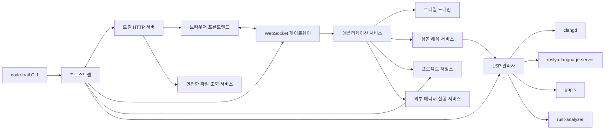
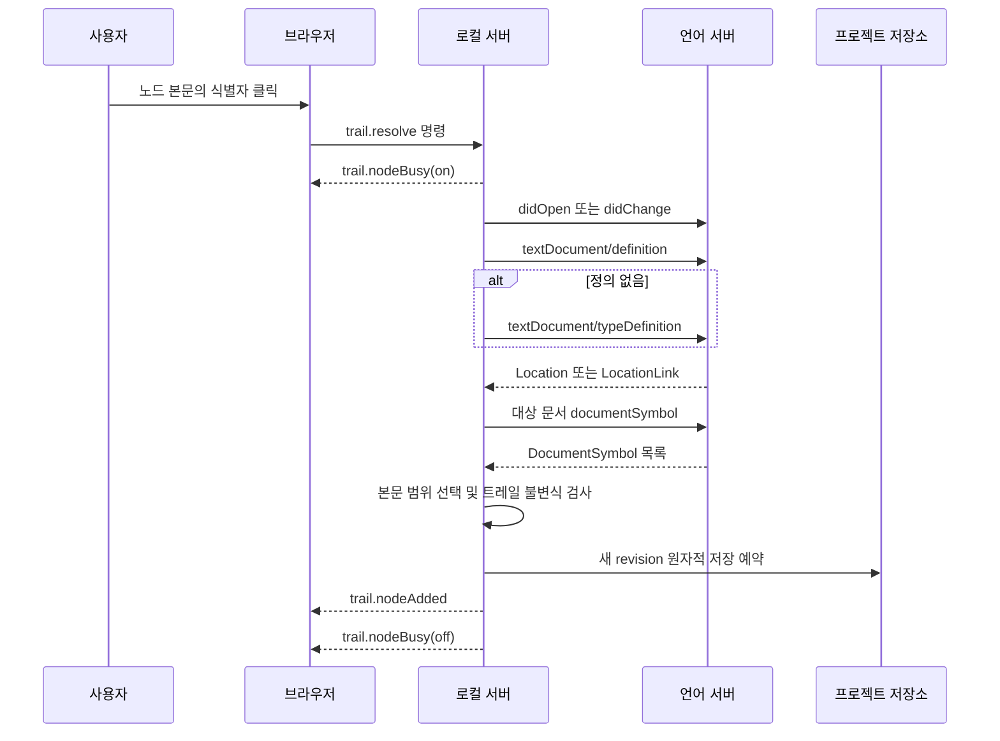

# 설계 기록

네 계획서와 이식 체크리스트를 한 파일로 합친 **역사 기록**이다. 설계 결정의 근거를 찾을 때만 읽는다.


---

## Code Trail 독립 프로그램 전환 상세 구현서

### 0. 전체 구현 태스크 체크리스트

이 목록을 구현 진행의 정본으로 사용한다. 작업 코드만 작성한 상태에서는 체크하지 않고, 해당 항목의 테스트와 완료 조건까지 통과했을 때 `[ ]`를 `[x]`로 바꾼다. 하위 항목이 모두 끝나기 전에는 단계 완료 항목을 체크하지 않는다. 세부 구현 기준과 완료 조건은 [21. 구현 단계](#21-구현-단계)와 [23. 최종 인수 조건](#23-최종-인수-조건)을 함께 따른다.

#### 0.1 단계 0 — 기존 확장 보존과 기준선

- [x] 현재 VS Code 확장의 마지막 커밋을 확정한다.
- [x] 마지막 확장 상태에 식별 가능한 git tag를 만든다.
- [x] `npm run compile` 기준 결과를 기록한다.
- [x] 토크나이저·셸·UI 테스트 기준 결과를 기록한다.
- [x] 트리 모드와 보드 모드의 기준 스크린샷을 남긴다.
- [x] 현재 `ResolvedSymbol`, `Trail`, 웹뷰 메시지 payload fixture를 만든다.
- [x] 현재 사용자 기능을 독립 프로그램 E2E 이식 목록과 연결한다.
- [x] 단계 0의 산출물과 기준선이 재현되는지 검증한다.
- [x] **단계 0 완료**

#### 0.2 단계 1 — 모노레포와 공유 도메인

- [x] 루트 `package.json`을 npm workspaces 구조로 전환한다.
- [x] `tsconfig.base.json`과 workspace별 TypeScript 설정을 만든다.
- [x] `packages/shared`, `packages/server`, `packages/web`, `packages/cli`를 만든다.
- [x] 공유 protocol command·event 타입을 정의한다.
- [x] HTTP·WebSocket runtime schema 검증 구조를 만든다.
- [x] 새 `ResolvedSymbol` 타입을 VS Code 타입 없이 정의한다.
- [x] 새 `Trail`, `TrailNode`, `TrailOrigin`, `NodeUiState` 타입을 정의한다.
- [x] 노드와 트레일 ID를 UUID로 생성한다.
- [x] 트레일 revision 증가 규칙을 구현한다.
- [x] addRoot·addChild·remove·toggle·promoteToRoot를 이식한다.
- [x] 재귀·순환 판정 규칙을 이식한다.
- [x] 새 독립 프로그램 전용 저장 스키마를 정의한다.
- [x] Markdown 내보내기를 shared 패키지로 옮긴다.
- [x] 트리 불변식 단위 테스트를 작성한다.
- [x] 저장·로드 round trip 테스트를 작성한다.
- [x] shared 패키지가 `vscode` 의존성 없이 빌드되는지 확인한다.
- [x] **단계 1 완료**

#### 0.3 단계 2 — CLI, 로컬 서버와 빈 웹 셸

- [x] `code-trail [project-directory]` CLI 인자를 구현한다.
- [x] `--port`, `--no-open`, `--trail`, `--log-level`, `--config`를 구현한다.
- [x] 프로젝트 경로 절대화와 실제 디렉터리 검증을 구현한다.
- [x] 프로젝트 루트의 심볼릭 링크 실제 경로를 고정한다.
- [x] Fastify 서버 부트스트랩을 구현한다.
- [x] Vite와 React 빈 애플리케이션을 만든다.
- [x] 빌드된 웹 자산을 Fastify에서 제공한다.
- [x] 서버가 `127.0.0.1`과 선택적 `::1`에만 바인딩되게 한다. — IPv4 만 연다. `::1` 리스너는 붙이지 않았다(선택 사항)
- [x] 빈 포트 자동 선택을 구현한다.
- [x] 256비트 세션 토큰을 생성한다.
- [x] fragment 토큰을 `sessionStorage`로 옮기고 URL에서 제거한다.
- [x] HTTP Bearer 인증 middleware를 구현한다.
- [x] WebSocket 인증과 Origin 검사를 구현한다.
- [x] 외부 CDN과 인라인 스크립트를 막는 CSP를 설정한다.
- [x] 기본 브라우저 자동 열기를 구현한다.
- [x] 동일 프로젝트의 살아 있는 서버 재사용을 구현한다.
- [x] SIGINT·SIGTERM·Windows 종료 신호 처리를 구현한다.
- [x] 토큰 없음·잘못된 Origin·외부 인터페이스 접속 거부 테스트를 작성한다.
- [ ] Windows, macOS, Linux에서 빈 웹 화면 실행을 확인한다. — **Windows 만 확인함.** macOS·Linux 는 그 환경에서 `npm run test:e2e` 를 돌려야 한다
- [ ] **단계 2 완료** — 위 한 줄(3개 OS 확인)만 남았다

#### 0.4 단계 3 — 프로젝트 저장소와 파일 탐색

- [x] 프로젝트 루트에 `.code-trail/`을 생성한다.
- [x] `.code-trail/settings.json` 스키마와 기본값을 구현한다.
- [x] `.code-trail/index.json` 트레일 목록을 구현한다.
- [x] `.code-trail/trails/<trail-id>.json` 저장을 구현한다.
- [x] `.code-trail/runtime/.gitignore`를 생성한다.
- [x] 임시 파일과 rename을 이용한 원자적 저장을 구현한다.
- [x] revision 기반 debounce 저장을 구현한다.
- [x] 남은 임시 파일의 복구 후보 탐지를 구현한다.
- [x] 결정적인 JSON 키·배열 순서를 보장한다.
- [x] 프로젝트 루트 `.gitignore`를 자동 수정하지 않는지 검증한다.
- [x] 파일 탐색기 지연 조회 API를 구현한다.
- [x] 기본 제외 디렉터리 규칙을 구현한다.
- [x] 파일 이름 검색 API를 구현한다.
- [x] 클라이언트에 절대경로 대신 documentId를 발급한다.
- [x] 프로젝트 밖 경로와 `..` 경로를 거부한다.
- [x] 심볼릭 링크를 통한 프로젝트 경계 탈출을 거부한다.
- [x] 파일 감시와 변경 알림을 구현한다.
- [x] Monaco 읽기 전용 코드 화면을 만든다.
- [x] 원본 들여쓰기·탭·줄바꿈을 변형하지 않는지 테스트한다.
- [x] 설정과 빈 트레일이 서버 재시작 후 복원되는지 확인한다.
- [x] **단계 3 완료**

#### 0.5 단계 4 — 공통 LSP 전송 계층

- [x] `vscode-jsonrpc` 기반 stdio transport를 구현한다.
- [x] `Content-Length` 프레이밍 parser를 구현한다.
- [x] stdout을 JSON-RPC 전용으로 처리한다.
- [x] stderr를 크기 제한 ring buffer로 분리한다.
- [x] LSP 요청 ID와 pending request map을 구현한다.
- [x] 요청별 timeout을 구현한다.
- [x] `$/cancelRequest` 전송을 구현한다.
- [x] `initialize` 요청과 `initialized` 알림을 구현한다.
- [x] `shutdown` 요청과 `exit` 알림을 구현한다.
- [x] 동적 capability 등록·해제를 구현한다.
- [x] `window/logMessage`, `window/showMessage`, `$/progress`를 수신한다.
- [x] UTF-16 position encoding capability를 명시한다.
- [x] 문서별 URI·languageId·version·hash 캐시를 구현한다.
- [x] `textDocument/didOpen`을 구현한다.
- [x] full-content `textDocument/didChange`를 구현한다.
- [x] `textDocument/didClose`를 구현한다.
- [x] 열린 문서 LRU와 서버 재시작 후 didOpen 복원을 구현한다.
- [x] LSP 상태 머신을 구현한다.
- [x] 1초·2초·5초의 최대 세 번 재시작 backoff를 구현한다.
- [x] 정상 종료 후 자식 LSP 프로세스가 남지 않게 한다.
- [x] 가짜 stdio LSP 서버를 테스트 fixture로 만든다.
- [x] 정상·지연·취소·프로토콜 오염·crash·재시작 테스트를 작성한다.
- [x] **단계 4 완료**

#### 0.6 단계 5 — 심볼 해석 서비스

- [x] LSP `DocumentSymbol` 평탄화를 구현한다.
- [x] LSP `SymbolInformation` 평탄화를 구현한다.
- [x] `narrower` 정렬 규칙을 이식한다.
- [x] `pickEnclosing`을 이식한다.
- [x] `pickEnclosingBody`를 이식한다.
- [x] `pickByDeclaration`을 이식한다.
- [x] Location과 LocationLink 정규화를 구현한다.
- [x] definition 요청을 연결한다.
- [x] definition 실패 시 typeDefinition 폴백을 구현한다.
- [x] documentSymbol 요청을 연결한다.
- [x] implementation 요청을 연결한다.
- [x] references를 구현 찾기 폴백으로 사용하지 않는지 검증한다.
- [x] 복수 정의 후보 선택 명령과 응답을 구현한다.
- [x] 한 줄 range의 targetRange 폴백을 구현한다.
- [x] 다음 심볼 경계 기반 본문 끝 추정을 구현한다.
- [x] `contextLines` 최종 폴백을 구현한다.
- [x] 노드당 4,000줄 하드 캡을 구현한다.
- [x] 선언만 판정을 별도 휴리스틱으로 격리한다.
- [x] 동일 부모 아래 동일 심볼 중복 방지를 구현한다.
- [x] 구현 후보가 하나일 때만 자동으로 붙인다.
- [x] 구현 후보가 여러 개면 자동 선택하지 않는지 검증한다.
- [x] 선언 노드가 구현 추적 후에도 남는지 검증한다.
- [x] Roslyn 심볼 이름의 `(` 앞 표시 이름 처리를 이식한다.
- [x] 탭·한글·이모지·surrogate pair 좌표 테스트를 작성한다.
- [x] **단계 5 완료**

#### 0.7 단계 6 — 언어별 LSP 어댑터

##### C/C++ — clangd

- [x] 설정 경로와 PATH 기반 clangd 탐지를 구현한다.
- [x] 플랫폼별 일반 LLVM 설치 위치 탐지를 구현한다.
- [x] `clangd --version` 진단을 구현한다.
- [x] `compile_commands.json` 탐지를 구현한다.
- [x] `compile_flags.txt` 폴백 진단을 구현한다.
- [x] 설정된 `--compile-commands-dir`와 `--query-driver` argv를 전달한다.
- [ ] C++ definition·documentSymbol·가상 함수 implementation fixture를 통과한다. — **clangd 미설치로 미확인.** `npm run test:lsp` 이 fixture 를 들고 있고, clangd 가 있는 기계에서 돌리면 검증된다

##### Go — gopls

- [x] 설정 경로, PATH, GOBIN, GOPATH/bin 탐지를 구현한다.
- [x] `gopls version`과 `go version` 진단을 구현한다.
- [x] `go.work`와 `go.mod` 탐지를 구현한다.
- [ ] Go definition·documentSymbol·interface implementation fixture를 통과한다. — **gopls 미설치로 미확인.** 같은 방법으로 검증한다

##### Rust — rust-analyzer

- [x] 설정 경로, PATH, rustup proxy 탐지를 구현한다.
- [x] 실제 선택된 rust-analyzer 경로를 표시한다.
- [x] rust-analyzer·rustc·cargo 버전 진단을 구현한다.
- [x] `Cargo.toml`, `rust-project.json`, `rust-src` 진단을 구현한다.
- [ ] Rust definition·documentSymbol·trait implementation fixture를 통과한다. — **rustup proxy 만 있고 rust-analyzer 본체가 없어 미확인.** `rustup component add rust-analyzer` 뒤 `npm run test:lsp`

##### C# — roslyn-language-server

- [ ] 독립 C# 언어 서버 선행 스파이크 환경을 만든다. — fixture 와 어댑터는 있으나 **roslyn-language-server 미설치로 실행 확인 못 함**
- [x] 설정의 명시 실행 경로를 우선하도록 구현한다.
- [x] PATH의 `roslyn-language-server` 탐지를 구현한다.
- [x] 실행 인자와 initializationOptions를 C# 어댑터에 격리한다.
- [x] `.sln`, `.slnx`, `.csproj` 후보 탐지를 구현한다.
- [x] 후보 하나를 제안하고 여러 후보는 사용자가 선택하게 한다.
- [x] 선택한 솔루션 경로를 프로젝트 상대경로로 저장한다.
- [ ] C# definition·documentSymbol·implementation·typeDefinition을 검증한다. — **미확인**
- [ ] 다중 프로젝트 간 정의 이동을 검증한다. — **미확인**
- [ ] 인터페이스 구현 하나와 여러 개 시나리오를 검증한다. — 가짜 LSP 로는 검증했으나 **실제 Roslyn 으로는 미확인**
- [x] 서버 배포 규약 변화가 공통 LSP 계층에 영향을 주지 않는지 확인한다. — 인자와 initializationOptions 를 어댑터 안에만 뒀다

##### 어댑터 단계 완료

- [x] 네 어댑터의 실행 파일 누락 안내를 구현한다.
- [x] capability 미지원 기능을 UI에서 비활성화한다.
- [x] 네 언어 실제 LSP 스모크 테스트를 별도 명령으로 분리한다. — `npm run test:lsp`. 설치된 언어만 돌고 나머지는 이유를 적고 건너뛴다
- [ ] **단계 6 완료** — 어댑터·탐지·진단은 끝났다. 위의 실제 언어 서버 fixture 검증만 남았다

#### 0.8 단계 7 — 트레일 UI 이식

- [x] 기존 CSS 변수에서 VS Code 테마 의존성을 제거한다.
- [x] 시스템·밝은·어두운 테마를 구현한다.
- [x] `TrailNodeView`를 구현한다.
- [x] 헤더의 종류·이름·시그니처·경로·배지를 이식한다.
- [x] 원본 코드 본문 렌더링을 이식한다.
- [x] 토크나이저를 TypeScript 순수 함수로 이식한다.
- [x] 주석·문자열을 클릭 후보에서 제외한다.
- [x] 식별자 클릭과 Alt+클릭을 서버 명령에 연결한다.
- [x] Ctrl/Cmd+클릭을 외부 에디터 명령에 연결한다.
- [x] 호출부 순번과 자식 헤더 순번의 짝을 구현한다.
- [x] 트리 모드 부모 위·자식 아래 배치를 구현한다.
- [x] 트리 모드 연결선을 구현한다.
- [x] 형제 코드 순서·클릭 순서 전환을 구현한다.
- [x] 브레드크럼을 구현한다.
- [x] 진입 링크와 부모 호출부 왕복 포커스를 구현한다.
- [x] 노드 접기·펼치기를 구현한다.
- [x] 노드 삭제와 하위 노드 제거를 구현한다.
- [x] `⇱` 새 루트 승격을 구현한다.
- [x] 이름·경로 필터를 구현한다.
- [x] 전체 펼치기·전체 접기를 구현한다.
- [x] Markdown 다운로드를 구현한다.
- [x] JSON 저장·불러오기 버튼을 제거한다.
- [x] 새 트레일 생성·선택·이름 변경·삭제 UI를 구현한다.
- [x] 현재 트리 모드 E2E 시나리오를 모두 이식한다.
- [x] 새로고침 후 트리와 접힘 상태 복원을 확인한다.
- [x] **단계 7 완료**

#### 0.9 단계 8 — 보드 모드와 UI 영속성

- [x] 보드 모드에서 모든 노드를 캔버스 바로 아래에 평평하게 렌더링한다.
- [x] 부모 오른쪽에서 자식 왼쪽으로 가는 연결선을 구현한다.
- [x] 헤더 pointer capture 기반 drag를 구현한다.
- [x] drag 중 임시 좌표와 drag 종료 저장 좌표를 분리한다.
- [x] 새 노드를 부모 근처에 배치한다.
- [x] 트리·보드 전환을 구현한다.
- [x] 보드 이동이 부모-자식 관계를 바꾸지 않는지 테스트한다.
- [x] 트리 복귀 후 원래 계층 배치를 확인한다.
- [x] 보드 재진입 후 좌표가 유지되는지 확인한다.
- [x] 서버 재시작 후 좌표가 복원되는지 확인한다.
- [x] 본문 높이 조절과 저장을 구현한다.
- [x] Ctrl+휠 노드별 코드 글자 크기와 저장을 구현한다.
- [x] 줄 번호 더블클릭 초기화를 구현한다.
- [x] ResizeObserver 기반 코드 폭 맞춤을 구현한다.
- [x] 코드 폭 맞춤이 헤더 글자를 줄이지 않는지 테스트한다.
- [x] 1,000개 노드 성능 측정과 병목 기록을 수행한다.
- [x] **단계 8 완료**

#### 0.10 단계 9 — 외부 에디터와 진단 화면

- [x] 외부 에디터 설정 스키마를 구현한다.
- [x] `{path}`, `{line}`, `{column}`, `{project}` placeholder를 구현한다.
- [x] 실행 파일과 argv 배열을 `shell: false`로 실행한다.
- [x] 알려진 에디터 CLI 후보를 PATH에서 탐지한다.
- [x] 사용자 확정 전 자동 실행하지 않게 한다.
- [x] documentId에서 서버가 안전한 실제 경로를 역조회한다.
- [x] 프로젝트 밖 임의 경로 실행 요청을 거부한다.
- [x] 실행 실패 시 경로·줄 복사 폴백을 제공한다.
- [x] shell injection 테스트를 작성한다.
- [x] 언어별 실행 파일·버전·PID·capability 상태를 표시한다.
- [x] 언어별 프로젝트 인식 상태를 표시한다.
- [x] 마지막 요청 시간과 오류 요약을 표시한다.
- [x] 언어 서버 재시작 버튼을 구현한다.
- [x] 정제된 LSP 로그 보기와 다운로드를 구현한다.
- [x] 환경 변수·토큰·코드 본문이 로그에 노출되지 않는지 검사한다.
- [x] 실제 샘플 요청이 성공해야 `지원됨`으로 표시하게 한다.
- [x] **단계 9 완료**

#### 0.11 단계 10 — 전체 보안과 회복성 검증

- [x] 모든 API가 인증을 요구하는지 목록 기반으로 검사한다.
- [x] 모든 WebSocket 명령이 runtime schema 검증을 거치는지 검사한다.
- [x] 다른 origin의 HTTP·WebSocket 요청을 거부한다.
- [x] 세션 토큰이 URL query·로그·파일에 남지 않는지 검사한다.
- [x] 절대경로와 코드 본문이 일반 오류 응답에 노출되지 않는지 검사한다.
- [x] 외부 LSP 정의 URI의 일시 documentId 권한을 구현한다.
- [x] 재시작 후 외부 파일 권한이 자동 복원되지 않는지 확인한다.
- [x] 여러 브라우저 탭의 revision 충돌 처리를 검증한다.
- [x] commandId 멱등 재전송을 검증한다.
- [x] WebSocket 재연결과 snapshot 재동기화를 검증한다.
- [x] 저장 중 강제 종료 후 임시 파일 복구를 검증한다.
- [x] LSP 세 번 연속 crash 후 자동 재시작이 멈추는지 검증한다.
- [x] 서버 종료 중 새 연결과 새 명령을 거부하는지 검증한다.
- [x] 보안·회복성 통합 테스트 묶음이 통과한다.
- [x] **단계 10 완료**

#### 0.12 단계 11 — VS Code 확장 완전 제거와 문서 정리

- [x] 현재 확장의 최종 tag가 원격 저장소에 보존됐는지 확인한다.
- [x] `src/extension.ts`를 제거한다.
- [x] `src/panel.ts`를 제거한다.
- [x] VS Code 종속 옛 `src/symbols.ts`를 제거한다.
- [x] 확장 개발 호스트용 `.vscode/launch.json` 구성을 제거한다.
- [x] 확장 전용 `.vscode/tasks.json` 작업을 제거한다.
- [x] `test/preview.html`을 제거한다.
- [x] `test/shell.test.js`를 제거한다.
- [x] `@types/vscode` 의존성을 제거한다.
- [x] `engines.vscode`, `main`, `activationEvents`, `contributes`를 제거한다.
- [x] `vscode:prepublish`를 제거한다.
- [x] `.vscodeignore`를 제거한다.
- [x] 저장소의 `.vsix` 파일을 제거한다.
- [x] README를 CLI 설치·실행·언어 서버·웹 UI 기준으로 다시 작성한다.
- [x] `docs/terms.md`를 브라우저 앱 기준으로 갱신한다.
- [x] `docs/terms.svg`를 브라우저 앱 기준으로 갱신하고 눈으로 확인한다.
- [x] CHANGELOG에 독립 프로그램 전환 주 버전을 기록한다.
- [x] package version을 새 주 버전으로 올린다.
- [x] AGENTS.md의 명령·구조·용어·동기화 표를 갱신한다.
- [x] `import 'vscode'`가 저장소에서 검색되지 않는지 확인한다.
- [x] `acquireVsCodeApi`, `WebviewPanel`, `executeDefinitionProvider`가 검색되지 않는지 확인한다. 남은 것은 이 문서의 위 두 줄과 20.4의 확인 목록뿐이다 — 무엇을 찾아야 하는지 적어둔 자리라 지우면 확인 방법이 사라진다.
- [x] VS Code 없이 전체 빌드와 테스트가 통과하는지 확인한다.
- [x] **단계 11 완료**

#### 0.13 단계 12 — 패키징과 릴리스

- [x] npm CLI 패키지의 `bin` 항목을 설정한다.
- [x] CLI·서버·shared·웹 정적 자산을 배포물에 포함한다.
- [x] 언어 서버 바이너리가 배포물에 포함되지 않는지 확인한다.
- [x] 개발 소스맵·fixture·로그·토큰을 배포물에서 제외한다.
- [x] `npm pack` 결과 파일 목록을 자동 검증한다. (`npm run test:pack`)
- [x] 깨끗한 Windows 환경에서 설치·실행한다. (`npm run test:install` — tarball 넷을 임시 폴더에 실제로 설치하고 서버를 띄워 확인)
- [ ] 깨끗한 macOS 환경에서 설치·실행한다. **못 했다** — 이 기계에 macOS 가 없다. 그 환경에서 `npm run test:install` 을 돌리면 확인된다.
- [ ] 깨끗한 Linux 환경에서 설치·실행한다. **못 했다** — 위와 같은 이유. 같은 방법으로 확인한다.
- [~] Windows x64·arm64 CI를 구성한다. — **하지 않기로 했다.** 저장소 주인이 CI 를 두지 않기로 정했다. 플랫폼별 확인은 그 환경에서 `npm test` · `npm run test:e2e` · `npm run test:install` 을 손으로 돌린다.
- [~] macOS x64·arm64 CI를 구성한다. — 위와 같다.
- [~] Linux x64·arm64 CI를 구성한다. — 위와 같다.
- [x] 라이선스와 외부 의존성 고지를 포함한다. (`THIRD-PARTY-NOTICES.md`)
- [x] 설치·업데이트·제거 문서를 작성한다. (README `## 설치와 실행`)
- [x] 첫 독립 프로그램 릴리스 후보를 만든다. `npm pack -w <각 패키지>` 가 네 tarball 을 만들고, `npm run test:install` 이 그것을 설치해 띄운다.
- [ ] 릴리스 후보로 네 언어 실제 프로젝트 스모크 테스트를 수행한다. **못 했다** — 이 기계에 clangd·gopls·roslyn 이 없고 rust-analyzer 는 rustup proxy 뿐이다. `npm run test:lsp` 이 fixture 를 들고 있으니 서버가 설치된 기계에서 돌리면 확인된다.
- [ ] npm 배포 또는 배포 아카이브 게시를 완료한다. **하지 않았다** — 배포는 되돌릴 수 없고 npm 자격 증명도 없다. 패키지 쪽 준비(이름, `bin`, `files`, `publishConfig`, 버전)는 끝났으므로 `CONTRIBUTING.md` 의 릴리스 절차대로 패키지별 순서로 올린다. 저장소 주인이 정할 일이다.
- [ ] **단계 12 완료** — 위 세 줄(macOS·Linux 설치, 실제 언어 서버 스모크, npm 배포)이 이 기계에서 못 하는 것이라 열어 둔다. CI 세 줄은 두지 않기로 정해 `[~]` 로 닫았다.

#### 0.14 최종 인수 체크

- [x] VS Code가 없는 환경에서 실행된다. 저장소에 `vscode` 를 참조하는 코드가 하나도 없고, `npm run test:install` 이 워크스페이스 밖 폴더에서 서버를 띄운다.
- [x] 데스크톱 셸 없이 기본 브라우저에서 동작한다. Electron·Tauri 를 쓰지 않는다.
- [ ] Windows, macOS, Linux에서 프로젝트를 연다. **Windows 만 실제로 확인했다.** 나머지 둘은 그 환경에서 손으로 확인해야 한다.
- [ ] C/C++, C#, Go, Rust의 정의와 문서 심볼 탐색이 성공한다. **가짜 언어 서버로만 확인했다** — 이 기계에 네 서버가 없다. `npm run test:lsp` 이 실제 서버용 fixture 를 들고 있다.
- [ ] 지원 가능한 언어 서버에서 구현과 타입 정의 탐색이 성공한다. 위와 같은 이유. 프로토콜 수준의 동작은 `test/integration/lsp.test.mjs` 가 확인한다.
- [x] 심볼 해석이 네 표준 LSP 요청만 사용한다. 가짜 서버가 `references` 요청을 받으면 표시를 남기고 테스트가 그걸 잡는다.
- [x] 탭·한글·이모지·CRLF 코드의 원본과 좌표가 보존된다. (`test/unit/tokenizer-port.test.mjs`, `test/integration/security.test.mjs` 의 "원본 문자열을 한 글자도 바꾸지 않는다")
- [x] 트리의 부모-자식·형제·재귀 규칙이 유지된다.
- [x] 단일 구현만 자동 추적하고 복수 구현은 자동 선택하지 않는다.
- [x] 트리·보드·브레드크럼·진입 링크·순번·배지가 정상 동작한다. (`npm run test:e2e`)
- [x] 트레일·보드 좌표·노드 크기·설정이 `.code-trail/`에서 복원된다. E2E 가 서버를 실제로 껐다 켜서 확인한다.
- [x] 기존 확장 JSON을 읽거나 가져오는 기능이 없다. 가져오기 명령도 경로도 없다.
- [x] VS Code 확장 소스와 VSIX 흐름이 완전히 제거됐다.
- [x] 서버가 loopback 외 주소에서 접근되지 않는다. (`test/integration/security.test.mjs` 의 바인딩 검사)
- [x] 인증·Origin·경로 탈출·명령 주입 테스트가 통과한다. (`security` · `resilience` · `editor` 세 묶음)
- [x] 단위·통합·E2E·실제 LSP 스모크 테스트가 통과한다. 스모크는 네 언어 모두 "서버 없음" 을 이유로 적고 건너뛴다.
- [x] README·CHANGELOG·용어 문서·AGENTS.md 가 일치한다.
- [ ] **독립 프로그램 전환 완료** — 코드와 문서는 끝났다. 남은 것은 이 기계에서 할 수 없는 셋이다: 다른 운영체제에서의 설치 확인, 실제 언어 서버 네 개로 하는 스모크, npm 배포.

### 1. 문서 상태

- 상태: 구현 기준안
- 대상: 현재 VS Code 확장인 Code Trail을 로컬 웹 서버와 브라우저 프론트엔드로 전환하는 작업
- 실행 형태: 데스크톱 셸 없이 CLI가 로컬 서버를 시작하고 기본 브라우저를 연다.
- 지원 플랫폼: Windows, macOS, Linux
- 지원 언어: C/C++, C#, Go, Rust, TypeScript/JavaScript다. 뒤의 언어는 1.1.0 확장에서 추가했다.
- 저장 위치: 탐색 대상 프로젝트 내부의 `.code-trail/`
- 기존 데이터: 현재 확장의 JSON 형식과 호환하지 않는다.
- VS Code 확장: 최종 결과물에서 완전히 제거한다.

이 문서는 구현자가 추가 제품 결정을 하지 않아도 작업을 시작할 수 있는 수준을 목표로 한다. 다만 C# 독립 언어 서버는 아직 배포 규약이 안정되지 않았으므로, C# 어댑터의 실행 명령은 설정 가능하게 두고 선행 검증을 통과한 뒤 본 구현에 들어간다.

### 2. 확정된 제품 결정

| 항목 | 결정 |
| --- | --- |
| 사용자 인터페이스 | 시스템 기본 브라우저에서 실행되는 웹 애플리케이션 |
| 서버 실행 | `code-trail <프로젝트 경로>` CLI |
| 데스크톱 패키지 | Electron과 Tauri를 포함해 별도 데스크톱 셸을 만들지 않음 |
| 코드 화면 | 파일 탐색기와 읽기 전용 코드 화면을 제공함 |
| 편집 | 웹에서는 편집하지 않으며 외부 에디터 열기를 제공함 |
| 심볼 해석 | 언어별 자체 파서를 만들지 않고 표준 LSP 요청만 사용함 |
| 언어 서버 배포 | 사용자 시스템에 설치된 실행 파일을 자동 탐지하고, 필요하면 설정에서 경로를 지정함 |
| 지원 언어 | C/C++, C#, Go, Rust, TypeScript/JavaScript를 지원함 |
| 네트워크 | `127.0.0.1` 및 `::1`의 로컬 접속만 허용함 |
| 영속 저장 | 프로젝트 루트의 `.code-trail/`에 설정과 트레일을 저장함 |
| 기존 JSON | 가져오기와 변환 기능을 제공하지 않음 |
| 기존 확장 | 새 프로그램 완성 후 소스·매니페스트·VSIX 흐름을 모두 제거함 |

### 3. 목표와 비목표

#### 3.1 목표

1. 사용자가 터미널에서 프로젝트 경로를 넘겨 Code Trail을 시작할 수 있어야 한다.
2. 브라우저에서 파일을 찾고 코드를 읽으며 임의의 함수·메서드·클래스 심볼을 루트로 펼칠 수 있어야 한다.
3. 노드 본문의 식별자를 클릭하면 언어 서버가 반환한 정의를 자식 노드로 붙여야 한다.
4. 정의, 문서 심볼, 구현, 타입 정의 기능은 모두 표준 LSP 요청으로 처리해야 한다.
5. 트리 모드, 보드 모드, 브레드크럼, 진입 링크, 호출부 순번, 배지, 내보내기 등 현재 핵심 경험을 유지해야 한다.
6. 트레일과 보드 배치, 노드별 본문 높이와 글자 크기, 사용자 설정을 프로젝트 안에 자동 저장해야 한다.
7. 언어 서버의 설치 누락, 기동 실패, 프로젝트 로드 실패를 사용자가 진단 화면에서 확인할 수 있어야 한다.
8. 브라우저에 임의의 로컬 파일 읽기나 명령 실행 권한을 주지 않아야 한다.
9. 서버와 프론트엔드의 계약을 런타임 스키마로 검증하고 자동 테스트해야 한다.

#### 3.2 비목표

- 웹 기반 코드 편집기나 IDE를 만들지 않는다.
- 컴파일, 실행, 디버깅, 리팩터링, 자동 완성 기능을 만들지 않는다.
- 언어별 AST 파서, 타입 추론기, 호출 그래프 분석기를 자체 구현하지 않는다.
- 인터넷에 서버를 공개하거나 여러 사용자가 공동 편집하는 기능을 만들지 않는다.
- 기존 VS Code 확장과 동시 동작하거나 상태를 동기화하지 않는다.
- 현재 확장의 `version: 1` JSON을 읽지 않는다.
- 언어 서버 바이너리를 Code Trail 배포물에 포함하지 않는다.

### 4. 현재 코드의 재사용 경계

현재 코드는 도메인 모델과 화면 로직은 재사용 가능하지만, 호스트와 심볼 해석 계층은 VS Code API에 강하게 결합돼 있다.

| 현재 파일 | 현재 책임 | 전환 후 처리 |
| --- | --- | --- |
| `src/extension.ts` | 명령 등록, 활성 에디터와 커서 조회 | 제거하고 CLI 부트스트랩과 웹 명령으로 대체함 |
| `src/panel.ts` | 웹뷰 생성, 설정 조회, 메시지 처리, 파일 대화상자, 에디터 열기 | 제거하고 HTTP/WebSocket 컨트롤러와 외부 에디터 서비스로 분리함 |
| `src/symbols.ts` | VS Code provider 호출, 위치 정규화, 본문 범위 선택 | 알고리즘은 이식하되 VS Code 타입과 명령 호출은 LSP 클라이언트와 파일 저장소로 교체함 |
| `src/trail.ts` | 트레일 모델, 재귀 판정, JSON/Markdown 직렬화 | 공유 도메인 패키지로 이동하고 UUID, revision, 영속 UI 상태를 추가함 |
| `media/tokenizer.js` | 하이라이팅, 클릭 후보와 원본 좌표 생성 | TypeScript 모듈로 이식하고 역할을 그대로 제한함 |
| `media/main.js` | DOM 렌더링, 트리·보드 상호작용, 웹뷰 메시지 | 기능 단위 React 컴포넌트와 상태 모듈로 나누고 WebSocket 클라이언트로 교체함 |
| `media/style.css` | 패널과 노드 스타일 | CSS 변수와 레이아웃 규칙을 재사용하되 VS Code 테마 변수 의존을 제거함 |
| `test/preview.html` | 웹뷰 API 스텁 기반 UI 하네스 | Vite 개발 서버와 Playwright 픽스처로 대체함 |
| `test/shell.test.js` | `panel.ts` HTML과 preview 셸 동기화 | 삭제함. 정적 셸이 하나만 남으므로 필요하지 않음 |
| `test/tokenizer.test.js` | 좌표·주석·문자열 제외 검증 | TypeScript 단위 테스트로 이식함 |
| `test/ui.test.js` | 패널 UI 검증 | 실제 로컬 서버와 가짜 LSP를 사용하는 Playwright 테스트로 확장함 |
| `package.json`의 `contributes` | VS Code 명령·설정·키바인딩 | 전부 제거하고 CLI `bin`, npm workspaces, 서버·웹 빌드 스크립트로 교체함 |

#### 4.1 반드시 유지할 도메인 규칙

- 부모는 클릭한 코드가 속한 노드로 결정한다.
- 보드에서 노드를 옮겨도 부모-자식 관계는 변하지 않는다.
- `⇱`만 부모 관계를 바꾸며 해당 노드를 새 루트로 승격한다.
- 원본 코드는 들여쓰기 제거, 탭 변환, 줄바꿈 정규화를 하지 않는다.
- 클릭 좌표는 원본 문서 기준 0-based 줄·UTF-16 컬럼으로 유지한다.
- 주석과 문자열 내부 식별자는 클릭 후보로 만들지 않는다.
- 구현 후보가 정확히 하나일 때만 자동으로 따라간다.
- 구현 후보가 둘 이상이면 사용자가 선택하게 하며 임의로 하나를 고르지 않는다.
- 선언 노드는 구현으로 따라간 뒤에도 삭제하지 않는다.
- 보드 모드의 노드는 캔버스 루트 바로 아래에 평평하게 렌더링한다.
- 코드 폭 맞춤은 본문 글자에만 적용하고 헤더 글자는 줄이지 않는다.

### 5. 목표 아키텍처



#### 5.1 프로세스 구성

한 프로젝트를 열 때 다음 프로세스가 생긴다.

1. `code-trail` Node.js 프로세스 하나가 CLI, HTTP, WebSocket, 저장소를 함께 호스팅한다.
2. 브라우저 탭 하나 이상이 같은 서버에 연결할 수 있다.
3. 언어 서버는 실제로 해당 언어 파일을 처음 열 때 지연 기동한다.
4. 언어별로 기본 한 프로세스를 유지한다. 같은 언어의 요청은 동일 세션을 공유한다.
5. 서버 종료 시 LSP `shutdown` 요청과 `exit` 알림을 보낸 뒤 제한 시간 안에 끝나지 않는 자식 프로세스만 종료한다.

한 서버 프로세스는 프로젝트 하나만 연다. 여러 프로젝트를 보려면 CLI를 각각 실행한다. 이 제약은 경로 보안, LSP 루트, 프로젝트 내부 저장소, 종료 처리를 단순하게 만든다.

#### 5.2 계층별 책임

| 계층 | 책임 | 금지 사항 |
| --- | --- | --- |
| CLI | 인자 해석, 프로젝트 검증, 포트 선택, 브라우저 열기, 종료 신호 처리 | 심볼 해석과 트레일 변경을 직접 하지 않음 |
| HTTP 서버 | 정적 파일, 부트스트랩, 파일 트리, 문서 본문, 내보내기 응답 | 클라이언트가 준 임의 절대경로를 읽지 않음 |
| WebSocket | 명령 수신, 이벤트 방송, 연결 인증, 재연결 동기화 | 도메인 규칙을 직접 구현하지 않음 |
| 애플리케이션 서비스 | 명령 검증, 트레일 mutation 직렬화, LSP와 저장소 조정 | DOM이나 브라우저 상태를 알지 않음 |
| 도메인 | 트리 불변식, 재귀 판정, 직렬화 가능한 상태 | 파일 시스템과 네트워크에 접근하지 않음 |
| LSP 관리자 | 실행 파일 탐지, 프로세스 수명주기, JSON-RPC, 문서 동기화 | 언어별 구문 분석을 하지 않음 |
| 심볼 해석 | LSP 결과 정규화, 범위 선택, 원문 추출 | 타입 추론이나 AST 분석을 하지 않음 |
| 프론트엔드 | 읽기 전용 코드 탐색, 트레일 렌더링, 사용자 입력 | 파일 시스템과 프로세스에 직접 접근하지 않음 |

### 6. 기술 스택과 저장소 구조

#### 6.1 기술 스택

- 런타임: 지원 중인 Node.js LTS
- 언어: 서버, CLI, 공유 모델, 프론트엔드 모두 TypeScript strict mode
- 패키지 관리: npm workspaces
- HTTP: Fastify
- WebSocket: `@fastify/websocket`
- 정적 자산: `@fastify/static`
- 프론트엔드 빌드: Vite
- UI: React와 함수형 컴포넌트
- 코드 화면: Monaco Editor를 읽기 전용으로 사용함
- 프로토콜 런타임 검증: **Zod** 하나로 HTTP와 WebSocket에 공통 사용함 (단계 1에서 확정)
- LSP 타입: `vscode-languageserver-protocol`, `vscode-languageserver-types`, `vscode-uri`
- JSON-RPC: `vscode-jsonrpc`를 사용함
- 테스트: **Node 내장 test runner** 로 통일하고, E2E는 Playwright를 사용함 (단계 1에서 확정)

`vscode-languageclient`는 VS Code 확장 호스트를 전제로 하므로 사용하지 않는다. 독립 클라이언트는 `vscode-jsonrpc`와 LSP 프로토콜 타입 위에 필요한 기능만 얇게 구현한다.

React 도입은 기존 화면을 새 디자인으로 바꾸기 위한 결정이 아니다. 1,000줄이 넘는 단일 `main.js`를 파일 탐색기, 코드 화면, 트레일, 보드, 설정, 진단 화면으로 분리하고 상태 변경을 타입으로 제한하기 위한 결정이다.

#### 6.2 목표 디렉터리

```text
code-trail/
├─ package.json
├─ package-lock.json
├─ tsconfig.base.json
├─ packages/
│  ├─ shared/
│  │  └─ src/
│  │     ├─ protocol/
│  │     │  ├─ commands.ts
│  │     │  ├─ events.ts
│  │     │  └─ schemas.ts
│  │     ├─ domain/
│  │     │  ├─ trail.ts
│  │     │  ├─ symbol.ts
│  │     │  ├─ settings.ts
│  │     │  └─ markdown.ts
│  │     └─ index.ts
│  ├─ server/
│  │  └─ src/
│  │     ├─ app.ts
│  │     ├─ bootstrap.ts
│  │     ├─ config/
│  │     ├─ http/
│  │     ├─ ws/
│  │     ├─ workspace/
│  │     ├─ persistence/
│  │     ├─ editor/
│  │     ├─ lsp/
│  │     │  ├─ client.ts
│  │     │  ├─ manager.ts
│  │     │  ├─ transport.ts
│  │     │  ├─ documents.ts
│  │     │  ├─ resolver.ts
│  │     │  └─ adapters/
│  │     │     ├─ clangd.ts
│  │     │     ├─ csharp.ts
│  │     │     ├─ gopls.ts
│  │     │     └─ rustAnalyzer.ts
│  │     └─ security/
│  ├─ web/
│  │  ├─ index.html
│  │  └─ src/
│  │     ├─ app/
│  │     ├─ api/
│  │     ├─ components/
│  │     ├─ features/
│  │     │  ├─ workspace/
│  │     │  ├─ source/
│  │     │  ├─ trail/
│  │     │  ├─ board/
│  │     │  ├─ diagnostics/
│  │     │  └─ settings/
│  │     ├─ tokenizer/
│  │     └─ styles/
│  └─ cli/
│     └─ src/
│        ├─ main.ts
│        ├─ args.ts
│        └─ openBrowser.ts
├─ test/
│  ├─ unit/
│  ├─ integration/
│  ├─ e2e/
│  ├─ fixtures/
│  └─ fake-lsp/
└─ docs/
```

#### 6.3 루트 스크립트

최종 루트 `package.json`에는 최소한 다음 작업을 둔다.

```text
npm run dev             서버와 Vite 개발 서버를 함께 실행
npm run build           shared → server → web → cli 순으로 빌드
npm run typecheck       모든 workspace의 TypeScript 검사
npm run lint            정적 검사
npm run test            단위·통합 테스트
npm run test:e2e        Playwright E2E
npm run test:lsp        설치된 실제 언어 서버 스모크 테스트
npm run start -- <dir>  빌드 결과로 프로젝트 실행
npm pack                npm 배포물 검증
```

### 7. CLI와 부트스트랩

#### 7.1 명령 형식

```text
code-trail [project-directory]
  --port <number>            기본값 0, 운영체제가 빈 포트를 선택함
  --no-open                  브라우저를 자동으로 열지 않음
  --trail <trail-id>         시작 후 특정 트레일을 선택함
  --log-level <level>        error|warn|info|debug
  --config <path>            테스트와 특수 환경에서만 설정 파일을 덮어씀
```

호스트 주소를 외부 주소로 바꾸는 옵션은 제공하지 않는다. 서버는 IPv4 `127.0.0.1`에 바인딩하고, IPv6 지원 시 별도의 `::1` 리스너만 허용한다.

#### 7.2 시작 순서

1. 인자가 없으면 현재 작업 디렉터리를 사용한다.
2. 경로를 절대경로로 정규화하고 실제 디렉터리인지 확인한다.
3. 심볼릭 링크를 해석한 실제 프로젝트 루트를 고정한다.
4. `.code-trail/`을 만들 수 있는지 확인한다.
5. 기존 런타임 잠금 파일을 읽고 PID와 포트의 생존 여부를 확인한다.
6. 살아 있는 동일 프로젝트 서버가 있으면 새 프로세스를 만들지 않고 기존 URL을 연다.
7. 256비트 난수 세션 토큰을 생성한다.
8. HTTP와 WebSocket 서버를 빈 로컬 포트에 바인딩한다.
9. `.code-trail/runtime/server.json`에 PID, 포트, 시작 시간만 원자적으로 기록한다. 원문 토큰은 기록하지 않는다.
10. `http://127.0.0.1:<port>/#token=<token>`을 기본 브라우저로 연다.
11. 프론트엔드는 fragment의 토큰을 `sessionStorage`로 옮긴 뒤 주소에서 즉시 제거한다.
12. SIGINT, SIGTERM, Windows 콘솔 종료를 받아 정상 종료 절차를 수행한다.

#### 7.3 종료 순서

1. 새 HTTP와 WebSocket 연결을 받지 않는다.
2. 프론트엔드에 `server.stopping` 이벤트를 보낸다.
3. 대기 중인 트레일 저장을 완료한다.
4. 언어 서버별 `shutdown` 요청을 보낸다.
5. 응답 후 `exit` 알림을 보낸다.
6. 제한 시간을 넘긴 자식 프로세스만 강제 종료한다.
7. 런타임 잠금 파일을 제거한다.

### 8. 로컬 서버 보안

브라우저 애플리케이션이라도 로컬 파일과 프로세스에 접근하므로 일반 웹 서비스와 같은 수준으로 경계를 둔다.

#### 8.1 필수 통제

- 모든 API와 WebSocket 연결은 시작 시 생성한 Bearer 토큰을 요구한다.
- WebSocket은 `Origin`이 현재 로컬 서버의 정확한 origin과 일치해야 한다.
- CORS는 기본적으로 비활성화하고 다른 origin을 허용하지 않는다.
- 세션 토큰을 URL query, 로그, `.code-trail/`, 오류 메시지에 남기지 않는다.
- 정적 HTML에는 엄격한 CSP를 설정한다. 외부 CDN, 인라인 스크립트, 임의 `connect-src`를 허용하지 않는다.
- 서버가 읽을 수 있는 기본 범위는 실제 프로젝트 루트 아래로 제한한다.
- 클라이언트가 절대경로나 `..`를 보내 파일을 직접 지정하는 API를 만들지 않는다.
- 외부 에디터 실행은 shell 문자열이 아니라 실행 파일과 argv 배열로 호출한다.
- 프로젝트 설정의 실행 파일 경로와 인자는 스키마 검증 후 사용한다.
- 서버 로그에는 코드 본문, 토큰, 환경 변수 전체, 언어 서버 인증 관련 값을 기록하지 않는다.

#### 8.2 외부 정의 파일 허용

표준 라이브러리나 패키지 캐시의 정의는 프로젝트 밖에 있을 수 있다. 이를 지원하면서 임의 파일 읽기를 막기 위해 서버가 문서 권한을 발급한다.

1. 프로젝트 내부 파일은 시작할 때 기본 허용한다.
2. LSP가 프로젝트 밖의 `file:` URI를 결과로 반환하면 서버가 해당 URI를 검증한다.
3. 검증된 URI에 임의의 `documentId`를 발급하고 서버 메모리의 허용 목록에 넣는다.
4. 브라우저에는 절대 URI 대신 `documentId`와 표시용 경로만 보낸다.
5. 파일 본문 API는 `documentId`만 받는다.
6. 재시작 후 외부 파일 권한은 자동 복원하지 않는다. 저장된 코드 스냅샷은 볼 수 있지만 다시 열기는 새 LSP 결과로 권한을 얻은 뒤 가능하다.

심볼릭 링크는 매 요청마다 실제 경로를 확인한다. 정규화된 실제 경로가 프로젝트 루트 또는 서버가 발급한 외부 문서 허용 목록에 없으면 403으로 거부한다.

### 9. 프로젝트 내부 저장소

#### 9.1 디렉터리 형식

```text
.code-trail/
├─ settings.json
├─ index.json
├─ trails/
│  ├─ <trail-id>.json
│  └─ ...
└─ runtime/
   ├─ .gitignore
   ├─ server.json
   └─ lsp/
      ├─ clangd.log
      ├─ csharp.log
      ├─ gopls.log
      └─ rust-analyzer.log
```

`runtime/.gitignore`는 `*`를 포함해 실행 부산물이 커밋되지 않게 한다. 프로젝트 루트의 `.gitignore`는 자동 수정하지 않는다. `settings.json`, `index.json`, `trails/*.json`은 사용자가 원하면 형상 관리할 수 있는 결정적 형식으로 쓴다.

#### 9.2 설정 스키마

```ts
interface ProjectSettings {
    schemaVersion: 1;
    ui: {
        theme: 'system' | 'light' | 'dark';
        clickTarget: 'allSymbols' | 'callsOnly';
        childOrder: 'source' | 'click';
        maxCodeLines: number;
        contextLines: number;
        fitToWidth: boolean;
        minFontSize: number;
        fontSize: number;
        autoFollowSingleImplementation: boolean;
        revealInExternalEditorOnAdd: boolean;
    };
    editor: {
        executable: string | null;
        args: string[];
    };
    languages: {
        cpp: LanguageServerSettings;
        csharp: LanguageServerSettings;
        go: LanguageServerSettings;
        rust: LanguageServerSettings;
    };
}

interface LanguageServerSettings {
    enabled: boolean;
    executable: string | null;
    args: string[];
    env: Record<string, string>;
    initializationOptions: unknown;
}
```

`env`는 명시한 키만 자식 프로세스 환경에 덮어쓴다. 설정을 저장할 때 비밀값 저장을 경고하고 로그에서는 값을 가린다.

#### 9.3 트레일 스키마

기존 확장 형식과 호환하지 않는 새 스키마를 사용한다.

```ts
interface StoredTrail {
    schemaVersion: 1;
    id: string;
    title: string;
    createdAt: string;
    updatedAt: string;
    revision: number;
    activeNodeId: string | null;
    mode: 'tree' | 'board';
    roots: TrailNode[];
    nodeUi: Record<string, NodeUiState>;
}

interface TrailNode {
    id: string;
    parentId: string | null;
    symbol: ResolvedSymbol;
    origin: TrailOrigin | null;
    collapsed: boolean;
    recursive: boolean;
    children: TrailNode[];
}

interface NodeUiState {
    boardX?: number;
    boardY?: number;
    bodyHeight?: number;
    codeFontSize?: number;
}
```

노드 ID와 트레일 ID는 프로세스 전역 카운터가 아니라 UUID를 사용한다. 보드 좌표와 노드별 크기를 트레일에 저장하므로 현재 확장과 달리 재시작 후에도 배치가 유지된다.

#### 9.4 심볼 저장 규칙

`ResolvedSymbol`은 표시용 코드 스냅샷과 원본 위치를 함께 가진다.

- 프로젝트 내부 파일은 OS 독립적인 `/` 구분 상대경로를 저장한다.
- 절대경로와 세션 `documentId`는 저장하지 않는다.
- 파일 내용의 SHA-256 해시와 저장 시 수정 시간을 기록한다.
- 트레일을 다시 열 때 현재 파일 해시가 다르면 노드에 `변경됨` 상태를 표시한다.
- 저장된 스냅샷은 그대로 보여주고, 사용자가 원할 때만 현재 정의를 다시 해석해 새 노드로 갱신한다.
- 프로젝트 외부 심볼은 표시용 경로와 코드 스냅샷만 저장하고 재시작 후 외부 에디터 열기를 비활성화한다.

#### 9.5 원자적 저장

1. mutation마다 메모리 revision을 증가시킨다.
2. 300~500ms debounce 후 `<id>.json.tmp`에 전체 JSON을 쓴다.
3. 파일 flush 후 같은 디렉터리에서 최종 파일명으로 교체한다.
4. 저장 중 다시 변경되면 최신 revision을 한 번 더 저장한다.
5. 시작 시 남은 `.tmp`가 있고 최종 파일보다 새로우면 복구 후보로 진단 화면에 표시한다.
6. JSON 키와 배열 순서를 결정적으로 유지해 git diff가 불필요하게 흔들리지 않게 한다.

### 10. 워크스페이스와 읽기 전용 코드 화면

#### 10.1 파일 탐색기

- 초기 응답에는 프로젝트 루트의 첫 단계만 반환한다.
- 디렉터리는 펼칠 때 지연 조회한다.
- `.git`, `node_modules`, `out`, `dist`, `target`, `bin`, `obj`, `.code-trail/runtime`은 기본 제외한다.
- 제외 목록은 설정에서 추가할 수 있지만 보안 허용 범위는 넓히지 않는다.
- 파일 확장자로 언어를 판정하되 어댑터가 최종 `languageId`를 반환한다.
- 대형 디렉터리는 항목 수 제한과 이름 검색을 제공한다.
- 파일 검색은 서버에서 수행하며 결과에 상대경로와 파일 ID만 반환한다.

#### 10.2 읽기 전용 코드 화면

Monaco 모델은 다음 원칙으로 관리한다.

- `readOnly: true`와 `domReadOnly: true`를 설정한다.
- 서버에서 받은 원본 문자열을 그대로 모델에 넣는다.
- 줄바꿈을 클라이언트에서 변환하지 않는다.
- 탭 크기는 표시 설정일 뿐 원본 텍스트와 LSP 컬럼을 변경하지 않는다.
- 브라우저의 Monaco 위치는 1-based이므로 서버 명령을 만들 때 줄과 컬럼을 각각 1 빼서 보낸다.
- JavaScript와 LSP 기본 위치 인코딩이 맞도록 LSP 초기화에서 UTF-16을 명시한다.
- 코드 클릭 후보 판정은 토크나이저 모듈을 사용하고 주석·문자열이면 탐색 명령을 만들지 않는다.

#### 10.3 루트 생성 흐름

루트를 만드는 방법은 두 가지를 제공한다.

1. 코드 화면에서 커서를 두고 `Ctrl+Alt+T`, macOS에서는 `Cmd+Alt+T`를 누른다.
2. 문서 심볼 사이드 목록에서 심볼 이름의 `새 루트` 버튼을 누른다.

첫 번째 방식은 현재 `resolveEnclosing` 알고리즘을 이식한다.

1. 커서가 식별자 위인지 확인한다.
2. 자신의 선언 위치가 아니라면 `textDocument/definition`을 먼저 시도한다.
3. 정의를 찾지 못했거나 자기 선언이면 `textDocument/documentSymbol` 결과에서 커서를 감싸는 몸통 심볼 중 가장 좁은 것을 고른다.
4. 몸통 심볼이 없으면 가장 좁은 심볼을 사용한다.
5. 문서 심볼 자체가 없으면 현재 줄부터 `contextLines`만큼을 근사 본문으로 만든다.

### 11. LSP 클라이언트 구현

#### 11.1 사용 요청

심볼 해석에는 다음 네 요청만 사용한다.

| Code Trail 동작 | LSP 메서드 |
| --- | --- |
| 식별자 정의 | `textDocument/definition` |
| 심볼과 본문 범위 | `textDocument/documentSymbol` |
| 구현 찾기 | `textDocument/implementation` |
| 정의 폴백 | `textDocument/typeDefinition` |

참조 검색 결과에는 호출부가 섞일 수 있으므로 `textDocument/references`를 구현 찾기 폴백으로 사용하지 않는다. 서버가 구현 요청을 지원하지 않으면 기능을 비활성화하고 진단 화면에 명시한다.

#### 11.2 JSON-RPC 전송

- 언어 서버는 기본적으로 stdio 자식 프로세스로 실행한다.
- stdout은 `Content-Length` 프레이밍을 해석하는 JSON-RPC 전용 스트림으로 사용한다.
- stderr는 줄 단위 진단 로그로 별도 수집한다.
- stdout에 프로토콜이 아닌 문자가 섞이면 해당 서버를 `protocolError` 상태로 전환한다.
- 요청 ID는 세션별 증가 정수로 관리한다.
- 요청별 timeout과 취소 토큰을 둔다.
- 브라우저 연결이 끊기거나 사용자가 취소하면 `$/cancelRequest`를 보낸다.
- 서버가 보낸 `window/logMessage`, `window/showMessage`, `$/progress`를 진단 이벤트로 변환한다.
- 동적 capability 등록과 해제를 반영한다.

#### 11.3 초기화

각 어댑터는 공통 초기화 빌더에 다음 값을 제공한다.

```ts
interface LspAdapter {
    id: 'cpp' | 'csharp' | 'go' | 'rust' | 'typescript';
    languageIds: string[];
    detectExecutable(settings: ProjectSettings): Promise<DetectionResult>;
    buildCommand(settings: ProjectSettings): SpawnCommand;
    buildInitializeParams(workspace: WorkspaceInfo): InitializeParams;
    classifyFile(path: string): string | null;
    healthChecks(workspace: WorkspaceInfo): Promise<HealthCheck[]>;
}
```

공통 `initialize`에는 다음을 넣는다.

- `processId`: Code Trail 서버 PID
- `clientInfo`: Code Trail 이름과 버전
- `rootUri`: 실제 프로젝트 루트의 file URI
- `workspaceFolders`: 프로젝트 하나
- `locale`: `ko`
- `capabilities.general.positionEncodings`: `['utf-16']`
- definition, documentSymbol, implementation, typeDefinition의 LocationLink 지원
- progress, workspace folders, watched files 지원 범위

`initialize` 응답을 받은 뒤 capability를 저장하고 `initialized` 알림을 보낸다. 필수 capability인 documentSymbol 또는 definition이 없으면 서버는 실행 중이어도 Code Trail 지원 상태를 `degraded`로 표시한다.

#### 11.4 문서 동기화

언어 서버 요청 전에 대상 문서를 반드시 연다.

1. 파일 저장소에서 UTF-8 원문을 읽는다. BOM은 디코딩에서만 처리하고 본문 문자열에는 넣지 않는다.
2. 문서별 URI, 언어 ID, version, 내용 해시를 캐시한다.
3. 처음 요청하면 `textDocument/didOpen`을 보낸다.
4. 파일 감시기가 변경을 감지하면 다시 읽고 version을 증가시켜 full-content `didChange`를 보낸다.
5. 파일 삭제 시 `didClose`와 watched-files 알림을 보낸다.
6. 열린 문서는 LRU로 관리하되 언어 서버가 프로젝트 분석을 유지하는 데 방해되지 않는 넉넉한 상한을 둔다.
7. 서버 재시작 후 기존 열린 문서를 새 세션에 다시 `didOpen`한다.

웹이 읽기 전용이므로 incremental edit 계산은 필요하지 않다.

#### 11.5 위치와 URI 정규화

- 내부 좌표는 `line`, `character` 모두 0-based UTF-16 code unit으로 통일한다.
- URI 파싱과 file path 변환은 `vscode-uri`를 사용한다.
- Windows 드라이브 문자 대소문자와 UNC 경로를 정규화하되 표시 문자열은 원래 경로를 보존한다.
- 같은 위치의 중복 결과는 정규화 URI와 시작 위치로 제거한다.
- Location과 LocationLink를 하나의 `NormalizedLocation`으로 바꾼다.
- LocationLink의 `targetSelectionRange`는 anchor로, `targetRange`는 본문 힌트로 사용한다.
- `file:`이 아닌 URI는 기본적으로 코드 본문을 읽지 못하는 외부 가상 문서로 표시한다.

#### 11.6 장애와 재시작

LSP 상태는 다음 상태 머신으로 관리한다.

```text
stopped → detecting → starting → initializing → ready
                        │             │          │
                        └─────────────┴──────────┤
                                                ↓
                         failed ← backoff ← crashed
```

- 예상하지 못한 종료는 1초, 2초, 5초 간격으로 최대 세 번 자동 재시작한다.
- 세 번 실패하면 자동 재시작을 멈추고 사용자가 진단 화면에서 다시 시작하게 한다.
- 설정 변경으로 실행 파일이나 인자가 달라지면 기존 프로세스를 정상 종료한 뒤 새 설정으로 시작한다.
- 각 세션은 최근 stderr를 크기 제한 ring buffer에 보관한다.
- 브라우저에는 종료 코드, 마지막 오류 요약, 재시도 횟수만 기본 표시한다.
- 상세 로그 다운로드는 토큰 인증을 거치고 코드 본문이나 환경 변수 전체를 포함하지 않는다.

### 12. 언어별 어댑터

#### 12.1 C/C++ — clangd

탐지 순서:

1. `.code-trail/settings.json`의 명시 경로
2. `PATH`의 `clangd`
3. 플랫폼별 일반 LLVM 설치 위치를 읽기 전용으로 확인

필수 진단:

- `clangd --version` 실행 성공 여부
- 프로젝트 또는 상위 빌드 디렉터리의 `compile_commands.json` 존재 여부
- 없으면 `compile_flags.txt` 존재 여부
- 컴파일 데이터베이스가 없을 때 정확도가 낮아질 수 있다는 안내

언어 서버에는 프로젝트 루트를 cwd로 넘긴다. 사용자가 설정한 `--compile-commands-dir`와 `--query-driver`는 argv 배열로만 전달한다. Code Trail이 C++ 빌드 플래그를 추측하거나 헤더 탐색 경로를 자체 계산하지 않는다.

#### 12.2 C# — roslyn-language-server

C#은 전체 전환의 선행 위험 항목이다. 공식 서버는 지원되지만 명령줄과 배포 방식이 아직 실험적이므로 다음 구조를 지킨다.

1. 실행 파일 자동 다운로드나 확장 디렉터리 재사용을 구현하지 않는다.
2. 우선 프로젝트 설정의 명시 경로를 사용한다.
3. 다음으로 `PATH`의 `roslyn-language-server`를 확인한다.
4. 실행 인자와 initializationOptions를 어댑터 밖 공통 코드에 박지 않는다.
5. `.sln`, `.slnx`, `.csproj` 후보를 검색해 진단 화면에서 보여준다.
6. 후보가 하나면 기본 workspace 대상으로 제안한다.
7. 후보가 둘 이상이면 사용자가 설정 화면에서 하나를 선택하게 한다.
8. 선택한 솔루션 경로는 프로젝트 상대경로로 저장한다.

C# 본 구현 전에 별도 스파이크 테스트를 만든다. definition, documentSymbol, implementation, typeDefinition, 다중 프로젝트 정의 이동, 인터페이스 구현, 프로세스 종료가 모두 통과해야 한다. 실패하면 C# 어댑터만 실험 기능으로 남기고 공통 LSP 계층을 변경하지 않는다.

Roslyn 이름이 `Foo(string, int) : Task<T>`처럼 오면 표시 이름은 `(` 앞까지만 자르는 현재 규칙을 유지한다.

#### 12.3 Go — gopls

탐지 순서:

1. 설정의 명시 경로
2. `PATH`의 `gopls`
3. `GOBIN`과 `GOPATH/bin`의 실행 파일

진단에는 `gopls version`, `go version`, `go.work`, `go.mod` 탐지 결과를 포함한다. 설치 안내는 공식 명령인 `go install golang.org/x/tools/gopls@latest`를 보여주되 사용자의 명시적 실행 없이 자동 설치하지 않는다.

#### 12.4 Rust — rust-analyzer

탐지 순서:

1. 설정의 명시 경로
2. `PATH`의 `rust-analyzer`
3. rustup proxy가 가리키는 실행 파일

진단에는 `rust-analyzer --version`, `rustc --version`, `cargo --version`, `Cargo.toml`, `rust-project.json`, `rust-src` 사용 가능 여부를 포함한다. rustup proxy와 별도 설치 바이너리가 충돌할 수 있으므로 실제 선택된 경로를 항상 표시한다.

### 13. 심볼 해석 서비스 이식

#### 13.1 문서 심볼 평탄화

LSP `DocumentSymbol[] | SymbolInformation[]`을 현재 `FlatSymbol`에 대응하는 내부 형식으로 바꾼다.

```ts
interface FlatSymbol {
    name: string;
    detail: string;
    container: string;
    kind: number;
    range: Range;
    selectionRange: Range;
    depth: number;
}
```

- DocumentSymbol은 children을 재귀적으로 평탄화하며 depth와 부모 이름을 기록한다.
- SymbolInformation은 `containerName`을 container로 사용한다.
- selectionRange가 없거나 잘못된 서버 응답은 range로 폴백한다.
- range가 문서 범위를 벗어나면 잘라 쓰지 않고 잘못된 응답으로 진단한 뒤 후보에서 제외한다.

#### 13.2 심볼 선택

현재의 `narrower`, `pickEnclosing`, `pickEnclosingBody`, `pickByDeclaration` 규칙을 그대로 단위 테스트와 함께 이식한다.

정렬 우선순위는 다음과 같다.

1. 줄 범위가 더 좁은 심볼
2. 같은 범위면 depth가 더 깊은 심볼
3. 그래도 같으면 언어 서버 원래 순서

함수 시작은 몸통 종류를 우선하고 정의 위치 해석은 selectionRange 포함을 우선한다.

#### 13.3 본문 범위

본문 범위는 다음 순서로 정한다.

1. 문서 심볼의 다중 행 range
2. LocationLink의 targetRange
3. 같은 depth 이하에서 다음에 시작하는 심볼의 바로 앞 줄
4. 현재 위치부터 `contextLines`

한 노드가 읽는 절대 상한을 설정한다. 현재 4,000줄 상한은 유지하되 상수와 설정의 관계를 테스트한다. 공통 들여쓰기 제거와 탭 변환은 하지 않는다.

#### 13.4 선언만 판정

언어별 파서를 만들지 않는다. 현재처럼 callable 종류이면서 근사 본문이 아니고 코드에 몸통 시작 표지가 없는지를 보수적으로 판정한다. 이 휴리스틱은 별도 함수와 테스트로 격리해 잘못된 판정이 심볼 해석 전체에 퍼지지 않게 한다.

#### 13.5 정의와 구현 흐름

정의 클릭:

1. definition을 요청한다.
2. 결과가 없으면 typeDefinition을 요청한다.
3. 후보가 여러 개면 브라우저 선택 대화상자에 모두 표시한다.
4. 선택된 문서에 documentSymbol을 요청한다.
5. `ResolvedSymbol`을 만들고 같은 부모의 중복 자식인지 확인한다.
6. 중복이면 기존 노드로 포커스한다.
7. 새 노드면 원래 클릭 위치를 origin으로 저장하고 붙인다.
8. 선언만이며 자동 추적 설정이 켜졌으면 implementation을 요청한다.
9. 몸통 있는 후보가 정확히 하나일 때만 그 구현을 선언 노드의 자식으로 붙인다.

구현 버튼:

1. implementation만 요청한다.
2. 선언 자기 자신과 중복 위치를 제거한다.
3. 최대 후보 수를 제한하고 잘린 사실을 UI에 표시한다.
4. 몸통 있는 결과를 먼저 정렬한다.
5. 각 구현을 같은 부모 아래 형제 자식으로 붙인다.

### 14. 도메인 모델과 동시성

#### 14.1 서버 권위 모델

트레일의 정본은 서버 메모리에 둔다. 브라우저는 렌더링용 복사본을 가지며 모든 변경을 명령으로 보낸다.

- 서버는 트레일별 mutation queue를 둬 명령을 순서대로 실행한다.
- 모든 명령에 `commandId`, `trailId`, `baseRevision`을 넣는다.
- 성공 이벤트에는 새 `revision`을 넣는다.
- baseRevision이 오래됐으면 명령을 거부하고 최신 snapshot을 보낸다.
- 같은 commandId 재전송은 한 번만 처리한다.
- 여러 브라우저 탭은 같은 이벤트를 받아 동기화한다.
- 공동 편집이나 CRDT는 구현하지 않는다.

#### 14.2 도메인 명령

```text
trail.create
trail.rename
trail.delete
trail.select
trail.addRootAt
trail.addRootFromSymbol
trail.resolve
trail.resolveImplementations
trail.chooseCandidate
trail.removeNode
trail.toggleNode
trail.promoteToRoot
trail.undoPromote
trail.setMode
trail.setNodeUi
trail.setActiveNode
trail.resetBoardLayout
trail.clear
trail.exportMarkdown
ui.saveLocalState
workspace.openDocument
workspace.searchFiles
editor.openLocation
settings.update
settings.updateLocalAuthor
lsp.restart
lsp.verify
analysis.create
analysis.updatePlan
analysis.recover
analysis.saveDraft
annotation.create
annotation.update
annotation.delete
annotation.restore
annotation.reply
annotation.setStatus
review.setState
anchor.capture
anchor.recheck
anchor.rebind
walkthrough.update
share.prepare
share.export
share.uploadStart
share.uploadChunk
share.uploadFinish
share.importPreview
share.importCommit
share.mergeCommit
ai.generate
ai.cancel
ai.accept
```

`lsp.verify`는 단계 9에서 추가했다. 진단 화면의 `지원됨`은 프로세스가 떴다는 뜻이 아니라 실제 샘플 문서에서 `documentSymbol`과 `definition`이 응답했다는 뜻이고, 그 확인을 사용자가 눌러서 돌린다. HTTP가 아니라 명령인 이유는 언어 서버를 띄우고 요청을 보내는 상태 변경이기 때문이다.

`trail.toggleNode`는 단계 7에서 화면 명령으로 옮겼다. 접기는 트리 모양을 바꾸지 않고, 구조 명령으로 두면 "전체 접기"가 노드마다 명령을 보내면서 두 번째부터 전부 오래된 revision으로 거절된다. 같은 이유로 `trail.setMode`·`trail.setNodeUi`·`trail.setActiveNode`도 revision을 올리지 않는다.

`trail.chooseCandidate`는 단계 5에서 추가했다. 정의 후보가 여러 개일 때 서버가 하나를 고르지 않고 `trail.definitionChoice` 이벤트로 목록을 보내며, 사용자가 고르면 이 명령으로 돌아온다. 서버가 응답을 붙들고 사용자를 기다리면 그 사이 같은 트레일의 다른 명령이 전부 막히므로 왕복을 둘로 나눴다.

트리 구조를 바꾸는 명령과 순수 UI 상태 명령을 타입으로 구분한다. `trail.setNodeUi`는 드래그 중 매 pointer event마다 보내지 않고 클라이언트에서 프레임 단위로 그린 뒤 drag end에 최종 좌표만 보낸다.

### 15. HTTP와 WebSocket 계약

#### 15.1 HTTP API

| 메서드 | 경로 | 용도 |
| --- | --- | --- |
| GET | `/api/bootstrap` | 프로젝트 표시 정보, 설정, 트레일 목록, 서버 capability |
| GET | `/api/workspace/children?id=...` | 파일 탐색기 하위 항목 |
| GET | `/api/workspace/search?q=...` | 파일 이름 검색 |
| GET | `/api/documents/:documentId` | 허용된 원문과 언어 ID 조회 |
| GET | `/api/documents/:documentId/symbols` | 현재 문서의 심볼 목록 조회 |
| GET | `/api/analyses` | 분석 목록 조회 |
| GET | `/api/analyses/:analysisId` | 분석 정본 조회 |
| GET | `/api/analyses/:analysisId/anchors/:anchorId/compare` | 기록 당시 코드와 현재 코드의 읽기 전용 비교 |
| GET | `/api/annotations/search` | 분석 기록 본문·메타데이터 검색 |
| GET | `/api/changes` | 읽기 전용 Git 변경 목록 조회. `from`·`to`·`mergeBase` 로 변경 기준을 고른다 |
| GET | `/api/changes/refs` | 변경 기준으로 고를 브랜치와 최근 커밋 |
| GET | `/api/workspace/content-search` | 제한된 일반 문자열 내용 검색 |
| GET | `/api/trails/:trailId/export.md` | Markdown 다운로드. `analysis`·`mermaid` 로 기록과 그림을 함께 싣는다 |
| GET | `/api/trails/:trailId/nodes/:nodeId/export.md` | 노드 하나와 그 하위의 Markdown |
| GET | `/api/shares/:planId/:format` | 공유 묶음·Markdown·정적 HTML 다운로드 |
| GET | `/api/diagnostics` | LSP 상태와 안전하게 정제한 진단 정보 |
| GET | `/api/health` | 현재 프로세스의 단순 생존 확인 |

상태 변경은 WebSocket 명령으로만 처리한다. 파일 저장 대화상자 대신 브라우저 다운로드를 사용한다. JSON 저장·불러오기 버튼은 제거하고 트레일 자동 저장과 목록 관리를 제공한다.

#### 15.2 WebSocket envelope

클라이언트 명령:

```ts
interface ClientCommand<TPayload> {
    protocolVersion: 1;
    type: string;
    commandId: string;
    trailId?: string;
    baseRevision?: number;
    payload: TPayload;
}
```

서버 이벤트:

```ts
interface ServerEvent<TPayload> {
    protocolVersion: 1;
    type: string;
    eventId: string;
    commandId?: string;
    trailId?: string;
    revision?: number;
    payload: TPayload;
}
```

공통 오류:

```ts
interface CommandError {
    code:
        | 'INVALID_COMMAND'
        | 'UNAUTHORIZED'
        | 'STALE_REVISION'
        | 'ANNOTATION_CONFLICT'
        | 'NOT_FOUND'
        | 'LSP_UNAVAILABLE'
        | 'LSP_TIMEOUT'
        | 'PATH_DENIED'
        | 'PERSISTENCE_FAILED'
        | 'SERVER_STOPPING'
        | 'INTERNAL_ERROR';
    message: string;
    retryable: boolean;
    details?: Record<string, unknown>;
}
```

`details`에는 stack, 절대경로, 코드 본문, 환경 변수, 원문 LSP payload를 넣지 않는다.

`SERVER_STOPPING`은 단계 10에서 추가했다. 종료 절차는 저장을 끝낸 뒤 언어 서버를 내리는데, 그 사이에 들어온 명령을 처리하면 트레일이 또 바뀌고 그 변경은 어디에도 남지 않는다. 그래서 종료가 시작된 순간부터 새 WebSocket 연결과 새 명령을 모두 거절하고, 왜 거절했는지 이 코드로 알린다.

#### 15.3 정의 클릭 시퀀스



### 16. 프론트엔드 구현

#### 16.1 화면 구조

```text
┌─────────────────────────────────────────────────────────────┐
│ 상단 앱 바: 프로젝트·트레일 선택·언어 서버 상태·설정       │
├───────────────┬─────────────────────────────────────────────┤
│ 파일 탐색기   │ 코드 화면 또는 트레일 화면                  │
│ 문서 심볼     │                                             │
│ 검색          │ 트레일 툴바                                 │
│               │ 브레드크럼                                  │
│               │ 트리/보드 캔버스                            │
└───────────────┴─────────────────────────────────────────────┘
```

코드 화면과 트레일 화면은 탭 또는 분할 화면으로 전환한다. 작은 화면에서는 파일 탐색기를 접을 수 있게 한다. 기존 `⧉ 새 창`은 데스크톱 셸이 없으므로 제거한다. 브라우저 탭 복제와 새 창은 브라우저 자체 기능을 사용한다.

#### 16.2 상태 분리

- 서버 상태: 프로젝트, 설정, 트레일 snapshot, LSP 상태
- 문서 상태: 열린 문서, 커서, 문서 심볼, 검색 결과
- 트레일 UI 상태: 활성 노드, 필터, 모드, 임시 드래그 좌표
- 연결 상태: WebSocket 연결, 재연결, 마지막 eventId, 처리 중 명령

서버에서 영속할 값과 한 탭에서만 필요한 임시 값을 타입으로 구분한다. 필터 문자열, 열린 사이드바 폭, hover 등은 서버에 저장하지 않는다.

#### 16.3 현재 UI 이식 순서

1. 기존 CSS 변수와 노드 마크업을 React `TrailNodeView`로 옮긴다.
2. `renderCode`와 토크나이저를 순수 함수로 옮긴다.
3. 호출부의 `data-idx`와 자식 헤더의 순번 계산을 selector로 옮긴다.
4. 브레드크럼과 진입 링크 포커스 이동을 DOM ref 레지스트리로 구현한다.
5. 트리 연결선 계산을 독립 훅으로 옮긴다.
6. 보드 모드에서 노드를 캔버스 바로 아래 평면 목록으로 렌더링한다.
7. 보드 연결선과 drag pointer capture를 이식한다.
8. 노드별 높이와 글자 크기를 서버 명령에 연결한다.
9. 자동 폭 맞춤은 `ResizeObserver` 기반으로 이식하되 코드 본문만 조정한다.
10. 접근성 이름, 키보드 포커스, reduced motion을 추가한다.

#### 16.4 네트워크 연결

- 초기 snapshot은 `/api/bootstrap`에서 받는다.
- 이후 변경은 WebSocket 이벤트로 받는다.
- 연결이 끊기면 지수 backoff로 재접속한다.
- 재접속 시 마지막 eventId와 알고 있는 revision을 보낸다.
- 이벤트 이력이 남아 있으면 차이만 받고, 없으면 전체 snapshot을 다시 받는다.
- 처리 중 명령은 commandId를 유지해 재전송한다.
- LSP 요청이 오래 걸리면 노드 단위 busy 표시와 취소 버튼을 보여준다.

### 17. 외부 에디터 연동

#### 17.1 설정 형식

```json
{
  "editor": {
    "executable": "code",
    "args": ["-g", "{path}:{line}:{column}"]
  }
}
```

지원 placeholder는 `{path}`, `{line}`, `{column}`, `{project}`만 허용한다. line과 column은 외부 에디터 관례에 맞게 1-based로 전달한다.

#### 17.2 탐지와 실행

1. 사용자가 설정한 실행 파일을 우선한다.
2. 설정이 없으면 VS Code, Cursor 등 알려진 CLI를 PATH에서 탐지한다.
3. 후보가 하나면 진단 화면에 제안하되 사용자 설정으로 확정하기 전에는 자동 실행하지 않는다.
4. 실행 시 `shell: false`로 자식 프로세스를 생성한다.
5. 경로는 서버가 발급한 문서 ID에서 역조회하며 브라우저가 보낸 path를 사용하지 않는다.
6. 실행 실패 시 경로와 줄을 복사하는 대체 동작을 제공한다.

### 18. 진단 화면

진단 화면은 언어별로 다음 항목을 표로 보여준다.

- 선택된 실행 파일의 정규화 경로
- 버전 명령 결과
- 프로세스 상태와 PID
- 초기화 시간
- 서버가 광고한 네 필수 capability
- 마지막 성공 요청과 응답 시간
- 마지막 종료 코드 또는 오류 요약
- 프로젝트 인식 정보
  - C/C++: compile_commands 또는 compile_flags
  - C#: 선택된 solution/project
  - Go: go.work/go.mod
  - Rust: Cargo.toml/rust-project.json/rust-src
- 재시작 버튼
- 정제된 로그 보기와 다운로드

`지원됨`은 프로세스가 떴다는 뜻이 아니라 documentSymbol과 definition 요청이 실제 샘플 문서에서 응답했다는 뜻으로 표시한다.

단계 9에서 정한 것 두 가지.

- **실행 파일은 정규화 경로가 아니라 이름만 내보낸다.** 위 목록의 첫 줄은 8.1("로그와 오류에 절대경로를 남기지 않는다")과 정면으로 부딪힌다. 진단 화면은 브라우저에서 열리고 그 내용은 사용자가 붙여 넣어 공유하기 쉬우므로 8.1을 우선했다. 어느 실행 파일인지는 `detectionSource`(설정 / PATH / 설치 위치 / GOBIN / rustup)와 버전 명령 결과로 구분된다. 예외는 rust-analyzer 뿐이고, rustup proxy와 별도 설치를 구분할 방법이 경로밖에 없어 어댑터가 점검 항목에 담는다.
- **확인은 사용자가 누른다.** `lsp.verify` 명령이 샘플 문서 하나를 골라 documentSymbol과 definition을 실제로 보낸다. 진단 화면을 여는 것만으로 모든 언어 서버를 띄우지 않는다 — 쓰지도 않을 서버가 CPU와 메모리를 먹는다(5.1의 지연 기동과 같은 이유).

### 19. 성능과 자원 제한

초기 목표치를 다음과 같이 둔다.

| 항목 | 목표 |
| --- | --- |
| 서버 시작에서 정적 화면 표시 | 일반 개발 PC에서 2초 이내 |
| 저장된 트레일 열기 | 1,000개 노드에서 1초 이내 첫 화면 |
| UI 상호작용 | 드래그와 스크롤 60fps 지향 |
| 트레일 저장 | 사용자 입력을 막지 않는 비동기 저장 |
| 파일 트리 | 전체 사전 스캔 없이 지연 로드 |
| LSP 요청 | 종류별 timeout과 사용자 취소 제공 |
| 로그 | 언어 서버별 크기 제한과 rotation |

대형 트레일은 화면 밖 서브트리를 접거나 가상화한다. 다만 연결선과 보드 좌표가 있으므로 일반 리스트 가상화를 바로 적용하지 말고 1,000개 노드 성능 측정 뒤 병목 구간에만 적용한다.

단계 8에서 실제로 쟀다. `node test/perf/board-1000.mjs` 로 다시 잴 수 있고 결과와 병목은 [`docs/perf-1000-nodes.md`](perf-1000-nodes.md) 에 있다. 요약하면 1,000개 노드 첫 화면이 660ms 로 목표(1초) 안이고, 배치 계산은 넷을 합쳐 8ms 라 병목이 아니다. 시간은 노드마다 도는 토크나이저와 그 결과를 span 으로 펴는 DOM 생성에 들어간다. **그래서 지금은 가상화를 넣지 않는다** — 화면 밖 노드의 크기를 모르게 되면 자동 배치와 연결선이 함께 망가지는데, 얻는 것보다 잃는 것이 크다.

### 20. 테스트 전략

#### 20.1 단위 테스트

- 트레일 add/remove/promote/recursive 불변식
- UUID 중복 방지
- 저장과 로드 round trip
- Markdown 내보내기
- 경로 정규화와 프로젝트 경계 검사
- 심볼릭 링크 탈출 차단
- Location과 LocationLink 정규화
- 문서 심볼 평탄화와 좁은 범위 선택
- 한 줄 range 본문 추정
- Roslyn 짧은 이름 처리
- 선언만 판정
- 토크나이저의 주석·문자열 제외
- 탭, 비ASCII, surrogate pair가 있는 줄의 UTF-16 좌표
- WebSocket 명령 스키마와 revision 충돌
- 설정 placeholder 치환과 shell 미사용

#### 20.2 가짜 LSP 통합 테스트

`test/fake-lsp`는 stdio JSON-RPC 서버로 만들고 다음 동작을 제어 가능하게 한다.

- 정상 initialize와 capability 응답
- DocumentSymbol과 SymbolInformation 두 형식
- Location과 LocationLink 두 형식
- 복수 정의 후보
- 구현 0개, 1개, 여러 개
- 응답 지연과 취소
- 잘못된 범위
- stdout 프로토콜 오염
- 비정상 종료와 재시작
- 동적 capability 등록

서버 통합 테스트는 실제 브라우저 없이 WebSocket 명령을 보내 트레일 이벤트와 저장 파일을 검증한다.

#### 20.3 프론트엔드 테스트

- 파일 탐색기 지연 로드와 검색
- 코드 화면에서 루트 생성
- 식별자 클릭, Alt+클릭, Ctrl/Cmd+클릭
- 트리 부모-자식과 형제 배치
- 호출부와 자식 순번의 짝
- 진입 링크와 브레드크럼 이동
- 접기, 삭제, 승격
- 트리·보드 전환
- 보드 평탄화와 연결선
- 드래그 좌표 저장 후 새로고침 복원
- 본문 높이와 글자 크기 복원
- 폭 맞춤이 헤더를 줄이지 않는지 확인
- 다중 브라우저 탭 revision 동기화
- 서버 재시작과 WebSocket 재연결
- 토큰 없는 API와 잘못된 Origin 거부

#### 20.4 실제 언어 서버 스모크 테스트

각 언어별 작은 fixture 프로젝트를 저장소에 둔다.

| 언어 | 필수 시나리오 |
| --- | --- |
| C++ | compile_commands 기반 함수 정의, 헤더 이동, 가상 함수 구현 |
| C# | 솔루션 간 정의, 인터페이스 선언, 구현 하나와 여러 개 |
| Go | 모듈 내부와 다른 패키지 정의, 인터페이스 구현 |
| Rust | 모듈 이동, trait 선언, impl 구현 |

스모크 테스트는 언어 서버가 설치된 언어만 돌고 나머지는 이유를 적고 건너뛴다. 일반 단위·통합 테스트는 외부 언어 서버가 없어도 항상 결정적으로 통과해야 한다.

### 21. 구현 단계

각 단계는 이전 단계의 완료 조건을 만족해야 다음 단계로 넘어간다.

#### 단계 0. 보존점과 기준선

작업:

1. 현재 확장의 마지막 상태에 식별 가능한 git tag를 만든다.
2. 현재 컴파일과 세 테스트 결과를 기록한다.
3. 기존 주요 동작의 스크린샷과 용어 문서를 기준 자료로 남긴다.
4. 현재 `ResolvedSymbol`, `Trail`, 웹뷰 메시지를 fixtures로 추출한다.

완료 조건:

- 독립 프로그램 전환 중 필요하면 마지막 확장 코드를 tag에서 확인할 수 있다.
- 현재 핵심 UI 동작 목록이 E2E 이식 체크리스트로 존재한다.

#### 단계 1. 모노레포 뼈대와 공유 도메인

작업:

1. npm workspaces와 공통 TypeScript 설정을 만든다.
2. `packages/shared`에 새 도메인 타입과 프로토콜 스키마를 만든다.
3. `src/trail.ts`의 알고리즘을 UUID와 revision 기반으로 이식한다.
4. 새 영속 스키마와 Markdown 출력을 구현한다.
5. 현재 트레일 단위 테스트를 추가한다.

완료 조건:

- VS Code 타입 없이 shared 패키지가 빌드된다.
- 트리 불변식과 저장 round trip 테스트가 통과한다.

#### 단계 2. 로컬 서버와 빈 웹 셸

작업:

1. CLI 인자, 프로젝트 검증, 포트 선택을 구현한다.
2. Fastify, 정적 자산, 인증 middleware, CSP를 구현한다.
3. Vite와 React 앱을 연결한다.
4. 토큰 fragment 부트스트랩과 WebSocket 인증을 구현한다.
5. 동일 프로젝트 중복 서버 감지를 구현한다.

완료 조건:

- Windows, macOS, Linux에서 CLI가 로컬 URL을 연다.
- 토큰이 없거나 Origin이 다르면 API와 WebSocket이 거부된다.
- 네트워크 인터페이스 검사에서 loopback 외 주소에 listen하지 않는다.

#### 단계 3. 프로젝트 저장소와 파일 탐색

작업:

1. `.code-trail/` 생성과 원자적 JSON 저장을 구현한다.
2. 파일 트리, 검색, documentId 발급을 구현한다.
3. Monaco 읽기 전용 코드 화면과 문서 심볼 패널의 빈 상태를 만든다.
4. 파일 감시와 변경 상태를 구현한다.

완료 조건:

- 프로젝트 밖 경로 요청과 symlink 탈출이 테스트에서 거부된다.
- 파일을 열어 원문과 좌표를 변형 없이 표시한다.
- 설정과 빈 트레일이 재시작 후 복원된다.

#### 단계 4. 공통 LSP 전송 계층

작업:

1. stdio JSON-RPC transport를 구현한다.
2. initialize, shutdown, exit, timeout, cancel을 구현한다.
3. didOpen, didChange, didClose 문서 저장소를 구현한다.
4. capability 레지스트리와 상태 머신을 구현한다.
5. 가짜 LSP 서버와 장애 테스트를 만든다.

완료 조건:

- 가짜 서버에서 정상 요청, 취소, crash, 재시작, 종료가 모두 검증된다.
- stdout과 stderr가 섞이지 않는다.
- 서버 종료 후 자식 LSP 프로세스가 남지 않는다.

#### 단계 5. 심볼 해석 이식

작업:

1. `src/symbols.ts`의 VS Code 독립 알고리즘을 resolver로 이식한다.
2. 네 LSP 요청을 연결한다.
3. 복수 후보 선택 프로토콜을 만든다.
4. declarationOnly와 단일 구현 자동 추적을 구현한다.
5. 현재 언어 서버별 함정 테스트를 이식한다.

완료 조건:

- 가짜 LSP로 정의, 타입 정의 폴백, 문서 심볼, 구현 흐름이 모두 통과한다.
- 참조 검색 없이 동작한다.
- 좌표가 비ASCII와 탭이 있는 코드에서도 맞는다.

#### 단계 6. 언어별 어댑터

작업 순서:

1. clangd
2. gopls
3. rust-analyzer
4. C# 선행 스파이크
5. C# 정식 어댑터
6. TypeScript/JavaScript 어댑터 (`typescript-language-server --stdio`)

각 어댑터마다 실행 파일 탐지, 버전, 프로젝트 인식, 초기화 옵션, fixture 스모크 테스트를 만든다.

완료 조건:

- 지원 언어에서 definition과 documentSymbol이 통과한다. 1.1.0에 추가한 TypeScript/JavaScript는 실제 서버 fixture를 별도로 둔다.
- 지원 서버에서는 implementation과 typeDefinition도 통과한다.
- C# 다중 프로젝트와 인터페이스 시나리오가 통과한다.

#### 단계 7. 트레일 UI 이식

작업:

1. 노드, 헤더, 본문, 배지, 호출부, 순번을 이식한다.
2. 트리 배치와 연결선을 이식한다.
3. 브레드크럼과 진입 링크를 이식한다.
4. 구현 버튼, 삭제, 승격, 접기, 필터, 정렬을 연결한다.
5. Markdown 다운로드를 연결한다.

완료 조건:

- 현재 트리 모드 UI E2E가 모두 통과한다.
- 같은 부모의 여러 클릭이 형제 노드를 만든다.
- 새로고침 뒤 트레일 구조와 접힘 상태가 복원된다.

#### 단계 8. 보드와 UI 영속성

작업:

1. 평면 보드 렌더링과 연결선을 이식한다.
2. drag와 좌표 저장을 구현한다.
3. 노드별 높이와 글자 크기 저장을 구현한다.
4. 본문 폭 맞춤을 이식한다.

완료 조건:

- 보드 이동이 트리 부모 관계를 바꾸지 않는다.
- 트리 복귀와 보드 재진입 후 위치가 유지된다.
- 서버 재시작 후에도 보드와 노드 UI 상태가 유지된다.

#### 단계 9. 외부 에디터와 진단

작업:

1. 에디터 CLI 탐지와 안전한 argv 실행을 구현한다.
2. 경로 복사 폴백을 구현한다.
3. 언어 서버 진단 화면과 재시작을 구현한다.
4. 정제된 로그 다운로드를 구현한다.

완료 조건:

- shell injection 테스트가 통과한다.
- 프로젝트 밖 임의 파일을 에디터로 열 수 없다.
- 언어 서버 누락과 프로젝트 설정 문제를 UI에서 구분할 수 있다.

#### 단계 10. VS Code 확장 완전 제거

제거 대상:

- `src/extension.ts`
- `src/panel.ts`
- VS Code에 종속된 옛 `src/symbols.ts`
- `.vscode/launch.json`의 확장 개발 호스트 구성
- `.vscode/tasks.json`의 확장 전용 작업
- `test/preview.html`
- `test/shell.test.js`
- `@types/vscode`
- `engines.vscode`, `main`, `activationEvents`, `contributes`
- `vscode:prepublish`
- `.vscodeignore`
- 저장소에 남은 `.vsix`
- README의 설치, F5, 확장 명령, 패널 새 창 설명

수정 대상:

- README를 CLI 설치·실행·언어 서버 준비·웹 UI 사용법으로 다시 작성한다.
- `docs/terms.md`와 `docs/terms.svg`를 브라우저 앱 기준으로 갱신한다.
- CHANGELOG에 확장에서 독립 프로그램으로 전환된 새 주 버전을 기록한다.
- AGENTS.md의 구조, 명령, 동기화 표, 용어를 새 구조에 맞춘다.

완료 조건:

- 저장소에서 `import 'vscode'`, `acquireVsCodeApi`, `WebviewPanel`, `executeDefinitionProvider`가 검색되지 않는다.
- 빌드와 테스트가 VS Code 설치 없이 통과한다.
- 결과 npm 패키지와 배포 아카이브에 VSIX 관련 파일이 없다.

#### 단계 11. 패키징과 릴리스

1차 배포는 npm CLI 패키지로 한다.

```text
npm install -g code-trail
code-trail /path/to/project
```

패키지에는 빌드된 CLI, 서버, 공유 코드, 프론트엔드 정적 자산을 포함한다. 설치 후 네트워크 다운로드 없이 UI가 떠야 한다. 언어 서버는 포함하지 않는다.

그 다음 선택 단계로 Node 단일 실행 파일 또는 플랫폼별 런타임 포함 아카이브를 평가한다. 이 단계에서도 데스크톱 셸은 추가하지 않는다. Windows x64/arm64, macOS x64/arm64, Linux x64/arm64를 각 환경에서 빌드하고 실제 OS 스모크 테스트를 통과한 형식만 제공한다.

**CI 는 두지 않는다.** 저장소 주인의 결정이다. 플랫폼별 확인은 그 환경에서 `npm test` · `npm run test:e2e` · `npm run test:install` 을 손으로 돌리는 것으로 한다. 앞으로 이 문서에 CI 항목을 새로 넣지 않는다.

완료 조건:

- 깨끗한 환경에서 npm 설치 후 `code-trail <fixture>`가 실행된다.
- 배포물에 개발 소스맵, 테스트 fixture, 로그, 토큰이 포함되지 않는다.
- 라이선스 고지와 외부 의존성 고지가 포함된다.

### 22. 위험 목록과 대응

| 위험 | 영향 | 대응 |
| --- | --- | --- |
| C# 공식 독립 서버의 초기 단계 배포 규약 | C# 지원 지연 또는 실행 방식 변경 | 어댑터 격리, 명시 경로 우선, 선행 스파이크, 공통 계층과 분리 |
| 언어 서버별 capability 차이 | 구현·타입 정의 일부 미지원 | initialize capability 기반 기능 비활성화와 진단 표시 |
| 프로젝트 설정 불완전 | 정의가 없거나 잘못된 결과 | C++ compile DB, C# solution, Go module, Rust project 진단 |
| 대형 저장소의 초기 인덱싱 | 긴 대기와 높은 메모리 | LSP 지연 기동, 진행률 표시, 취소, 언어별 한 프로세스 |
| 브라우저에서 로컬 서버 공격 | 파일 노출 또는 명령 실행 | loopback 고정, 난수 토큰, Origin 검사, documentId, shell 금지 |
| 다중 탭의 동시 변경 | 저장 덮어쓰기와 UI 불일치 | 서버 권위 revision, mutation queue, commandId 멱등성 |
| 파일 변경으로 저장 노드가 낡음 | 예전 코드와 현재 위치 혼동 | 내용 해시, 변경됨 표시, 명시적 재해석 |
| UTF-16 좌표와 OS 경로 차이 | 엉뚱한 정의 요청 | 내부 좌표 규약 고정, URI 라이브러리, 비ASCII·Windows 테스트 |
| React 이식 중 UI 회귀 | 트리·보드 동작 손상 | 현재 E2E를 먼저 목록화하고 기능 단위로 이식 |
| 프로젝트 내부 저장 파일의 git noise | 불필요한 diff | 결정적 JSON, runtime만 자체 ignore, debounce와 원자 저장 |

### 23. 최종 인수 조건

다음 조건을 모두 만족해야 독립 프로그램 전환을 완료로 본다.

1. VS Code를 설치하지 않은 환경에서 CLI와 웹 UI가 실행된다.
2. Windows, macOS, Linux에서 프로젝트를 열 수 있다.
3. C/C++, C#, Go, Rust, TypeScript/JavaScript fixture에서 정의와 문서 심볼 탐색이 성공한다.
4. 지원되는 fixture에서 구현과 타입 정의 탐색이 성공한다.
5. 언어별 자체 파서 없이 네 표준 LSP 요청으로만 심볼을 해석한다.
6. 원본 코드와 좌표가 탭, 한글, 이모지, CRLF 파일에서 어긋나지 않는다.
7. 트리의 부모-자식 규칙과 단일 구현 자동 추적 규칙이 유지된다.
8. 트리 모드와 보드 모드가 현재 기능을 보존한다.
9. 트레일, 보드 좌표, 노드 크기, 설정이 `.code-trail/`에서 복원된다.
10. 기존 확장 JSON은 지원하지 않으며 UI에도 가져오기 기능이 없다.
11. VS Code 확장 소스, 매니페스트 기여, VSIX 산출물이 저장소와 배포물에서 제거된다.
12. loopback 외 주소에서 서버에 접속할 수 없다.
13. 토큰·Origin·경로 탈출·명령 주입 보안 테스트가 통과한다.
14. 단위, 통합, E2E, 실제 LSP 스모크 테스트가 통과한다.
15. README, CHANGELOG, 용어 문서가 독립 프로그램 기준으로 일치한다.

### 24. 구현 시작 시 첫 작업 묶음

실제 코딩을 시작할 때 첫 PR 또는 첫 작업 묶음은 다음 범위로 제한한다.

1. 현재 확장 기준선 tag와 회귀 체크리스트 작성
2. npm workspaces와 `packages/shared` 생성
3. 새 `ResolvedSymbol`, `Trail`, 저장 스키마 정의
4. `Trail` 도메인 이식과 단위 테스트
5. CLI가 프로젝트를 검증하고 인증된 빈 웹 화면을 여는 최소 수직 조각
6. `.code-trail/settings.json`과 빈 트레일의 원자 저장

이 첫 묶음에서는 실제 언어 서버와 기존 트레일 UI를 아직 연결하지 않는다. 먼저 VS Code 없는 실행·보안·저장·도메인 경계를 고정한 뒤 LSP와 UI를 각각 붙인다.

### 25. 공식 참고 자료

- [Language Server Protocol 3.17 명세](https://microsoft.github.io/language-server-protocol/specifications/lsp/3.17/specification/)
- [Microsoft vscode-languageserver-node 저장소](https://github.com/microsoft/vscode-languageserver-node)
- [Node.js 릴리스와 LTS 정책](https://nodejs.org/en/about/previous-releases)
- [Vite 백엔드 통합](https://vite.dev/guide/backend-integration.html)
- [Fastify TypeScript 문서](https://fastify.dev/docs/latest/Reference/TypeScript/)
- [clangd 설치와 프로젝트 설정](https://clangd.llvm.org/installation)
- [gopls 공식 문서](https://go.dev/gopls/)
- [rust-analyzer 바이너리 설치](https://rust-analyzer.github.io/book/rust_analyzer_binary.html)
- [Roslyn 공식 저장소](https://github.com/dotnet/roslyn)

---

## Code Trail 코드 이해·분석 기록·공유 확장 계획

### 0. 전체 태스크 체크리스트

이 목록을 이 확장 작업의 진행 정본으로 사용한다. 상세 설계를 읽었다는 이유로 구현 항목을 체크하지 않는다. 해당 태스크의 구현, 검증, 관련 문서 변경이 모두 끝났을 때만 `[ ]`를 `[x]`로 바꾸고 14장의 완료 기록에 증거를 남긴다. 환경이 없어 검증하지 못한 항목은 미완료로 남기고 이유를 적는다.

#### 0.1 분석과 기준 확정

- [x] D00 — 현재 코드와 저장·탐색·공유 구조를 분석하고 이 계획서를 작성한다.
- [x] T01 — 첫 배포 범위와 대표 사용자 시나리오, 성공 지표를 확정한다.
- [ ] T02 — 현재 다섯 언어와 운영체제별 실행·설치 기준선을 실제 환경에서 확인한다. **미완료** — Windows만 확인했고 실제 언어 서버 다섯 개가 모두 없어 성공 응답을 검증하지 못했다.
- [x] T03 — 분석 기록·위치 기준점·공유 묶음의 타입과 스키마를 정의한다.
- [x] T04 — 저장 형식 이전, 백업, 복구, 지원하지 않는 버전의 보호를 구현한다.
- [x] T05 — 분석 기록 명령·이벤트·동시 수정·디스크 저장 확인을 구현한다.

#### 0.2 코드 옆에 분석을 남기는 최소 기능

- [x] T06 — 노드·코드 범위·트레일에 분석 기록을 작성하고 수정한다.
- [x] T07 — 트레일 패널에서 정확한 코드 범위를 선택하고 기록 위치를 표시한다.
- [x] T08 — 코드 화면에서도 같은 기록을 열고 범위를 선택해 기록한다.
- [x] T09 — 기록 종류·검토 상태·태그·목록·검색을 구현한다.
- [x] T10 — 작성자 표시·답글·기록 변경 이력·삭제 복구를 구현한다.
- [x] T11 — 작성 초안 복구와 저장 실패·재연결 처리를 구현한다.

#### 0.3 코드가 바뀌어도 기록을 신뢰할 수 있는 기반

- [x] T12 — 파일·노드·기록별 코드 기준과 최신 여부를 판정한다.
- [x] T13 — 위치 자동 재탐색과 모호한 후보의 수동 재연결을 구현한다.
- [x] T14 — 이전 코드와 현재 코드를 비교하고 검토 상태를 무효화한다.

#### 0.4 다른 사람에게 전달하고 같은 맥락으로 읽는 기능

- [x] T15 — 공유 전용 묶음 형식과 포함 범위 선택·검사를 구현한다.
- [x] T16 — 공유 묶음의 업로드·검증·별도 복사본 가져오기를 구현한다.
- [x] T17 — 수신자의 프로젝트 연결과 코드 버전 불일치 처리를 구현한다.
- [x] T18 — 프로젝트와 언어 서버 없이 공유 내용을 읽는 경로를 구현한다.
- [x] T19 — 코드·분석 기록·읽기 순서를 함께 담은 Markdown 내보내기를 구현한다.
- [x] T20 — 안내 순서와 특정 단계·기록으로 이동하는 링크를 구현한다.
- [x] T21 — 수신자가 추가한 기록을 돌려받아 변경을 검토하고 합친다.

#### 0.5 많은 코드에서 읽을 곳을 빨리 찾는 기능

- [x] T22 — Git 변경 파일·변경 범위를 읽기 시작점으로 제공한다.
- [ ] T23 — 현재 문서의 심볼 목록과 선택 범위의 심볼 탐색을 구현한다. **미완료** — 구현·가짜 서버·취소·캐시는 확인했지만 실제 언어 서버 성공 시험이 없다.
- [x] T24 — 탐색 뒤로·앞으로 이동, 중요 위치, 중복 심볼 간 이동을 구현한다.
- [x] T25 — 읽기 목표·검토 범위·근거 연결과 진행률을 구현한다.
- [x] T26 — 긴 본문·많은 기록을 포함한 실제 규모 성능을 측정한다.
- [x] T27 — 측정 결과에 따라 본문 렌더링·캐시·이벤트 전달을 개선한다.
- [x] T28 — 키보드 조작·초점·색상 외 상태 표시·넓은 트리 탐색을 개선한다.

#### 0.6 처음 쓰는 개발자와 배포 품질

- [x] T29 — 설치 직후 체험할 예제와 첫 트레일·기록·공유 안내를 제공한다.
- [x] T30 — 진단 화면에서 실패 원인과 다음 행동을 연결한다.
- [x] T31 — 로컬 설정과 공유 가능한 프로젝트 설정을 분리한다.
- [x] T32 — 배포 문서·기여 안내·호환성·데이터 형식 문서를 정비한다.
- [ ] T33 — 실제 사용자의 코드 이해·공유 과제로 사용성을 평가한다. **미완료** — 평가 절차는 만들었지만 실제 참여자 관찰은 수행하지 않았다.
- [ ] T34 — 첫 배포의 종단 간 인수 검증과 버전·변경 기록을 완료한다. **미완료** — 자동 인수와 1.1.0 정리는 끝났지만 T02·T23·T33 증거가 없다.

#### 0.7 후속 확장

- [x] T35 — 공유 화면을 정적 HTML 산출물로 내보내는 기능을 구현한다.
- [x] T36 — 프로젝트 코드의 제한된 내용 검색을 구현한다.
- [ ] T37 — 사용자 수요와 검증 결과에 따라 언어 지원을 추가한다. **미완료** — TypeScript/JavaScript 어댑터는 구현했지만 실제 서버와 사용자 수요 검증이 없다.
- [x] T38 — 근거와 검토 절차가 있는 선택적 AI 설명 초안을 구현한다.
- [x] T39 — 형상 관리용 분석 자료와 개인 화면 상태를 분리한다.
- [ ] T40 — 첫 배포 이후 효과를 재측정하고 후속 우선순위를 조정한다. **미완료** — 실제 사용자의 배포 전후 측정값이 없다.

최종 구현 점검 기준은 2026-09-10 02:20 KST, 패키지 버전 `1.1.0`이다. T01~T40 중 저장소 안에서 구현·자동 검증할 수 있는 34개를 완료했다. T02·T23·T37은 설치된 실제 언어 서버와 운영체제 조합이 없고, T33·T40은 실제 참여자의 배포 전후 관찰값이 없으며, T34는 이 미완료 인수 증거에 의존하므로 체크하지 않았다. 구현 완료와 외부 환경·사용자 검증을 같은 뜻으로 표시하지 않는다.

### 1. 판단과 제품 목표

현재 Code Trail은 함수 본문을 이어서 펼쳐 보고 탐색한 경로를 보존하는 기반을 갖추고 있다. 사용자가 원하는 다음 단계는 **어떤 코드를 어떤 이유로 읽었고, 무엇을 이해했으며, 무엇이 아직 불확실한지를 코드 위치 및 코드 버전과 함께 남기는 것**이다. 이를 다른 사람이 같은 코드 옆에서 이어 읽을 수 있어야 한다.

우선순위는 `분석 기록 → 코드 기준 확인 → 공유와 수신 → 변경 중심 탐색 → 규모와 사용성 개선`으로 둔다. 기록을 남길 수 있어도 다른 버전의 엉뚱한 줄에 붙으면 분석 자료로 신뢰하기 어렵다. 공유가 가능해도 수신자가 설치·언어 서버 설정 단계에서 멈추면 반복 사용으로 이어지기 어렵다. 따라서 댓글 입력창만 추가하는 작업으로 범위를 끝내지 않는다.

이 문서는 저장소의 실제 코드와 프로젝트 문서를 근거로 한 제품·구현 제안이다. 경쟁 제품 비교, 시장 점유율, 외부 서비스의 최신 기능, 패키지 배포 여부에 대한 인터넷 조사는 포함하지 않는다. 우선순위·성능 목표·사용자 수는 검증할 제안값이며 이미 확인된 시장 사실이나 측정 결과가 아니다.

#### 1.1 핵심 사용자 과제

| 사용자 | 시작 상황 | 도구로 끝내려는 일 | 남겨야 하는 결과 |
| --- | --- | --- | --- |
| AI가 만든 코드를 검토하는 개발자 | 여러 파일에 변경이 한꺼번에 생긴다 | 변경의 목적, 흐름, 예외, 검증 누락을 파악한다 | 변경 기준·읽은 범위·우려·근거·미확인 사항이다 |
| 처음 참여한 개발자 | 파일 구조와 호출 관계를 모른다 | 특정 기능이 어디서 시작하고 어떤 책임을 거치는지 이해한다 | 안내 순서가 붙은 트레일과 설명이다 |
| 코드를 설명하는 개발자 | 분석한 내용을 동료에게 전달해야 한다 | 중요한 코드와 설명을 같은 순서로 보여준다 | 코드 기준이 명시된 공유 묶음이다 |
| 분석을 전달받는 개발자 | 설명의 근거를 원본에서 확인해야 한다 | 코드와 기록을 읽고 질문을 추가한다 | 동일한 코드 기준의 답글 또는 별도 검토 결과다 |
| 시간이 지난 뒤 다시 보는 작성자 | 코드가 이미 변경되었다 | 기존 이해 중 다시 확인할 부분을 찾는다 | 오래된 기록 목록과 재검토 결과다 |

#### 1.2 첫 배포가 만족해야 하는 사용자 흐름

1. 개발자 A가 파일에서 루트를 만들고 필요한 정의를 펼친다.
2. 본문의 한 범위를 선택해 “이 분기는 빈 결과를 성공으로 처리한다”라는 기록을 남긴다.
3. 해당 기록을 `우려`, `미검토`로 두고 관련 테스트 코드를 근거로 연결한다.
4. 다른 노드에 “여기서 입력을 정규화한다”라는 설명을 적고 읽을 순서를 정한다.
5. 공유할 기록과 코드 포함 여부를 확인하고 묶음을 저장한다.
6. 개발자 B가 자기 기계에서 묶음을 연다. 프로젝트가 없어도 포함된 코드와 설명을 읽는다.
7. 프로젝트를 연결하면 코드 기준이 같은지 확인하고, 다르면 이전 코드와 현재 코드를 구분한다.
8. B가 질문을 남긴 복사본을 A에게 전달한다. A는 변경 목록을 보고 필요한 기록을 합친다.

T21의 자동 비교·합치기가 나오기 전에는 8단계를 별도 복사본 열기와 수동 대조로 처리한다. 첫 배포의 필수 인수 범위는 1~7단계이며, 8단계의 자동 합치기는 후속 배포로 둔다.

#### 1.3 첫 배포의 경계

코드 파일은 계속 읽기 전용이다. 분석 기록만 별도 데이터로 편집한다. 로그인이나 원격 서버를 전제로 하지 않고 파일 전달로 협업한다. localhost 주소와 세션 토큰은 공유 링크로 사용하지 않는다.

심볼 의미 해석에는 기존 네 LSP 요청만 사용한다. `references`, 호출 계층 요청, 작업 공간 심볼 요청을 새로 추가하는 설계로 해결하지 않는다. 화면에 보이는 트리는 사용자가 탐색한 관계이며 전체 프로그램의 실행 경로나 완전한 호출 그래프를 보증하지 않는다.

### 2. 현재 구현 분석과 간극

#### 2.1 근거 파일

다음 링크는 이 문서 위치를 기준으로 한 저장소 상대경로다. 새 파일 제안은 12장에서 별도로 구분한다.

| 근거 | 확인한 현재 구조 | 개선에 주는 의미 |
| --- | --- | --- |
| [trail.ts](../packages/shared/src/domain/trail.ts) | `TrailNode`에 심볼·진입 링크·자식·접기 상태가 있고, `Trail`에 구조 revision이 있다 | 사용자 설명과 검토 상태를 저장할 별도 도메인이 필요하다 |
| [symbol.ts](../packages/shared/src/domain/symbol.ts) | 코드 본문·파일 해시·좌표가 있고 `symbolKey`는 경로와 `anchorLine`을 사용한다 | 재시작 복원 기반은 있으나 코드 이동을 견디는 영속 식별자로는 부족하다 |
| [storage.ts](../packages/shared/src/domain/storage.ts) | 저장 형식 1이며 `documentId`를 빼고 본문과 표시 경로를 저장한다 | 로컬 저장을 공유 파일로 그대로 취급해서는 안 된다 |
| [schemas.ts](../packages/shared/src/protocol/schemas.ts) | 저장·프로토콜 스키마가 명시되어 있고 저장 버전은 `literal(1)`이다 | 타입 추가와 스키마 이전을 동시에 설계해야 한다 |
| [commands.ts](../packages/shared/src/protocol/commands.ts) | 구조 명령과 화면 명령, `commandId` 및 `baseRevision`을 구분한다 | 기록 변경은 세 번째 변경 영역으로 분리하는 편이 안전하다 |
| [service.ts](../packages/server/src/trails/service.ts) | 트레일별 mutation queue와 저장 예약이 있다 | 기록도 서버를 정본으로 삼고 짧은 원자적 변경을 큐에서 처리할 수 있다 |
| [atomic.ts](../packages/server/src/persistence/atomic.ts) · [scheduler.ts](../packages/server/src/persistence/scheduler.ts) | 임시 파일·flush·rename, debounce와 종료 시 저장이 있다 | 기록의 디스크 저장 확인과 실패 재시도 상태를 확장할 기반이다 |
| [gateway.ts](../packages/server/src/ws/gateway.ts) | 저장된 프로젝트 내부 경로에서 문서 권한을 다시 발급한다 | 공유 가져오기에서도 외부 경로를 권한으로 전환하지 않아야 한다 |
| [markdown.ts](../packages/shared/src/domain/markdown.ts) | 이름·배지·경로·진입 정보·코드 본문을 순회 출력한다 | 분석 기록·작성자·기준 버전·읽기 순서를 추가해야 한다 |
| [App.tsx](../packages/web/src/app/App.tsx) · [watcher.ts](../packages/server/src/workspace/watcher.ts) | 파일 변경을 방송하고 현재 열린 코드 화면에 변경 상태를 표시한다 | 트레일 노드와 기록 전체의 최신 여부·재연결은 별도 작업이다 |
| [CodeBody.tsx](../packages/web/src/features/trail/CodeBody.tsx) | 원본 좌표로 토큰을 만들며 표시 줄 수를 제한한다 | 범위 선택 시 줄 번호·순번과 코드 텍스트를 구분해야 한다 |
| [TrailNode.tsx](../packages/web/src/features/trail/TrailNode.tsx) · [TrailView.tsx](../packages/web/src/features/trail/TrailView.tsx) | 노드 동작·이름/경로 필터·트리/보드 모드가 있다 | 분석 기록 입력과 검토 필터를 추가할 접점이다 |
| [CodeView.tsx](../packages/web/src/features/source/CodeView.tsx) | Monaco 읽기 전용 모델과 클릭 좌표를 제공한다 | 선택 범위와 장식 표시를 추가해 기록을 양쪽 화면에 연결한다 |
| [search.ts](../packages/server/src/workspace/search.ts) | 파일 이름 검색이며 결과 200개·디렉터리 방문 5,000개 제한이 있다 | 내용 검색·문서 심볼 탐색·변경 중심 시작점은 현재 기능과 다르다 |
| [languages.ts](../packages/server/src/workspace/languages.ts) | 여러 확장자의 표시를 알지만 심볼 해석 지원은 C/C++·C#·Go·Rust다 | 하이라이팅 가능과 심볼 해석 가능을 구분해서 안내해야 한다 |
| [성능 기록](perf-1000-nodes.md) | 1,000개 노드 첫 화면 660.4ms, 보드 전환 680.7ms이며 평균 본문은 4줄이다 | 긴 실제 코드에서도 충분히 빠르다는 근거로 확대 해석할 수 없다 |
| [기존 구현서](design-history.md) | 실제 언어 서버·macOS/Linux·배포 관련 미확인 내역이 남아 있다 | 널리 쓰기 위한 선행 과제는 실제 환경 호환성을 입증하는 것이다 |

위 성능 수치는 기존 문서에 기록된 과거 결과를 인용한 것이다. 이번 분석에서 재측정하지 않았다. 저장소의 배포 설정과 설치 설명이 있다는 사실만으로 현재 공개 배포가 완료되었다고 판단하지 않는다.

#### 2.2 재사용할 강점

서버가 트레일 정본을 갖고 명령·이벤트로 동기화하는 구조는 기록 충돌과 재연결을 다루는 기반으로 적합하다. 원본 코드와 UTF-16 좌표를 유지하는 규칙은 기록 위치에도 그대로 적용할 수 있다. 트리와 보드의 관계를 모델에서 계산하므로 기록을 DOM 계층과 독립적으로 연결할 수 있다.

불투명한 문서 권한, 상대경로 경계 검사, 외부 에디터의 셸 없는 실행도 유지한다. 저장 형식과 런타임 형식이 이미 다르므로 공유 형식까지 명시적으로 분리할 수 있다. 기존 단위·통합·브라우저·배포 시험 구조를 확장하면 핵심 회귀를 검증할 수 있다.

#### 2.3 부족한 부분의 우선순위

| 간극 | 사용자에게 생기는 문제 | 우선순위 | 태스크 |
| --- | --- | --- | --- |
| 분석 기록 도메인과 입력 기능이 없다 | 코드 외부에 설명을 적고 다시 위치를 찾아야 한다 | P0 | T03~T11 |
| 기록과 코드 기준의 연결이 없다 | 코드 변경 후 설명이 여전히 맞는지 알기 어렵다 | P0 | T12~T14 |
| 공유 가져오기와 수신자 복원 흐름이 없다 | Markdown을 읽을 수 있어도 같은 탐색을 이어가기 어렵다 | P0 | T15~T20 |
| 설치·실제 언어 서버 검증에 미확인 부분이 있다 | 처음 써본 사용자가 본 기능에 도달하기 전에 멈출 수 있다 | P0 | T02·T29~T34 |
| 파일을 안 뒤에 탐색을 시작하는 구조다 | AI가 바꾼 많은 파일에서 읽을 시작점을 찾기 어렵다 | P1 | T22~T25 |
| 긴 코드·많은 기록의 측정이 없다 | 기능 추가 뒤 입력과 탐색이 느려질 가능성을 판단하기 어렵다 | P1 | T26~T28 |
| 왕복 공유와 저장소 병합 정책이 없다 | 여러 사람이 기록을 수정하면 충돌과 중복이 생긴다 | P1/P2 | T21·T39 |
| AI 설명 기능이 없다 | 설명 초안 작성의 반복 비용이 남는다 | P2 | T38 |

P0는 처음으로 기록을 안전하게 전달하는 데 필요한 범위다. P1은 반복 분석의 효율을 높이는 범위다. P2는 핵심 과제의 사용성 검증 후 진행한다. AI가 만든 코드의 분석을 돕는 목적은 AI API 연동이 없어도 달성할 수 있다.

### 3. 분석 기록의 사용자 경험

#### 3.1 새 용어 제안

이 표는 향후 구현에 사용할 제안이다. 실제 화면에 도입할 때 [AGENTS.md](../AGENTS.md)의 용어 표, `docs/terms.*`, README와 함께 반영한다.

| 한글 이름 | 코드 식별자 제안 | 의미 |
| --- | --- | --- |
| 분석 기록 | `Annotation` | 코드·노드·트레일에 연결한 사용자 설명이나 질문이다 |
| 기록 목록 | `AnnotationList` | 현재 분석 범위의 기록을 검색하고 고르는 영역이다 |
| 기록 위치 | `Anchor` | 기록이 가리키는 코드 범위와 작성 당시의 기준이다 |
| 검토 상태 | `ReviewState` | 사용자가 해당 범위의 검토 진행을 표시한 값이다 |
| 코드 기준 | `SourceBaseline` | 기록이나 검토가 근거로 삼은 코드 버전이다 |
| 공유 묶음 | `ShareBundle` | 트레일·기록·코드 기준·선택한 본문을 전달하는 파일이다 |
| 안내 순서 | `Walkthrough` | 상대방에게 보여줄 노드·기록·설명을 배열한 순서다 |
| 변경 목록 | `ChangeList` | 선택한 Git 기준 사이의 파일·범위 변경 목록이다 |

#### 3.2 기록 작성 동작

트레일 제목 근처에서는 전체 분석의 목적과 결론을 기록한다. 노드에서는 함수 전체에 관한 설명을 남긴다. 코드 범위를 선택하면 그 범위에 관한 질문·우려·설명을 남긴다. 처음에는 세 진입점이 같은 기록 작성 UI를 사용하도록 한다.

본문 옆에는 기록 개수와 위치를 표시하고, 선택한 기록의 내용은 기록 목록에서 펼친다. 긴 기록과 답글이 모든 노드의 높이를 늘리지 않게 한다. 좁은 화면에서는 기록 목록을 접을 수 있고, 넓은 화면에서는 코드와 함께 볼 수 있게 한다. 보드 좌표나 부모·자식 관계를 기록을 열었다는 이유로 바꾸지 않는다.

기록 작성 중에도 원본 파일 내용은 바뀌지 않는다. 작성 영역의 키 입력은 노드 접기, 보드 이동, 코드 식별자 탐색으로 전달하지 않는다. 선택을 드래그한 직후의 mouseup/click이 정의 탐색으로 이어지는 문제도 차단한다.

#### 3.3 기록 구조와 상태

기록 종류는 `설명`, `질문`, `우려`, `결론`으로 시작한다. 사용자 태그는 별도로 둔다. 종류를 늘려 복잡한 리뷰 시스템부터 만들지 않는다.

질문과 우려에는 `열림`과 `해결됨`의 처리 상태를 둔다. 코드 검토 상태는 `미검토`, `확인 중`, `확인함`, `재검토 필요`로 별도 관리한다. 질문 하나가 해결되었다고 함수 전체를 확인했다고 표시하지 않는다. `확인함`은 사용자의 판단 기록이며 프로그램의 정확성 보증이 아니다.

검토 상태는 파일 전체를 기본 단위로 하지 않는다. 우선 지정한 노드 또는 명시한 코드 범위에 연결한다. 함수 일부를 읽었다는 이유로 파일 전체가 완료되는 일이 없어야 한다.

#### 3.4 동일한 함수가 여러 번 나타나는 경우

한 심볼이 여러 호출 경로에서 펼쳐져도 같은 함수다. 하지만 “이 호출에서는 빈 목록이 들어온다”와 같은 설명은 특정 경로의 맥락이다. 따라서 기록 대상은 다음과 같이 분리한다.

| 대상 | 연결 방식 | 다른 노드에 나타날 때 |
| --- | --- | --- |
| 트레일 전체 | `trailId`다 | 해당 트레일에서만 보인다 |
| 특정 탐색 맥락 | `trailId + nodeId`다 | 다른 노드에 자동 복제하지 않는다 |
| 코드 범위 | `anchorId`다 | 같은 코드 기준·범위를 보여주는 노드와 코드 화면에서 함께 찾는다 |

노드 UUID와 심볼 식별자를 같은 것으로 사용하지 않는다. 노드를 지워도 코드 범위 기록을 함께 지우지 않는다. 맥락 기록은 삭제된 노드의 최소 설명과 함께 `연결 대상 없음`으로 남기고 재연결 또는 명시적 삭제를 선택하게 한다.

#### 3.5 작성 초안과 저장 확인

작성 초안은 아직 정본으로 채택되지 않은 사용자 입력이다. 브라우저에 초안을 보존하는 것은 서버 승인 전에 기록이 저장되었다고 그리는 것과 다르다. UI에서 `작성 중`, `서버 반영됨`, `디스크 저장됨`, `저장 실패`를 구분한다.

저장 완료 표시는 실제 디스크 쓰기가 성공한 버전을 기준으로 한다. WebSocket 응답이 왔다는 사실만으로 영속 저장이 끝났다고 표시하지 않는다. 기록을 작성한 뒤 탭을 닫고 서버를 재시작해도, 저장 완료라고 표시된 기록은 복원되어야 한다.

### 4. 데이터 모델과 저장 구조

#### 4.1 세 형식을 분리한다

| 형식 | 용도 | 담는 정보 | 담지 않는 정보 |
| --- | --- | --- | --- |
| 런타임 형식 | 서버와 브라우저의 현재 세션이다 | 문서 권한, 현재 연결 가능 상태, 편집용 버전이다 | 외부 파일을 열 수 있는 임의 경로 입력이다 |
| 로컬 저장 형식 | 작성자의 재시작 복원이다 | 기록·이력·코드 기준·선택한 본문·로컬 표시 상태다 | 세션 토큰·`documentId`다 |
| 공유 형식 | 다른 기계로 전달하는 공개 계약이다 | 선택한 기록·트레일·상대경로·코드 기준·선택한 본문이다 | 실행 설정·환경 변수·절대경로·로그·초안·세션 정보다 |

현재 `StoredTrail`을 그대로 `JSON.stringify`하여 공유하지 않는다. 특히 `displayPath`는 프로젝트 외부 심볼에 대해 전체 경로를 포함할 수 있다. 공유 직렬화는 허용 필드를 하나씩 구성하고 외부 심볼은 경로를 제거한 설명으로 바꾼다. 이는 로컬 진단에서 rust-analyzer 경로를 보여주는 기존 예외를 바꾸는 작업과 무관하다.

#### 4.2 핵심 타입 제안

다음은 구현 계약을 설명하는 초안이다. 실제 타입과 모든 런타임 스키마는 T03에서 함께 확정한다. 해시 계산은 서버 책임이며 shared는 결과 문자열과 순수 검증·변환만 다룬다.

```ts
type Position = { line: number; char: number };
type CodeRange = { start: Position; end: Position }; // 끝 좌표는 포함하지 않는다.

type AnnotationTarget =
  | { kind: 'trail'; trailId: string }
  | { kind: 'node'; trailId: string; nodeId: string }
  | { kind: 'range'; anchorId: string };

interface Annotation {
  id: string;
  version: number;
  target: AnnotationTarget;
  kind: 'explanation' | 'question' | 'concern' | 'conclusion';
  body: string;
  tags: string[];
  status: 'open' | 'resolved';
  authorId: string;
  createdAt: string;
  updatedAt: string;
  deletedAt: string | null;
}

interface Anchor {
  id: string;
  baselineId: string;
  fileId: string;
  range: CodeRange;
  selectedTextHash: string;
  contextBeforeHash: string | null;
  contextAfterHash: string | null;
  symbolHint: {
    name: string;
    detail: string;
    container: string;
    kind: number;
  } | null;
}

interface SourceBaseline {
  id: string;
  repositoryId: string | null;
  commit: string | null;
  dirty: boolean | null;
  capturedAt: string;
  files: Array<{
    fileId: string;
    relPath: string;
    contentHash: string;
    textEncoding: 'utf-8';
  }>;
}

interface ReviewRecord {
  id: string;
  target: AnnotationTarget;
  baselineId: string;
  state: 'unreviewed' | 'reviewing' | 'reviewed' | 'needsReview';
  authorId: string;
  evidenceIds: string[];
  version: number;
}
```

`Annotation.id`, `Anchor.id`, `fileId`는 별도 UUID로 둔다. `fileId`는 분석 자료 안의 파일 식별자이며 파일 읽기 권한이 아니다. 서버가 로컬 프로젝트에 안전하게 연결한 뒤에만 새 `documentId`를 발급한다. 코드 범위 기록이 아직 루트나 노드로 펼쳐지지 않은 파일에도 존재할 수 있게 한다.

작성자는 `{id, displayName}`으로 시작한다. 로컬 사용자가 적은 이름이므로 신원 인증으로 취급하지 않는다. 전자우편과 운영체제 계정 이름을 자동 수집하지 않는다. 답글은 `{id, annotationId, version, body, authorId, createdAt, updatedAt, deletedAt}`로 별도 관리한다.

이력 항목은 대상 ID, 이전 버전, 다음 버전, 변경 종류, 행위자, 시각, 변경된 필드 또는 이전 본문을 보존한다. 이력에 기록 본문이 남는다는 사실을 삭제 UI와 보존 정책에 표시한다. 공유할 때는 기본적으로 현재 기록과 선택한 답글만 담고, 삭제된 기록·과거 수정 본문은 제외한다.

#### 4.3 코드 기준과 해시

현재 `contentHash`는 서버가 읽은 텍스트의 SHA-256이다. 새 형식에서도 초기에는 UTF-8로 읽은 원본 문자열을 변경 없이 해시하는 정책을 사용하고 해시 방식과 인코딩을 형식 문서에 적는다. 줄바꿈·탭을 정규화한 해시로 조용히 교체하지 않는다.

정확한 일치 판정에는 파일 해시, 범위, 선택 텍스트 해시를 사용한다. 줄바꿈만 다른 경우도 정확 일치로 표시하지 않고 재탐색 단계에서 별도로 다룬다. 비교용 정규화 문자열이 필요하면 원본과 분리하고, 그 좌표를 직접 LSP에 보내지 않는다.

Git 커밋은 유용한 설명 정보지만 파일 해시를 대신하지 않는다. 커밋이 같아도 작업 디렉터리의 수정·추적되지 않은 파일은 다를 수 있다. Git이 없으면 `commit: null`, `dirty: null`로 두고 파일 해시로 동작한다. 여러 시점에 펼친 트레일은 노드별 코드 기준이 다를 수 있음을 허용한다. 내보내는 순간의 HEAD 하나로 모든 본문을 대표하지 않는다.

선택 텍스트의 실제 내용과 주변 문맥은 선택적 스냅샷에 보관한다. 코드 미포함 공유에서는 본문, 인용문, 주변 문맥을 모두 제거하고 해시만 남긴다. 이 경우 수신자가 원본 파일을 갖고 있지 않거나 파일이 바뀌었으면 자동 재연결 능력이 제한된다는 점을 표시한다.

#### 4.4 로컬 저장 배치 제안

```text
.code-trail/
  settings.json                   기존 프로젝트 설정이다.
  index.json                      기존 트레일 목록이다.
  trails/<trail-id>.json           기존 트레일 저장을 유지한다.
  analysis/<analysis-id>.json      기록·위치·검토·안내 순서의 정본이다.
  snapshots/<content-id>.json      필요한 코드 본문을 중복 없이 저장한다.
  local/settings.json             기계별 실행 설정과 작성자 선택이다.
  local/drafts/                    명시적으로 서버에 보존한 개인 초안이다.
  runtime/                        업로드 임시 데이터와 재생성 가능한 상태다.
```

`AnalysisDocument`는 `schemaVersion`, `id`, `title`, `revision`, 관련 `trailIds`, 기록·답글·위치·검토·안내 순서·이력을 담는 단위다. 첫 구현에서는 이 분석 문서 한 파일을 원자적으로 저장한다. 트레일 파일과 동시에 성공해야 하는 분산 저장을 최소화하기 위해 관계는 ID 참조로 두고, 끊어진 참조를 명시적으로 처리한다.

스냅샷은 불변으로 쓰고 분석 문서가 이를 참조한다. 쓰기 순서는 `스냅샷 완성 → 분석 문서 원자적 교체 → 재생성 가능한 목록 갱신`이다. 중간 종료로 참조 대상이 없는 정본이 생기지 않게 한다. 삭제되지 않은 정본·백업·복구 후보가 참조하는 스냅샷은 정리하지 않는다. 자동 정리와 이력 압축은 초기에는 도입하지 않는다.

T39 이전에는 트레일의 기존 화면 상태 저장을 유지한다. `local/`이 추가되면 그 안에 전용 ignore 파일을 두되 프로젝트 루트의 `.gitignore`를 자동 변경하지 않는다. 아직 추적 중인 기존 설정 파일은 ignore만으로 기록에서 사라지지 않으므로 설정 이전의 영향을 설명한다.

#### 4.5 형식 이전과 데이터 보호

현재 트레일 형식 1과 새 분석 형식 1은 서로 다른 형식이다. 별도 파일 추가만으로 가능한 기능을 위해 트레일 버전을 불필요하게 올리지 않는다. 트레일 본문이나 기준 연결을 바꾸어 새 필드가 필수가 되는 시점에는 트레일 형식 2와 명시적인 1→2 변환을 도입한다.

읽기 순서는 `파일 크기 검사 → JSON 파싱 → 형식/버전 확인 → 해당 버전 스키마 → 변환 → 현재 스키마`다. 알 수 없는 상위 버전은 기본값으로 저장하지 않고 읽기 실패 이유를 알려 원본을 보존한다. 기존 트레일에 존재하지 않던 코드 기준이나 작성자를 추정해 채우지 않는다. `기준 미확인`으로 둔다.

변환 전에는 원본의 복구 가능한 백업을 만든다. 변환 결과를 임시 위치에서 다시 파싱하고 저장·재시작 복원을 검증한 다음 활성 파일로 바꾼다. 앱 버전, 로컬 저장 버전, 공유 형식 버전, 프로토콜 버전은 각자 관리한다.

### 5. 명령·동시 수정·저장 계약

#### 5.1 revision을 세 용도로 구분한다

| 값 | 바뀌는 계기 | 충돌 검사 용도 |
| --- | --- | --- |
| 기존 `Trail.revision` | 노드 추가·삭제·승격 등 기존 구조 명령이다 | 사용자가 본 탐색 구조가 유효한지 확인한다 |
| `AnalysisDocument.revision` | 기록·답글·검토·안내 순서 변경이다 | 분석 자료의 변경 순서와 재연결을 확인한다 |
| 개별 `Annotation.version` 등 | 해당 기록 또는 답글의 수정이다 | 같은 대상을 동시에 덮어쓰는 것을 막는다 |

접기·보드 위치·활성 노드 같은 화면 상태는 구조 revision을 올리지 않는다. 댓글을 입력하는 동안 정의 탐색이 구조 충돌로 실패하지 않게 기록 수정도 기존 `Trail.revision`과 분리한다.

같은 분석 문서의 서로 다른 기록을 수정할 때는 개별 버전을 검사하여 둘 다 성공할 수 있게 한다. 동일 기록의 같은 버전에서 두 수정이 오면 먼저 승인한 하나만 적용하고 나머지는 `ANNOTATION_CONFLICT`와 최신 기록을 돌려준다. 클라이언트의 입력 초안은 남겨 비교·복사·다시 적용할 수 있게 한다.

#### 5.2 명령과 이벤트 초안

아래 이름과 API는 모두 제안이며 현재 구현되어 있지 않다. 브라우저에서 상태를 바꾸는 동작은 기존 원칙에 따라 WebSocket 명령으로 처리한다.

| 명령 | 주요 입력 | 서버 검증과 결과 |
| --- | --- | --- |
| `analysis.create` | 제목·관련 트레일 ID다 | 기존 트레일 존재를 확인하고 분석 문서를 만든다 |
| `annotation.create` | 분석 ID·대상·본문·종류·`commandId`다 | 대상 접근·범위·길이를 검사하고 ID와 버전을 부여한다 |
| `annotation.update` | 기록 ID·`baseVersion`·필드 변경이다 | 같은 기록의 버전만 검사하고 수정 이력을 남긴다 |
| `annotation.delete` / `annotation.restore` | 기록 ID·`baseVersion`이다 | 영구 삭제 대신 삭제 표시 또는 복원한다 |
| `annotation.reply` | 기록 ID·답글 본문이다 | 대상 존재와 삭제 상태를 확인한다 |
| `annotation.setStatus` | 기록 ID·`baseVersion`·처리 상태다 | 질문·우려의 해결 상태를 변경한다 |
| `review.setState` | 대상·코드 기준 ID·상태·근거다 | 현재 코드 기준과 대상을 검사한다 |
| `anchor.recheck` | 위치 ID 목록이다 | 최신 여부와 재탐색 후보를 계산한다 |
| `anchor.rebind` | 위치 ID·후보 ID·`baseVersion`이다 | 서버가 발급한 후보와 코드 기준을 다시 검증한다 |
| `walkthrough.update` | 안내 순서 ID·`baseVersion`·단계다 | 참조 존재·중복·삭제 대상을 검사한다 |
| `share.prepare` / `share.export` | 분석 ID·포함 정책·확인한 계획 ID다 | 동일 정책으로 미리보기와 최종 파일을 생성한다 |
| `share.uploadStart/Chunk/Finish` | 길이·청크 번호·내용이다 | 제한된 임시 업로드를 조립하고 해시를 확인한다 |
| `share.importPreview` / `share.importCommit` | 업로드 ID·가져오기 계획 ID다 | 격리 검증 후 새 분석 문서로 저장한다 |

상태 변경 이벤트는 `annotation.created/updated/deleted/restored`, `annotation.replyAdded`, `review.changed`, `anchor.checked/rebound`, `analysis.snapshot`, `analysis.persisted`, `analysis.persistenceFailed`, `share.ready`로 나눈다. 이벤트에는 분석 ID, 개체 ID, 개체 버전, 분석 revision, 필요한 변경 내용만 담는다.

#### 5.3 멱등성·재연결·지연 작업

기존 `commandId` 처리의 보장 범위를 확인하고 기록 생성에는 재시작 후에도 중복을 막을 키를 영속화한다. 무제한 명령 로그 대신 생성 명령의 원본 키와 대상 ID를 기록하거나, 클라이언트가 미리 생성한 UUID의 동일 입력 재전송을 허용하는 방식 중 하나를 T05에서 확정한다. 같은 키에 다른 입력이 오면 오류로 처리한다.

서버의 명령 승인과 디스크 저장 완료는 별도 시점이다. `analysis.persisted`는 실제 저장한 분석 revision을 포함한다. 그 사이 새 입력이 생겼으면 더 최신 입력을 저장 완료로 표시하지 않는다. 저장 작업에는 불변 직렬화 결과와 해당 저장 세대 번호를 묶어, 쓰기 도중 바뀐 메모리와 완료 번호가 어긋나지 않게 한다.

재연결 시 서버 snapshot으로 정본을 맞추고 로컬 초안은 별도 보존한다. 과거 기록 이벤트가 새 버전을 덮지 않게 버전을 검사한다. 장시간 위치 재탐색·Git 조회·공유 준비는 변경 큐 밖에서 수행하고, 결과 적용 직전에 개체 버전과 파일 해시를 다시 검사한다.

### 6. 코드 변경과 기록 위치의 재연결

#### 6.1 판정 상태

| 상태 | 뜻 | 기본 동작 |
| --- | --- | --- |
| 일치함 | 같은 파일 내용과 같은 범위다 | 현재 코드에 바로 표시한다 |
| 위치 이동 | 같은 내용이 유일한 새 위치에서 확인된다 | 위치가 옮겨졌음을 표시하고 비교 결과를 보존한다 |
| 코드 변경 | 선택 범위의 내용이 달라졌다 | 이전 코드와 현재 코드를 함께 보여주고 재검토를 요구한다 |
| 후보 여러 개 | 같은 내용·이름이 여러 위치에 있다 | 자동 연결하지 않고 후보를 고르게 한다 |
| 연결 대상 없음 | 삭제되었거나 대응 위치를 찾지 못했다 | 원래 기록과 스냅샷을 보존한다 |
| 기준 미확인 | 파일·해시·필요한 본문이 없다 | 읽기를 허용하되 현재 코드에 확정 연결하지 않는다 |

`연결 대상 없음`은 기록을 삭제할 이유가 아니다. 잘못된 자동 연결을 줄이는 것이 자동 연결률을 높이는 것보다 우선이다.

#### 6.2 재탐색 순서

1. 서버의 프로젝트 연결에서 상대경로를 해석하고 경계·심볼릭 링크·실제 파일을 확인한다.
2. 현재 파일 해시가 기준 해시와 같으면 범위 유효성을 확인해 정확하게 연결한다.
3. Git 변경 정보를 이용할 수 있으면 이름 변경과 줄 이동을 후보로 계산한다. Git의 이름 변경 판단만으로 연결을 확정하지 않는다.
4. 이전 선택 본문이 있으면 같은 파일의 제한된 범위에서 정확한 텍스트와 앞뒤 문맥을 비교한다. 일치가 유일하고 주변 근거도 맞을 때 위치 이동 후보로 인정한다.
5. LSP가 있으면 `documentSymbol` 결과의 이름·종류·컨테이너·시그니처·범위를 비교해 후보를 좁힌다. 심볼 이름만 같다는 이유로 확정하지 않는다.
6. 후보가 여러 개이거나 본문이 바뀌었으면 이전/현재 내용을 보여주고 수동 연결을 받는다.
7. 적용 직전 파일 해시와 위치 버전을 다시 확인한 뒤 새 위치 연결을 기록한다. 작성 당시 위치와 코드 기준은 이력으로 남긴다.

위 과정의 텍스트 비교는 위치 재탐색이며 타입 추론이나 자체 언어 파서가 아니다. 현재 `symbolKey`를 전역 영속 ID로 확대 사용하지 않는다. 내부 중복 판단 규칙을 바꿀 필요가 생기면 기존 재귀·형제 중복 회귀 시험도 함께 수정한다.

#### 6.3 오래된 코드에서 정의를 펼치는 문제

저장된 노드 본문과 디스크 파일이 달라지면 옛 본문의 `(line, char)`를 현재 LSP에 보내는 것은 잘못된 정의로 연결될 수 있다. 기록 표시뿐 아니라 기존 식별자 클릭에도 이 경계를 적용한다.

클릭 전에 해당 노드 코드 기준을 확인한다. 다르면 즉시 현재 위치로 요청하지 않고 `이전 코드 읽기 유지`, `현재 코드와 비교`, `현재 코드로 재연결`을 제공한다. 이전 코드 전용 상태에서는 기존 자식 관계는 읽을 수 있지만 새 LSP 탐색은 확정된 현재 좌표가 있을 때만 허용한다. 프로젝트가 없는 공유 읽기도 같은 규칙을 사용한다.

#### 6.4 검토 상태 무효화

검토 상태는 검토한 범위와 코드 기준에 귀속된다. 선택 범위가 바뀌면 `확인함`을 그대로 현재 코드에 표시하지 않고 `재검토 필요`로 둔다. 파일 다른 부분의 변경은 기본적으로 영향 미확인 상태로 알리고, 기록 범위가 그대로임을 확인한 뒤 사용자가 기존 검토를 유지할지 정한다.

직접 연결한 근거 코드가 바뀌면 그 근거에 의존하는 결론에도 재확인 표시를 한다. 프로그램 전체의 의미적 영향 전파를 완전히 계산했다고 주장하지 않는다. 화면에 보이는 연결과 사용자가 등록한 근거 범위 안에서만 알린다.

### 7. 공유 묶음과 받는 사람의 사용 방법

#### 7.1 전달 방식과 도입 순서

| 방식 | 받는 사람에게 필요한 것 | 보장하는 경험 | 도입 시점 |
| --- | --- | --- | --- |
| Markdown | 일반 Markdown 열기 도구다 | 코드와 설명을 순서대로 읽는다 | T19에서 기존 기능을 확장한다 |
| 공유 묶음 | Code Trail 실행 환경이다 | 트리·보드·기록·안내 순서를 복원한다 | T15~T18에서 우선 제공한다 |
| 공유 묶음과 프로젝트 연결 | Code Trail과 로컬 프로젝트다 | 일치한 코드에서 추가 탐색·외부 에디터 열기가 가능하다 | T17에서 제공한다 |
| 정적 HTML | 일반 브라우저다 | 설치 없이 포함된 코드와 기록을 읽는다 | T35에서 후속 제공한다 |
| 기록이 추가된 복사본의 왕복 전달 | 양쪽의 Code Trail이다 | 변경을 비교하고 합친다 | T21에서 후속 제공한다 |

첫 공유 파일 확장자는 `.ctshare.json`으로 제안한다. 별도 압축 라이브러리와 압축 해제 경계 없이 형식 검증부터 시작할 수 있다. 크기 측정 후 압축이 필요하면 공유 형식의 별도 컨테이너 버전으로 설계한다.

#### 7.2 공유 파일의 내용

```text
ShareBundle
  format: "code-trail-share"
  schemaVersion: 1
  bundleId, createdAt, producerVersion
  lineage: 원본 분석 ID·기준 내용 해시·선택적 이전 묶음 ID다.
  project: 사용자 지정 이름·선택적 저장소 식별 정보다.
  baselines: 코드 기준과 파일별 상대경로·해시다.
  trails: 루트·노드·진입 링크·선택한 화면 배치다.
  analysis: 기록·답글·검토 상태·안내 순서다.
  snapshots: 포함하도록 선택한 코드 본문이다.
  exportPolicy: 코드·작성자·이력의 포함 정책이다.
  integrity: 정규 직렬화 규칙으로 계산한 내용 해시다.
```

무결성 해시는 파일 손상과 동일 내용 여부를 확인하는 수단이다. 작성자 신원이나 신뢰 가능한 서명을 증명하지 않는다. 해시 계산 대상에서 `integrity` 자체를 제외하고 키 순서·배열 의미·문자 인코딩을 형식 문서에 고정한다.

본문 스냅샷은 파일 전체를 기본으로 담지 않는다. 선택한 노드 본문과 기록 범위를 담고, 각 부분에 기준 파일 ID·시작 위치·내용 해시를 둔다. 전체 파일이 있어야 정확하게 보이는 화면에서는 일부 코드만 있다는 사실을 표시한다. 현재 `ResolvedSymbol.code`가 항상 문자열이라는 전제를 공유 형식에도 강제로 적용하지 않는다. 공유 형식에는 본문 참조가 없는 상태를 명시한다.

#### 7.3 내보내기 절차

1. 현재 분석 또는 선택한 트레일을 공유 대상으로 고른다.
2. 기록·답글·안내 순서와 코드 포함 범위를 고른다. 코드 미포함을 기본 정책으로 두고, 포함된 코드로 상대가 읽어야 할 때 명시적으로 선택한다.
3. 파일·노드·기록 수, 코드 포함 범위, 작성자 표시, 외부 심볼 처리, 코드 기준을 미리 보여준다.
4. 기록 본문에 직접 적힌 코드나 비밀값, 상대경로를 포함한 프로젝트 정보도 전달된다는 점을 같은 화면에서 확인할 수 있게 한다.
5. 공유용 허용 필드만 직렬화하고 전체 스키마·참조·크기·무결성을 검사한다.
6. 완성한 파일을 다운로드한다. 준비 뒤 원본이 바뀌었다면 준비 시점의 고정된 자료임을 표시하거나 새 계획을 생성한다.

코드 미포함은 사용자가 기록 본문에 붙여 넣은 코드를 자동으로 제거한다는 뜻이 아니다. 자동 검사로 모든 비밀을 제거했다고 보증하지 않는다. 구조 필드에서 세션 정보·실행 설정·절대경로를 배제하는 것은 필수이고, 사용자 자유문 내용은 내보내기 미리보기에서 검토하게 한다. 같은 정책을 Markdown과 HTML에도 적용한다.

외부 심볼은 기본적으로 본문을 제외하고 표시 이름·종류·프로젝트 외부라는 사실만 담는다. 프로젝트 외부의 파일 경로나 외부 에디터 실행 권한은 전달하지 않는다. 런타임 문서 ID, 서버 포트, 토큰, `settings.json`, 환경 변수, 로그, 개인 초안, 삭제 이력은 공유 객체에서 제외한다.

#### 7.4 가져오기 절차

1. 브라우저 파일 선택으로 읽은 바이트를 인증된 세션에서 제한된 청크로 전송한다. 브라우저가 파일 시스템 경로를 보내 서버가 임의 파일을 읽게 하지 않는다.
2. 서버는 실행 데이터와 분리된 임시 공간에 묶음을 모으고 크기·청크 순서·전체 해시·중단 여부를 확인한다.
3. JSON 파싱 전 전체 크기를 제한하고 파싱 후 버전·필드·깊이·개체 수·참조를 검사한다.
4. 가져올 트레일·기록 수와 제외되거나 연결되지 못할 항목을 미리 보여준다.
5. 사용자가 가져오면 새 로컬 분석 ID와 트레일 ID를 만든다. 묶음의 원본 ID는 별도 매핑으로 보존한다.
6. 참조를 새 ID로 일관되게 바꾼 뒤 임시 저장본을 재검증한다. 분석 정본을 원자적으로 등록하고 목록은 재생성 가능한 파생 자료로 취급한다.
7. 기존 자료를 덮어쓰지 않고 가져온 복사본을 연다. 같은 묶음의 반복 가져오기는 중복임을 알려 기존 복사본 열기 또는 새 복사본 만들기를 선택하게 한다.

순환하는 부모 관계, 중복 ID, 존재하지 않는 필수 참조, 음수 좌표, 역전된 범위, 무한대 배치 좌표는 거부한다. 삭제된 대상에 연결한 기록처럼 형식상 허용되는 끊어진 참조는 상태를 보존한다. 모든 끊어진 참조를 동일하게 취급하지 않는다.

깊이 검사는 재귀 스키마에 넣기 전에 반복 순회로 수행하여 과도한 중첩으로 스택이 고갈되지 않게 한다. 정규식·HTML·스크립트·실행 명령을 공유 데이터의 기능으로 해석하지 않는다.

#### 7.5 프로젝트 연결과 코드 확인

수신자는 자기 프로젝트를 CLI로 지정해 실행한 뒤 공유 묶음을 가져올 수 있다. 프로젝트 없이 시작하는 읽기 모드에서는 연결을 안내하는 로컬 실행 명령 예시를 제공한다. 브라우저가 보낸 임의 절대경로로 서버 루트를 바꾸지 않는다.

서버는 묶음의 상대경로를 [paths.ts](../packages/server/src/security/paths.ts)에 통과시키고 프로젝트 내부 실경로로 제한한다. `..`, 절대경로, UNC, 드라이브 경로, 심볼릭 링크 탈출, Windows 경로 특수 사례를 검사한다. 프로젝트 하위 디렉터리 매핑이 필요하면 서버가 조회해 발급한 내부 선택 ID로 지정한다.

저장소 이름·선택적 remote 식별 정보는 사용자가 연결을 판단할 참고 정보다. remote URL은 자격 증명과 개인 서버 주소를 포함할 수 있으므로 기본 제외한다. 같은 프로젝트라고 확정할 핵심 근거는 사용자의 로컬 프로젝트 선택과 실제 파일 내용 비교다.

| 수신 상태 | 표시와 허용 동작 |
| --- | --- |
| 같은 경로·같은 파일 해시다 | 현재 코드에 연결하고 LSP 탐색을 허용한다 |
| 경로는 있지만 파일 해시가 다르다 | 이전 코드와 현재 코드를 구분하고 T13 재연결을 제공한다 |
| 경로가 이동했다 | 후보를 표시하고 실제 내용을 확인한 뒤 연결한다 |
| 프로젝트가 없다 | 포함된 코드와 기록·기존 관계만 읽는다 |
| 코드 미포함이고 프로젝트도 없다 | 기록·제목·기준 정보만 읽고 코드가 없는 이유를 표시한다 |
| 프로젝트 외부 심볼이다 | 공유 데이터에서 로컬 문서 권한을 발급하지 않는다 |

#### 7.6 프로젝트 없는 읽기 모드

CLI 제안은 `code-trail --read-share <공유 파일>`이다. 인자명은 T18에서 기존 `args.ts`와 충돌 없이 확정한다. 일반 실행의 프로젝트 `.code-trail/` 자동 생성 경로를 그대로 사용하지 않고 공유 데이터 전용 컨텍스트를 구성한다. 이 모드에서는 언어 서버를 탐지·기동할 필요가 없다.

코드가 포함되어 있으면 트레일 패널, 기록 목록, 안내 순서를 읽을 수 있다. 원본과 함께 전달된 부모·자식 관계는 그대로 사용한다. 추가 정의 해석과 외부 에디터 열기는 프로젝트 연결 이후의 기능이다. 공유 읽기를 시작했다는 이유로 사용자 원본 묶음을 수정하지 않는다.

메모를 추가하려면 명시적으로 로컬 복사본을 만든다. 읽기 모드와 작성 모드의 저장 위치 및 권한을 분리한다. 그 복사본의 답글은 T21 이전에도 새 공유 묶음으로 내보낼 수 있지만 자동 병합을 약속하지 않는다.

#### 7.7 왕복 공유와 병합

T21은 분석 기록과 답글의 왕복 전달부터 지원한다. 트리 구조의 동시 편집과 보드 배치 충돌은 첫 병합 범위에 넣지 않고 각 복사본을 유지한다.

송신 기준 자료, 작성자의 현재 자료, 수신자가 돌려준 자료의 세 버전을 비교한다. ID만 같다고 같은 변경으로 보지 않고 개체별 기준 버전과 내용 해시를 비교한다. 기준 자료가 없으면 자동 병합을 하지 않고 가져온 복사본과 변경 후보를 보여준다.

| 변경 조합 | 처리 |
| --- | --- |
| 수신자만 새 답글을 추가했다 | 새 답글 후보로 보여주고 적용한다 |
| 수신자만 기존 기록을 고쳤다 | 이전/이후 본문을 보여주고 적용한다 |
| 양쪽이 같은 기록을 고쳤다 | 충돌로 두고 양쪽 본문을 보존한다 |
| 한쪽은 삭제하고 다른 쪽은 수정했다 | 삭제/수정 충돌로 표시한다 |
| 같은 회신을 다시 가져왔다 | 변경 ID와 내용으로 중복 적용을 막는다 |

작성자 이름과 시간은 병합 승자를 정하는 기준이 아니다. `최신 시각 우선`은 서로 다른 기계의 시계와 사용자의 의도를 보장하지 못한다. 사용자가 선택하기 전에는 충돌한 원문을 지우지 않는다.

### 8. 많은 코드를 빠르게 읽는 기능

#### 8.1 변경 중심의 시작점

AI가 만든 많은 코드에서 가장 먼저 필요한 정보는 “어디가 바뀌었고 무엇부터 확인할 것인가”다. T22는 변경 목록에서 파일·추가/수정/삭제·변경 줄 수를 보여주고, 선택한 변경 범위에서 코드 화면을 연 뒤 루트를 만들게 한다.

비교 대상은 기본적으로 `기준 커밋 → 현재 작업 디렉터리`와 `두 커밋`을 제공한다. staged/unstaged/추적되지 않은 파일을 구분한다. 삭제된 코드는 이전 내용 읽기와 기록만 제공하고 현재 LSP에 과거 좌표를 보내지 않는다.

Git 실행은 서버에 격리하고 `shell: false`와 argv 배열을 사용한다. 사용자 입력 revision은 검증하여 커밋 객체 ID로 고정하고 이후 조회에 사용한다. 경로는 `--` 뒤에 놓는다. 외부 diff와 textconv 실행은 끄고, 저장소 내 필터·설정이 임의 프로그램 실행으로 이어지는 경로를 사용하지 않는다. 조회만 수행하며 checkout·fetch·stage·커밋을 자동 실행하지 않는다.

경로 목록은 NUL 구분 출력으로 처리하여 공백·개행·탭이 있는 파일 이름을 견딘다. Git이 없거나 저장소가 아니면 파일 탐색과 해시 기반 기록 기능은 정상 동작한다. 변경 줄 수는 읽기 우선순위의 단서일 뿐 위험도나 정확성을 증명하지 않는다.

#### 8.2 문서 심볼 목록과 제한된 탐색

현재 파일의 `documentSymbol` 결과를 계층적으로 보여주고 이름으로 필터한다. 이미 있는 `trail.addRootFromSymbol` 명령을 활용할 수 있는지 확인하여 선택 위치에서 루트를 만든다. 문서 목록 요청·응답 계약은 현재 공개 API에 맞춰 추가한다.

저장소 전체 심볼 목록은 첫 요청에 모든 파일을 여는 방식으로 만들지 않는다. 사용자가 선택한 폴더·변경 파일·최근 파일부터 요청하고 파일 수·시간·동시 요청 수를 제한한다. 취소와 부분 결과를 제공하고 해시가 바뀌면 해당 문서 결과만 무효화한다. `workspace/symbol` 요청은 추가하지 않는다.

#### 8.3 탐색 기억과 읽기 순서

T24는 뒤로·앞으로 이동 이력, 중요한 노드 표시, 같은 심볼이 나타난 다른 노드로 이동을 제공한다. 방문 이력은 선택·스크롤 상태이며 트리 부모 관계를 바꾸지 않는다. 중요한 위치의 의미 있는 이름은 분석 자료로 공유할 수 있고 단순 화면 이동 이력은 기본적으로 개인 상태다.

T20의 안내 순서는 탐색 당시 클릭 순서와 별개다. 설명하기 좋은 순서가 실제 탐색 순서와 다를 수 있기 때문이다. 각 단계에 제목, 짧은 설명, 노드 또는 기록 참조, 기준 코드를 담고 앞/뒤 이동을 제공한다. 대상을 지우면 해당 단계가 사라지지 않고 연결할 곳이 없음을 알린다.

#### 8.4 검토 목표와 근거

분석 시작 시 목표를 짧게 적는다. 예를 들어 “빈 입력과 재시도 때 데이터가 중복 저장되지 않는지 확인한다”로 두고 해당 목표에 관련 노드·기록·테스트 코드 범위를 연결한다. 테스트 실행 여부는 사용자가 근거로 남긴 사실이며 도구가 시험을 실행하지 않았으면 통과라고 표시하지 않는다.

AI 코드 검토용 질문 틀은 입력 경계, 실패 경로, 자원 수명, 동시성, 외부 상태 변경, 테스트 근거 정도로 제공한다. 언어별 의미 분석을 자체 구현하여 자동으로 정답을 채우지 않는다. 사용자가 적용할 항목을 고르고 결과를 설명하게 한다.

진행률의 분모는 사용자가 확정한 검토 대상 집합이다. `확인함 8/지정한 12개 범위`처럼 표시한다. 노드를 펼친 횟수를 이해 완료율로 계산하지 않는다. 같은 코드 범위의 중복 노드는 중복 집계하지 않으며, 변경으로 재검토가 필요해진 범위는 완료 개수에서 제외한다.

#### 8.5 내용 검색의 별도 범위

T36은 현재 구현서의 내용 검색 비목표를 변경하는 후속 제안이다. 구현을 시작할 때 기존 비목표와 검색 계약을 함께 갱신한다. 이 문서에서 이미 기존 기능으로 간주하지 않는다.

기본은 일반 문자열·대소문자 옵션·파일 범위 선택이다. 바이너리·생성물·설정된 제외 경로·크기 초과 파일은 건너뛰고 결과 제한과 취소를 제공한다. 위험한 정규식의 무제한 실행을 초기 기능으로 넣지 않는다. 검색 결과는 텍스트 일치이며 호출 관계나 구현 정의를 의미하지 않는다.

### 9. 성능·입력 정확성·운영 경계

#### 9.1 우선 측정할 항목

기존 1,000개 노드 성능 기록을 기준선으로 보존하고, 평균 4줄이 아닌 40줄·250줄 본문, 소수의 4,000줄 본문, 기록 0·1,000·10,000개를 조합해 측정한다. 노드 100·1,000개는 필수이며 5,000개는 한계 관찰용으로 둔다.

| 항목 | 초기 목표 제안 | 측정 방법 |
| --- | --- | --- |
| 이미 저장된 대표 트레일의 첫 조작 가능 시점 | 지정 시험 기계에서 p95 1.5초 이내다 | 시작부터 실제 노드 조작 응답까지 최소 20회 잰다 |
| 기록 입력 반응 | p95 100ms 이내다 | 입력 이벤트부터 화면 반영까지 잰다 |
| 기록 저장 확인 | 로컬 정상 디스크에서 p95 1초 이내다 | 저장 명령부터 디스크 완료 이벤트까지 잰다 |
| 1,000개 노드의 보드 전환 | p95 1.5초 이내다 | 렌더와 연결선 안정 시점을 포함한다 |
| 10,000개 기록의 필터 | p95 200ms 이내다 | 입력 debounce와 계산 시간을 구분한다 |
| 공유 10MiB의 가져오기 | p95 3초 이내를 시작 목표로 둔다 | 업로드·검증·디스크 저장 시간을 나눠 잰다 |
| 장시간 반복 열기/닫기 | 잔류 메모리가 반복마다 계속 증가하지 않는다 | 워밍업 뒤 20회 반복과 유휴 후 값을 비교한다 |

측정 기계·OS·런타임·브라우저·데이터 크기·콜드/웜 상태를 같이 기록한다. 목표 미달이면 기록·공유 입력의 응답성을 먼저 지키고 표시 범위를 조절한다. 언어 서버 응답 지연은 UI 렌더 시간과 분리한다.

#### 9.2 최적화 순서

현재 `CodeBody`는 `useMemo`로 컴포넌트 내부 결과를 재사용하지만 처음에는 전체 본문을 토큰화한 뒤 표시 줄 수를 자른다. 따라서 `더 보기`가 있다는 사실이 토큰화 비용까지 줄였다는 뜻은 아니다. 여러 줄 주석·문자열의 상태를 유지하면서 앞부분만 계산하거나 청크별 이어 계산하는 방법을 먼저 검토한다.

1. 실제 DOM 생성·토큰화·큰 snapshot·기록 검색 중 어디가 느린지 분리한다.
2. 접힌 본문이 실제로 렌더되지 않는지 확인하고, 필요하면 본문 지연 렌더를 추가한다.
3. 같은 본문을 공유하는 노드 사이에 바이트 상한이 있는 토큰 캐시를 둔다. 키에 본문 해시·언어·시작 줄·클릭 정책·토크나이저 버전을 포함한다.
4. 기록 변경 이벤트로 해당 기록과 관련 위치만 갱신한다. 댓글 한 글자 때문에 트레일 전체 코드를 다시 전송하지 않는다.
5. 기록 목록부터 가상화를 적용한다. 트리·보드 노드 자체의 가상화는 좌표·크기·연결선·화면 밖 초점 복원을 해결한 뒤 검토한다.

노드 폭 제한과 코드 본문 전용 폭 맞춤을 유지한다. 기록 텍스트는 코드 글꼴 변수의 영향을 받지 않게 한다. 연결선은 계속 모델의 부모 관계에서 계산한다.

#### 9.3 정확한 범위 선택

트레일 패널에서는 화면의 `textContent` 전체를 그대로 선택 범위로 쓰지 않는다. 줄 번호, 호출부 순번, 장식 문자열이 섞이기 때문이다. 실제 코드 텍스트 노드와 원본 줄·컬럼을 매핑한다. 토큰 사이·빈 줄·탭·한글·이모지·역방향 드래그·여러 줄 선택을 시험한다.

순번은 시각 장식이며 선택 텍스트와 복사한 코드에서 제외한다. 범위 끝은 exclusive로 통일하고 Monaco의 1-based 위치는 경계에서 한 번만 0-based UTF-16으로 바꾼다. 코드가 생략된 구간까지 이어진 선택은 허용 범위를 표시하고 필요하면 더 보기를 요구한다.

브라우저는 `{documentId 또는 nodeId, baselineId, range}`를 보내고 서버가 해당 코드 기준에서 선택 문자열과 해시를 계산한다. 브라우저가 보내는 임의 본문·해시를 위치의 진실로 믿지 않는다.

#### 9.4 초기 자원 제한 제안

| 대상 | 시작 제한 | 초과 처리 |
| --- | --- | --- |
| 기록 본문 하나 | UTF-8 64KiB다 | 입력을 보존하고 더 짧게 나누도록 알린다 |
| 답글 하나 | UTF-8 32KiB다 | 명령 적용 전에 거부한다 |
| 기록의 태그 | 최대 20개·각 64자다 | 스키마에서 제한한다 |
| 공유 JSON 전체 | 32MiB다 | 업로드 시작과 최종 검사 양쪽에서 거부한다 |
| 공유 전송 청크 | 원시 바이트 256KiB다 | Base64 사용 시 증가한 메시지 크기도 별도로 제한한다 |
| 노드·기록 개수 | 각 10,000개다 | 가져오기 미리보기 전 명확히 거부한다 |
| 트리 깊이 | 128단계다 | 재귀 복원 전에 거부한다 |
| 동시 업로드 | 세션당 1개다 | 기존 작업 완료·취소 후 시작한다 |
| 선택 파일 심볼 조회 | 기본 동시 2개·최대 100파일이다 | 부분 결과·범위 좁히기·취소를 제공한다 |

이 값은 제품의 최대 처리 능력을 주장하는 수치가 아니다. T26에서 정상 사용과 실패 양쪽을 측정하여 조정한다. 기존 8MiB 문서 제한과 각 API의 제한은 따로 유지하며 하나를 늘린다고 나머지가 자동으로 늘지 않게 한다.

#### 9.5 신뢰 경계와 복구

Markdown 렌더는 원시 HTML과 실행 가능한 URL을 기본 비활성화한다. 외부 이미지 자동 로딩도 끄고 내부 근거 링크만 도구의 참조로 해석한다. 공유 파일은 코드와 텍스트 데이터이며 스크립트·플러그인·명령 설치 지시를 실행하지 않는다.

새 HTTP 경로에도 기존 인증·Host 검사·CSP를 적용하고, 새 WebSocket 명령도 권한·스키마·종료 상태를 검사한다. 가져오기 실패·저장 실패·Git 오류·LSP 오류에는 코드 본문·비밀값·절대경로를 담지 않는다. 자세한 검토용 본문은 권한이 있는 정상 데이터 응답으로만 제공한다.

종료가 시작되면 새 기록·업로드·가져오기 명령도 거부한다. 디스크에 반영되지 않은 기록을 먼저 저장하고 언어 서버를 종료하는 기존 순서를 유지한다. 서버가 저장 실패를 알렸으면 해당 입력을 성공으로 체크하지 않고 초안 내보내기와 재시도 경로를 제공한다.

### 10. 다른 개발자가 사용하게 만드는 방법

#### 10.1 처음 5분의 경험을 만든다

첫 화면에서 현재 프로젝트, 지원 가능한 언어, 언어 서버 상태, 첫 트레일을 만드는 방법을 알 수 있게 한다. 언어 서버가 준비되지 않았어도 이미 만들어 둔 예제 공유 묶음을 열어 코드·설명·안내 순서를 체험할 수 있게 한다.

예제는 기능 하나의 흐름, 질문 하나, 우려 하나, 코드 변경 후 재검토 사례 하나를 담는다. 네 언어의 기존 검증 자료는 훼손하지 않고 배포용 예제를 별도로 만든다. 사용자가 작성한 원본 코드나 비밀이 예제에 섞이지 않게 한다.

첫 배포에서 “설치했다”보다 “첫 루트를 펼쳤다”, “첫 기록을 저장했다”, “다른 사람이 묶음을 열었다”를 성공으로 본다. 안내 문서는 실제로 시험한 명령과 파일을 사용한다.

#### 10.2 진단을 행동으로 연결한다

실행 파일 없음, 시작 실패, 솔루션 선택 필요, `compile_commands.json` 없음, 초기화 중, 필요한 요청 미지원, 샘플 요청 실패를 구분한다. 사용자가 다음에 실행하거나 설정할 일을 한 단계씩 안내한다. 설치 명령은 안내만 하고 언어 서버를 자동으로 내려받지 않는다.

프로세스가 실행된 상태와 실제 `documentSymbol`·`definition`이 성공한 상태를 구분하는 기존 `지원됨` 의미를 유지한다. 새 기능마다 필요한 capability가 다르면 그 기능에 필요한 조건을 따로 보여준다.

#### 10.3 설정 공유의 함정을 줄인다

현재 프로젝트 설정에는 실행 파일·argv·환경 변수 같은 기계 의존 항목이 함께 있다. 사용자가 `.code-trail/` 전체를 형상 관리하거나 전달하면 개인 실행 경로가 섞일 수 있다. 공유 묶음에서 설정을 제외하는 것과 별개로 T31에서 로컬 설정 분리를 진행한다.

프로젝트 설정에는 공통 UI 기본값과 필요한 상대경로 선택만 두고, 로컬 설정에는 실행 파일·환경 변수·작성자 선택을 둔다. 적용 순서는 `기본값 → 프로젝트 설정 → 로컬 설정`으로 명시한다. 기존 설정 이전은 값을 지우기 전에 백업·적용 결과·재시작 확인을 수행한다. 기존 Git 이력에 들어간 값까지 제거된다고 안내하지 않는다.

#### 10.4 배포와 기여 자료

README에는 도구의 목적, 짧은 실제 사용 예, 언어별 준비 조건, 공유 파일 여는 방법, 데이터가 저장되는 곳, 지원하지 않는 경우를 먼저 보여준다. 사용자가 실제로 설치할 수 있는 배포 상태를 확인한 다음 배포 명령 안내와 맞춘다.

기여 안내에는 개발 실행, 시험 범위, 주요 불변식, 최소 재현 자료 만드는 방법, 언어 어댑터 추가 기준을 둔다. 지원 요청 템플릿은 코드·절대경로·토큰을 자동 첨부하지 않는다. 공유 형식과 버전 정책을 공개 문서로 두어 분석 데이터가 도구 버전에 갇히지 않게 한다.

한국어 UI와 용어 정책을 현재 기준으로 유지한다. 초기 확산은 한국어 안내와 실제 사용 예제로 검증한다. 다국어 UI는 수요가 확인될 때 용어 정책까지 함께 결정하는 별도 제품 범위다.

#### 10.5 사용성 검증과 지표

처음 5~8명의 개발자를 대상으로 같은 난도의 과제를 수행하게 하는 소규모 평가를 제안한다. 자동 외부 사용량 수집을 기본으로 추가하지 않는다. 참여 동의를 받은 관찰과 사용자가 직접 내보내는 로컬 측정 자료로 시작한다.

| 질문 | 측정할 값 | 초기 성공 기준 제안 |
| --- | --- | --- |
| 설치 뒤 탐색을 시작할 수 있는가 | 준비 완료부터 첫 루트까지 시간이다 | 필요한 언어 서버가 준비된 참가자 대부분이 5분 안에 성공한다 |
| 코드 이해가 빨라지는가 | 같은 기능의 설명 과제 시간과 정답 근거다 | 기존 도구 사용 대비 시간 감소와 근거 정확성 유지를 확인한다 |
| 기록이 유용한가 | 기록 작성 후 일주일 뒤 위치·의미 재확인 성공이다 | 원문을 다시 추적하지 않고 대부분의 기록 맥락을 복원한다 |
| 상대가 전달 자료를 이해하는가 | 묶음 열기부터 지정 질문 답변까지 시간이다 | 작성자 도움 없이 코드·기록·기준을 찾아 답한다 |
| 오래된 설명을 구분하는가 | 기준이 다른 묶음의 상태 인지율이다 | 모든 참가자가 현재 코드와 이전 코드를 구분한다 |
| 반복 사용 이유가 있는가 | 두 번째 실제 분석에 자발적으로 사용했는지다 | 재사용한 이유와 중단한 이유를 모두 기록한다 |

참가자 수가 작으므로 성과를 시장 전체로 일반화하지 않는다. “빠르다”는 느낌만 묻지 않고 코드에서 확인 가능한 설명·근거 과제를 사용한다. 사용성 결과가 나쁘면 기능 수를 늘리기 전에 입력·설치·읽기 동선을 수정한다.

### 11. 후속 기능의 채택 조건

#### 11.1 정적 HTML 공유

T35의 목적은 설치 없이 코드와 설명을 읽는 것이다. 단일 파일 여부는 파일 크기와 브라우저 제약을 실험한 뒤 결정한다. 서버용 앱을 통째로 묶어 HTTP API를 찾게 만드는 방식은 사용하지 않는다.

공유 스냅샷을 읽는 표현 계층을 재사용하고 탐색·접기·검색만 로컬에서 수행한다. 실행 가능한 데이터 삽입, `</script>` 같은 경계 문자열, 외부 이미지와 폰트 요청, `file://` 제약을 실제 브라우저에서 시험한다. 외부 CDN·자동 통신 없이 열리고 읽히는 것을 완료 조건으로 둔다. 실제 코드 해석을 위한 LSP 기능은 포함하지 않는다.

#### 11.2 언어 지원 확대

T37은 사용자가 읽는 언어 수요와 설치 재현성이 확인된 뒤 착수한다. TypeScript/JavaScript 또는 Python 같은 후보를 검토할 수 있으나 현재 하이라이팅 지원이 있다는 이유로 LSP 지원 완료라고 적지 않는다.

새 어댑터는 기존 네 요청과 문서 동기화만으로 핵심 탐색이 가능한지 시험한다. 탐지·실행·진단·언어별 예외는 어댑터에 격리한다. 지원 언어 목록·프로토콜 enum·설정·진단·스모크 시험의 확장이 필요하므로 어댑터 파일 하나만 추가하고 끝내지 않는다. 공통 심볼 해석 계층에 언어별 타입 추론을 넣지 않는다.

#### 11.3 선택적 AI 설명 초안

T38은 사용자가 선택한 범위의 요약·설명 초안·미확인 질문을 만드는 기능이다. 사용자 요청 전에 전체 저장소를 모델로 보내지 않는다. 어떤 코드·기록을 어느 제공자에게 보내는지 입력 범위를 보여주고, 호출 비용·중단·실패를 처리한다. 특정 제품·모델·요금은 이 문서에서 선정하지 않는다.

출력에는 입력 코드 기준, 실제 사용한 범위, 모델 정보, 생성 시각을 붙이고 `AI 초안`으로 구분한다. 모델이 제시한 경로·줄·근거 ID는 서버가 실제 선택 범위와 대조한다. 존재하지 않는 근거를 클릭 가능한 확정 링크로 만들지 않는다. 코드 안의 지시문은 분석 대상 텍스트로 취급하고 도구 실행 지시로 받아들이지 않는다.

사람이 검토해 채택하기 전에는 `확인함`이나 최종 결론으로 자동 저장하지 않는다. 파일 수정·명령 실행·원격 게시 기능을 설명 생성의 부수 효과로 추가하지 않는다. 제공자 비밀키는 브라우저·공유 묶음·프로젝트 설정·로그에 저장하지 않는다. 이 기능이 실패하거나 꺼져 있어도 기록·공유 전체가 동작해야 한다.

#### 11.4 형상 관리에 적합한 분석 자료

T39에서 공유 가능한 의미 데이터와 개인 화면 배치를 더 분리한다. 기록의 본문·위치·근거·안내 순서는 공유 데이터이고, 활성 노드·스크롤·창 크기·드래그 위치는 개인 상태를 기본으로 한다. 의도적으로 보여주려는 보드 배치는 공유 내보내기 옵션으로 남긴다.

개체별 파일 저장은 큰 분석 문서의 Git 충돌을 줄일 수 있지만 여러 파일의 원자적 등록·삭제·복구 문제가 생긴다. 실제 병합 충돌과 문서 크기가 확인되기 전에는 첫 저장 구조를 성급하게 분해하지 않는다. 변경 이력 압축·스냅샷 정리·자동 병합을 함께 도입하지 않고 각각 인수 기준을 둔다.

실시간 원격 공동 편집은 이 계획의 구현 태스크에 포함하지 않는다. 사용자 인증·권한·서버 운영이 추가되므로 파일 전달의 사용성 결과를 확인한 뒤 별도 설계한다. 로컬 WebSocket 서버를 외부에 공개하는 옵션으로 대체하지 않는다.

### 12. 구현 위치와 함께 수정할 파일

#### 12.1 모듈 구성 제안

아래 `신규` 경로는 아직 없는 구현 제안이다. 공통 타입은 shared, 파일·Git·해시·권한은 server, 화면과 선택은 web, 실행 모드는 cli에 둔다.

| 영역 | 기존 접점 | 신규 모듈 제안 | 책임 |
| --- | --- | --- | --- |
| 분석 모델 | `shared/src/domain/trail.ts`, `storage.ts`다 | `shared/src/domain/analysis.ts`, `annotation.ts`, `anchor.ts`, `review.ts`다 | 의미 데이터·순수 변환·불변식을 정의한다 |
| 공유 모델 | `shared/src/domain/markdown.ts`다 | `shared/src/domain/share.ts`, `walkthrough.ts`다 | 공유 허용 필드·참조·순서·내보내기를 정의한다 |
| 계약 | `shared/src/protocol/{commands,events,schemas}.ts`다 | 필요하면 영역별 스키마 파일로 분리한다 | 기존 명령 목록과 공통 파싱 구조에서 검증한다 |
| 분석 정본 | `server/src/trails/service.ts`, `context.ts`다 | `server/src/analysis/{service,history}.ts`다 | 기록 변경 큐·버전·충돌·이벤트 결과를 관리한다 |
| 위치 검증 | `server/src/workspace/documents.ts`, `symbols/resolver.ts`다 | `server/src/analysis/{baselines,reanchor}.ts`다 | 원본 범위 검증·해시·위치 후보 계산을 담당한다 |
| 저장 | `server/src/persistence/{store,atomic,scheduler}.ts`다 | `server/src/persistence/{analysisStore,migrations,snapshots}.ts`다 | 저장·백업·복구·디스크 완료를 담당한다 |
| 공유 처리 | `server/src/ws/gateway.ts`, `http/routes.ts`다 | `server/src/sharing/{export,import,upload,merge}.ts`다 | 공유 계획·파일 검증·격리 등록·병합을 담당한다 |
| Git 조회 | 기존 구현이 없다 | `server/src/git/{service,changes}.ts`다 | 셸 없는 읽기 조회와 코드 기준 정보를 제공한다 |
| 기록 화면 | `TrailNode.tsx`, `CodeBody.tsx`, `CodeView.tsx`다 | `web/src/features/annotations/`다 | 기록 작성·목록·답글·범위 장식을 담당한다 |
| 공유 화면 | `App.tsx`, `TrailView.tsx`다 | `web/src/features/sharing/`, `walkthrough/`다 | 내보내기·가져오기·읽기 순서를 담당한다 |
| 변경 탐색 | `FileTree.tsx`, `FileSearch.tsx`다 | `web/src/features/changes/`, `symbols/`다 | 변경 파일과 문서 심볼 시작점을 제공한다 |
| 실행 모드 | `cli/src/{args,main}.ts`, `server/src/bootstrap.ts`다 | 공유 전용 서버 컨텍스트를 분리한다 | 프로젝트 없는 읽기와 일반 실행의 수명을 구분한다 |

#### 12.2 API 추가 원칙

읽기 API 후보는 `GET /api/analyses/:analysisId`, `GET /api/shares/:exportId/download`, `GET /api/documents/:documentId/symbols`, `GET /api/changes`다. 구현 시 현재 API 인증 검사와 응답 스키마에 등록한다. `exportId`는 인증된 세션에 귀속되고 만료·재사용 정책을 둔다.

공유 업로드의 상태 변경은 5장의 청크 명령을 우선안으로 둔다. 큰 파일 때문에 HTTP 업로드가 반드시 필요하다는 측정 결과가 나오면, 읽기 전용 HTTP라는 현재 원칙의 변경을 별도 설계에 명시한 뒤 채택한다. 계획에 없는 쓰기 API를 임의로 섞지 않는다.

#### 12.3 변경 종류별 동반 수정

| 변경 | 함께 완료할 일 |
| --- | --- |
| 노드에 기록 버튼·상태 표시를 넣는다 | `docs/terms.svg`, `docs/terms.md`, AGENTS 용어 표, README 헤더·배지 설명, `test/e2e/trail.e2e.mjs`를 수정한다 |
| 툴바에 공유·안내 순서를 넣는다 | `docs/terms.svg`의 툴바와 README 사용법을 맞춘다 |
| 도메인 타입을 추가한다 | 런타임 스키마와 단위 시험을 함께 만든다. shared의 DOM·Node 의존성 금지는 유지한다 |
| 명령·이벤트를 추가한다 | 프로토콜 목록 시험과 기존 구현서 14.2·15.2를 맞춘다 |
| HTTP 경로를 추가한다 | 기존 구현서 15.1과 인증·경계 통합 시험을 맞춘다 |
| LSP 요청·응답을 바꾼다 | 새 시험 자료와 가짜 LSP 시나리오, `test/integration/lsp.test.mjs`, 필요한 실제 스모크를 보강한다 |
| 코드 범위·토크나이저를 바꾼다 | `symbols.test.mjs`, `tokenizer-port.test.mjs`, 기존 구현서 13장을 해당 변경에 맞춘다 |
| 진단·설정을 추가한다 | 진단 타입→API→웹 타입→화면과 설정 타입→스키마→README를 함께 맞춘다 |
| CLI 인자를 추가한다 | `args.ts`의 사용법, README 실행 인자 표, CLI 단위 시험을 맞춘다 |
| 런타임 의존성·배포 파일을 바꾼다 | `test:pack`, `test:install`, `THIRD-PARTY-NOTICES.md`를 확인한다 |
| 제품 동작을 배포한다 | 네 workspace 패키지 버전과 내부 의존성, `CHANGELOG.md`를 맞춘다 |

기존 구현서는 독립 프로그램 전환의 이력이며 이 문서는 이후 확장의 진행 정본이다. 과거 완료 체크를 새로운 기능의 완료 표시로 재사용하지 않는다. 변경한 공개 계약은 두 문서에서 상충하지 않게 연결한다. 문서만 추가하는 이번 작업에는 제품 버전 인상이나 UI 그림 변경이 필요하지 않다.

### 13. 태스크별 구현 지시와 완료 조건

각 태스크의 범위는 한 번의 변경으로 이해 가능한 묶음이다. 크기가 커지면 `T15-a`, `T15-b`처럼 하위 작업으로 나누어 0장에 추가한다. 부모 항목은 모든 하위 작업과 인수 조건이 끝난 뒤 체크한다. 아래 산출 파일은 제안 경로이며 실제 모듈 분리는 구현 시 기존 구조에 맞춘다.

#### 13.1 T01~T05 — 기준과 저장 계약

**T01 — 범위와 성공 지표를 확정한다.**

- 의존성은 D00이며 우선순위는 P0다.
- 1장의 대표 과제와 첫 배포 필수 범위를 제품 기준으로 정한다. 기록 대상·코드 포함 기본값·읽기 모드·검토 상태의 의미를 확정한다.
- 산출물은 이 문서의 결정 기록과 대표 사용자 과제 자료다. 화면 초안은 기록 작성·공유·수신의 세 흐름만 먼저 만든다.
- 완료 조건은 모든 P0 항목에 사용자 동작과 기대 결과가 있고, 후속 기능과 혼동되는 미결정 사항이 없는 것이다.

**T02 — 실제 환경 기준선을 확인한다.**

- 의존성은 T01이며 우선순위는 P0다. 다른 환경이 없어도 독립적인 모델·화면 작업은 진행할 수 있다.
- 기존 구현서의 미확인 항목을 OS·언어 서버·버전별로 분리해 실제 서버 스모크와 깨끗한 설치를 수동 수행한다. 선언·복수 구현·다중 프로젝트·UTF-16 위치를 포함한다.
- 산출물은 실행 환경, 명령, 성공·실패·건너뜀, 로그 위치를 적은 검증표다. 기존 불변 fixture는 수정하지 않는다.
- 완료 조건은 첫 배포에서 지원한다고 표기할 조합이 실제로 검증된 것이다. 미검증 조합은 지원 범위를 축소해 표시하거나 미완료로 남긴다.

**T03 — 모델과 스키마를 정의한다.**

- 의존성은 T01이며 우선순위는 P0다.
- 4장의 타입을 shared에 정의하고 기록 대상 union, exclusive 범위, ID 참조, 필드·개수·크기 제한을 스키마에 반영한다. 로컬·런타임·공유 형식을 분리한다.
- 단위 시험에서 같은 심볼의 맥락 기록과 범위 기록, 코드 미포함, 외부 심볼, 알 수 없는 버전, 잘못된 참조를 검증한다.
- 완료 조건은 직렬화 왕복 후 의미가 같고 세션 필드가 저장·공유에 섞이지 않으며 shared 독립성 검사가 유지되는 것이다.

**T04 — 저장과 형식 이전을 구현한다.**

- 의존성은 T03이며 우선순위는 P0다.
- 분석 저장소·불변 스냅샷·백업·이전 함수를 만들고, 스냅샷 선저장과 정본 원자적 교체를 구현한다. 목록은 정본에서 다시 만들 수 있게 한다.
- 읽기 실패·상위 버전·임시 파일·부분 저장·디스크 쓰기 실패를 통합 시험한다. 기존 저장 형식 1의 새 복사 자료로 이전을 검증한다.
- 완료 조건은 강제 종료 후 이전 정상본 또는 새 정상본으로 복구되고, 알 수 없는 데이터를 기본값으로 덮어쓰지 않는 것이다.

**T05 — 명령과 동시 수정 계약을 구현한다.**

- 의존성은 T03·T04이며 우선순위는 P0다.
- 분석 정본 서비스, 개체별 버전 검사, 분석 revision, 영속 중복 방지, 변경 이벤트, 실제 디스크 저장 확인을 구현한다.
- 서로 다른 기록 동시 수정·같은 기록 충돌·재전송·재시작 후 재전송·종료 중 명령·저장 실패를 시험한다.
- 완료 조건은 구조 탐색과 기록 수정이 불필요하게 충돌하지 않고, 실패한 저장을 완료로 표시하지 않으며, 재전송이 기록을 중복 생성하지 않는 것이다.

#### 13.2 T06~T11 — 기록 작성과 보존

**T06 — 분석 기록 작성·수정을 구현한다.**

- 의존성은 T05이며 우선순위는 P0다.
- 트레일·노드·범위 기록의 공통 작성 UI, 본문 저장·수정·닫기·초안 유지와 서버 이벤트 반영을 구현한다. 처음에는 안전한 일반 텍스트 또는 제한된 Markdown으로 시작한다.
- 원본 파일 해시를 기록 전후 비교하고 새로고침·서버 재시작 후 같은 기록이 나타나는지 브라우저 시험한다.
- 완료 조건은 코드가 바뀌지 않으며 세 대상에 기록을 남기고 수정할 수 있고 저장 상태가 실제 서버·디스크 상태와 맞는 것이다.

**T07 — 트레일 패널의 범위 선택을 구현한다.**

- 의존성은 T03·T06이며 우선순위는 P0다.
- 실제 코드 텍스트와 원본 좌표를 매핑하고 줄별 위치 표시와 선택 강조를 추가한다. 드래그 선택·식별자 클릭·헤더 접기·보드 이동의 충돌을 해소한다.
- 탭·빈 줄·CRLF·한글·이모지·순번·역방향 선택·여러 줄·더 보기 경계를 시험한다. 트리와 보드에서 같은 범위가 선택되어야 한다.
- 완료 조건은 서버가 추출한 범위 문자열이 원본과 정확히 같고 줄 번호나 장식이 코드 좌표에 섞이지 않는 것이다.

**T08 — 코드 화면과 기록을 연결한다.**

- 의존성은 T07·T12이며 우선순위는 P0다.
- Monaco 선택과 위치 장식을 연결하고 기록 목록에서 해당 문서·범위로 이동한다. 노드 없는 파일에도 범위 기록을 허용한다.
- 같은 기준의 코드 화면과 노드가 같은 기록을 보여주는지, 파일 변경 뒤 옛 기록이 잘못 붙지 않는지 시험한다.
- 완료 조건은 두 화면에서 기록 위치가 일치하고 모델 교체·파일 전환 뒤 이전 장식과 이벤트가 남지 않는 것이다.

**T09 — 종류·상태·목록·검색을 구현한다.**

- 의존성은 T06이며 우선순위는 P0다.
- 종류·처리 상태·태그·작성자·검토 상태로 기록을 필터하고 트레일·프로젝트 범위의 결과 수를 표시한다. 검색 대상은 기록 본문과 메타데이터다.
- 질문 해결이 코드 검토 완료로 전파되지 않는지, 노드 중복 때문에 동일 범위 기록이 여러 건으로 집계되지 않는지 시험한다.
- 완료 조건은 질문·우려·미검토·재검토 기록을 각각 찾고 원래 위치로 돌아갈 수 있는 것이다.

**T10 — 답글·이력·복구를 구현한다.**

- 의존성은 T05·T06이며 우선순위는 P0다.
- 로컬 작성자 이름, 답글, 수정 이력, 삭제 표시와 복원을 구현한다. 노드 삭제가 범위 기록의 연쇄 삭제로 이어지지 않게 한다.
- 다른 작성자 ID·같은 표시 이름·답글 수정 충돌·삭제 뒤 답글·복원·대상 없는 기록을 시험한다.
- 완료 조건은 누가 어떤 내용으로 남겼는지와 최신 본문을 구분하고 삭제 실수를 복구할 수 있는 것이다. 작성자 이름을 인증 표시로 사용하지 않는다.

**T11 — 초안과 실패 복구를 구현한다.**

- 의존성은 T05·T06이며 우선순위는 P0다.
- 초안을 정본과 별도로 보존하고 연결 종료·충돌·저장 실패 때 유지한다. 브라우저 포트가 바뀌면 origin 저장소도 달라질 수 있으므로 같은 origin의 임시 복구만으로 재시작 보존을 약속하지 않는다.
- 필요하면 개인 초안을 서버 로컬 저장소에 저장하되 공유 대상에서 제외한다. 브라우저·서버 양쪽이 멈춘 경계에서 보장 가능한 범위를 UI에 맞춘다.
- 완료 조건은 저장 실패 후 초안을 복사·복구·재시도할 수 있고, 타 프로젝트나 가져온 공유 자료에 개인 초안이 섞이지 않는 것이다.

#### 13.3 T12~T14 — 코드 기준과 위치 검증

**T12 — 최신 여부를 판정한다.**

- 의존성은 T03·T05이며 우선순위는 P0다.
- 코드 기준을 노드와 기록에 연결하고 파일 해시 비교를 구현한다. 파일 감시는 재검사 신호로 사용하고 재시작·포커스 복귀·추가 탐색 시에도 필요한 파일을 확인한다.
- 감시 이벤트 누락·다른 파일 변경·같은 mtime에 내용 변경·삭제·복수 기준 노드를 시험한다.
- 완료 조건은 옛 코드 좌표가 현재 LSP 요청으로 무검증 전달되지 않고 상태를 확정할 수 없는 경우 기준 미확인으로 남는 것이다.

**T13 — 위치 재탐색과 수동 재연결을 구현한다.**

- 의존성은 T12이며 우선순위는 P0다. Git 후보 활용은 T22 뒤에 보강할 수 있다.
- 6장의 순서로 후보를 계산하고 원래 위치를 보존한 새 연결을 만든다. 서버가 생성한 후보 ID를 사용하고 적용 직전에 해시를 확인한다.
- 함수 위 줄 삽입·파일 이동·이름 변경·동일 본문 복제·오버로드·함수 삭제·재탐색 중 파일 수정을 시험한다.
- 완료 조건은 동일 후보가 여러 개이면 자동 연결하지 않고 수동 선택 결과와 이전 연결을 이력으로 확인할 수 있는 것이다.

**T14 — 코드 비교와 재검토를 구현한다.**

- 의존성은 T08·T09·T12·T13이며 우선순위는 P0다.
- 이전/현재 코드를 읽기 전용으로 비교하고 바뀐 기록 범위·직접 연결한 근거에 재검토 상태를 반영한다. 현재 코드로 옮길 때 사용자가 결과를 확인한다.
- 코드 미포함 묶음·줄바꿈 차이·일부 범위만 변경·코드 기준이 같은 경우를 시험한다.
- 완료 조건은 과거 검토 완료가 변경된 현재 코드의 완료로 오인되지 않고 원래 설명과 코드가 보존되는 것이다.

#### 13.4 T15~T21 — 공유와 수신

**T15 — 공유 묶음을 생성한다.**

- 의존성은 T03·T04·T10·T12이며 우선순위는 P0다.
- 공유 전용 serializer, 코드 포함 정책, 외부 심볼 처리, 작성자·답글 선택, 고정된 내보내기 계획과 무결성 해시를 구현한다.
- 공유 파일의 모든 구조 필드를 검사하고 세션 ID·절대경로·환경 변수·설정·삭제 이력이 섞이지 않는지 시험한다. 코드 미포함 시 인용과 주변 문맥도 검사한다.
- 완료 조건은 미리보기와 최종 파일이 같은 정책을 따르고, 공유 파일만으로 스키마 검증과 의미 복원이 가능한 것이다.

**T16 — 공유 묶음을 가져온다.**

- 의존성은 T05·T15이며 우선순위는 P0다.
- 제한된 청크 업로드, 중단·만료·정리, 스키마/깊이/참조 검증, 새 로컬 ID 매핑, 격리 저장과 등록을 구현한다.
- 손상 JSON·큰 입력·중복 ID·순환·청크 재전송·잘못된 해시·부분 종료·반복 가져오기·상위 버전을 시험한다.
- 완료 조건은 가져오기에 실패해도 기존 자료가 유지되고 성공 시 모든 필수 참조가 새 ID로 연결되는 것이다.

**T17 — 수신자의 프로젝트를 연결한다.**

- 의존성은 T13·T16이며 우선순위는 P0다.
- 서버가 지정한 프로젝트 안에서만 파일을 연결하고 상대경로·파일 해시를 비교한 뒤 `documentId`를 발급한다. 기존 연결과 새 권한을 분리한다.
- 다른 절대 위치의 같은 저장소·동일 이름의 다른 저장소·다른 commit·수정된 작업 디렉터리·심볼릭 링크 탈출을 시험한다.
- 완료 조건은 같은 코드만 확정 연결하고 불일치·미존재·외부 심볼을 명시적으로 처리하는 것이다.

**T18 — 프로젝트 없이 읽는다.**

- 의존성은 T16이며 우선순위는 P0다.
- 공유 읽기 CLI, 프로젝트 없는 서버 컨텍스트, 포함된 본문 렌더, 기능 가용성 표시, 로컬 복사본 만들기를 구현한다.
- LSP가 없는 환경, 코드 미포함 파일, 공백·한글이 있는 공유 파일명, 반복 실행과 정상 종료를 시험한다.
- 완료 조건은 언어 서버 없이 공유 자료를 읽고 원본 파일과 임의의 프로젝트 디렉터리를 변경하지 않는 것이다. CLI·배포 문서와 설치 시험도 완료한다.

**T19 — 설명을 포함한 Markdown을 내보낸다.**

- 의존성은 T10·T15·T20이며 우선순위는 P0다.
- 제목·목적·코드 기준·범위·기록·답글·검토 상태·미해결 사항·안내 순서와 목차를 출력한다. 동일 내보내기 정책을 사용한다.
- 백틱·제목 기호·대괄호·HTML·긴 본문·코드 미포함·외부 심볼·여러 기준 코드의 출력을 시험한다.
- 완료 조건은 일반 Markdown 도구에서 읽을 수 있고 포함 코드의 원본 문자열이 유지되며 로컬 세션 링크가 없는 것이다.

**T20 — 안내 순서와 내부 링크를 구현한다.**

- 의존성은 T06·T16이며 우선순위는 P0다.
- 단계 작성·재정렬·앞/뒤 이동·단계 설명·노드/기록 초점을 구현하고 공유 형식에 저장한다. 삭제 대상을 명시한다.
- 링크는 묶음/분석 ID와 단계/기록 ID로 해석한다. 세션 토큰을 포함하지 않는다. 다른 기계에서는 묶음을 먼저 연 뒤 내부 참조를 해석한다.
- 완료 조건은 수신자가 작성자가 정한 순서로 읽을 수 있고 링크 이동이 트리 관계나 보드 좌표를 바꾸지 않는 것이다.

**T21 — 왕복 기록을 비교하고 합친다.**

- 의존성은 T10·T16·T20이며 우선순위는 P1이다.
- 원본 계보·기준 내용 해시·개체 변경 집합을 저장하고 기록/답글만 세 방향 비교한다. 충돌 화면에서 양쪽 내용을 보존한다.
- 동일 회신 재가져오기·동시 수정·삭제/수정·기준 유실·서로 다른 시계를 시험한다.
- 완료 조건은 충돌 없는 변경만 검토 후 적용되고 반복 적용으로 기록이 늘어나지 않으며 충돌 본문이 유실되지 않는 것이다.

#### 13.5 T22~T28 — 읽기 효율과 성능

**T22 — Git 변경 시작점을 제공한다.**

- 의존성은 T01·T12이며 우선순위는 P1이다.
- 읽기 전용 Git 서비스, 기준 커밋 선택, 변경 파일/범위, staged/unstaged/추적되지 않은 파일 구분을 구현한다. 삭제 코드 읽기를 분리한다.
- 비저장소·Git 없음·이름 변경·공백/개행 파일명·셸 문자·Git 외부 diff 설정·비정상 revision을 시험한다.
- 완료 조건은 저장소 상태를 바꾸지 않고 현재 유효한 범위에서 탐색을 시작하며 옛 범위는 비교용으로만 쓰는 것이다.

**T23 — 문서 심볼 탐색을 구현한다.**

- 의존성은 T02의 해당 언어 검증·T01이며 우선순위는 P1이다.
- 현재 문서 목록을 먼저 제공하고 선택 파일 범위의 점진적 심볼 조회·캐시·취소를 추가한다. 기존 루트 생성 명령을 연결한다.
- 늦은 응답·취소 뒤 응답·빈 결과·파일 변경·미지원 서버·동시 요청 제한을 가짜 LSP와 실제 서버에서 시험한다.
- 완료 조건은 네 허용 요청만 사용하며 결과가 없거나 일부만 조회되었을 때 이를 표시하는 것이다.

**T24 — 탐색 이력과 중요 위치를 구현한다.**

- 의존성은 T06이며 우선순위는 P1이다.
- 뒤로·앞으로 이력, 중요 위치, 동일 심볼 노드 선택을 구현한다. 초점 복원과 개인 이력 저장 수명을 정한다.
- 노드 삭제·트레일 전환·필터 중 이동·보드/트리 전환·같은 파일 같은 줄의 구분 가능한 심볼을 시험한다.
- 완료 조건은 위치 이동 후 원래 읽던 자리로 돌아오고 이력 조작이 구조 revision을 올리지 않는 것이다.

**T25 — 검토 목표와 진행률을 구현한다.**

- 의존성은 T09·T14·T22이며 우선순위는 P1이다.
- 검토 대상 집합, 목표 설명, 근거 코드 참조, 미확인 질문, 분모가 명확한 진행률을 구현한다.
- 중복 노드·대상 추가/삭제·코드 변경·근거 변경·부분 범위 검토를 시험한다.
- 완료 조건은 펼친 노드 수와 확인 완료를 구분하고 어떤 기준 코드의 어느 범위를 검토했는지 역추적할 수 있는 것이다.

**T26 — 실제 규모를 측정한다.**

- 의존성은 T06·T16이며 우선순위는 P1이다. 첫 배포 전 제한값 검증은 필수다.
- 9장의 데이터 조합과 입력·저장·내보내기·가져오기·보드 전환·장시간 사용을 측정한다. 기존 성능 결과는 보존하고 새 조건을 추가한다.
- 자동 생성한 정상/한계 자료와 측정 명령·환경·결과를 `test/perf/`와 성능 문서에 기록한다.
- 완료 조건은 병목이 구간별로 분리되고 첫 배포의 처리 제한과 목표 달성 여부를 수치로 판단할 수 있는 것이다.

**T27 — 측정한 병목을 개선한다.**

- 의존성은 T26이며 우선순위는 P1이다.
- 토큰화·DOM·기록 목록·이벤트 전송 중 실제 병목만 우선 수정한다. 청크 토큰화는 여러 줄 어휘 상태를 보존하고 캐시는 바이트 상한을 둔다.
- 변경 전후 같은 데이터로 측정하고 원본 좌표·연결선·폭 맞춤·화면 밖 초점·메모리 회귀를 확인한다.
- 완료 조건은 목표 미달 항목이 개선되거나 명확한 표시 제한이 도입되고 기존 의미 동작이 유지되는 것이다.

**T28 — 키보드와 화면 접근성을 개선한다.**

- 의존성은 T07·T08·T20이며 우선순위는 P1이다. 새 P0 화면의 기본 키보드 사용은 각 태스크에서 먼저 구현한다.
- 기록 열기·저장·취소·답글·공유·안내 순서의 키보드 경로와 초점 복귀를 제공한다. 색상만으로 상태를 구분하지 않는다.
- 입력기 조합 중 Enter, Esc 충돌, 키보드만 사용한 범위/기록 이동, 확대된 글꼴과 좁은 화면을 시험한다.
- 완료 조건은 마우스 없이 핵심 기록·공유 과제를 수행하고 초점이 숨겨진 노드나 닫힌 창에 남지 않는 것이다.

#### 13.6 T29~T34 — 첫 배포 품질

**T29 — 예제와 처음 사용 안내를 제공한다.**

- 의존성은 T18·T19·T20이며 우선순위는 P0다.
- 언어 서버 없이 읽을 예제 공유 묶음과 실제 프로젝트에서 첫 루트·첫 기록·공유를 만드는 짧은 안내를 만든다.
- 예제와 문서의 명령을 깨끗한 설치 환경에서 따라 하고 사용자 코드가 포함되지 않았는지 확인한다.
- 완료 조건은 새 사용자가 준비 상태를 알고 예제를 읽은 다음 자기 코드 분석을 시작할 수 있는 것이다.

**T30 — 진단과 다음 행동을 연결한다.**

- 의존성은 T02·T18이며 우선순위는 P0다.
- 기존 진단 항목에 기능별 실패 이유와 해결 순서를 연결한다. 공유 읽기에서는 필요 없는 언어 서버 경고를 강제하지 않는다.
- 실행 파일 없음·초기화 중·솔루션 여러 개·필요 capability 없음·검증 실패를 시험한다.
- 완료 조건은 실패한 기능의 원인과 사용자가 할 다음 일이 표시되고, 단순 프로세스 실행을 지원 검증 완료로 표시하지 않는 것이다.

**T31 — 설정을 분리한다.**

- 의존성은 T04이며 우선순위는 P0다.
- 프로젝트/로컬 설정 스키마와 적용 우선순위를 구현하고 기존 설정의 실행 파일·환경 변수·작성자 데이터를 백업 후 이전한다.
- 우선순위·잘못된 로컬 설정·기존 설정만 있는 프로젝트·다른 기계로 이동·이전 중 종료를 시험한다.
- 완료 조건은 공유 데이터에 기계 설정이 섞이지 않고 기존 사용자의 실행 설정이 예고 없이 사라지지 않는 것이다.

**T32 — 배포·기여·데이터 문서를 정비한다.**

- 의존성은 T15·T18·T29·T30·T31이며 우선순위는 P0다.
- README·용어 그림·기여 안내·지원 조합·공유 형식 명세·데이터 이전/복구 문서를 작성한다. 공개 배포 절차는 저장소 주인의 배포 방식에 맞춰 준비한다.
- 설치·실행·예제·공유·복구 명령을 수동 재현하고 내부 링크와 패키지 파일 목록을 확인한다.
- 완료 조건은 다른 개발자가 대화 내역 없이 설치·기여·데이터 이동 방법을 이해할 수 있는 것이다.

**T33 — 실제 사용 과제를 평가한다.**

- 의존성은 T29·T30·T32이며 우선순위는 P0다.
- 10.5절의 과제로 코드 이해 시간·정확한 근거·공유 성공·버전 차이 인지를 관찰한다. 참여자 모집과 연락은 실제 진행 시 사용자와 정한다.
- 산출물은 익명화된 관찰 결과, 실패 위치, 재사용 이유, 수정 우선순위다. 실행하지 않은 평가는 완료로 표시하지 않는다.
- 완료 조건은 설치나 데이터 손실처럼 사용을 막는 문제가 해결되고 남은 문제의 범위·우선순위가 기록되는 것이다.

**T34 — 첫 배포를 인수한다.**

- 의존성은 T01~T20·T26·T29~T33이며 우선순위는 P0다. T26에서 필수 수정이 발견되면 해당 T27 작업도 선행한다.
- 14장의 종단 간 시험과 호환성·저장 복구·공유 경계·배포 설치 검증을 수행한다. 버전·내부 의존성·CHANGELOG·작업 로그를 함께 맞춘다.
- 산출물은 배포 가능한 로컬 산출물, 검증 보고, 알려진 제약, 배포 문서다. 외부 공개 배포 여부는 별도 실행 기록으로 구분한다.
- 완료 조건은 지원한다고 표기한 환경에서 기록 작성→저장→공유→수신→기준 확인이 재현되고 배포 차단 문제가 없는 것이다.

#### 13.7 T35~T40 — 후속 확장

**T35 — 정적 HTML 내보내기를 구현한다.**

- 의존성은 T15·T18·T20·T34이며 우선순위는 P2다.
- 공유 읽기 표현 계층을 재사용해 브라우저에서 독립적으로 읽는 산출물을 만든다. 외부 통신과 실행 기능을 제거하고 공유 정책을 재사용한다.
- 여러 브라우저에서 파일로 열기, 위험한 HTML 문자열, 큰 본문, 기록 검색과 안내 순서를 시험한다.
- 완료 조건은 Code Trail 설치·서버·네트워크 없이 포함된 내용을 읽고 코드가 실행되지 않는 것이다.

**T36 — 제한된 내용 검색을 구현한다.**

- 의존성은 T22·T26이며 우선순위는 P2다.
- 기존 내용 검색 비목표를 수정하고 안전한 파일 집합 안의 일반 문자열 검색·범위 선택·부분 결과·취소를 구현한다.
- 생성물·바이너리·큰 파일·권한 없는 경로·취소·결과 제한과 UI 지연을 시험한다.
- 완료 조건은 제한 내에서 읽기 시작점을 찾고 검색 일치를 심볼 관계로 오인하게 표시하지 않는 것이다.

**T37 — 수요에 따른 언어를 추가한다.**

- 의존성은 T02·T33·T34이며 우선순위는 P2다.
- 실제 사용자 수요로 언어 하나를 먼저 선정하고 어댑터·설정·언어 목록·진단·실제 시험 자료를 함께 구현한다.
- 네 요청의 결과, 설치 실패 안내, 복수 구현과 플랫폼별 실행을 실제 서버로 시험한다.
- 완료 조건은 지원 범위가 검증표와 일치하고 하이라이팅만 가능한 상태를 심볼 지원으로 표시하지 않는 것이다.

**T38 — AI 설명 초안을 구현한다.**

- 의존성은 T12·T14·T15·T33·T34이며 우선순위는 P2다.
- 입력 범위 선택·제공자 인터페이스·사용량 제한·중단·근거 대조·사람의 채택 절차를 구현한다. 제공자 선정 시점에 공식 자료로 API 계약을 확인한다.
- 입력 범위 밖 코드 유출, 코드 속 지시문, 가짜 근거, 실패·취소·코드 기준 변경을 시험한다.
- 완료 조건은 AI 결과가 근거 있는 초안으로만 남고 사람이 채택하기 전 검토 완료가 되지 않으며 AI 없이도 제품 전체를 사용할 수 있는 것이다.

**T39 — 형상 관리용 데이터 배치를 개선한다.**

- 의존성은 T21·T26·T31·T34이며 우선순위는 P2다.
- 실제 충돌 사례로 의미 데이터와 개인 화면 상태의 분리를 설계하고 필요할 때만 개체별 파일 구조로 이전한다.
- 순서 안정성·동일 내용의 결정적 직렬화·Git 병합·구버전 이전·여러 파일 쓰기 중 종료를 시험한다.
- 완료 조건은 화면 이동으로 공유 자료 diff가 발생하지 않고 실패 시 복구 가능한 정본이 보존되는 것이다.

**T40 — 효과를 재평가한다.**

- 의존성은 T33·T34이며 우선순위는 P1이다. 후속 기능 모두가 끝날 때까지 기다리지 않는다.
- 첫 배포 전후 실제 코드 이해 과제를 비교하고 가장 큰 실패 비용을 기준으로 T21·T22~T28·T35~T39의 순서를 조정한다.
- 산출물은 수치·관찰·중단 이유·다음 배포 범위와 선택 근거다. 기능 채택은 사용자 수요와 검증 가능성으로 판단한다.
- 완료 조건은 효과가 없던 가정을 명시적으로 수정하고 다음 작업의 완료 조건이 정해지는 것이다.

### 14. 진행 순서·검증·완료 기록

#### 14.1 권장 배포 단위

| 배포 단위 | 태스크 | 사용자가 얻는 결과 | 다음 단계로 넘어갈 조건 |
| --- | --- | --- | --- |
| A — 계약과 저장 기반이다 | T01~T05이며 T02 환경 검증을 병행한다 | 아직 새 사용자 기능보다 데이터 보호 기반을 만든다 | 타입·이전·동시 수정·실패 복구가 검증된다 |
| B — 개인 분석 기록이다 | T06~T14이며 T31을 병행한다 | 코드 옆에 기록하고 다시 열어도 위치와 기준을 안다 | 원본 불변·범위 정확성·오래된 기록 처리가 검증된다 |
| C — 첫 공유 배포다 | T15~T20·T26·T29~T34다 | 동료가 같은 코드와 설명을 읽는다 | 프로젝트 없는 읽기와 프로젝트 연결이 모두 검증된다 |
| D — 반복 검토 효율이다 | T21~T25·T27~T28·T40이다 | 바뀐 곳을 찾아 검토하고 회신을 합친다 | 실제 사용 과제에서 시간과 전달 정확성이 개선된다 |
| E — 수요에 따른 확장이다 | T35~T39다 | 설치 없는 전달·내용 검색·언어·AI·형상 관리를 확장한다 | 각 기능의 수요와 독립적인 인수 검증이 있다 |

태스크 간 선행 관계는 13장을 따른다. 같은 배포 단위 안에서도 T20의 결과를 T19에 연결하는 등의 마무리 통합이 필요하다. 환경 검증 대기 때문에 모델·문서 작업을 막지 않되 검증되지 않은 지원 범위를 배포 완료로 체크하지 않는다.

#### 14.2 작업 크기와 일정 산정 방법

달력 일정은 담당자 수·실제 언어 서버 환경·현재 테스트 실행 상태를 확인한 뒤 산정한다. 다음은 일정 약속이 아니라 세부 작업으로 나누기 위한 상대 크기다.

| 크기 | 해당 태스크 | 분해 기준 |
| --- | --- | --- |
| 작음이다 | T01·T19·T24·T29·T32·T40이다 | 기존 기반 활용 또는 문서·평가 계획 중심이다 |
| 중간이다 | T03·T06·T08~T10·T20·T23·T25·T28·T30·T31·T33이다 | 타입·서버·화면 중 둘 이상을 함께 바꾼다 |
| 큼이다 | T02·T04·T05·T07·T11~T18·T21·T22·T26·T27·T34~T39이다 | 환경 의존·정확성·보안 경계·복구·새 실행 경로를 포함한다 |

큰 태스크는 계약·서버·화면·경계 시험으로 나누어 각각 검토 가능한 변경으로 만든다. 예를 들어 T16은 청크 업로드, 검증기, ID 변환, 원자적 등록, 미리보기 UI로 나눈다. 하나의 대형 변경에 기록·공유·AI를 동시에 넣지 않는다.

#### 14.3 시험 구성

새 시험 자료는 `test/analysis-fixtures/`, `test/share-fixtures/` 등의 별도 위치를 제안한다. 확장 시절의 `test/fixtures/`는 수정하지 않는다.

| 시험 계층 | 필수 확인 |
| --- | --- |
| 단위다 | 타입/스키마, 범위 비교, 버전 충돌, 위치 후보, ID 변환, 내보내기 정책, Markdown, 공유 무결성이다 |
| 통합이다 | 실제 저장·재시작·강제 종료·디스크 실패·인증·경로 경계·청크 업로드·동시 명령·가짜 LSP다 |
| 브라우저다 | 선택 정확성·입력기·초안·기록 이동·코드 비교·트리/보드·공유·수신·키보드다 |
| 실제 언어 서버다 | 네 언어의 실제 위치/정의/구현 응답과 문서 변경 뒤 동작이다 |
| 배포다 | 공유 읽기 인자를 포함한 파일 목록·깨끗한 설치·실행·종료다 |
| 성능이다 | 긴 본문·많은 기록·반복 편집·파일 가져오기와 메모리다 |

구현 변경에 맞춰 수동으로 실행할 기본 명령은 다음과 같다. 전부 이번 문서 작성에서 실행했다는 뜻은 아니다.

```powershell
npm run build
npm run typecheck
npm test
npm run test:e2e
npm run test:lsp
npm run test:pack
npm run test:install
npm run test:perf
```

빌드된 dist를 읽는 시험보다 빌드를 먼저 수행한다. 모든 태스크마다 전체 성능·설치 시험을 반복하지 않고 해당 변경의 검증과 배포 인수 시점에 수행한다. 언어 서버가 없어 건너뛴 스모크는 해당 언어의 성공 증거가 아니다.

#### 14.4 첫 배포 종단 간 인수 시나리오

| ID | 시나리오 | 통과 조건 |
| --- | --- | --- |
| A01 | A가 트레일·노드·여러 줄 코드 범위에 기록한다 | 세 대상이 구분되고 원본 파일 바이트가 바뀌지 않는다 |
| A02 | 한글·탭·이모지·빈 줄을 포함한 본문을 선택한다 | 원본 UTF-16 좌표와 선택 문자열이 일치한다 |
| A03 | 같은 함수를 다른 호출 경로에서 펼친다 | 범위 기록은 찾아볼 수 있고 맥락 기록은 잘못 복제되지 않는다 |
| A04 | 두 탭에서 서로 다른 기록과 같은 기록을 수정한다 | 다른 기록은 보존되고 같은 기록 충돌에는 양쪽 입력이 남는다 |
| A05 | 저장 완료 후 브라우저와 서버를 종료한다 | 재시작 뒤 완료된 최신 버전이 복원된다 |
| A06 | 디스크 쓰기 실패와 저장 중 종료를 일으킨다 | 거짓 완료 표시가 없고 이전 정본 또는 새 정본으로 복구된다 |
| A07 | 함수 위에 줄을 추가하고 같은 함수를 복제한다 | 유일한 이동과 복수 후보를 구분하고 모호한 경우 자동 연결하지 않는다 |
| A08 | 코드 본문을 바꾼 뒤 옛 노드의 식별자를 누른다 | 옛 좌표로 현재 정의를 잘못 펼치지 않는다 |
| A09 | 코드 포함/미포함으로 공유한다 | 선택 정책에 맞는 데이터만 담고 세션·설정·외부 절대경로가 없다 |
| A10 | B가 프로젝트와 언어 서버 없이 묶음을 연다 | 포함된 코드·기록·안내 순서를 읽고 없는 기능의 이유를 안다 |
| A11 | B가 다른 폴더의 같은 코드와 다른 코드를 연결한다 | 같은 해시는 연결되고 다른 해시는 재검토 흐름으로 간다 |
| A12 | 악성 경로·중첩·대형 입력·실행 가능한 문자열을 가져온다 | 경계 밖 읽기·임의 실행·기존 자료 덮어쓰기 없이 거부 또는 안전하게 표시한다 |
| A13 | 노드·기록을 삭제한 뒤 복원한다 | 보존해야 할 기록이 사라지지 않고 끊어진 안내 단계가 명시된다 |
| A14 | 공유한 Markdown을 일반 도구로 연다 | 코드·설명·기준·미해결 사항이 읽히고 코드 펜스가 깨지지 않는다 |
| A15 | 새 설치에서 예제 읽기와 자기 프로젝트 첫 기록을 수행한다 | 문서만으로 실행되고 지원 표와 실제 동작이 일치한다 |
| A16 | 대표 크기의 긴 본문과 많은 기록으로 입력·공유한다 | 지정 성능 목표 또는 합의한 처리 제한을 만족한다 |

첫 배포 차단 조건은 데이터 유실, 잘못된 코드 위치 확정, 공유 정책 위반, 경계 밖 파일 접근, 저장 실패를 완료로 표시하는 문제다. 미검증 환경과 성능 한계는 숨기지 않고 지원 범위와 제한에 반영한다.

#### 14.5 태스크 완료 기록 방법

태스크 완료 시 0장의 해당 항목을 체크하고 아래 기록표에 행을 추가한다. 날짜·시간은 실제 시스템 명령으로 확인한 KST를 사용한다. 관련 커밋이 아직 없으면 변경 파일과 검증 자료 위치를 적고, 임의 커밋 값을 만들지 않는다.

| 태스크 | 완료 시각 | 구현·검증 증거 | 남은 제약 |
| --- | --- | --- | --- |
| D00 | 2026-09-09 19:56 KST다 | 현재 코드 근거는 2장, 설계는 3~12장, 태스크 계약은 13장, 인수 조건은 14장에 기록했다. 체크리스트와 상세 태스크 40개의 대응 및 상대 링크 23개를 확인했다 | 제품 기능 구현과 빌드·실행 검증은 수행하지 않았다 |
| T01 | 2026-09-10 02:20 KST다 | 1장·14장에 첫 배포 범위, 대표 시나리오와 측정 지표를 확정했다 | 실제 사용자 지표는 T33·T40에 남았다 |
| T03 | 2026-09-10 02:20 KST다 | `domain/analysis.ts`·`domain/share.ts`와 런타임 스키마, 참조 무결성 단위 시험을 추가했다 | 상위 스키마 버전은 거부한다 |
| T04 | 2026-09-10 02:20 KST다 | `AnalysisStore`의 임시 파일·백업·지원하지 않는 버전 보호와 재시작 복구를 통합 시험했다 | 손상 원본은 자동 덮어쓰지 않는다 |
| T05 | 2026-09-10 02:20 KST다 | 분석 명령·이벤트, 개체 버전 충돌, `commandId` 멱등성, 저장 완료 revision을 구현하고 단위·통합 시험했다 | 실시간 원격 공동 편집은 범위 밖이다 |
| T06 | 2026-09-10 02:20 KST다 | 트레일·노드·정확한 범위 대상 기록 생성·수정 UI와 서버 정본을 구현하고 Chrome에서 작성했다 | 코드 파일 자체는 읽기 전용이다 |
| T07 | 2026-09-10 02:20 KST다 | `CodeBody`의 원본 UTF-16 범위 선택·장식과 탭·한글·이모지 범위 단위 시험을 추가했다 | 생략된 본문 밖 선택은 받지 않는다 |
| T08 | 2026-09-10 02:20 KST다 | Monaco 코드 화면 선택을 같은 범위 기록 흐름에 연결했다 | 언어 의미 해석은 LSP에 맡긴다 |
| T09 | 2026-09-10 02:20 KST다 | 네 기록 종류, 처리·검토 상태, 태그, 필터와 검색을 구현하고 브라우저 시험했다 | 정규식 검색은 제공하지 않는다 |
| T10 | 2026-09-10 02:20 KST다 | 로컬 작성자, 답글, 변경 이력, 논리 삭제·복원을 구현하고 재시작까지 시험했다 | 표시 이름은 인증된 신원이 아니다 |
| T11 | 2026-09-10 02:20 KST다 | 브라우저·로컬 파일 초안, 재전송 멱등성, 저장 실패 복구 후보와 서버 snapshot 재동기화를 시험했다 | 충돌 초안은 자동 병합하지 않는다 |
| T12 | 2026-09-10 02:20 KST다 | 파일 해시·기준·범위별 선택 본문과 최신 상태 판정을 구현했다 | Git 커밋을 알 수 없으면 미확인으로 둔다 |
| T13 | 2026-09-10 02:20 KST다 | 정확 본문·앞뒤 문맥 기반 재탐색, 다중 후보 보류와 서버 발급 후보 재연결을 구현했다 | 언어별 자체 파서는 만들지 않았다 |
| T14 | 2026-09-10 02:20 KST다 | 인증된 읽기 API와 화면에서 기록 당시/현재 코드를 나란히 비교하고 변경 시 `재검토 필요`로 내리는 통합·Chrome 시험을 통과했다 | 코드 미포함 공유는 이전 본문 없음으로 표시한다 |
| T15 | 2026-09-10 02:20 KST다 | 코드 기본 미포함 정책, 허용 필드, 건수·크기·경고 미리보기, 결정적 JSON과 SHA-256 무결성을 시험했다 | 자유 입력의 비밀값은 사용자가 확인한다 |
| T16 | 2026-09-10 02:20 KST다 | 제한 청크 업로드, 전체 해시·스키마·깊이·참조 검사, 전 ID 재발급과 별도 복사본 등록을 시험했다 | 기존 분석을 덮어쓰지 않는다 |
| T17 | 2026-09-10 02:20 KST다 | 가져온 상대경로를 문서 권한 경계로 다시 확인하고 일치·변경·이동·없음 상태와 재연결을 구현했다 | 프로젝트 매핑 자동 추측은 하지 않는다 |
| T18 | 2026-09-10 02:20 KST다 | `--read-share` 임시 전용 루트, 읽기 전용 capability와 원본 불변 실행을 pack·install 시험에 포함했다 | 추가 LSP 탐색과 편집은 막힌다 |
| T19 | 2026-09-10 02:20 KST다 | 기준·목차·안내 순서·기록·답글·검토·미해결·선택 코드를 Markdown으로 출력하고 특수 본문을 시험했다 | 로컬 세션 링크는 넣지 않는다 |
| T20 | 2026-09-10 02:20 KST다 | 안내 단계에 기록 ID를 보존하고 묶음·분석·단계·기록 ID 내부 링크를 라이브 화면과 정적 HTML에서 Chrome·Edge로 시험했다 | 링크에 토큰·절대경로가 없다 |
| T21 | 2026-09-10 02:20 KST다 | 원본 ID 복원, 세 방향 기록·답글 비교, 충돌 본문 보존, 검토 후 적용과 반복 적용 멱등성을 시험했다 | 트레일 구조 동시 병합은 하지 않는다 |
| T22 | 2026-09-10 02:20 KST다 | 셸 없는 Git 조회로 staged·unstaged·추적 안 됨·삭제·이름 변경과 줄 수를 표시하고 실제 임시 저장소에서 시험했다 | 옛 코드는 LSP 탐색에 보내지 않는다 |
| T24 | 2026-09-10 02:20 KST다 | 개인 뒤로·앞으로 이력, 중요 위치와 같은 심볼 노드 이동을 구현했다 | 개인 이력은 공유하지 않는다 |
| T25 | 2026-09-10 02:20 KST다 | 목표·중요 위치·범위 근거와 지정 검토 대상만 분모로 쓰는 진행률을 구현했다 | 펼친 노드 수는 완료율이 아니다 |
| T26 | 2026-09-10 02:20 KST다 | 100·1,000·10,000개 기록과 1,000개 노드의 직렬화·검증·렌더·보드 시간을 실제 측정해 성능 문서에 기록했다 | 단일 기계 콜드 측정이다 |
| T27 | 2026-09-10 02:20 KST다 | 접힌 본문 지연 렌더와 분석 목록 필터 메모화를 적용하고 실제 렌더·검증 시간이 목표 안임을 확인했다 | 목표 안이라 토큰 캐시와 트리 가상화는 보류했다 |
| T28 | 2026-09-10 02:20 KST다 | Ctrl/Cmd+Enter·Esc, 초점 대상, 텍스트 상태, 가로 스크롤과 넓은 트리를 실제 Chrome에서 시험했다 | 보조기기 참여자 평가는 T33에 남았다 |
| T29 | 2026-09-10 02:20 KST다 | `examples/first-review.ctshare.json`과 첫 검토 안내를 만들고 무결성·pack 포함·읽기 실행을 검사했다 | 예제는 코드 미포함이다 |
| T30 | 2026-09-10 02:20 KST다 | 다섯 언어·공유·저장·에디터 진단에 실패 원인과 다음 행동을 연결했다 | 실제 지원 배지는 사용자 확인 요청 뒤만 붙는다 |
| T31 | 2026-09-10 02:20 KST다 | 프로젝트 의미 설정과 `local/settings.json`의 실행 경로·환경·작성자·AI를 분리하고 구형 설정을 백업 이전했다 | 로컬 설정은 공유·배포물에 넣지 않는다 |
| T32 | 2026-09-10 02:20 KST다 | README, 변경 기록, 기여·호환성·공유 형식·데이터 복구 문서와 구현서를 1.1.0에 맞췄다 | 실제 OS/LSP 표는 미확인 상태를 유지한다 |
| T35 | 2026-09-10 02:20 KST다 | 외부 자원·스크립트 없이 여는 단일 정적 HTML을 생성하고 긴 악성 본문·내부 링크를 Chrome·Edge에서 시험했다 | LSP 기능은 포함하지 않는다 |
| T36 | 2026-09-10 02:20 KST다 | 제한 문자열 검색의 범위·대소문자·제외·바이너리·대용량·500건 상한·취소를 통합 시험했다 | 검색 일치를 심볼 관계로 표시하지 않는다 |
| T38 | 2026-09-10 02:20 KST다 | 명시적으로 켠 loopback Ollama에 선택 범위만 보내고 크기·시간·취소·근거 재발급·사람 채택을 시험했다 | 이 기계에 실제 Ollama 모델은 없어 가짜 제공자로 계약을 검증했다 |
| T39 | 2026-09-10 02:20 KST다 | 의미 데이터와 로컬 실행·작성·화면 상태를 분리하고 결정적 공유 직렬화·왕복 ID 복원을 시험했다 | 실제 Git 다자 충돌 관찰은 아직 없다 |

기록 예시는 `T07 / 실제 완료 시각 / 변경 파일·범위 선택 시험 결과·확인한 브라우저 / 남은 제한` 형식이다. 작업 로그에도 요청 단위의 완료 내용을 최신 순서로 남긴다. 발견한 추가 문제가 현재 태스크의 필수 정확성에 영향을 주면 관련 하위 태스크로 등록하고 완료 체크를 보류한다.

#### 14.6 다음 착수 순서

먼저 T01에서 첫 공유 배포의 계약을 확정하고 T03~T05로 데이터 보존·동시 수정 기반을 만든다. T02의 실제 환경 검증을 병행한다. 다음으로 T06~T14의 기록과 코드 기준 확인을 끝낸 뒤, T15~T20을 연결해 다른 기계에서 같은 분석을 읽는 흐름을 완성한다.

변경 목록·검토 진행률·AI 초안은 기록과 공유가 실제 사용자 과제에서 작동한 다음에 확장한다. 제품의 판단 기준은 기능 개수보다 **작성자가 이해한 내용을 코드 근거와 함께 남기고, 수신자가 그 근거를 같은 버전에서 확인할 수 있는가**다.

---

## Code Trail 코드 리뷰·분석 도구 사용성 개선 계획

작성 기준: 2026-09-17 KST, 커밋 `6e1df5f`(버전 1.1.0). 저장소의 실제 코드와 문서만 근거로 삼았다.
실제 언어 서버(clangd·gopls·rust-analyzer·roslyn·typescript-language-server)가 이 기계에 없어
언어 서버 응답 자체의 정확도는 평가하지 않았다. 그것은 [`design-history.md`](design-history.md)
의 T02·T23·T37 이 그대로 맡는다.

이 문서는 "코드 리뷰와 분석을 목적으로 하는 도구" 로서 **지금 구현에서 부족한 것**과
**무엇을 어떻게 만들지**를 태스크 단위로 적는다. 사용 편의성(UX)을 첫째 기준으로 삼았다.

### 0. 태스크 목록

한 태스크를 끝낼 때마다 즉시 그 줄을 `- [x]` 로 바꾸고 완료 일시(KST, 시스템 명령으로 확인)를
덧붙인다. 여러 개를 몰아서 체크하지 않는다. 각 항목은 본문의 상세 절로 링크한다.

**U01~U20 이 모두 끝났다** (1.2.0 · 1.3.0 · 1.4.0). 구현하면서 계획과 달라진 판단은
아래 [7.1 계획과 달라진 것](#71-계획과-달라진-것) 에 모아 두었다. 남은 것은 이 기계에서
할 수 없는 확인뿐이다 — 7장을 본다.

#### A. 탐색 흐름의 마찰 제거

- [x] [U01. 언어 서버 상태를 화면에 항상 보여주고 오류를 다음 행동으로 잇는다](#u01-언어-서버-상태를-화면에-항상-보여주고-오류를-다음-행동으로-잇는다) — P0 — 완료 2026-09-18 12:51 KST
- [x] [U02. 알림 채널을 하나로 합치고 닫기·행동 버튼을 붙인다](#u02-알림-채널을-하나로-합치고-닫기행동-버튼을-붙인다) — P0 — 완료 2026-09-18 12:51 KST
- [x] [U03. 지우기·트레일 삭제에 확인을, 노드 삭제에 되돌리기를 붙인다](#u03-지우기트레일-삭제에-확인을-노드-삭제에-되돌리기를-붙인다) — P0 — 완료 2026-09-18 12:51 KST
- [x] [U04. 본문 드래그가 탭을 바꾸지 않게 하고 선택 위에 행동 칩을 띄운다](#u04-본문-드래그가-탭을-바꾸지-않게-하고-선택-위에-행동-칩을-띄운다) — P0 — 완료 2026-09-18 12:51 KST
- [x] [U05. 트레일이 없어도 `Ctrl+Alt+T` 한 번으로 루트를 만든다](#u05-트레일이-없어도-ctrlaltt-한-번으로-루트를-만든다) — P1 — 완료 2026-09-18 12:51 KST
- [x] [U06. 활성 노드로 화면을 이동시키고 잠깐 강조한다](#u06-활성-노드로-화면을-이동시키고-잠깐-강조한다) — P1 — 완료 2026-09-18 12:51 KST
- [x] [U07. 코드 화면에서 마우스로도 트레일을 시작한다](#u07-코드-화면에서-마우스로도-트레일을-시작한다) — P1 — 완료 2026-09-18 12:51 KST
- [x] [U08. 파일이 바뀌면 노드에 `바뀜` 배지를 달고 다시 읽기를 제공한다](#u08-파일이-바뀌면-노드에-바뀜-배지를-달고-다시-읽기를-제공한다) — P1 — 완료 2026-09-18 12:51 KST
- [x] [U09. 정의·구현 후보를 클릭한 지점 옆에서 고른다](#u09-정의구현-후보를-클릭한-지점-옆에서-고른다) — P1 — 완료 2026-09-18 12:51 KST

#### B. 기록을 코드 옆에 붙이기

- [x] [U10. 트레일 노드에 기록 수 배지와 줄 표시를 붙인다](#u10-트레일-노드에-기록-수-배지와-줄-표시를-붙인다) — P0 — 완료 2026-09-18 12:51 KST
- [x] [U11. 첫 기록 때 분석을 자동으로 만들고 트레일과 연결한다](#u11-첫-기록-때-분석을-자동으로-만들고-트레일과-연결한다) — P0 — 완료 2026-09-18 12:51 KST
- [x] [U12. 트레일 패널 옆에 접이식 기록 열을 둔다](#u12-트레일-패널-옆에-접이식-기록-열을-둔다) — P1 — 완료 2026-09-18 12:51 KST
- [x] [U13. `window.prompt` 편집을 인라인 편집으로 바꾸고 기록에서 코드로 바로 간다](#u13-windowprompt-편집을-인라인-편집으로-바꾸고-기록에서-코드로-바로-간다) — P1 — 완료 2026-09-18 12:51 KST
- [x] [U14. 변경 목록을 hunk 단위로 펼치고 코드 화면에 변경 표시와 변경 보기를 넣는다](#u14-변경-목록을-hunk-단위로-펼치고-코드-화면에-변경-표시와-변경-보기를-넣는다) — P1 — 완료 2026-09-18 12:51 KST

#### C. 화면 구성과 조작

- [x] [U15. 설정 화면을 만들고 Monaco 테마를 앱 테마에 맞춘다](#u15-설정-화면을-만들고-monaco-테마를-앱-테마에-맞춘다) — P1 — 완료 2026-09-18 12:51 KST
- [x] [U16. 키보드로 트리를 다니고 단축키 도움말을 띄운다](#u16-키보드로-트리를-다니고-단축키-도움말을-띄운다) — P1 — 완료 2026-09-18 12:51 KST
- [x] [U17. 형제 정렬 설정을 실제로 반영하고 트레일에 저장한다](#u17-형제-정렬-설정을-실제로-반영하고-트레일에-저장한다) — P2 — 완료 2026-09-18 12:51 KST
- [x] [U18. 사이드바 폭을 끌어 조절하고 접는다](#u18-사이드바-폭을-끌어-조절하고-접는다) — P2 — 완료 2026-09-18 12:51 KST

#### D. 첫 사용 경험

- [x] [U19. 빈 코드 화면을 시작하기 카드로 바꾸고 탭 순서와 저장 상태를 정리한다](#u19-빈-코드-화면을-시작하기-카드로-바꾸고-탭-순서와-저장-상태를-정리한다) — P1 — 완료 2026-09-18 12:51 KST

#### E. 문서 정합

- [x] [U20. `CLAUDE.md`·`AGENTS.md`·README 의 용어·구조를 1.1.0 구조에 맞춘다](#u20-claudemdagentsmdreadme-의-용어구조를-110-구조에-맞춘다) — P2 — 완료 2026-09-18 12:51 KST

### 1. 현재 구현 평가

#### 1.1 그대로 지킬 강점

- **정본이 서버에 있고 화면은 이벤트로만 바뀐다.** 여러 탭 동기화, 재시작 복원, revision 충돌 처리가 한 구조에서 나온다. 이 문서의 어떤 태스크도 낙관적 갱신을 넣지 않는다.
- **심볼 해석은 LSP 네 요청뿐이다.** 언어별 분기가 어댑터에만 있다. 이 문서는 새 LSP 요청을 추가하지 않는다(hover 는 6장에서 "결정 보류" 로 남긴다).
- **경계가 분명하다.** 불투명한 `documentId`, 셸 없는 자식 프로세스, 오류에 절대경로·토큰 없음. 새 API(U14 의 hunk·원본 조회)도 같은 경계를 지난다.
- **트리 구조 규칙이 단순하다.** "클릭한 코드가 속한 노드가 부모" 하나뿐이라 새 UI 를 얹어도 설명이 안 늘어난다.
- **테스트 층이 갖춰져 있다.** 단위 148 · 통합 110 · E2E · pack · install. 각 태스크의 검증은 이 층에 한 줄씩 더하는 방식으로 적었다.

#### 1.2 부족한 것 — 근거와 함께

| 간극 | 근거 (파일:줄) | 사용자에게 생기는 일 | 태스크 |
| --- | --- | --- | --- |
| 언어 서버 상태가 앱 바·코드 화면 어디에도 없다. 정의 실패 메시지가 언어·상태를 안 알려준다 | `ws/gateway.ts:433` "정의를 찾지 못했다. 해당 언어의 언어 서버가 켜져 있는지 확인한다.", `app/App.tsx` 앱 바에 연결 상태만 표시 | 저장소 주인이 적어 준 실제 불만 그대로다 — C# 에서 정의를 못 찾는데 왜인지 모른다 | U01 |
| 오류 표시가 두 갈래고 닫을 수 없다 | `App.tsx` `error` → `.panel-error`(닫기 없음, 다음 파일 열기까지 남음), `useTrail.ts` `notice` → `.toast`. `App.tsx` 의 `onEvent` 가 `command.error` 를 먼저 먹고 `return` 하므로 `useTrail` 의 같은 분기는 죽은 코드다 | 지난 오류가 화면 아래 계속 남고, 새 오류가 덮어쓴다 | U02 |
| 되돌릴 수 없는 삭제에 확인도 실행 취소도 없다 | `TrailView.tsx` `지우기` → `commands.clear` 직행, `TrailBar.tsx` `✕ 트레일` → `commands.deleteTrail` 직행, `TrailNode.tsx` `✕` → 하위까지 삭제. `window.confirm` 사용처 0 | 한 번 잘못 누르면 수십 노드가 사라진다 | U03 |
| 본문에서 글자를 드래그하면 분석 기록 탭으로 튕긴다 | `CodeBody.tsx` `onMouseUp` → `onRangeSelect` → `App.tsx` `setPane('analysis')` | 코드 한 줄을 복사하려 해도 탭이 바뀐다 | U04 |
| 트레일이 없으면 `Ctrl+Alt+T` 를 두 번 눌러야 한다 | `App.tsx` `addRootHere`: 트레일 생성 후 "한 번 더 누른다" | 첫 사용에서 가장 먼저 만나는 마찰이다 | U05 |
| 이미 펼친 노드를 다시 클릭하면 활성만 바뀌고 화면이 안 움직인다 | `gateway.ts` `'existing'` → `trail.activeNodeChanged` 만 방송, `TrailView.tsx` 는 `jumpToOrigin` 에서만 `scrollIntoView` | 어디로 갔는지 찾아 스크롤해야 한다 | U06 |
| 코드 화면에서 트레일을 시작하는 수단이 단축키 하나다 | `CodeView.tsx` 는 커서 위치만 기록. 우클릭 메뉴·버튼 없음 | 단축키를 모르면 시작을 못 한다 | U07 |
| 파일이 바뀌어도 트레일 노드는 옛 코드를 조용히 보여준다 | `App.tsx` 는 열린 문서만 `staleDocument`. `TrailNode.tsx` 에 `contentHash` 비교 없음 | 옛 좌표로 정의를 물어 엉뚱한 곳으로 간다 | U08 |
| 정의 후보 대화상자가 트리 맨 위에 뜨고 무엇을 클릭했는지 안 보인다. 구현이 여럿이면 토스트로 `⚑` 를 누르라고만 한다 | `TrailView.tsx` `.choice` 위치, `useTrail.ts` `trail.implementationChoice` | 저장소 주인의 세 번째 질문 — "왜 깃발을 또 눌러야 하나" | U09 |
| 트레일 패널에 기록 존재 표시가 전혀 없다 | `TrailNode.tsx` 헤더 배지는 `재귀·선언만·근사` 뿐. 당시 목업의 `+ 기록`·개수·검토 상태가 구현에 없다 | 어느 함수에 우려가 달려 있는지 트리에서 알 수 없다 | U10 |
| 분석을 먼저 만들어야 기록할 수 있다 | `AnalysisPanel.tsx` `analysis === null` 이면 작성 폼만 보인다 | 트레일 만들기 → 분석 만들기 → 대상 고르기 → 쓰기, 네 단계다 | U11 |
| 기록이 별도 탭이라 코드와 기록 사이를 계속 오간다 | `App.tsx` 탭 넷 중 `analysis` 만 기록을 그린다 | 노드 하나에 기록을 달 때마다 왕복한다 | U12 |
| 기록·목표 수정에 `window.prompt` 를 쓴다. 기록에서 코드로 가는 링크가 없다 | `AnalysisPanel.tsx:271, 308, 395`, 기록 헤더는 "코드 범위" 라는 글자만 | 여러 줄 기록이 한 줄 입력창에서 깨진다 | U13 |
| 변경 목록이 파일 단위다. 코드 화면에 변경 표시·diff 가 없다 | `git/service.ts` 는 `--name-status`·`--numstat` 만, `ReadingStarts.tsx` 는 파일 첫 줄로 연다 | "바뀐 곳만 보기" 가 안 된다. 리뷰 도구의 핵심 동선이다 | U14 |
| 설정을 바꾸려면 JSON 파일을 열어야 한다. 밝은 테마에서도 코드 화면은 어둡다 | `ui.*` 10개 중 UI 편집 가능 0개, `CodeView.tsx` `theme: 'vs-dark'` 고정 (당시 화면 기준) | 테마·글자 크기 하나 바꾸려고 파일을 연다 | U15 |
| 키보드로 트리를 다닐 수 없다 | `TrailNode.tsx` `.hd` 는 `div` + `onClick`, `tabIndex` 없음. `aria-label` 은 웹 전체 13곳 | 마우스 없이는 한 노드도 못 연다 | U16 |
| `ui.childOrder` 설정이 무시된다 | `TrailView.tsx` `useState<'source' \| 'click'>('source')` | README 가 약속한 설정이 안 먹는다 | U17 |
| 사이드바가 280px 고정이고 접을 수 없다 | `app.css` `.sidebar { width: 280px }` | 좁은 화면에서 트리 자리가 모자란다 | U18 |
| 첫 화면이 빈 코드 화면이고 준비 상태를 알려주지 않는다. 탭 순서가 `분석 기록 · 코드 · 트레일 · 진단` 이다 | `App.tsx` `renderCodePane` placeholder, `pane-tabs` 순서 | 진단 탭을 찾아 들어가야 시작 가능 여부를 안다 | U19 |
| `CLAUDE.md` 용어 표에 1.1.0 부위 셋이 없고, 구조 목록에 `analysis·sharing·git·ai` 모듈이 없다 | `CLAUDE.md` 와 `AGENTS.md` 의 `## 용어` diff 3줄, 양쪽 `## 구조` 에 `server/src/analysis/` 등 부재 | 다음 작업자가 없는 모듈을 다시 만든다 | U20 |

#### 1.3 우선순위 원칙

P0 는 **지금 사용자가 실제로 막히거나 데이터를 잃는 것**이다(U01~U04, U10, U11).
P1 은 리뷰 동선을 짧게 만드는 것, P2 는 있으면 좋은 것이다.
기능 수를 늘리기보다 "첫 루트 → 첫 기록 → 바뀐 곳 확인" 이 끊기지 않게 하는 데 집중한다.

### 2. 권장 배포 단위

| 배포 | 태스크 | 목표 |
| --- | --- | --- |
| 1.2.0 — 막힘 제거 | U01 U02 U03 U04 U05 U06 U10 U11 U20 | 정의 실패 원인을 화면에서 알 수 있고, 실수로 지우지 않고, 기록이 트리에 보인다 |
| 1.3.0 — 리뷰 연결 | U07 U08 U09 U12 U13 U14 | 바뀐 곳에서 시작해 코드 옆에서 기록하고, 옛 코드를 구분한다 |
| 1.4.0 — 조작·설정·첫 경험 | U15 U16 U17 U18 U19 | 마우스 없이 다니고, 파일 없이 설정하고, 첫 화면에서 준비 상태를 본다 |

각 배포는 `CHANGELOG.md` 항목과 네 `package.json` 의 `version` 을 함께 올린다(`CLAUDE.md` `바꾸면 같이 고칠 것`).

### 3. 새로 정하는 용어

이 문서의 태스크가 만드는 화면 부위다. 구현 시 `CLAUDE.md`·`AGENTS.md` 의 `## 용어` 표에 그대로 옮기고,
트레일 패널 안에 생기는 것은 `docs/terms.svg` 에도 그린다.

| 용어 | 코드 / DOM | 뜻 | 태스크 |
| --- | --- | --- | --- |
| **서버 상태 표시** | `LspStatus`, `.lsp-status` | 앱 바와 코드 화면 문서 줄에 붙는 현재 문서 언어의 언어 서버 상태. 누르면 진단 화면의 그 언어 카드로 간다 | U01 |
| **알림** | `Notices`, `.notices`, `.notice` | 화면 오른쪽 아래에 쌓이는 메시지. 수준(info/warn/error)과 행동 버튼을 가진다. "토스트", "패널 오류" 를 대체한다 | U02 |
| **선택 칩** | `SelectionChip`, `.selection-chip` | 본문이나 코드 화면에서 글자를 드래그하면 선택 끝에 뜨는 작은 버튼 묶음(`＋ 기록` · `AI 초안` · `복사`) | U04 |
| **후보 팝오버** | `ChoicePopover`, `.choice` | 정의·구현 후보를 클릭한 식별자 바로 아래에서 고르는 창. 기존 `.choice` 의 자리를 옮긴 것 | U09 |
| **기록 표시** | `.badge.notes`, `.cl.noted` | 노드 헤더의 `✎ N` 배지와 본문 줄 왼쪽의 색 띠. 그 노드·줄에 분석 기록이 있다는 뜻 | U10 |
| **기록 열** | `AnnotationColumn`, `.annotation-column` | 트레일 패널 오른쪽의 접이식 세로 영역. 활성 노드의 기록 목록과 작성 칸이 있다 | U12 |
| **변경 보기** | `.code-view.diff` | 코드 화면을 `HEAD` 대비 좌우 비교로 바꾼 상태. 읽기 전용 Monaco DiffEditor | U14 |
| **설정 화면** | `SettingsView`, `#settings` | `ui.*`·언어 사용 여부·작성자·AI 설정을 편집하는 탭 | U15 |
| **단축키 도움말** | `ShortcutsHelp`, `.shortcuts` | `?` 로 띄우는 키 목록 오버레이 | U16 |
| **시작하기 카드** | `StartCard`, `.start-card` | 파일을 열기 전 코드 화면 자리에 보이는 준비 상태·시작 방법 안내 | U19 |

배지 표에 `바뀜`(U08)이 추가된다.

### 4. 상세 태스크

각 절은 목적 · 변경할 파일 · 구현 방법 · 검증 방법 · 완료 기준 · 함께 고칠 문서 순이다.
새 명령·이벤트는 반드시 `packages/shared/src/protocol/` 의 스키마와 `test/unit/protocol.test.mjs` 의 목록에 같이 넣는다.

---

#### U01. 언어 서버 상태를 화면에 항상 보여주고 오류를 다음 행동으로 잇는다

**목적.** 정의를 못 찾았을 때 "언어 서버 때문인지, 서버가 뜨는 중인지, 이 파일 형식은 원래 안 되는지, C# 솔루션을 안 골라서인지" 를
화면에서 바로 알 수 있게 한다. 저장소 주인이 적어 준 첫 불만이 이것이다.

**변경할 파일.**

- `packages/shared/src/protocol/events.ts` (또는 `schemas.ts` 의 `commandErrorSchema`) — `CommandError` 에 선택 필드 `context` 추가
- `packages/server/src/trails/resolveFlow.ts` — `toCommandError`, `resolveFromNode`, `addRootAt`
- `packages/server/src/ws/gateway.ts` — `runResolve` 의 `'none'` 분기, `resolveImplementations` 의 `'none'` 분기
- `packages/server/src/lsp/manager.ts` — 언어별 상태 조회 함수 노출(이미 `/api/diagnostics` 가 쓰는 항목을 재사용)
- `packages/server/src/http/routes.ts` — `/api/workspace/open` 응답에 `supportedLanguage: 'cpp' | 'csharp' | 'go' | 'rust' | 'typescript' | null` 추가
- `packages/web/src/api/http.ts` — `DocumentContent.supportedLanguage`
- `packages/web/src/features/diagnostics/LspStatus.tsx` (신규) — 상태 표시 컴포넌트
- `packages/web/src/app/App.tsx` — 앱 바·문서 줄에 `LspStatus` 배치, `addRootHere` 의 사전 검사, `onIdentifierClick` 의 사전 검사
- `packages/web/src/styles/app.css` — `.lsp-status` 상태별 색과 점

**구현 방법.**

1. `CommandError` 에 다음을 더한다. 전부 선택이라 기존 이벤트와 호환된다.

   ```ts
   context?: {
       language?: 'cpp' | 'csharp' | 'go' | 'rust' | 'typescript';
       lspState?: 'notStarted' | 'starting' | 'ready' | 'failed' | 'stopped';
       verified?: boolean;
       /** 화면이 붙일 버튼. */
       action?: 'openDiagnostics' | 'retry' | 'chooseSolution' | 'verify';
   }
   ```

2. `ResolveFlow` 는 `grant.languageId` 로 언어를 알고, `LspManager` 에서 그 언어의 `state`·`verified`·`lastError` 를 읽어 `context` 를 채운다.
   `'none'` 결과의 메시지를 상태별로 나눈다.
   - `ready` 이고 `verified` — "언어 서버가 정의를 돌려주지 않았다. 헤더 파일이나 생성 코드일 수 있다." (`action: 'retry'` 없음)
   - `ready` 이고 미확인 — "언어 서버는 떠 있지만 아직 실제 요청으로 확인하지 않았다." (`action: 'verify'`)
   - `starting` — "언어 서버가 뜨는 중이다. 큰 프로젝트는 첫 요청까지 수십 초 걸린다." (`action: 'retry'`)
   - `failed`·`stopped` — `lastError` 한 줄 + (`action: 'openDiagnostics'`)
   - C# 이고 어댑터 점검에 "솔루션 후보 N개" 가 있으며 `solutionPath === null` — "C# 솔루션을 고르지 않았다. 진단 화면에서 고른다." (`action: 'chooseSolution'`, 진단 화면의 `csharp` 카드로 스크롤)
   `LSP_TIMEOUT`·`LSP_UNAVAILABLE` 도 같은 `context` 를 싣는다.
3. 웹은 `command.error` 를 U02 의 알림으로 보내고, `context.action` 에 따라 버튼을 붙인다. `openDiagnostics`·`chooseSolution` 은 `setPane('diagnostics')` 뒤 `[data-language=...]` 카드로 `scrollIntoView`. `retry` 는 마지막 해석 명령을 다시 보낸다(명령 객체를 `lastResolveRef` 에 들고 있는다).
4. `supportedLanguage === null` 인 문서에서 `Ctrl+Alt+T` 를 누르면 서버에 보내지 않고 즉시 알림 "이 파일 형식(`.py`)은 심볼 해석을 지원하지 않는다. 지원 언어: C/C++·C#·Go·Rust·TypeScript". 코드 화면 문서 줄에도 `심볼 해석 없음` 회색 표시.
5. `LspStatus` 컴포넌트: `App` 이 이미 들고 있는 `diagnostics` 배열에서 현재 문서 언어 항목을 찾아 그린다. 상태 → 표시:
   `notStarted` "안 뜸" · `starting` "뜨는 중"(점 깜빡임, `prefers-reduced-motion` 이면 정지) · `ready`+미확인 "실행 중 · 확인 전" · `ready`+`verified` "지원됨" · `failed` "실패". 클릭하면 진단 화면의 해당 카드로 간다.
   앱 바에는 현재 문서 언어 하나만, 문서가 없으면 숨긴다. `lsp.stateChanged` 이벤트가 오면 `refreshDiagnostics` 가 이미 돌므로 추가 폴링은 없다.
6. 노드의 `…` 배지(`busy`)에 `title` 로 "언어 서버 응답 대기 중 (뜨는 중)" 처럼 상태를 함께 적는다.

**검증 방법.**

- 단위 `test/unit/protocol.test.mjs`: `command.error` 가 `context` 없이도, 있어도 통과한다.
- 통합 `test/integration/lsp.test.mjs`: 가짜 서버가 `definition` 에 `null` 을 주는 시나리오에서 오류 `context.language === 'cpp'`, `lspState === 'ready'`. 시작 직후 죽는 시나리오에서 `lspState === 'failed'`, `action === 'openDiagnostics'`.
- 통합 `test/integration/adapters.test.mjs`: 솔루션 후보 둘인 C# 프로젝트에서 `action === 'chooseSolution'`.
- E2E `test/e2e/trail.e2e.mjs`: `.lsp-status` 텍스트가 "실행 중 · 확인 전" → `✓ 확인` 뒤 "지원됨". `.py` 파일에서 `Ctrl+Alt+T` → 알림 한 줄, 서버 명령 0건(가짜 서버 로그로 확인).
- `npm run typecheck`, `npm test`.

**완료 기준.** 정의 실패 알림이 언어·상태·다음 행동 버튼을 갖고, 앱 바에 현재 문서 언어의 서버 상태가 보이며, 지원하지 않는 파일에서는 서버 왕복 없이 안내가 뜬다.

**함께 고칠 문서.** `## 용어` 표에 "서버 상태 표시", README `## 동작 방식`(진단 탭 설명 옆 한 줄), `CHANGELOG.md`, `test/fake-lsp/server.mjs` 시나리오 목록.

---

#### U02. 알림 채널을 하나로 합치고 닫기·행동 버튼을 붙인다

**목적.** 오류·안내가 한 자리에서 같은 모양으로 나오고, 사용자가 닫을 수 있고, 필요한 다음 행동이 버튼으로 붙게 한다.

**변경할 파일.**

- `packages/web/src/features/notices/Notices.tsx`, `useNotices.ts` (신규)
- `packages/web/src/app/App.tsx` — `error` 상태·`.panel-error`·`editorFallback` 제거, `onEvent` 의 `command.error` 처리
- `packages/web/src/features/trail/useTrail.ts` — `notice` 상태 제거(죽은 `command.error` 분기 포함), `trail.implementationChoice`·`trail.exportReady` 는 알림 API 호출로 대체
- `packages/web/src/features/diagnostics/DiagnosticsView.tsx` — `.diag-notice` 를 알림으로
- `packages/web/src/styles/app.css`, `trail.css` — `.toast`, `.panel-error`, `.editor-fallback`, `.diag-notice` 삭제, `.notices` 추가

**구현 방법.**

1. `useNotices()` 가 `{ notices, push, dismiss }` 를 준다. 항목은 `{ id, level: 'info'|'warn'|'error', message, actions?: Array<{ label, run }>, sticky }`.
   `info` 6초, `warn` 10초 뒤 자동으로 사라지고 `error` 는 닫을 때까지 남는다. 마우스를 올리면 타이머가 멈춘다. 최대 3개, 넘치면 가장 오래된 것부터 뺀다.
2. `Notices` 는 오른쪽 아래에 세로로 쌓는다. `role="status"`(`info`/`warn`) 와 `role="alert"`(`error`) 를 나눈다. `Esc` 는 가장 최근 것을 닫는다. 각 항목에 `×` 버튼.
3. `App` 은 `command.error` 를 받으면 `push({ level, message, actions })` 한다. `actions` 는 U01 의 `context.action` 으로 만든다. `retryable` 이면 `warn`, 아니면 `error`.
4. 외부 에디터 실패(`editor.opened` 의 `launched === false`)는 행동 둘 — "경로·줄 복사", "에디터 정하기" — 를 가진 `error` 알림이 된다. 기존 `.editor-fallback` 의 문구를 그대로 옮긴다.
5. `useTrail` 은 이벤트 → 상태만 담당하고 알림은 `App` 이 붙인다. `trail.implementationChoice` 는 U09 에서 팝오버로 바뀌므로 그때까지만 알림으로 둔다.
6. 서버 연결이 끊기면(`connection === 'closed'`) sticky `error` 알림 "서버와 연결이 끊겼다. 터미널의 code-trail 이 살아 있는지 본다." 를 하나만 띄우고 재연결되면 지운다.

**검증 방법.**

- E2E `test/e2e/trail.e2e.mjs`: 정의 실패 → `.notice.notice-warn` 한 개, 버튼 클릭으로 진단 탭 이동, `×` 로 닫힘. `.panel-error` 와 `.toast` 가 DOM 에 없다.
- E2E `test/e2e/shell.e2e.mjs`: 서버를 끄면 sticky 알림, 다시 켜면 사라진다(재연결 로직이 이미 있으면 그 경로로).
- 단위 테스트는 두지 않는다. 타이머·큐는 E2E 가 실제 브라우저에서 확인한다.

**완료 기준.** 웹 코드에 오류 표시 경로가 `Notices` 하나뿐이고(`grep -rn "setError\|panel-error\|toast" packages/web/src` 결과 0), 모든 알림을 닫을 수 있다.

**함께 고칠 문서.** `## 용어` 표에 "알림", `CHANGELOG.md`.

---

#### U03. 지우기·트레일 삭제에 확인을, 노드 삭제에 되돌리기를 붙인다

**목적.** 한 번의 오클릭으로 탐색 결과를 잃지 않게 한다. 큰 삭제는 확인으로, 잦은 삭제(노드)는 되돌리기로 막는다. 확인 대화상자를 노드 삭제마다 띄우면 리뷰 흐름이 끊기므로 둘을 구분한다.

**변경할 파일.**

- `packages/shared/src/domain/trail.ts` — `remove(id)` 가 떼어낸 서브트리를 돌려주도록, `insertSubtree(parentId, nodes, index)` 추가
- `packages/shared/src/domain/storage.ts` — 변경 없음(되돌리기 버퍼는 저장하지 않는다)
- `packages/shared/src/protocol/commands.ts` — `trail.undoRemove` (구조 명령, payload `{ nodeId }`), `STRUCTURE_COMMAND_TYPES` 에 추가
- `packages/server/src/trails/service.ts` — `lastRemoved: Map<trailId, { rootNodeId, parentId, index, nodes, nodeUi, expiresAt }>` (한 단계, 60초)
- `packages/server/src/ws/gateway.ts` — `trail.removeNode` 처리 뒤 버퍼 저장, `trail.undoRemove` 처리 → `trail.snapshot` 방송
- `packages/web/src/api/commands.ts` — `undoRemove`
- `packages/web/src/features/trail/ConfirmPopover.tsx` (신규) — `.choice` 와 같은 스타일의 인라인 확인
- `packages/web/src/features/trail/TrailView.tsx` — `지우기` 확인
- `packages/web/src/features/trail/TrailBar.tsx` — `✕ 트레일` 확인
- `packages/web/src/app/App.tsx` — `trail.nodeRemoved` 수신 시 되돌리기 알림

**구현 방법.**

1. `Trail.remove` 는 지금 `boolean` 을 준다. 떼어낸 노드들을 `walk()` 순서로 모은 배열과 부모 안에서의 형제 인덱스를 함께 돌려준다. 재귀 배지 계산은 기존 `promoteToRoot` 가 쓰는 것을 `insertSubtree` 에서 재사용한다(조상이 같으니 원래 값 그대로다).
2. `TrailService` 는 `mutate` 로 삭제한 직후 그 결과를 `lastRemoved` 에 넣는다. 다음 구조 명령이 오면(어떤 것이든) 버퍼를 비운다 — 그 사이에 트리가 바뀌면 원래 자리에 되돌릴 수 없기 때문이다. 60초가 지나도 비운다.
3. `trail.undoRemove` 는 `baseRevision` 을 검사하고, 버퍼의 `parentId` 가 아직 있으면 `insertSubtree` 로 같은 ID·같은 `origin`·같은 `nodeUi` 를 되살린다. 부모가 없어졌으면 `NOT_FOUND` "되돌릴 자리가 없어졌다". 결과는 `trail.snapshot` 으로 보낸다(큰 변화는 snapshot 을 쓰는 기존 관례).
4. 웹: `trail.nodeRemoved` 를 받으면 알림 "『Find』와 하위 2개를 지웠다" + 행동 "되돌리기"(8초). 다른 탭에서 지운 것에도 뜬다 — 정본이 서버라 되돌리기도 서버가 한다.
5. `지우기` 와 `✕ 트레일` 은 `ConfirmPopover` 를 버튼 바로 아래에 띄운다. 문구는 개수를 포함한다: "노드 12개를 지운다. 되돌릴 수 없다." / "트레일 『로그인 검토』(노드 12개)를 지운다. 이 트레일을 대상으로 한 분석 기록 3개는 남지만 트레일 대상 링크는 끊긴다." `Enter` 확정, `Esc` 취소, 첫 포커스는 취소 버튼.
6. U16 이 들어오면 `Delete` 키도 같은 경로를 탄다.

**검증 방법.**

- 단위 `test/unit/trail.test.mjs`: `remove` → `insertSubtree` 왕복 뒤 `walk()` 결과(ID·부모·origin·형제 순서·collapsed)가 같다. 부모가 사라진 뒤 `insertSubtree` 는 `undefined`.
- 단위 `test/unit/protocol.test.mjs`: 명령 목록에 `trail.undoRemove`.
- 통합 `test/integration/websocket.test.mjs`: 삭제 → 되돌리기 → snapshot 이 원래와 같다. 삭제 → 다른 구조 명령 → 되돌리기는 `NOT_FOUND`. 삭제 → 61초(테스트에서는 옵션으로 줄임) → `NOT_FOUND`.
- E2E: `지우기` 클릭 → 확인 팝오버 → `Esc` 로 취소되면 노드 수 그대로. 노드 `✕` → 알림의 "되돌리기" → 노드 복귀.

**완료 기준.** 지우기·트레일 삭제는 확인 없이 실행되지 않고, 노드 삭제는 8초 안에 되돌릴 수 있으며 되돌린 노드의 ID·순번·진입 링크가 그대로다.

**함께 고칠 문서.** README `## 사용법` 의 "노드 삭제" 줄에 되돌리기 언급, 구현서 14.2 명령 표, `CHANGELOG.md`.

---

#### U04. 본문 드래그가 탭을 바꾸지 않게 하고 선택 위에 행동 칩을 띄운다

**목적.** 코드를 복사하려고 드래그해도 화면이 그대로 있고, 기록을 남기고 싶을 때만 한 번 더 눌러 가게 한다.

**변경할 파일.**

- `packages/web/src/features/trail/CodeBody.tsx` — `onMouseUp` 은 범위만 알린다
- `packages/web/src/features/selection/SelectionChip.tsx` (신규)
- `packages/web/src/features/source/CodeView.tsx` — Monaco 선택 끝 좌표(`getScrolledVisiblePosition`)를 함께 알린다
- `packages/web/src/app/App.tsx` — `onRangeSelect` 에서 `setPane('analysis')` 제거, 칩 렌더
- `packages/web/src/features/annotations/AnalysisPanel.tsx` — `selectedRange` 가 새로 생기면 `targetKind` 를 `'range'` 로 자동 전환
- `packages/web/src/styles/trail.css` — `.selection-chip`

**구현 방법.**

1. `CodeBody` 의 `onMouseUp` 은 지금처럼 원본 좌표 범위를 계산하되, 추가로 `selection.getRangeAt(0).getBoundingClientRect()` 의 오른쪽 아래 점을 함께 준다. `App` 은 `selectedRange` 와 `chipAnchor` 를 세운다. 탭은 바꾸지 않는다.
2. `SelectionChip` 은 `position: fixed` 로 그 점 아래 8px 에 뜬다. 버튼: `＋ 기록`, `AI 초안`(`capabilities.ai.enabled` 일 때만), `복사`. 화면 밖으로 나가면 위쪽으로 뒤집는다.
3. `＋ 기록` — U12 의 기록 열이 있으면 그 작성 칸을 열고 대상을 "선택한 코드 범위" 로 둔다. 그 전까지는 `setPane('analysis')` 로 가되 `targetKind === 'range'` 가 미리 잡혀 있게 한다.
   `AI 초안` — `onGenerateAi` 를 바로 부른다(기존 조건 그대로: 분석이 있어야 한다. 없으면 U11 의 자동 생성이 먼저 돈다).
   `복사` — `navigator.clipboard.writeText(selection.toString())`.
4. 칩은 다음 중 하나로 사라진다: 선택이 접힘(`selectionchange`), 다른 곳 클릭, `Esc`, 스크롤 200px 이상, 탭 전환.
5. 코드 화면(Monaco)도 같은 칩을 쓴다. 지금은 선택해도 아무 표시가 없어 "선택한 코드 범위" 라는 대상이 어디서 오는지 알기 어렵다.
6. `CodeBody` 의 `suppressClick` (드래그 뒤 첫 클릭 무시)은 그대로 둔다.

**검증 방법.**

- E2E `test/e2e/analysis.e2e.mjs`: 노드 본문에서 두 줄 드래그 → `pane` 이 `trail` 그대로, `.selection-chip` 보임 → `＋ 기록` → 작성 칸의 대상이 `login.ts:63` 형식으로 표시. `Esc` → 칩 사라짐. 코드 화면에서도 같은 흐름.
- 기존 E2E 중 "드래그하면 분석 탭으로 간다" 를 전제로 한 단계가 있으면 칩 경유로 고친다.

**완료 기준.** 본문·코드 화면 어디서 드래그해도 탭이 바뀌지 않고, 칩의 `＋ 기록` 으로만 작성 칸이 열리며 대상이 미리 채워져 있다.

**함께 고칠 문서.** `## 용어` 표에 "선택 칩", `docs/terms.svg`(노드 본문 옆에 칩 하나와 콜아웃), README `### 분석 기록과 공유` 첫 문단, `CHANGELOG.md`.

---

#### U05. 트레일이 없어도 `Ctrl+Alt+T` 한 번으로 루트를 만든다

**목적.** 첫 사용의 첫 동작이 "한 번 더 누른다" 로 끝나지 않게 한다.

**변경할 파일.**

- `packages/web/src/app/App.tsx` — `addRootHere`, `trail.snapshot`·`trail.rootAdded` 수신 효과
- `packages/web/src/features/trail/TrailView.tsx` — 빈 패널 placeholder 문구

**구현 방법.**

1. `addRootHere` 는 `context.trailId === null` 이면 `pendingRootRef = { documentId, line, char, at: Date.now() }` 를 세우고 `commands.createTrail` 만 보낸다. 오류 메시지를 띄우지 않는다.
2. `trail.snapshot` 이 와서 `context.trailId` 가 생기면(이미 `useMemo` 로 갱신된다) 효과 하나가 `pendingRootRef` 를 보고 `commands.addRootAt` 을 보낸 뒤 비운다. 5초가 지나도 트레일이 안 생기면 알림 "트레일을 만들지 못했다" 를 띄운다.
3. `trail.rootAdded` 를 받았을 때 트레일 제목이 기본값(`새 트레일`)이고 루트가 하나뿐이면 `commands.renameTrail(context, node.symbol.name)` 을 보낸다. 트레일 목록의 `새 트레일 (3)` 이 `HandlePacket (3)` 이 된다. 사용자가 이미 이름을 바꿨으면 손대지 않는다.
4. 트레일 패널의 빈 placeholder 를 "코드 화면에서 함수 위를 누르고 `Ctrl+Alt+T`. 트레일은 자동으로 생긴다." 로 바꾼다. 앱 바의 `＋ 새 트레일` 은 그대로 둔다 — 둘째 트레일부터는 그게 필요하다.

**검증 방법.**

- E2E `test/e2e/trail.e2e.mjs`: 트레일이 0개인 프로젝트에서 파일 열기 → `Ctrl+Alt+T` 한 번 → 루트 1개, 앱 바의 트레일 이름이 그 함수 이름. 두 번째 루트를 추가해도 이름은 안 바뀐다.

**완료 기준.** 새 프로젝트에서 키 한 번으로 루트가 생기고 트레일 이름이 첫 함수 이름이다.

**함께 고칠 문서.** README `## 사용법` "탐색 시작" 줄, `CHANGELOG.md`.

---

#### U06. 활성 노드로 화면을 이동시키고 잠깐 강조한다

**목적.** 이미 펼친 식별자를 다시 눌렀을 때, 브레드크럼을 눌렀을 때, 같은 심볼 이동 버튼을 눌렀을 때 그 노드가 화면에 들어오게 한다.

**변경할 파일.**

- `packages/web/src/features/trail/TrailView.tsx` — `activeNodeId` 변화 효과
- `packages/web/src/styles/trail.css` — `.node.flash > .hd` 애니메이션

**구현 방법.**

1. `TrailView` 에 `useEffect([trail.activeNodeId])`: 해당 `.node > .hd` 가 `#root` 의 보이는 영역 안에 완전히 있는지 `getBoundingClientRect` 로 재고, 아니면 `scrollIntoView({ block: 'center', behavior: 'smooth' })`. 보드 모드는 같은 코드로 동작한다(절대 배치도 스크롤 컨테이너 안이다).
2. 이동 여부와 상관없이 `.flash` 클래스를 800ms 붙인다. `@media (prefers-reduced-motion: reduce)` 에서는 배경색만 잠깐 바꾸고 애니메이션은 없앤다.
3. 다른 탭이 활성 노드를 바꿔도 이 탭이 따라 스크롤하면 방해가 된다. `trail.activeNodeChanged` 이벤트의 `commandId` 가 이 탭이 보낸 것일 때만 스크롤한다 — `api/commands.ts` 가 보낸 `commandId` 를 `Set` 에 잠깐 기억해 두면 된다(이미 `command.error` 상관을 위해 `commandId` 가 이벤트에 실린다).
4. `runResolve` 의 `'existing'` 경우 알림은 띄우지 않는다. 이동과 강조로 충분하다.

**검증 방법.**

- E2E: 긴 트레일(루트 아래 자식 15개)에서 첫 호출부를 두 번 클릭 → 두 번째 클릭 뒤 자식 노드 헤더의 `boundingBox` 가 뷰포트 안. 노드 수는 그대로. 브레드크럼 클릭도 같은 검사.

**완료 기준.** 활성 노드가 바뀌면 그 노드가 화면 안에 있고 잠깐 강조된다. 다른 탭의 조작으로는 스크롤하지 않는다.

**함께 고칠 문서.** 없음(동작 보강). `CHANGELOG.md` 한 줄.

---

#### U07. 코드 화면에서 마우스로도 트레일을 시작한다

**목적.** 단축키를 모르는 사용자도 코드 화면에서 트레일을 시작할 수 있게 하고, 커서가 어느 함수 안에 있는지 미리 보여준다.

**변경할 파일.**

- `packages/web/src/features/source/CodeView.tsx` — Monaco `addAction`, `onAddRoot` prop
- `packages/web/src/app/App.tsx` — 문서 줄(`.doc-bar`)에 시작 버튼, 문서 심볼을 `App` 으로 올리기
- `packages/web/src/features/changes/ReadingStarts.tsx` — 문서 심볼을 `App` 에서 받도록
- `packages/web/src/styles/app.css` — `.doc-bar .start`

**구현 방법.**

1. `CodeView` 가 `editor.addAction({ id: 'code-trail.addRoot', label: '여기서 트레일 시작', keybindings: [monaco.KeyMod.CtrlCmd | monaco.KeyMod.Alt | monaco.KeyCode.KeyT], contextMenuGroupId: 'navigation', contextMenuOrder: 1, run: (ed) => onAddRoot(toZeroBased(ed.getPosition())) })` 를 등록한다. 우클릭 메뉴에 나오고 Monaco 안에서 키도 잡힌다. `App` 의 전역 `keydown` 은 코드 화면 밖(예: 파일 탐색기에 포커스)에서 누른 경우를 위해 남긴다.
2. 문서 줄에 버튼 `▶ 트레일 시작` 을 둔다. `title` 은 "Ctrl+Alt+T · 커서가 있는 함수부터". `App` 이 문서 심볼(`api.documentSymbols`)을 들고 있으면 커서를 감싸는 심볼 이름을 버튼 옆에 `HandlePacket 에서` 로 보여준다. 문서 심볼 요청은 지금 `ReadingStarts` 가 문서마다 한 번 하므로 그 결과를 `App` 으로 올려 둘이 나눠 쓴다 — 요청 수는 늘지 않는다.
3. 언어 서버가 없는 문서(U01 의 `supportedLanguage === null`)에서는 버튼을 비활성화하고 `title` 에 이유를 적는다.

**검증 방법.**

- E2E `test/e2e/shell.e2e.mjs`: `editor.getAction('code-trail.addRoot')` 가 있다. `.doc-bar .start` 클릭 → 트레일 탭에 루트 1개. `.py` 문서에서는 버튼이 `disabled`.

**완료 기준.** 우클릭 메뉴와 문서 줄 버튼으로 루트를 만들 수 있고, 버튼이 커서가 든 함수 이름을 보여준다.

**함께 고칠 문서.** README `## 사용법` "탐색 시작" 줄, `docs/terms.md` 의 "코드 화면" 설명, `CHANGELOG.md`.

---

#### U08. 파일이 바뀌면 노드에 `바뀜` 배지를 달고 다시 읽기를 제공한다

**목적.** 리뷰 중 코드가 고쳐졌을 때(특히 AI 가 다시 생성했을 때) 트레일이 옛 코드를 보여주고 있다는 것을 알리고, 옛 좌표로 언어 서버에 묻는 일을 막는다.

**변경할 파일.**

- `packages/server/src/bootstrap.ts` — `workspace.filesChanged` 방송 전에 영향받는 노드 계산
- `packages/server/src/trails/service.ts` — `staleNodesFor(relPaths, hashOf)`; `refreshNode`
- `packages/shared/src/domain/trail.ts` — `replaceSymbol(id, symbol)` (자식·origin·collapsed 유지, 재귀 배지 재계산)
- `packages/shared/src/protocol/events.ts` — `trail.nodesStale { trailId, nodeIds }`
- `packages/shared/src/protocol/commands.ts` — `trail.refreshNode { nodeId }` (구조 명령)
- `packages/server/src/ws/gateway.ts` — 두 처리
- `packages/server/src/symbols/resolver.ts` — `resolveByName(grant, name, container, kind)`: `documentSymbol` 결과에서 같은 이름·컨테이너·종류 찾기
- `packages/web/src/features/trail/useTrail.ts` — `staleNodeIds` 상태
- `packages/web/src/features/trail/TrailNode.tsx` — `바뀜` 배지와 `↻` 버튼
- `packages/web/src/app/App.tsx` — 오래된 노드에서 식별자 클릭 시 알림
- `packages/web/src/styles/trail.css` — `.badge.stale`

**구현 방법.**

1. 서버가 `workspace.filesChanged` 를 방송하기 직전에, 불러온 모든 트레일의 노드 중 `symbol.relPath ∈ relPaths` 인 것을 모으고 파일의 현재 해시(문서 레지스트리가 쓰는 것과 같은 방식)를 `symbol.contentHash` 와 비교한다. 다른 노드들을 `trail.nodesStale` 로 방송한다. 같으면(저장만 다시 됨) 아무것도 보내지 않는다. 계산은 파일당 한 번이고 노드 수에 비례한다 — 1,000개 노드에서도 ms 단위다.
2. 웹은 `staleNodeIds` 를 두고 헤더에 `바뀜` 배지(`title`: "이 노드의 파일이 바뀌었다. ↻ 로 현재 코드를 다시 읽는다") 와 `↻` 버튼을 붙인다. 오래된 노드 본문에서 식별자를 클릭하면 서버에 보내지 않고 알림 "옛 코드의 좌표다. 먼저 ↻ 로 다시 읽는다" + 행동 "다시 읽기".
3. `trail.refreshNode` 는 `documentSymbol` 로 같은 이름·컨테이너·종류의 심볼을 찾는다. 정확히 하나면 본문 범위를 기존 규칙(`symbols/body.ts`)으로 다시 잘라 `replaceSymbol` 하고 `trail.snapshot` 을 보낸다. 0개면 `NOT_FOUND` "현재 파일에 같은 이름의 심볼이 없다"(배지는 남는다). 여럿이면 `trail.definitionChoice` 를 재사용해 고르게 한다(U09 팝오버가 헤더 아래에 뜬다).
4. 자식의 `origin.line` 은 부모 본문이 바뀌면 어긋날 수 있다. 다시 읽은 부모의 자식 진입 링크에는 `(줄이 달라졌을 수 있다)` 를 덧붙이고 호출부 순번은 `origin.text` 로 같은 이름의 첫 토큰을 찾아 다시 붙인다. 못 찾으면 순번 없이 둔다. 이것은 알려진 한계로 README 에 적는다.
5. 서버를 다시 띄웠을 때도 같은 검사를 한 번 돌려 시작 snapshot 뒤에 `trail.nodesStale` 을 보낸다 — 꺼둔 사이에 바뀐 파일을 잡는다.

**검증 방법.**

- 단위 `test/unit/trail.test.mjs`: `replaceSymbol` 뒤 자식·origin·collapsed 유지, 재귀 배지 재계산.
- 통합 `test/integration/websocket.test.mjs`(파일 감시 fixture 재사용): 파일 수정 → `trail.nodesStale` 에 그 노드만. 같은 내용으로 다시 저장 → 이벤트 없음. `trail.refreshNode` → snapshot 의 본문이 새 코드, 자식 그대로.
- 통합 `test/integration/lsp.test.mjs`: 가짜 서버 시나리오 "같은 이름 심볼 둘" → `trail.definitionChoice`.
- E2E: 파일을 바꾼 뒤 `.badge.stale` 표시, `↻` 뒤 사라짐.

**완료 기준.** 파일이 바뀌면 관련 노드에만 `바뀜` 이 붙고, 다시 읽기로 현재 코드가 되며, 옛 노드에서의 클릭이 서버로 가지 않는다.

**함께 고칠 문서.** README `### 표시되는 배지` 에 `바뀜`, `## 용어` 표 배지 줄, `docs/terms.svg` 헤더 줄, 구현서 14.2·15.2, `CHANGELOG.md`.

---

#### U09. 정의·구현 후보를 클릭한 지점 옆에서 고른다

**목적.** 후보 목록이 "무엇의 후보인지" 보이게 하고, 구현이 여럿일 때 `⚑` 를 한 번 더 누르는 단계를 없앤다. 자동으로 고르지 않는다는 규칙은 그대로다.

**변경할 파일.**

- `packages/shared/src/protocol/events.ts` — `trail.definitionChoice` 에 `origin?: { line, char, text }`, `title?: string`; `trail.implementationChoice` 에 `choiceId`, `nodeId`, `candidates`
- `packages/server/src/trails/resolveFlow.ts` — `remember` 에 origin 전달, `autoFollowSingleImplementation` 이 후보 여럿일 때 `remember` 로 등록
- `packages/server/src/ws/gateway.ts` — 두 이벤트 payload
- `packages/web/src/features/trail/ChoicePopover.tsx` (신규, 기존 `.choice` JSX 이동)
- `packages/web/src/features/trail/TrailView.tsx` — 팝오버 위치 계산, 키 처리
- `packages/web/src/features/trail/useTrail.ts` — `implementationChoice` 를 `choice` 상태로
- `packages/web/src/styles/trail.css` — `.choice` 절대 배치

**구현 방법.**

1. 팝오버는 `#root` 안에서 `position: absolute` 로 그린다. 기준점은 정의 후보면 `[data-id=nodeId] [data-l=line][data-c=char]` 토큰의 아래, 구현 후보면 그 노드 헤더의 아래. 루트 만들기(`nodeId === null`) 때는 지금처럼 트리 맨 위. 화면 아래로 넘치면 위로 뒤집는다.
2. 제목: "『Find』의 정의 후보 3개" / "『IHandler::Invoke』의 구현 4개". 항목: 이름 · `경로:줄` · `선언만` 배지. 구현 목록에는 맨 위에 "전부 붙이기" 항목을 둔다(기존 `⚑` 와 같은 결과). `⚑` 버튼은 그대로 둔다 — 몸통 있는 가상 함수의 재정의를 모을 때 여전히 필요하다.
3. 키: `↑`/`↓` 이동, `Enter` 선택, `Esc` 닫기, 첫 포커스는 첫 항목. 팝오버가 열려 있으면 트리 다른 곳 클릭으로 닫힌다(`trail.chooseCandidate` 는 안 보낸다. 서버의 `pending` 은 32개 상한과 함께 그대로 둔다).
4. 서버: `autoFollowSingleImplementation` 이 몸통 있는 후보를 2개 이상 찾으면 `remember(trailId, nodeId, origin=null, candidates)` 로 등록하고 `trail.implementationChoice { choiceId, nodeId, candidates, truncated }` 를 보낸다. 사용자가 하나를 고르면 기존 `trail.chooseCandidate` 경로로 붙는다. "전부 붙이기" 는 기존 `trail.resolveImplementations` 를 보낸다.

**검증 방법.**

- 통합 `test/integration/lsp.test.mjs`: 구현 셋 시나리오에서 `trail.implementationChoice.candidates.length === 3` 과 `choiceId`; `trail.chooseCandidate` 로 하나 붙이면 선언 노드 아래 자식 1개.
- 단위 `test/unit/protocol.test.mjs`: 두 이벤트의 새 필드.
- E2E `test/e2e/trail.e2e.mjs` `[보드 모드]` 포함: 팝오버의 `boundingBox.y` 가 클릭한 토큰의 `y` 보다 크고 40px 안. `Esc` 로 닫힘. 구현 여럿인 fixture 에서 팝오버가 헤더 아래에 뜬다.

**완료 기준.** 후보 창이 클릭한 곳 옆에 제목과 함께 뜨고, 구현이 여럿일 때 토스트 대신 같은 창에서 바로 고를 수 있다.

**함께 고칠 문서.** README `### 인터페이스 · 가상 함수` 절, `## 용어` 표에 "후보 팝오버", `docs/terms.svg`, 구현서 15.2, `CHANGELOG.md`.

---

#### U10. 트레일 노드에 기록 수 배지와 줄 표시를 붙인다

**목적.** 트리를 보는 것만으로 어느 함수에 설명·질문·우려가 달려 있고 그중 몇 개가 미해결인지 알게 한다. 리뷰 도구에서 기록이 코드 옆에 안 보이면 기록 기능이 없는 것과 같다.

**변경할 파일.**

- `packages/web/src/features/trail/annotationIndex.ts` (신규, 순수 함수)
- `packages/web/src/features/trail/types.ts` — `AnnotationMarkView`
- `packages/web/src/app/App.tsx` — 활성 분석에서 색인 계산(`useMemo`), `TrailView` 에 전달
- `packages/web/src/features/trail/TrailView.tsx`, `TrailNode.tsx`, `CodeBody.tsx` — 배지·줄 표시·`＋ 기록` 버튼
- `packages/web/src/styles/trail.css` — `.badge.notes`, `.badge.notes.open`, `.cl.noted`, 종류별 색

**구현 방법.**

1. `buildAnnotationIndex(analysis)` 는 `{ byNode: Map<nodeId, { total, open }>, byFile: Map<relPath, Array<{ startLine, endLine, annotationId, kind, open }>> }` 를 만든다.
   - `target.kind === 'node'` → `byNode`.
   - `target.kind === 'range'` → `anchors` 에서 `anchorId` 로 앵커를, `baselines[].files` 에서 `fileId → relPath` 를 찾고 `currentRange ?? range` 를 쓴다.
   - `target.kind === 'trail'` 은 노드에 붙이지 않는다(툴바 오른쪽 "기록 N" 으로 표시).
   삭제된 기록(`deletedAt !== null`)은 뺀다. `open` 은 `kind ∈ {question, concern}` 이고 `status === 'open'`.
2. `TrailNode` 헤더: `byNode` 에 있거나 본문 줄 범위(`startLine ~ startLine + 줄 수`)와 겹치는 `byFile` 항목이 있으면 `✎ N` 배지. 미해결이 있으면 주황(`.open`), 없으면 회색. `title` 에 "설명 2 · 질문 1(미해결)". 클릭하면 U12 의 기록 열을 열거나(없으면 분석 기록 탭으로 가서) 그 노드 기록만 필터한다.
3. `CodeBody` 각 줄: 겹치는 항목이 있으면 `.cl.noted` 와 `data-kind` 로 왼쪽 3px 띠. 색은 `.annotation-kind` 과 같게(설명 파랑·질문 보라·우려 주황·결론 초록). `title` 은 첫 기록의 본문 첫 줄. 클릭은 그 기록으로 간다(`focusInternalReference` 재사용).
4. 헤더 버튼 줄에 `＋`(`data-act="note"`, `title` "이 노드에 기록 남기기") 를 추가한다. 대상은 `node`. U12 전까지는 분석 기록 탭으로 가되 `targetKind === 'node'` 를 미리 잡는다.
5. 툴바 오른쪽 `노드 12` 옆에 `기록 6 · 미해결 2` 를 붙인다(트레일 대상 기록 포함).
6. 색인은 **활성 분석 하나**만 본다. 다른 분석의 기록은 표시하지 않는다 — 분석을 바꾸면 배지도 바뀐다. 이 제한을 README 에 적는다.

**검증 방법.**

- 단위 `test/unit/annotation-index.test.mjs`(신규): 여러 줄 범위가 노드 본문과 부분적으로 겹칠 때 그 줄들만 `noted`; `fileId → relPath` 매핑이 다른 파일이면 표시 안 함; 삭제된 기록 제외; 미해결 계산. 이 넷은 실제로 틀리기 쉬운 계산이다.
- E2E `test/e2e/analysis.e2e.mjs`: 범위 기록 작성 → 그 노드 헤더 `✎ 1`, 해당 줄 `.cl.noted`; 해결로 표시 → `.open` 사라짐; 삭제 → 배지 사라짐.

**완료 기준.** 노드 헤더와 본문 줄에서 기록의 존재·종류·미해결 여부를 볼 수 있고, 클릭하면 그 기록으로 간다.

**함께 고칠 문서.** `## 용어` 표에 "기록 표시" 와 배지 줄, `docs/terms.svg`(헤더에 `✎ 2`, 본문 한 줄에 띠, 콜아웃), README `### 표시되는 배지`·`### 헤더에 표시되는 것`, `CHANGELOG.md`.

---

#### U11. 첫 기록 때 분석을 자동으로 만들고 트레일과 연결한다

**목적.** "분석을 먼저 만드세요" 단계를 없앤다. 트레일을 고르면 그 트레일의 분석이 따라온다.

**변경할 파일.**

- `packages/server/src/analysis/service.ts`, `packages/server/src/http/routes.ts` — `AnalysisSummaryView` 에 `trailIds` 포함
- `packages/shared/src/protocol/analysisSchemas.ts` — 요약 스키마
- `packages/web/src/api/http.ts` — `AnalysisSummaryView.trailIds`
- `packages/web/src/app/App.tsx` — 대기 중 기록(`pendingAnnotation`) 패턴 확장, 트레일 선택 시 분석 자동 선택
- `packages/web/src/features/annotations/AnalysisPanel.tsx` — 분석이 없어도 작성 칸 표시

**구현 방법.**

1. 작성 칸은 분석이 없어도 보인다. 저장 시 `analysis === null` 이면 `App` 이 `commands.createAnalysis({ title: <활성 트레일 제목>, purpose: '', trailIds: [활성 트레일], author })` 를 보내고 기록 내용을 `pendingAnnotation` 에 둔다. `analysis.snapshot` 이 오면(이미 `setAnalysis` 로 잡힌다) 그 ID 로 기록을 만든다. 범위 대상이면 기존 `captureAnchor → anchor.checked → createAnnotation` 사슬 앞에 한 단계가 더 붙을 뿐이다.
2. 트레일이 바뀌면(`trail.snapshot` 의 `id` 변경) `analyses` 중 `trailIds` 에 그 트레일이 든 첫 항목을 `api.analysis` 로 연다. 없으면 `analysis` 를 `null` 로 두어 다음 저장이 새로 만들게 한다. 사용자가 분석 선택 상자에서 직접 고른 것은 `manualAnalysisRef` 로 기억해 트레일을 바꿔도 그 세션 동안 유지한다.
3. `새 분석 만들기` 폼은 "다른 분석 만들기" 로 이름을 바꿔 아래로 내린다. 목적(`purpose`)은 나중에 U13 의 인라인 편집으로 쓴다.

**검증 방법.**

- 통합 `test/integration/analysis-sharing.test.mjs`: `analysis.create` 요약에 `trailIds`.
- E2E `test/e2e/analysis.e2e.mjs`: 새 프로젝트, 루트 하나 → 분석 없이 노드 기록 저장 → 분석 목록 1개, 제목이 트레일 제목, `trailIds` 에 트레일. 둘째 트레일로 바꾸면 분석 선택이 비고, 첫 트레일로 돌아오면 다시 잡힌다.

**완료 기준.** 사용자가 분석을 만들지 않아도 첫 기록이 저장되고, 트레일과 분석이 자동으로 짝지어진다.

**함께 고칠 문서.** README `### 분석 기록과 공유` 첫 문단("분석 하나를 만든 뒤" 삭제), `docs/first-review-guide.md` 3단계, `CHANGELOG.md`.

---

#### U12. 트레일 패널 옆에 접이식 기록 열을 둔다

**목적.** 노드를 보면서 바로 옆에서 기록을 읽고 쓴다. 분석 기록 탭은 목록 관리·공유·안내 순서 용도로 남긴다.

**변경할 파일.**

- `packages/web/src/features/annotations/AnnotationComposer.tsx`, `AnnotationItem.tsx` (신규, `AnalysisPanel.tsx` 에서 분리)
- `packages/web/src/features/annotations/AnnotationColumn.tsx` (신규)
- `packages/web/src/features/annotations/AnalysisPanel.tsx` — 분리한 컴포넌트 사용
- `packages/web/src/features/trail/TrailView.tsx` — 툴바 `✎ 기록` 토글, `.trail` 을 가로 flex 로
- `packages/web/src/app/App.tsx` — 열 상태(localStorage `code-trail.annotationColumn`), 콜백 연결
- `packages/web/src/styles/trail.css` — `.annotation-column`(기본 320px, `min 240px`, 끌어 조절)

**구현 방법.**

1. `.trail` 을 `flex-direction: row` 로 바꾸고 안에 `.trail-main`(툴바·브레드크럼·트리)과 `.annotation-column` 을 둔다. 열이 열리면 `#root` 폭이 줄고 `useFitToWidth` 가 `ResizeObserver` 로 이미 따라간다.
2. 열 내용, 위에서 아래로: 대상 표시("『Find』 · registry.cpp:4" / 선택 범위면 "registry.cpp:6–7"), 작성 칸(`AnnotationComposer`: 종류·태그·본문, `Ctrl+Enter` 저장, `Esc` 비움), 활성 노드에 붙은 기록 목록(`AnnotationItem`, U10 의 색인으로 노드+범위 모음), 맨 아래 "이 트레일의 기록 전체 보기 →"(분석 기록 탭).
3. 대상 결정 순서: 선택 칩에서 왔으면 범위 → 활성 노드 → 트레일. 작성 칸 위에 대상을 글자로 보여주고 클릭하면 바꿀 수 있다.
4. 활성 노드가 없으면 열은 "노드를 고르면 그 노드의 기록이 여기 보인다" 를 보여준다.
5. 열 열림 여부와 폭은 브라우저에 저장한다. 트레일과 함께 저장하지 않는다 — 화면 상태다.
6. `AnalysisPanel` 의 목록은 분리한 `AnnotationItem` 을 그대로 쓴다. 두 벌이 생기면 U13 의 편집 방식이 갈린다.

**검증 방법.**

- E2E `test/e2e/analysis.e2e.mjs`: `✎ 기록` → 열 표시, 노드 클릭 → 열 제목이 그 노드, 저장 → 헤더 `✎ 1`, 열 닫기 → `#root` 폭이 원래대로. 새로고침 뒤 열 상태 유지.
- E2E `test/e2e/trail.e2e.mjs` 의 폭 맞춤 검사가 열이 열린 상태에서도 통과한다(코드 글자 크기가 줄어든다).

**완료 기준.** 트레일 패널을 떠나지 않고 활성 노드의 기록을 읽고 쓸 수 있으며, 열을 닫으면 트리가 원래 폭을 되찾는다.

**함께 고칠 문서.** `## 용어` 표에 "기록 열", 툴바 줄에 버튼 추가, `docs/terms.svg`(툴바 버튼과 오른쪽 열), README `## 사용법`, `CHANGELOG.md`.

---

#### U13. `window.prompt` 편집을 인라인 편집으로 바꾸고 기록에서 코드로 바로 간다

**목적.** 여러 줄 기록을 잃지 않고 고치고, 기록 하나에서 그 코드로 한 번에 간다.

**변경할 파일.**

- `packages/web/src/features/annotations/AnnotationItem.tsx` — 편집 모드, 대상 링크
- `packages/web/src/features/annotations/AnalysisPanel.tsx` — 목적·중요 위치 이름의 인라인 편집
- `packages/web/src/app/App.tsx` — `navigateAnalysisTarget` 에 노드 대상 스크롤(U06 와 연동), 범위 대상이 트레일 노드 안에 있으면 그 노드로
- `packages/web/src/styles/app.css` — `.annotation-item.editing`

**구현 방법.**

1. `AnnotationItem` 의 `수정` 은 그 카드 안을 `textarea`(본문) + 태그 입력 + 종류 선택으로 바꾼다. `Ctrl+Enter` 저장, `Esc` 취소, 저장 버튼. `baseVersion` 은 편집 시작 시점 값을 쓰고 서버가 `STALE` 로 거절하면(다른 탭이 고침) 알림 "다른 곳에서 먼저 고쳤다" + "새 내용 보기".
2. 목적(`purpose`) 은 카드 안의 `textarea` 로, 중요 위치 이름은 `input` 으로. `window.prompt` 호출을 전부 없앤다.
3. 헤더의 대상 글자를 링크로 바꾼다.
   - 노드 대상: `Find · registry.cpp:4` → 클릭하면 트레일 탭에서 그 노드로(활성 + 스크롤).
   - 범위 대상: `registry.cpp:6–7` → 클릭하면 코드 화면 그 줄로(기존 `openFile(relPath, line)`). 범위가 활성 트레일의 어느 노드 본문 안에 있으면 두 번째 링크 "트레일에서 보기" 를 붙인다(U10 색인 역조회).
   - 트레일 대상: `트레일 · 로그인 검토`.
4. 답글 작성 칸도 같은 키(`Ctrl+Enter`/`Esc`)를 쓴다.

**검증 방법.**

- E2E `test/e2e/analysis.e2e.mjs`: 세 줄짜리 기록을 수정해 저장 → 줄바꿈 유지. 헤더 링크 클릭 → 코드 탭의 커서 줄 == 범위 시작. `window.prompt` 가 호출되지 않는다(`page.on('dialog')` 로 감시).

**완료 기준.** 웹 코드에 `window.prompt` 가 없고, 기록 헤더에서 코드나 노드로 한 번에 간다.

**함께 고칠 문서.** README `### 분석 기록과 공유`, `CHANGELOG.md`.

---

#### U14. 변경 목록을 hunk 단위로 펼치고 코드 화면에 변경 표시와 변경 보기를 넣는다

**목적.** "바뀐 곳만 보기" 를 가능하게 한다. 리뷰의 시작점은 파일이 아니라 hunk 다.

**변경할 파일.**

- `packages/server/src/git/service.ts` — `hunks(relPath, from?, to?)`, `originalText(ref, relPath)`
- `packages/server/src/http/routes.ts` — `GET /api/changes/hunks?relPath=&from=&to=`, `GET /api/changes/original?relPath=&ref=`
- `packages/server/src/security/paths.ts` — 두 경로가 반드시 통과
- `packages/web/src/api/http.ts` — 두 API
- `packages/web/src/features/changes/ReadingStarts.tsx` — 파일 항목 펼치면 hunk 목록, 열어봄·기록 수 표시
- `packages/web/src/features/source/CodeView.tsx` — 바뀐 줄 장식, `diff` 모드(`monaco.editor.createDiffEditor`)
- `packages/web/src/app/App.tsx` — 문서 줄에 `변경 보기` 토글, `이전 변경`/`다음 변경`
- `packages/web/src/styles/app.css` — `.changed-line`, `.code-view.diff`

**구현 방법.**

1. `hunks`: `git diff -U0 --no-ext-diff --no-textconv --no-color [from to] -- <relPath>` 를 `execFile` 로 돌리고 `@@ -a[,b] +c[,d] @@` 만 읽어 `{ oldStart, oldCount, newStart, newCount }[]` 를 만든다. 추적되지 않은 파일은 hunk 하나(전체)로 취급한다. 출력 상한은 기존 `MAX_OUTPUT`.
2. `originalText`: `git show <ref>:<relPath>` (`ref` 는 `HEAD` 또는 40자 해시만 허용, `-` 로 시작하는 값 거부). 크기 상한은 문서 읽기와 같게, 바이너리(NUL 포함)면 거부. 응답은 `{ text, ref }` 뿐이고 절대경로는 없다.
3. 두 경로 모두 `relPath` 를 `security/paths.ts` 로 검사하고, 현재 변경 목록에 있는 파일만 허용한다.
4. `ReadingStarts` 의 변경 목록: 파일 줄에 `+12 −3`, 펼치면 hunk 줄(`63–67`, `+5`) 클릭으로 그 줄에서 연다. 파일 줄 오른쪽에 `열어봄 ✓`(이동 이력에 있음)·`✎ 2`(U10 색인의 `byFile`) 표시. 이것이 리뷰 진행의 실제 감이 된다.
5. 코드 화면: 열린 문서가 변경 목록에 있으면 hunk 를 받아 `deltaDecorations` 로 왼쪽 여백에 색 띠(추가 초록, 수정 파랑, 삭제 위치 빨강 표식). 문서 줄에 `이전 변경`/`다음 변경` 버튼(`Alt+↑`/`Alt+↓`)과 `변경 보기` 토글.
6. `변경 보기`: 같은 자리에 `createDiffEditor({ readOnly: true, originalEditable: false, renderSideBySide: width > 1100 })` 를 만들고 `original = originalText(HEAD)`, `modified = 현재 문서`. `Ctrl+Alt+T` 와 우클릭 시작(U07)은 `modified` 쪽 커서를 쓴다. 토글을 끄면 일반 편집기로 돌아온다(모델은 재사용).
7. 커밋 범위 비교(`from`/`to`)는 기존 `/api/changes` 의 쿼리를 그대로 이어받는다. UI 에서 범위를 고르는 입력은 이번에 넣지 않는다 — 작업 트리 변경만으로 시작한다.

**검증 방법.**

- 통합 `test/integration/git.test.mjs`: 추가·수정·이름 변경 파일의 hunk 파싱; `originalText('HEAD', ...)` 본문; `ref = '--output=x'` 거부; `relPath = '../x'` 거부(`security.test.mjs` 에 한 줄).
- 통합 `test/integration/resilience.test.mjs`: 새 경로 둘이 인증 훑기에 자동으로 잡힌다.
- E2E `test/e2e/shell.e2e.mjs`: 수정된 fixture 파일을 열면 `.changed-line` 장식, `변경 보기` → `.monaco-diff-editor`, `다음 변경` → 커서 줄이 hunk 시작.

**완료 기준.** 변경 목록에서 hunk 로 바로 가고, 코드 화면이 바뀐 줄을 표시하며, `HEAD` 와의 좌우 비교를 켜고 끌 수 있다.

**함께 고칠 문서.** `## 용어` 표에 "변경 보기" 와 "읽기 시작점" 설명 갱신, README `## 사용법`("변경에서 시작하기"), 구현서 15.1 표, `CHANGELOG.md`.

---

#### U15. 설정 화면을 만들고 Monaco 테마를 앱 테마에 맞춘다

**목적.** 파일을 열지 않고 설정을 바꾼다. 밝은 테마에서 코드 화면만 어두운 것을 고친다.

**변경할 파일.**

- `packages/web/src/features/settings/SettingsView.tsx` (신규)
- `packages/web/src/app/App.tsx` — `Pane` 에 `'settings'`, 탭 추가, 작성자 이름 입력을 여기로 이동
- `packages/web/src/features/source/CodeView.tsx` — 테마 따라가기
- `packages/web/src/features/annotations/AnalysisPanel.tsx` — 작성자 입력 제거
- `packages/web/src/styles/app.css` — `.settings`

**구현 방법.**

1. 설정 화면은 카드 넷이다.
   - **화면**: 테마(system/light/dark 라디오), 코드 글자 크기(0 = 자동, 숫자 입력), 폭 맞춤(체크), 최소 글자 크기, 노드당 최대 줄 수.
   - **탐색**: 클릭 대상(allSymbols/callsOnly), 형제 정렬 기본값, 구현 하나면 자동으로 따라가기, 노드 추가 시 외부 에디터 열기, 문맥 줄 수.
   - **언어 서버**: 언어별 켜기/끄기. 실행 파일·인자·환경 변수는 **로컬 설정**이므로 "진단 화면에서 탐지 결과를 보고, 직접 지정하려면 `.code-trail/local/settings.json`" 안내와 링크만 둔다 — 임의 실행 파일 경로를 웹 입력으로 받는 것은 이번에 넣지 않는다.
   - **작성자와 AI**: 표시 이름(기존 입력 이동), AI 켜기·모델 이름·endpoint(서버가 loopback 검사를 이미 한다). 이 카드는 `readOnlyShare` 면 숨긴다.
2. 각 입력은 바뀌면 400ms 뒤 `commands.updateSettings(context, next)` 를 보낸다. 서버가 프로젝트/로컬로 나눠 저장하고 `settings.changed` 로 돌려주는 기존 경로를 그대로 쓴다. 저장 상태 한 줄("저장됨" / "저장 중").
3. Monaco: `resolvedTheme = ui.theme === 'system' ? (matchMedia('(prefers-color-scheme: light)').matches ? 'light' : 'dark') : ui.theme` 를 계산해 `monaco.editor.setTheme(resolvedTheme === 'light' ? 'vs' : 'vs-dark')`. `matchMedia` 변화도 구독한다. `CodeView` 생성 시 `theme` 고정값을 없앤다.
4. 탭 순서는 U19 와 맞춰 `코드 · 트레일 · 분석 기록 · 설정 · 진단`.

**검증 방법.**

- E2E `test/e2e/shell.e2e.mjs`: 설정 탭에서 테마를 `light` 로 → `html[data-theme=light]` 와 `.monaco-editor.vs` 존재; `.code-trail/settings.json` 에 `ui.theme: "light"`; 로컬 키는 `local/settings.json` 에만(기존 분리 검사 재사용). 새로고침 뒤 유지.

**완료 기준.** `ui.*` 전부와 언어 켜기·작성자·AI 를 화면에서 바꿀 수 있고, 코드 화면 테마가 앱 테마를 따른다.

**함께 고칠 문서.** `## 용어` 표에 "설정 화면", README `## 설정`(첫 문단에 "설정 탭에서 바꾼다", 진단 탭 언급 조정), `docs/terms.md` "트레일 패널 밖", `CHANGELOG.md`.

---

#### U16. 키보드로 트리를 다니고 단축키 도움말을 띄운다

**목적.** 마우스 없이 노드를 고르고 펼치고 지우고 파고들 수 있게 한다. 리뷰는 손을 키보드에 둔 채 오래 하는 일이다.

**변경할 파일.**

- `packages/web/src/features/trail/keyboard.ts` (신규, 순수 함수 `nextVisible`, `prevVisible`, `parentOf`, `firstChild`)
- `packages/web/src/features/trail/TrailView.tsx` — `#root` 의 `onKeyDown`, roving tabindex
- `packages/web/src/features/trail/TrailNode.tsx` — `.hd` 에 `tabIndex`, `role`, `aria-expanded`, `aria-level`
- `packages/web/src/features/trail/CodeBody.tsx` — 클릭 후보 `span` 을 `Tab` 으로 다닐 수 있게(`tabIndex=-1`, `F`/`Enter` 로 파고들기)
- `packages/web/src/features/help/ShortcutsHelp.tsx` (신규)
- `packages/web/src/app/App.tsx` — `?` 전역 키, `Alt+←/→` 이동 이력
- `packages/web/src/styles/trail.css` — `:focus-visible` 표시

**구현 방법.**

1. 트리 모드의 `#root` 는 `role="tree"`, 각 `.node` 는 `role="treeitem"` 에 `aria-expanded`, `aria-level`. 보드 모드는 `role="list"`/`listitem`. 활성 노드의 `.hd` 만 `tabIndex=0`, 나머지는 `-1`(roving).
2. `#root` 의 키:
   - `↓`/`↑` — 보이는 순서(`flattenTree` 순서에서 접힌 서브트리와 필터에 걸린 것 제외)로 이동. 이동은 `commands.setActiveNode` 를 보낸다(화면 명령, revision 안 올림).
   - `→` — 접혀 있으면 펼치기, 아니면 첫 자식. `←` — 펼쳐 있으면 접기, 아니면 부모.
   - `Enter`/`Space` — 접기·펼치기. `Home`/`End`.
   - `Delete` — U03 의 삭제(되돌리기 알림). `o` — 외부 에디터. `f` — `⚑`. `p` — 진입 링크(부모 호출부로). `n` — 기록(U12). `r` — `⇱` 새 루트로.
   - `Tab` — 활성 노드 본문의 첫 클릭 후보로 들어가고, 후보 사이는 `Tab`/`Shift+Tab`, `Enter` 로 파고들기, `Alt+Enter` 로 구현. `Esc` 로 헤더로 돌아온다.
   - `/` — 툴바 필터에 포커스. `Esc` — 팝오버·칩·필터 닫기.
3. 전역: `?` 가 단축키 도움말 오버레이(표 한 장, `Esc` 로 닫기). `Alt+←`/`Alt+→` 가 기존 이동 이력 버튼. 입력 요소에 포커스가 있을 때는 한 글자 키를 잡지 않는다.
4. `:focus-visible` 에 헤더 테두리 강조. 활성 노드와 포커스가 다를 수 있으므로 색이 아니라 테두리 두께로 구분한다.

**검증 방법.**

- 단위 `test/unit/keyboard.test.mjs`(신규): 접힌 서브트리·필터 제외 노드를 건너뛴 `nextVisible`/`prevVisible`; 마지막에서 `↓` 는 그대로. 이 함수가 틀리면 키보드가 보이지 않는 노드로 "사라진다".
- E2E `test/e2e/trail.e2e.mjs`: `Tab` 으로 트리 진입 → `↓` 두 번 → `.node.active` 가 셋째 노드 → `Enter` 로 접힘 → `Delete` → 알림 → 되돌리기. `?` → `.shortcuts` 표시.

**완료 기준.** 마우스 없이 루트 만들기 → 파고들기 → 접기 → 삭제·되돌리기 → 기록 열기가 되고, 도움말이 모든 키를 나열한다.

**함께 고칠 문서.** README `## 사용법` 표에 키 열 추가, `## 용어` 표에 "단축키 도움말", `CHANGELOG.md`.

---

#### U17. 형제 정렬 설정을 실제로 반영하고 트레일에 저장한다

**목적.** README 가 약속한 `ui.childOrder` 가 동작하게 하고, 트레일마다 고른 정렬이 새로고침 뒤에도 남게 한다.

**변경할 파일.**

- `packages/shared/src/domain/trail.ts` — `childOrder: 'source' | 'click'` 화면 상태(`setChildOrder`)
- `packages/shared/src/domain/storage.ts`, `protocol/schemas.ts` — `StoredTrail.childOrder?`(선택, 저장 버전 1 유지)
- `packages/shared/src/protocol/commands.ts`, `events.ts` — `trail.setChildOrder`(화면 명령), `trail.childOrderChanged`
- `packages/server/src/ws/gateway.ts`, `trails/service.ts` — `updateUi` 경로
- `packages/web/src/features/trail/TrailView.tsx`, `useTrail.ts`, `api/commands.ts`, `app/App.tsx`

**구현 방법.**

1. 트레일 snapshot 에 `childOrder` 를 싣는다. 값이 없으면(옛 저장 파일) `settings.ui.childOrder` 를 쓴다.
2. 툴바 `⇅` 토글은 `commands.setChildOrder` 를 보내고, 이벤트로 돌아온 값을 그린다. `revision` 은 올리지 않는다(접기와 같은 화면 상태).
3. `TrailView` 의 `useState('source')` 를 없앤다.

**검증 방법.**

- 단위 `test/unit/storage.test.mjs`: `childOrder` 있는/없는 저장 파일 왕복.
- E2E: `⇅` 로 클릭 순서 → 새로고침 → 그대로. 설정에서 `click` 으로 바꾸고 새 트레일 → 기본이 클릭 순서.

**완료 기준.** 설정 기본값과 트레일별 선택이 모두 반영되고 저장된다.

**함께 고칠 문서.** 구현서 14.2·15.2, `CHANGELOG.md`.

---

#### U18. 사이드바 폭을 끌어 조절하고 접는다

**목적.** 넓은 트리와 긴 파일 이름이 서로 자리를 빼앗지 않게 한다.

**변경할 파일.**

- `packages/web/src/app/App.tsx` — `.sidebar-handle`, 접기 버튼(앱 바 왼쪽 `☰`)
- `packages/web/src/styles/app.css` — `.sidebar` 폭 변수 `--ct-sidebar-width`, `.sidebar.collapsed`

**구현 방법.**

1. 사이드바 오른쪽 가장자리에 4px 손잡이. pointer capture 로 끌어 180px ~ `50vw` 안에서 조절, `localStorage.code-trail.sidebarWidth` 에 저장. 손잡이 더블클릭은 기본 280px 로.
2. 앱 바 왼쪽 `☰` 로 접기·펴기. 접힌 상태에서도 파일 이름 검색은 `Ctrl+P` 로 열 수 있게 한다(검색 입력이 팝오버로 뜬다).
3. 손잡이는 `role="separator"`, `aria-orientation="vertical"`, 포커스 가능, `←`/`→` 로 16px 씩.

**검증 방법.**

- E2E `test/e2e/shell.e2e.mjs`: 손잡이를 120px 끌면 `.sidebar` 폭이 그만큼 늘고 새로고침 뒤 유지. `☰` 로 접으면 `.main` 이 전체 폭.

**완료 기준.** 사이드바 폭 조절·접기가 되고 새로고침에 남는다.

**함께 고칠 문서.** README `## 사용법` 한 줄, `CHANGELOG.md`.

---

#### U19. 빈 코드 화면을 시작하기 카드로 바꾸고 탭 순서와 저장 상태를 정리한다

**목적.** 첫 화면에서 "이 프로젝트가 되는지, 다음에 뭘 하면 되는지" 를 보게 한다. 진단 탭을 찾아가지 않아도 되게 한다.

**변경할 파일.**

- `packages/server/src/http/routes.ts` — `/api/bootstrap` 에 `languageSummary: Array<{ language, fileCount }>`
- `packages/server/src/workspace/tree.ts` — 확장자 집계(기존 방문 상한 5,000 디렉터리 안에서)
- `packages/server/src/persistence/scheduler.ts`, `ws/gateway.ts`, `shared/protocol/events.ts` — `trail.persisted { trailId, revision }`
- `packages/web/src/features/start/StartCard.tsx` (신규)
- `packages/web/src/app/App.tsx` — placeholder 대체, 탭 순서, 앱 바 저장 상태
- `packages/web/src/styles/app.css`

**구현 방법.**

1. 시작하기 카드 내용, 위에서 아래로:
   - 프로젝트 이름과 언어 요약: "C# 132 · C++ 14 · TypeScript 3". 각 언어 옆에 U01 의 서버 상태 표시. 지원하지 않는 언어만 있으면 "이 프로젝트의 파일 형식은 심볼 해석을 지원하지 않는다" 와 지원 언어 목록.
   - 시작 방법 세 줄: 파일 열기 → 함수 위에서 `Ctrl+Alt+T` 또는 `▶ 트레일 시작` → 본문의 식별자 클릭.
   - 바로가기: 변경 파일 상위 5개(`/api/changes`), 최근 연 파일 5개(이동 이력). 클릭하면 연다.
   - 언어 서버가 하나도 `ready` 가 아니면 예제 안내: "언어 서버 없이 흐름을 보려면 `code-trail --read-share examples/first-review.ctshare.json`".
2. 탭 순서를 `코드 · 트레일 · 분석 기록 · 진단`(U15 뒤 `설정` 추가)으로 바꾼다. 기본 탭은 `코드`. `분석 기록` 탭 이름의 개수 표시는 유지.
3. 앱 바 트레일 이름 옆에 저장 상태: `trail.persisted` 의 revision 과 현재 revision 이 같으면 "저장됨", 다르면 "저장 중…". 분석 기록 화면이 이미 같은 표시(`디스크 저장됨 · rN`)를 갖고 있으니 모양을 맞춘다.
4. `trail.persisted` 는 `scheduler` 가 파일 쓰기를 끝낸 뒤 방송한다. 서버 종료 중 flush 에서도 보낸다(이미 붙어 있는 연결에만).

**검증 방법.**

- 통합 `test/integration/persistence.test.mjs`: 구조 명령 뒤 debounce 시간 안에 `trail.persisted` 가 오고 revision 이 일치.
- E2E `test/e2e/shell.e2e.mjs`: 첫 화면에 `.start-card`, 언어 요약에 `cpp`, 변경 파일 바로가기 클릭으로 열림, 콘솔 오류 0. 탭 첫 번째가 `코드`.

**완료 기준.** 파일을 열기 전 화면이 준비 상태·시작 방법·바로가기를 보여주고, 앱 바에 저장 상태가 있다.

**함께 고칠 문서.** `## 용어` 표에 "시작하기 카드", `docs/terms.md` "트레일 패널 밖" 그림, README `## 사용법`, 구현서 15.2, `CHANGELOG.md`.

---

#### U20. `CLAUDE.md`·`AGENTS.md`·README 의 용어·구조를 1.1.0 구조에 맞춘다

**목적.** 다음 작업자가 이미 있는 모듈을 모르고 다시 만들거나, 없는 규칙을 따르는 일을 막는다.

**변경할 파일.** `CLAUDE.md`, `AGENTS.md`, `README.md`(`## 구조`), `docs/terms.md`.

**구현 방법.**

1. `CLAUDE.md` `## 용어` 표에 `AGENTS.md` 에만 있는 세 줄(분석 기록 화면 · 읽기 시작점 · AI 설명 초안)을 넣어 두 파일을 같게 한다. 이후 두 파일은 diff 가 0 이어야 한다.
2. 양쪽 `## 구조` 에 빠진 모듈을 넣는다.

   ```
   packages/shared/src/domain/     … analysis.ts(분석 기록), share.ts(공유 묶음), ai.ts
   packages/shared/src/protocol/   … analysisSchemas.ts
   packages/server/src/analysis/   분석 기록 정본, 기준 해시, 위치 재탐색
   packages/server/src/sharing/    공유 묶음 내보내기·검증·가져오기·병합
   packages/server/src/git/        변경 목록 (셸 없는 git 호출)
   packages/server/src/ai/         선택 범위만 보내는 loopback Ollama 제공자
   packages/server/src/workspace/contentSearch.ts  제한된 내용 검색
   packages/web/src/features/annotations/  분석 기록 화면
   packages/web/src/features/changes/      읽기 시작점
   test/e2e/analysis.e2e.mjs, share-html.e2e.mjs
   test/perf/analysis-scale.mjs
   ```

3. `## 지금 무엇을 하고 있나` 를 갱신한다: 독립 프로그램 전환(1.0.0) 과 코드 이해·공유(1.1.0) 가 끝났고, 이 문서(`docs/design-history.md`)가 다음 진행의 정본이라고 적는다. 남은 외부 검증(T02·T23·T33·T34·T37·T40)은 그대로 링크한다.
4. `## 바꾸면 같이 고칠 것` 에 두 줄을 더한다.
   - 분석 기록 도메인·스키마(`domain/analysis.ts`, `analysisSchemas.ts`) → `docs/data-formats.md`, `docs/data-formats.md`, `test/unit/analysis-sharing.test.mjs`
   - 공유 묶음에 들어가는 필드 → `docs/data-formats.md` 포함 정책, `examples/first-review.ctshare.json` 무결성 재계산
5. README `## 구조` 도 같은 목록으로.
6. 루트의 작업 메모(`working_prompt.md`)와 작업 로그(`working_log.md`)는 저장소 주인의 결정으로 지웠다. 두 지침 파일의 `## 바꾸면 같이 고칠 것` 에서 작업 로그를 참조하던 줄도 함께 걷어냈다.

**검증 방법.** `diff <(sed -n '/^## 용어/,/^## 지금/p' CLAUDE.md) <(sed -n '/^## 용어/,/^## 지금/p' AGENTS.md)` 가 비어 있다. `## 구조` 의 모든 경로가 실제로 존재한다(`ls`).

**완료 기준.** 두 지침 파일이 같고, 구조 목록이 실제 디렉터리와 일치한다.

**함께 고칠 문서.** 없음(이 태스크 자체가 문서다).

### 5. 종단 간 인수 시나리오

배포 단위 셋이 모두 끝났을 때 실제 브라우저에서 손으로 확인한다. 각 줄이 실패하면 그 태스크를 다시 연다.

1. 새 C# 프로젝트를 열면 시작하기 카드에 "C# N개" 와 서버 상태가 보인다. 솔루션이 둘이면 상태가 "솔루션 선택 필요" 이고 누르면 진단의 그 카드로 간다. (U19, U01)
2. 파일을 열고 `▶ 트레일 시작` 을 누르면 트레일이 자동으로 생기고 이름이 함수 이름이다. (U07, U05)
3. 본문에서 두 줄을 드래그해도 탭이 그대로다. 칩의 `＋ 기록` 을 누르면 기록 열이 열리고 대상이 그 범위다. 분석을 만든 적이 없는데 저장이 된다. (U04, U12, U11)
4. 저장 뒤 노드 헤더에 `✎ 1`, 그 줄에 색 띠가 보인다. 배지를 누르면 기록 열이 그 기록을 보여준다. (U10)
5. 변경 목록에서 hunk 를 누르면 그 줄이 열리고 바뀐 줄에 색 띠가 있다. `변경 보기` 로 좌우 비교가 뜬다. (U14)
6. 외부 에디터로 그 함수를 고치면 트레일 노드에 `바뀜` 이 붙고 `↻` 로 새 코드가 들어온다. (U08)
7. 인터페이스 메서드를 클릭하면 구현이 셋인 목록이 헤더 아래에 뜬다. 하나를 고르면 그것만 붙는다. (U09)
8. 노드 `✕` 를 누르고 8초 안에 되돌리면 순번·진입 링크가 그대로다. `지우기` 는 확인 없이 실행되지 않는다. (U03)
9. 마우스를 치우고 `↓` `→` `Enter` `Delete` `?` 만으로 3~8 을 다시 한다. (U16)
10. 설정 탭에서 밝은 테마로 바꾸면 코드 화면도 밝아진다. (U15)

### 6. 결정이 필요한 것

저장소 주인이 정할 일이다. 이 문서는 추천만 적는다.

| 물음 | 추천 | 이유 |
| --- | --- | --- |
| `textDocument/hover` 를 다섯 번째 요청으로 추가해 식별자 위에 타입·문서를 띄울까 | **지금은 넣지 않는다** | "넷만 쓴다" 는 이 프로젝트가 네 언어를 한 계층으로 지탱하는 근거다. hover 없이도 U01~U19 가 리뷰 동선을 충분히 줄인다. 실제 사용자 관찰(T33)에서 "무엇인지 몰라 파고든다" 가 반복되면 그때 다시 본다 |
| 설정을 새 `설정` 탭에 둘까, 진단 화면의 카드로 둘까 | **새 탭** | 테마를 바꾸러 "진단" 을 누르는 사람은 없다. 외부 에디터·솔루션 선택은 환경 진단이므로 진단에 남긴다 |
| 노드 삭제에 확인만 둘까, 되돌리기까지 만들까 | **되돌리기** | 노드 삭제는 리뷰 중 수십 번 일어난다. 매번 확인하면 흐름이 끊긴다. 서버 버퍼 한 단계(60초)면 충분하다 |
| `변경 보기` 의 원본을 `git show HEAD:path` 로 읽어도 되나 | **된다** | 프로젝트 안 경로만, 변경 목록에 있는 파일만, `ref` 는 `HEAD`·해시만 받는다. 셸을 거치지 않는다 |
| 기록 표시(U10)를 활성 분석 하나로 제한할까, 모든 분석을 합칠까 | **활성 분석 하나** | 여러 분석의 기록을 합치면 "누구의 우려인지" 가 흐려진다. 분석 선택 상자가 이미 있다 |
| `working_prompt.md` 를 저장소에 둘까 | **지웠다** (주인의 결정) | 루트에 작업 메모가 있으면 배포물 검사(`test:pack`)와 README 독자가 혼란스럽다. 작업 로그(`working_log.md`)도 같은 이유로 함께 지웠다 |

### 7. 이 문서가 다루지 않는 것

- 실제 언어 서버 다섯 개와 macOS·Linux 에서의 확인(T02·T23·T37, 구현서 0.13·0.14). 이 기계에 없다.
- 실제 참여자 사용성 평가(T33·T40, [`compatibility.md`](compatibility.md)). 이 문서의 태스크가 끝나면 그 평가의 과제 1~6 을 그대로 쓴다.
- npm 배포. 되돌릴 수 없어 저장소 주인이 정한다.
- 원격 서버·다중 사용자 동시 편집. 구현서 3.2 비목표 그대로다.
- 트리 가상화. [`perf-1000-nodes.md`](perf-1000-nodes.md) 의 판단(목표 안이라 보류)을 유지한다. U10·U12 로 노드가 무거워지면 그 문서의 측정을 다시 돌려 확인한다.

#### 7.1 계획과 달라진 것

구현하면서 계획과 다르게 간 곳이다. 이유를 함께 남긴다.

| 계획 | 실제 | 이유 |
| --- | --- | --- |
| U08 이 `trail.nodesStale` 를 새로 만든다 | 쓰이지 않던 `trail.nodeStale` 을 그 이름으로 바꿔 썼다 | 이름이 한 글자 다른 이벤트 둘을 두면 어느 쪽을 보내는지 매번 헷갈린다. `cleared` 를 더해 다시 읽은 노드의 배지를 떼는 신호도 같은 이벤트가 나른다 |
| U09 의 `trail.implementationChoice` 에 `choiceId` 추가 | `choiceId` 를 **nullable** 로 뒀다 | 상한에 걸려 잘렸다는 알림에는 고를 것이 없다. 같은 이벤트가 두 일을 하고, `null` 이 그 구분이다 |
| U03 의 `remove(id)` 가 배열과 인덱스를 돌려준다 | `RemovedSubtree`(루트 노드·부모·인덱스·`nodeUi`·개수) 하나로 돌려준다 | 되돌리기가 필요로 하는 것이 그 다섯이고, 흩어 두면 호출부가 다시 모아야 한다 |
| U11 이 `pendingAnnotation` 패턴을 확장한다 | 분석 자동 생성용 `pendingForNewAnalysis` 를 따로 뒀다 | 기존 것은 앵커를 기다리는 대기열이다. 분석을 기다리는 것과 섞으면 범위 기록이 두 단계를 기다리는 동안 어느 쪽인지 알 수 없다 |
| U15 가 AI endpoint 를 설정 화면에서 받는다 | 안내만 두고 로컬 설정 파일로 미뤘다 | endpoint 는 로컬 설정이고, 웹 입력으로 주소를 받으면 loopback 검사의 의미가 옅어진다. 켜고 끄는 것도 같은 파일에서 한다 |
| U19 의 `languageSummary` 를 `/api/bootstrap` 에 넣는다 | 그대로 넣되 실패해도 시작을 막지 않게 했다 | 큰 저장소에서 세는 일이 시작을 붙잡으면 안 된다. 방문 상한(5,000 디렉터리)에서 끊고 그 사실을 함께 준다 |
| — | `SelectionChip` 에 `mousedown` 기본 동작 막기를 넣었다 | 기본 동작대로면 칩을 누르는 순간 선택이 접히고, 그 `selectionchange` 가 칩을 먼저 지워 클릭이 아무 데도 닿지 않는다. 계획서에 없던 실제 함정이다 |
| — | 버전 검사에서 하드코딩한 `1.1.0` 을 걷어냈다 | `test/pack` · `test/install` 과 공유 묶음의 `producerVersion` 이 루트 `package.json` 하나를 본다. 손으로 적어 두면 올릴 때마다 한쪽이 빠진다 |

#### 7.2 이 구현으로 확인한 것

- 단위 163 · 통합 122 가 모두 통과한다. 새로 더한 것은 되돌리기 왕복·`replaceSymbol`·
  형제 정렬 저장(단위), 기록 색인·키보드 이동(순수 함수 단위), 오류 맥락·구현 후보
  목록·되돌리기 만료·`바뀜` 과 다시 읽기·hunk 파싱·`ref` 거부·변경 API 경계·저장
  알림·분석 요약의 `trailIds`(통합)다.
- E2E 넷(`shell` · `trail` · `analysis` · `share-html`)이 실제 Chrome 에서 통과한다.
  `npm run test:pack` 도 통과한다.
- **`npm run test:install` 과 `npm run test:lsp` 는 이번에 돌리지 않았다.** 앞의 것은
  네트워크가 필요하고, 뒤의 것은 이 기계에 실제 언어 서버가 없다.
- 루트의 `working_prompt.md` · `working_log.md` 는 저장소 주인의 결정으로 지웠다.
  이 문서와 `CHANGELOG.md` 가 진행 기록을 대신한다.

---

## Code Trail 기능·UX 추가 개선 계획

작성 기준: 2026-09-18 20:05 KST, 커밋 `8f6685c`(버전 1.4.0). 저장소의 실제 코드와 문서만 근거로 삼았다.
실제 언어 서버(clangd·gopls·rust-analyzer·roslyn·typescript-language-server)가 이 기계에 없어
언어 서버 응답 자체의 정확도는 평가하지 않았다. 그것은 [`design-history.md`](design-history.md)
의 T02·T23·T37 이 그대로 맡는다.

[`design-history.md`](design-history.md) 의 U01~U20 이 끝난 뒤의 구현을
"코드 리뷰와 분석을 목적으로 하는 도구" 로 다시 훑어, **아직 부족한 것**과 **무엇을 어떻게 만들지**를
태스크 단위로 적는다. 사용 편의성(UX)을 첫째 기준으로 삼았고, 새 LSP 요청은 하나도 추가하지 않는다.

### 0. 태스크 목록

한 태스크를 끝낼 때마다 즉시 그 줄을 `- [x]` 로 바꾸고 완료 일시(KST, 시스템 명령으로 확인)를
덧붙인다. 여러 개를 몰아서 체크하지 않는다. 각 항목은 본문의 상세 절로 링크한다.

**V01~V23 이 모두 끝났다(1.7.0).** 남은 것은 5장의 종단 간 인수 시나리오를 실제 언어
서버가 있는 기계에서 손으로 확인하는 일과, 6장에서 저장소 주인이 정할 것들이다.

#### A. 변경에서 시작하는 리뷰 동선

- [x] [V01. 변경 기준을 골라 작업 트리 외의 변경도 리뷰한다](#v01-변경-기준을-골라-작업-트리-외의-변경도-리뷰한다) — P0 · 완료 2026-09-19 09:40 KST
- [x] [V02. 노드에 검토 표시를 붙인다](#v02-노드에-검토-표시를-붙인다) — P0 · 완료 2026-09-19 09:40 KST
- [x] [V03. 변경 목록의 hunk 에 검토 표시를 붙인다](#v03-변경-목록의-hunk-에-검토-표시를-붙인다) — P1 · 완료 2026-09-19 09:40 KST
- [x] [V04. 코드 화면 여백에 트레일 노드와 기록 표식을 그린다](#v04-코드-화면-여백에-트레일-노드와-기록-표식을-그린다) — P1 · 완료 2026-09-19 09:40 KST
- [x] [V05. 노드 헤더의 경로에서 코드 화면으로 간다](#v05-노드-헤더의-경로에서-코드-화면으로-간다) — P0 · 완료 2026-09-19 09:40 KST
- [x] [V06. 문서 심볼 클릭은 이동하고 루트 만들기는 따로 둔다](#v06-문서-심볼-클릭은-이동하고-루트-만들기는-따로-둔다) — P1 · 완료 2026-09-19 09:40 KST
- [x] [V07. 넓은 화면에서 코드 화면과 트레일 패널을 나란히 본다](#v07-넓은-화면에서-코드-화면과-트레일-패널을-나란히-본다) — P2 · 완료 2026-09-19 09:40 KST

#### B. 트레일 패널 조작

- [x] [V08. 노드 메뉴를 만들고 Markdown 복사와 노드 링크를 넣는다](#v08-노드-메뉴를-만들고-markdown-복사와-노드-링크를-넣는다) — P1 · 완료 2026-09-19 09:40 KST
- [x] [V09. 트레일 필터를 본문과 기록까지 넓힌다](#v09-트레일-필터를-본문과-기록까지-넓힌다) — P2 · 완료 2026-09-19 09:40 KST
- [x] [V10. 새 루트로 떼어내기에 되돌리기를 붙인다](#v10-새-루트로-떼어내기에-되돌리기를-붙인다) — P2 · 완료 2026-09-19 09:40 KST
- [x] [V11. 보드 자동 배치 초기화를 넣는다](#v11-보드-자동-배치-초기화를-넣는다) — P2 · 완료 2026-09-19 09:40 KST
- [x] [V12. 접힌 노드에 하위 요약을 보여준다](#v12-접힌-노드에-하위-요약을-보여준다) — P2 · 완료 2026-09-19 09:40 KST

#### C. 기록과 분석

- [x] [V13. 안내 순서를 단계별로 따라 읽는 재생 모드를 만든다](#v13-안내-순서를-단계별로-따라-읽는-재생-모드를-만든다) — P1 · 완료 2026-09-19 09:40 KST
- [x] [V14. 안내 순서의 단계를 추가하고 지우고 고친다](#v14-안내-순서의-단계를-추가하고-지우고-고친다) — P1 · 완료 2026-09-19 09:40 KST
- [x] [V15. 기록 목록에 필터와 정렬과 전체 검색을 넣는다](#v15-기록-목록에-필터와-정렬과-전체-검색을-넣는다) — P1 · 완료 2026-09-19 09:40 KST
- [x] [V16. 코드 화면에도 기록 열을 붙인다](#v16-코드-화면에도-기록-열을-붙인다) — P1 · 완료 2026-09-19 09:40 KST
- [x] [V17. 파일이 바뀌면 기록 위치를 자동으로 다시 확인한다](#v17-파일이-바뀌면-기록-위치를-자동으로-다시-확인한다) — P1 · 완료 2026-09-19 09:40 KST

#### D. 앱 전반

- [x] [V18. 개인 화면 상태를 서버에 저장하고 마지막 상태를 복원한다](#v18-개인-화면-상태를-서버에-저장하고-마지막-상태를-복원한다) — P1 · 완료 2026-09-19 09:40 KST
- [x] [V19. 단축키를 보강하고 Alt 위아래 변경 이동을 실제로 붙인다](#v19-단축키를-보강하고-alt-위아래-변경-이동을-실제로-붙인다) — P0 · 완료 2026-09-19 09:40 KST
- [x] [V20. 탭 폭 설정을 추가해 두 화면의 표시를 맞춘다](#v20-탭-폭-설정을-추가해-두-화면의-표시를-맞춘다) — P1 · 완료 2026-09-19 09:40 KST
- [x] [V21. 파일 탐색기가 열린 파일을 펼치고 변경 상태를 보여준다](#v21-파일-탐색기가-열린-파일을-펼치고-변경-상태를-보여준다) — P2 · 완료 2026-09-19 09:40 KST
- [x] [V22. 트레일 목록을 관리하는 화면을 만든다](#v22-트레일-목록을-관리하는-화면을-만든다) — P2 · 완료 2026-09-19 09:40 KST
- [x] [V23. Markdown 과 정적 HTML 내보내기를 하나로 합친다](#v23-markdown-과-정적-html-내보내기를-하나로-합친다) — P2 · 완료 2026-09-19 09:40 KST

### 1. 현재 구현 평가

#### 1.1 그대로 지킬 강점

- **정본이 서버에 있고 화면은 이벤트로만 바뀐다.** 이 문서의 어떤 태스크도 낙관적 갱신을 넣지 않는다.
- **심볼 해석은 LSP 네 요청뿐이다.** 이 문서는 `hover`·`references`·`callHierarchy`·`workspace/symbol` 을 추가하지 않는다.
  hover 는 [6장](#6-정해진-것)에서 여전히 "결정 보류" 로 둔다.
- **경계가 분명하다.** 새 API(V01 의 기준 목록, V18 의 개인 상태)도 토큰·Host·Origin 검사와 "절대경로·토큰을 밖으로 내보내지 않는다" 를 그대로 지난다.
- **U01~U20 이 만든 통로가 있다.** 알림(`useNotices`)·선택 칩·기록 열·후보 팝오버·되돌리기 버퍼·키보드 이동을 그대로 쓴다. 새 표시 통로를 만들지 않는다.
- **테스트 층이 갖춰져 있다.** 단위 163 · 통합 122 · E2E 넷 · pack · install. 각 태스크의 검증은 이 층에 한 줄씩 더하는 방식으로 적었다.

#### 1.2 부족한 것 — 근거와 함께

| 간극 | 근거 (파일:줄) | 사용자에게 생기는 일 | 태스크 |
| --- | --- | --- | --- |
| 변경 목록이 작업 트리 변경만 본다. 서버는 두 커밋 사이 변경·hunk·원본을 줄 수 있는데 화면이 안 쓴다 | `App.tsx:213` `api.changes()` 인자 없음, `git/service.ts:246` `changesBetween`, `routes.ts:271` `from`·`to` 받음 | 브랜치 전체나 특정 커밋을 리뷰할 시작점이 없다. 커밋한 뒤에는 변경 목록이 비어 버린다 | V01 |
| "이 함수는 봤다" 를 남길 자리가 없다. 검토 상태는 노드 대상을 허용하는데 화면은 범위에만 붙인다 | `App.tsx:1635` `target.kind !== 'range'` 이면 무시, `AnalysisPanel.tsx:671` 진행률도 범위만 센다 | 수십 개 노드 중 어디까지 봤는지 트리에서 알 수 없다 | V02 |
| 변경 목록의 `열어봄 ✓` 는 파일을 열었다는 뜻일 뿐이다 | `ReadingStarts.tsx:111` | hunk 열 개 중 몇 개를 확인했는지 남지 않는다 | V03 |
| 코드 화면에 "이 함수가 트레일에 있다" 표시가 없고, 기록 범위는 밑줄과 hover 글뿐이라 누를 수 없다 | `CodeView.tsx:267-268` `inlineClassName`·`hoverMessage` 만 | 코드 화면에서 트레일·기록으로 건너갈 길이 없다 | V04 |
| 노드 헤더의 `경로:줄` 이 글자일 뿐이다. 노드에서 파일 전체를 보려면 외부 에디터뿐이다 | `TrailNode.tsx:261` `<span className="loc">` | 함수 주변 맥락(멤버·include·인접 함수)을 보려면 파일 탐색기에서 다시 찾는다 | V05 |
| 문서 심볼을 누르면 곧바로 루트가 생긴다 | `ReadingStarts.tsx:151` `onAddRoot` | 목록을 훑어보려던 클릭이 트레일을 오염시킨다. 계획서 8.2 의 이름 필터도 없다 | V06 |
| 코드 화면과 트레일 패널이 탭이라 한쪽을 잃는다 | `App.tsx:1077-1085` | hunk 를 보며 흐름을 따라가려면 탭을 계속 오간다 | V07 |
| 헤더 버튼이 여섯 개라 노드 단위 행동을 더 넣을 자리가 없다. 노드 하나를 Markdown 으로 복사하거나 링크를 만들 수 없다 | `TrailNode.tsx` `.acts` 여섯 버튼, `App.tsx` 해시는 `localAnalysis` 만 처리 | PR 댓글에 한 함수의 흐름을 붙이려면 전체 Markdown 을 내려받아 잘라낸다 | V08 |
| 필터가 이름·경로만 본다 | `TrailView.tsx:130` `filterIds` | "이 트레일에서 `mutex` 를 만진 곳" 을 못 찾는다 | V09 |
| `⇱` 는 진입 링크를 지우는데 되돌릴 수 없다. 되돌리기는 삭제에만 있다 | `commands.ts:367` `trail.undoRemove` 뿐 | 잘못 떼어낸 서브트리를 원래 자리로 되돌릴 길이 없다 | V10 |
| 보드에서 손으로 옮긴 자리는 영구 저장이고 초기화가 없다 | `TrailView.tsx:289-317` 좌표 없는 노드만 자동 배치 | 뒤엉킨 보드를 다시 정리할 방법이 없다 | V11 |
| 접힌 노드는 `↳ N`(직계만) 뿐이다 | `TrailNode.tsx:257` | 접힌 서브트리 안에 미해결 우려가 있는지 알 수 없다 | V12 |
| 안내 순서가 링크 목록일 뿐이다 | `AnalysisPanel.tsx:414-457` | 받는 사람이 단계마다 링크를 누르고 되돌아와야 한다 | V13 |
| 안내 순서는 "현재 기록 순서로 만들기" 와 위아래 이동만 된다 | `AnalysisPanel.tsx:456`, 단계 추가·삭제·수정 UI 없음 | 설명하기 좋은 순서로 다듬을 수 없다 | V14 |
| 기록 필터가 본문 검색·종류·삭제 포함뿐이다. 서버의 전체 검색 API 를 화면이 안 쓴다 | `AnalysisPanel.tsx:359-369`, `routes.ts:135` `/api/annotations/search` 미사용 | 열림/해결·작성자·파일별로 못 거르고, 다른 분석의 기록을 찾을 수 없다 | V15 |
| 코드 화면의 `＋ 기록` 은 분석 탭으로 보낸다 | `App.tsx:1093-1097` | 코드를 떠나야 기록한다. U12 가 트레일에만 기록 열을 붙였다 | V16 |
| 파일이 바뀌어도 `위치 다시 확인` 을 눌러야 상태가 바뀐다 | `gateway.ts:1245` 명령으로만 진입, `bootstrap.ts:271` 감시자는 `filesChanged` 만 방송 | 옛 위치에 붙은 기록을 모른 채 읽는다 | V17 |
| 새로고침·재시작 뒤 항상 시작하기 카드부터다. 개인 화면 상태는 `localStorage` 인데 origin 이 `127.0.0.1:<포트>` 이고 포트 기본값이 0 이라 재시작마다 origin 이 바뀐다 | `App.tsx:87,90`, `args.ts` USAGE "기본 0 = 운영체제가 빈 포트를 고른다" | 사이드바 폭·기록 열·이동 이력·최근 파일이 서버를 다시 띄우면 전부 사라진다. "브라우저에 남긴다" 가 실제로는 남지 않는다 | V18 |
| 툴팁과 단축키 도움말이 `Alt+↑/↓` 를 약속하지만 전역 처리기는 `Alt+←/→` 만 본다 | `App.tsx:1237,1244` 툴팁, `ShortcutsHelp.tsx:47`, `App.tsx:803` | 문서화된 키가 안 먹는다. 탭·사이드바·기록 열 토글 키도 없다 | V19 |
| 코드 화면은 탭 폭 4, 트레일 본문은 `tab-size` 미지정이라 브라우저 기본 8 | `CodeView.tsx:117` `tabSize: 4`, `trail.css:525-533` `.code` 에 `tab-size` 없음 | 같은 Go 함수가 두 화면에서 다르게 보이고 폭 맞춤도 8칸 기준으로 잰다 | V20 |
| 검색·변경 목록으로 연 파일이 파일 탐색기에서 안 보인다. 변경 상태도 안 보인다 | `FileTree.tsx:76` 이미 그려진 줄만 강조 | 지금 어느 폴더의 파일을 보고 있는지 트리에서 모른다 | V21 |
| 트레일 고르기가 `제목 (노드 수)` 셀렉트뿐이다. 서버가 주는 `updatedAt` 을 화면 타입이 버린다 | `TrailBar.tsx:36`, `types.ts:65` `TrailSummaryView`, `http.ts:89` `TrailSummary` 에는 있다 | 트레일이 쌓이면 무엇이 최신인지 모른다 | V22 |
| 트레일 Markdown 은 코드만, 공유 Markdown 은 기록 중심에 코드가 평평하다. 정적 HTML 도 평평하다 | `markdown.ts:46`, `sharing/service.ts:436,477`, `staticHtml` `<details>` 나열 | 같은 이름의 내보내기 둘이 다른 문서를 만들고, 어느 쪽도 트리+기록을 다 담지 않는다 | V23 |

#### 1.3 우선순위 원칙

P0 는 **리뷰의 시작점이 없거나 약속한 것이 안 되는 것**이다(V01·V02·V05·V19).
P1 은 리뷰 동선을 짧게 만들거나 저장한 줄 알았던 것을 실제로 남기는 것, P2 는 있으면 좋은 것이다.
기능 수를 늘리기보다 "변경 기준 고르기 → hunk 에서 시작 → 흐름 따라가기 → 봤다고 표시 → 기록 → 안내 순서로 전달" 이
끊기지 않게 하는 데 집중한다.

### 2. 권장 배포 단위

| 배포 | 태스크 | 목표 |
| --- | --- | --- |
| 1.5.0 — 변경 기준과 검토 표시 | V01 V02 V03 V05 V06 V19 V20 | 브랜치·커밋 단위로 리뷰를 시작하고, 본 것을 노드와 hunk 에 남기고, 약속한 키가 전부 먹는다 |
| 1.6.0 — 기록과 안내 순서 | V04 V08 V13 V14 V15 V16 V17 V18 | 코드 화면에서도 기록하고, 안내 순서를 다듬어 따라 읽게 하고, 개인 상태가 재시작을 견딘다 |
| 1.7.0 — 화면 구성 | V07 V09 V10 V11 V12 V21 V22 V23 | 넓은 화면을 쓰고, 트레일이 커져도 찾고 정리하고 내보낼 수 있다 |

각 배포는 `CHANGELOG.md` 항목과 네 `package.json` 의 `version` 을 함께 올린다(`CLAUDE.md` `바꾸면 같이 고칠 것`).

### 3. 새로 정하는 용어

이 문서의 태스크가 만드는 화면 부위다. 구현 시 `CLAUDE.md`·`AGENTS.md` 의 `## 용어` 표에 그대로 옮기고,
트레일 패널 안에 생기는 것은 `docs/terms.svg` 에도 그린다.

| 용어 | 코드 / DOM | 뜻 | 태스크 |
| --- | --- | --- | --- |
| **변경 기준** | `ChangeBase`, `.change-base` | 변경 목록·hunk·변경 보기가 무엇과 비교하는지. 작업 트리(기본)·커밋·브랜치 | V01 |
| **검토 표시** | `.act.review`, `.badge.reviewed` | 노드 헤더와 hunk 줄의 `☐/☑`. 눌러 `확인함` 을 남기고, 코드가 바뀌면 `재검토` 로 내려간다 | V02 V03 |
| **여백 표식** | `.glyph-node`, `.glyph-note` | 코드 화면 왼쪽 여백의 트레일 노드·기록 표시. 누르면 그 노드·기록으로 간다 | V04 |
| **분할 보기** | `.main.split` | 코드 화면과 트레일 패널을 나란히 놓은 상태. 좁은 화면에서는 탭으로 돌아간다 | V07 |
| **노드 메뉴** | `NodeMenu`, `.node-menu` | 헤더 우클릭 또는 `⋯` 로 여는 노드 단위 행동 목록 | V08 |
| **안내 순서 재생** | `WalkthroughPlayer`, `.walkthrough-player` | 화면 아래 고정 막대. `n/m · 제목 · ← 이전 · 다음 →` 로 단계를 따라간다 | V13 |
| **개인 화면 상태** | `LocalUiState`, `.code-trail/local/ui-state.json` | 사이드바·기록 열·마지막 문서·이동 이력처럼 이 기계의 이 사람에게만 속한 값 | V18 |
| **트레일 목록** | `TrailList`, `.trail-list` | 앱 바에서 여는 트레일 관리 팝오버. 셀렉트를 대체한다 | V22 |

배지 표에 `✓`(확인함)·`재검토`(V02)가 추가된다.

### 4. 상세 태스크

각 절은 목적 · 변경할 파일 · 구현 방법 · 검증 방법 · 완료 기준 · 함께 고칠 문서 순이다.
새 명령·이벤트는 반드시 `packages/shared/src/protocol/` 의 스키마와 `test/unit/protocol.test.mjs` 의 목록에 같이 넣는다.
새 순수 함수는 `packages/web/tsconfig.lib.json` 의 `include` 에 넣어야 단위 테스트가 찾는다.

---

#### V01. 변경 기준을 골라 작업 트리 외의 변경도 리뷰한다

**목적.** 리뷰 대상은 작업 트리 변경만이 아니다. "이 브랜치가 main 에서 갈라진 뒤 바뀐 것 전부",
"이 커밋 하나" 를 검토할 시작점이 지금은 없다. 서버는 이미 `changesBetween`·`hunks(from, to)`·
`originalText(ref)` 를 갖고 있고 `/api/changes` 도 `from`·`to` 를 받는데, 화면이 인자 없이만 부른다.

**변경할 파일.**
- `packages/server/src/git/service.ts` — `recentRefs()`: 브랜치(`for-each-ref --sort=-committerdate refs/heads refs/remotes`, 상위 30)와 최근 커밋(`log -n 20 --format=%H%x00%s`). `mergeBase(a, b)`. `hunks(relPath, from)` 에서 `to` 가 없으면 `git diff <from> -- path`(기준 커밋 → 작업 트리).
- `packages/server/src/http/routes.ts` — `GET /api/changes/refs`. `/api/changes` 와 `/api/changes/hunks` 에 `mergeBase=1` 이 오면 `from` 을 `merge-base(from, to)` 로 바꾼다.
- `packages/web/src/api/http.ts` — `changes(base)`, `hunks(relPath, base)`, `originalText(relPath, ref)`, `changeRefs()`.
- `packages/web/src/features/changes/ReadingStarts.tsx` — 변경 목록 머리에 **변경 기준** 셀렉트.
- `packages/web/src/app/App.tsx` — `changeBase` 상태 하나를 변경 목록·hunk·변경 보기·시작하기 카드가 같이 쓴다.

**구현 방법.**
1. 기준은 셋 중 하나다. `작업 트리`(기본, 지금과 같다) · `커밋 이후 작업 트리`(`from=<커밋>`, `to` 없음) · `두 지점 사이`(`from`·`to`, 브랜치면 `mergeBase=1`).
2. 셀렉트 목록은 `현재 브랜치 ← 기본 브랜치(merge-base)` 를 맨 위 추천으로 두고, 브랜치·최근 커밋을 그 아래 둔다. `ref` 는 서버 `resolveRevision` 을 통과한 것만 쓴다 — 화면이 보낸 문자열을 그대로 `git` 인자로 넘기지 않는다(`-` 로 시작하는 값 거부는 이미 있다).
3. 기준이 바뀌면 `changes`·열린 문서의 `hunks`·`originalText` 를 다시 받는다. `변경 보기` 의 왼쪽은 기준의 `from` 이다.
4. 두 지점 사이 모드에서는 `추적되지 않음`·`staged`·`unstaged` 구분이 없으므로 `area: 'commit'` 한 줄로 보인다. 삭제된 파일은 열지 못하므로 줄을 비활성으로 두고 이유를 툴팁에 적는다.
5. 기준 값은 V18 의 개인 화면 상태에 남긴다. V18 전에는 React 상태로만 둔다.

**검증 방법.**
- `test/integration/git.test.mjs` — 커밋 둘을 가진 임시 저장소에서 `refs` 목록, `merge-base` 기준 변경 목록, `from` 만 준 hunk 가 작업 트리를 본다는 것 각 한 줄.
- `test/integration/resilience.test.mjs` 의 인증 훑기가 새 경로를 자동으로 잡는다.
- `test/e2e/shell.e2e.mjs` — 기준을 `커밋 이후 작업 트리` 로 바꾸면 변경 목록 항목 수가 달라진다.

**완료 기준.** 기준을 고르면 변경 목록·hunk·변경 보기·시작하기 카드가 모두 그 기준을 따른다. Git 이 없는 프로젝트에서는 셀렉트가 비활성이고 나머지가 그대로 돈다. 새 API 는 토큰 없이 401 이다.

**함께 고칠 문서.** README `## 사용법` 의 `변경에서 시작하기` 줄, 구현서 15.1 HTTP 표, `CLAUDE.md`·`AGENTS.md` 용어 표(변경 기준), `docs/terms.md` 읽기 시작점 설명, CHANGELOG.

---

#### V02. 노드에 검토 표시를 붙인다

**목적.** 리뷰 도구인데 "이 함수는 봤다" 를 남길 자리가 없다. `review.setState` 는 `{kind:'node'}` 대상을
받을 수 있지만 화면은 범위 기록의 셀렉트로만 상태를 바꾼다. 트리에서 어디까지 봤는지 알 수 없고,
코드가 바뀌었을 때 "다시 봐야 할 함수" 도 알 수 없다.

**변경할 파일.**
- `packages/web/src/features/trail/annotationIndex.ts` — `reviewByNode: Map<nodeId, ReviewState>` 와 `reviewCounts`(확인함·재검토 수). 순수 함수.
- `packages/web/src/features/trail/TrailNode.tsx` — 버튼 묶음 맨 앞의 검토 표시 `☐/☑`, 헤더 배지 `✓`(초록)·`재검토`(주황).
- `packages/web/src/features/trail/TrailView.tsx` — 키 `v`, 툴바 오른쪽 `확인함 N · 재검토 K`.
- `packages/web/src/app/App.tsx` — `onReview` 가 노드 대상도 보낸다. 분석이 없으면 U11 과 같은 길로 먼저 만든다.
- `packages/web/src/features/annotations/AnalysisPanel.tsx` — `Progress` 가 노드 대상 검토도 센다. 노드 대상 기록 카드에도 검토 셀렉트를 붙인다.
- `packages/server/src/analysis/service.ts` — 노드 대상 검토는 그 노드 심볼의 `relPath`·`contentHash` 로 기준(baseline)을 잡는다. `trail.refreshNode` 로 해시가 달라지면 그 노드의 `reviewed` 를 `needsReview` 로 내린다.
- `packages/web/src/styles/trail.css`, `docs/terms.svg`.

**구현 방법.**
1. 검토 표시는 `unreviewed ↔ reviewed` 토글이다. `reviewing`·`needsReview` 는 셀렉트(기록 열·분석 화면)에서만 고른다 — 헤더 한 번 누르기의 뜻이 둘이면 안 된다.
2. 표시는 활성 분석 하나만 본다(U10 과 같은 결정). 분석이 없으면 첫 토글이 분석을 만든다.
3. 툴바 수치는 개수만 적는다. 분모를 노드 수로 잡으면 "노드를 펼친 횟수를 이해 완료율로 계산하지 않는다"(계획서 8.4)에 어긋난다. 분석 화면의 진행률은 지금처럼 검토 기록 수를 분모로 둔다.
4. 다시 읽기(`↻`)로 해시가 달라진 노드는 서버가 `needsReview` 로 내린다. 되돌리기(`trail.undoRemove`)로 살아난 노드의 검토 기록은 그대로다 — 노드 ID 가 같다.
5. Markdown 내보내기(V23)에 `확인함` 배지가 실린다.

**검증 방법.**
- `test/unit/annotation-index.test.mjs` — 노드 대상 검토가 색인에 들어가고 범위 대상은 섞이지 않는다.
- `test/integration/analysis-sharing.test.mjs` — 노드 대상 `review.setState` 왕복, `refreshNode` 뒤 `needsReview`.
- `test/e2e/analysis.e2e.mjs` — `v` 를 누르면 헤더에 `✓`, 툴바에 `확인함 1`.

**완료 기준.** 헤더 한 번으로 `확인함` 이 남고 새로고침·재시작 뒤에도 그대로다. 코드가 바뀐 노드는 다시 읽으면 `재검토` 가 된다. 공유 묶음에 노드 검토가 실려 받는 쪽에서도 보인다.

**함께 고칠 문서.** README `### 표시되는 배지`·`### 헤더에 표시되는 것`·키 표, `docs/terms.svg` 헤더 줄과 배지 콜아웃, `ShortcutsHelp.tsx`, 용어 표(검토 표시), `docs/data-formats.md`(검토 기록 포함 정책은 이미 있다 — 노드 대상 예시 한 줄), CHANGELOG.

---

#### V03. 변경 목록의 hunk 에 검토 표시를 붙인다

**목적.** `열어봄 ✓` 는 파일을 열었다는 뜻일 뿐이다. hunk 열 개 중 몇 개를 실제로 확인했는지가
리뷰의 진행이고, 코드가 또 바뀌면 어느 hunk 를 다시 봐야 하는지가 남아야 한다.

**변경할 파일.**
- `packages/web/src/features/changes/ReadingStarts.tsx` — hunk 줄 오른쪽 `☐/☑`, 파일 줄에 `✓ n/m`.
- `packages/web/src/app/App.tsx` — 토글 시 `api.open(relPath)` 로 문서 권한을 얻고 `anchor.capture(hunk 전체 줄)` → `review.setState(range, 'reviewed')`.
- `packages/web/src/features/trail/annotationIndex.ts` — `reviewsByFile`: 파일별 `확인함`·`재검토` 범위. 순수 함수.
- `packages/server/src/analysis/service.ts` — `anchor.capture` 가 같은 파일·같은 범위·같은 해시면 새 앵커를 만들지 않고 기존 것을 돌려준다.

**구현 방법.**
1. hunk 의 범위는 `newStart..newStart+newCount-1` 전체 줄이다. 삭제만 된 hunk(`newCount === 0`)는 앞줄 한 줄을 범위로 잡고 툴팁에 "지워진 자리" 라고 적는다.
2. 표시는 `reviewsByFile` 과 hunk 범위의 겹침으로 판정한다. 범위가 정확히 같지 않아도 `확인함` 범위가 hunk 를 덮으면 `☑` 다.
3. 파일이 바뀌면 V17 의 자동 재확인이 앵커를 `needsReview` 로 내리고, hunk 줄은 `재검토` 로 보인다.
4. 변경 기준(V01)을 바꾸면 hunk 가 달라지므로 표시도 새 hunk 기준으로 다시 판정한다. 검토 기록 자체는 지우지 않는다.

**검증 방법.**
- `test/unit/annotation-index.test.mjs` — `reviewsByFile` 과 겹침 판정.
- `test/integration/analysis-sharing.test.mjs` — 같은 범위 `anchor.capture` 두 번이 앵커 하나다.
- `test/e2e/analysis.e2e.mjs` — hunk `☐` → `☑`, 파일 줄 `✓ 1/2`.

**완료 기준.** hunk 단위로 봤다는 표시가 남고 재시작 뒤에도 유지된다. 코드가 바뀐 hunk 는 `재검토` 로 구분된다.

**함께 고칠 문서.** README `변경에서 시작하기`, `docs/terms.md` 읽기 시작점, 용어 표(검토 표시 — V02 와 한 줄), CHANGELOG.

---

#### V04. 코드 화면 여백에 트레일 노드와 기록 표식을 그린다

**목적.** 코드 화면은 "이 함수가 이미 트레일에 있다" 를 모른다. 기록 범위는 밑줄과 hover 글뿐이라
누를 수 없다. 리뷰어는 코드 화면에서 hunk 를 읽다가 트레일의 그 노드로, 또는 그 줄의 기록으로 바로 가고 싶다.

**변경할 파일.**
- `packages/web/src/features/source/gutterIndex.ts`(새 파일, 순수 함수) — 활성 트레일의 노드를 `relPath → Map<line, nodeId[]>` 로, 활성 분석의 범위 기록을 `relPath → Map<line, annotationId[]>` 로 편다. `tsconfig.lib.json` 에 넣는다.
- `packages/web/src/features/source/CodeView.tsx` — `glyphMargin: true`, `glyphMarginClassName`·`glyphMarginHoverMessage` 장식, `onMouseDown` 의 `GUTTER_GLYPH_MARGIN` 처리.
- `packages/web/src/app/App.tsx` — 표식 클릭 → 노드면 `setActiveNode` + 트레일 탭(같은 줄에 노드가 여럿이면 후보 팝오버가 아니라 알림으로 "같은 심볼 N/M" 이동을 안내), 기록이면 기록 열(V16) 또는 분석 화면의 그 카드.
- `packages/web/src/styles/app.css`.

**구현 방법.**
1. 노드 표식은 `anchorLine` 한 줄에만 둔다. 본문 전체에 색을 칠하면 hunk 색 띠와 섞인다.
2. 기록 표식은 종류별 색을 트레일 본문의 색 띠(`.cl.noted[data-kind]`)와 같은 값으로 쓴다. 같은 것을 두 색으로 부르지 않는다.
3. 변경 보기(diff)에서는 오른쪽(수정본)에만 그린다.
4. 표식은 활성 트레일·활성 분석만 본다(U10 과 같은 결정).

**검증 방법.**
- `test/unit/gutter-index.test.mjs`(새 파일) — 같은 파일의 노드 둘·기록 하나가 줄별로 색인된다.
- `test/e2e/trail.e2e.mjs` — 루트를 만든 뒤 그 파일을 다시 열면 여백 표식이 있고, 누르면 트레일 탭에서 그 노드가 활성이다.

**완료 기준.** 코드 화면에서 트레일 노드와 기록으로 한 번에 간다. 표식이 없는 줄의 여백은 지금과 같다.

**함께 고칠 문서.** 용어 표(여백 표식), `docs/terms.md` 코드 화면 설명, README `## 사용법`, CHANGELOG.

---

#### V05. 노드 헤더의 경로에서 코드 화면으로 간다

**목적.** 노드는 함수 본문만 보여준다. 그 함수를 감싸는 클래스의 다른 멤버, 파일 상단의 include,
바로 옆 함수를 보려면 지금은 외부 에디터(`↗`)뿐이다. 헤더의 `경로:줄` 은 이미 거기 있는데 글자일 뿐이다.

**변경할 파일.**
- `packages/web/src/features/trail/TrailNode.tsx` — `.loc` 을 `<button>` 으로. `relPath === null`(프로젝트 밖)이면 비활성 + 툴팁 "프로젝트 밖 파일은 코드 화면에서 열 수 없다".
- `packages/web/src/features/trail/TrailView.tsx` — 키 `g`.
- `packages/web/src/app/App.tsx` — `onOpenInCodeView(node)` → `openFile(relPath, anchorLine, anchorChar)`. 이동 이력에 남는다.

**구현 방법.**
1. 보드 모드의 드래그는 `closest('button')` 을 이미 건너뛰므로 버튼으로 바꿔도 끌기가 깨지지 않는다.
2. 코드 화면이 열리면 `revealLine` 이 가운데로 데려오고, V04 의 여백 표식이 그 노드를 가리킨다.
3. `Alt+←` 로 트레일의 그 노드로 돌아온다(이동 이력).

**검증 방법.**
- `test/e2e/trail.e2e.mjs` — `.loc` 클릭 → 코드 탭, 문서 줄 경로가 같고 커서 줄이 `anchorLine` 이다.

**완료 기준.** 노드에서 파일 전체 맥락으로 한 번에 가고 돌아온다.

**함께 고칠 문서.** README 키 표(`g`), `ShortcutsHelp.tsx`, `docs/terms.svg` 헤더 `경로:줄` 콜아웃에 "누르면 코드 화면", CHANGELOG.

---

#### V06. 문서 심볼 클릭은 이동하고 루트 만들기는 따로 둔다

**목적.** 문서 심볼 목록의 줄을 누르면 곧바로 루트가 생긴다. 목록으로 파일을 훑어보려던 사람이
트레일에 노드를 쌓는다. 계획서 8.2 가 말한 "이름으로 필터한다" 도 없다.

**변경할 파일.**
- `packages/web/src/features/changes/ReadingStarts.tsx` — 줄 클릭 = 코드 화면 그 위치로, 줄 오른쪽 `▶` = 루트. 위에 이름 필터 입력. 커서를 감싸는 심볼 강조.
- `packages/web/src/app/App.tsx` — `enclosingSymbol` 을 넘긴다.
- `packages/web/src/styles/app.css`.

**구현 방법.**
1. 클릭은 `onOpenFile(document.relPath, line, char)` 다. 이미 열린 문서이므로 `revealLine` 만 일어난다.
2. `▶` 는 지금의 `onAddRoot` 그대로다. 언어 서버가 심볼 해석을 지원하지 않는 문서면 `▶` 를 숨긴다.
3. 필터는 이름 부분 일치, 대소문자 무시. 계층(`depth`) 들여쓰기는 유지한다.

**검증 방법.**
- `test/e2e/shell.e2e.mjs` — 심볼 클릭 뒤 노드 수가 그대로고 커서 줄이 바뀐다. `▶` 로만 노드가 는다.

**완료 기준.** 문서 심볼 목록이 이동 도구가 되고 루트 만들기는 명시적 버튼이다.

**함께 고칠 문서.** README `## 사용법`, `docs/terms.md` 읽기 시작점, CHANGELOG.

---

#### V07. 넓은 화면에서 코드 화면과 트레일 패널을 나란히 본다

**목적.** 리뷰는 "코드 화면의 hunk ↔ 트레일의 흐름" 왕복이다. 구현서가 탭을 택한 이유
("작은 화면에서 둘을 나란히 놓으면 코드도 트리도 못 읽는다")는 그대로 지키되, 1400px 이상에서는
사용자가 켤 수 있는 **분할 보기**를 둔다. 기본은 탭이다.

**변경할 파일.**
- `packages/web/src/app/App.tsx` — `layout: 'tabs' | 'split'`. split 이면 `.main` 이 코드 열과 트레일 열 둘이고 탭 줄에는 분석 기록·설정·진단만 남는다. 열 경계는 사이드바 손잡이와 같은 방식으로 끈다.
- `packages/web/src/styles/app.css` — `.main.split`.
- `packages/web/src/features/trail/useFitToWidth.ts` — 건드리지 않는다. 트레일 열 폭이 곧 `--ct-tree-node-width` 의 컨테이너다.

**구현 방법.**
1. 토글은 탭 줄 오른쪽 `⫿ 분할` 과 `Ctrl+Alt+\`(V19). 창이 1400px 아래로 줄면 자동으로 탭으로 돌아가고 넓어지면 사용자가 켰던 값으로 돌아온다.
2. 분할 상태에서 `▶ 트레일 시작`·식별자 클릭은 탭을 바꾸지 않는다 — 두 열이 다 보인다. `focusRequest` 스크롤은 트레일 열 안에서만 일어난다.
3. 선택 칩·후보 팝오버는 뷰포트 좌표를 쓰므로 그대로 동작한다.
4. 상태는 V18 의 개인 화면 상태에 남긴다.

**검증 방법.**
- `test/e2e/shell.e2e.mjs` — 1600×900 에서 토글하면 `.code-view` 와 `.trail` 이 동시에 보이고, 1200 으로 줄이면 탭으로 돌아온다.

**완료 기준.** 넓은 화면에서 hunk 를 읽으며 흐름을 따라간다. 좁은 화면의 동작은 지금과 같다.

**함께 고칠 문서.** 용어 표(분할 보기), `docs/terms.md` 트레일 패널 밖 그림, README `## 사용법`, `ShortcutsHelp.tsx`, CHANGELOG.

---

#### V08. 노드 메뉴를 만들고 Markdown 복사와 노드 링크를 넣는다

**목적.** 헤더 버튼이 여섯이라 더 넣을 자리가 없다. 노드 단위로 필요한 행동 — 코드 화면에서 보기(V05),
서브트리를 Markdown 으로 복사, 노드 링크 복사, 안내 순서에 추가(V14), 검토 표시(V02) — 을 한 곳에 모은다.
PR 댓글에 함수 하나의 흐름을 붙이는 일이 지금은 전체 Markdown 을 내려받아 잘라내는 일이다.

**변경할 파일.**
- `packages/web/src/features/trail/NodeMenu.tsx`(새 파일) — `.node-menu`. 위치 잡기는 `ChoicePopover` 의 방식을 재사용한다.
- `packages/web/src/features/trail/TrailNode.tsx` — 헤더 `onContextMenu` 와 버튼 묶음 끝의 `⋯`.
- `packages/web/src/features/trail/TrailView.tsx` — 키 `m`·`Shift+F10`.
- `packages/shared/src/domain/markdown.ts` — `subtreeToMarkdown(node, options)`. `trailToMarkdown` 이 이것을 부른다.
- `packages/web/src/app/App.tsx` — 해시 `#trail=<id>&node=<id>` 를 읽어 트레일 선택 + 활성 노드. `localAnalysis` 처리와 같은 자리.
- `packages/web/src/styles/trail.css`, `docs/terms.svg`.

**구현 방법.**
1. 메뉴 항목 순서: 코드 화면에서 보기 · 에디터에서 열기 · 검토 표시 · 기록 남기기 · 안내 순서에 추가 · Markdown 복사 · 링크 복사 · 새 루트로 떼어내기 · 삭제. 기존 헤더 버튼은 그대로 둔다 — 메뉴는 자리가 모자란 행동을 위한 것이지 버튼의 대체가 아니다.
2. Markdown 복사는 그 노드와 하위를 `subtreeToMarkdown` 으로 만든다. 기록(활성 분석)이 있으면 코드 블록 뒤에 인용으로 붙인다(V23 과 같은 형식).
3. 링크는 `#trail=…&node=…` 뿐이다. 토큰·포트·경로를 담지 않는다. 같은 서버의 다른 탭에서 열면 그 노드가 활성이 되고, 정적 HTML(V23)이 이미 쓰는 매개변수 이름과 같다.
4. 클립보드는 `navigator.clipboard.writeText`. 실패하면 알림에 본문을 담은 `복사` 버튼을 둔다(에디터 실패 처리와 같은 길).

**검증 방법.**
- `test/unit/markdown.test.mjs` — 서브트리 Markdown 이 자식·진입 링크·배지를 담고 형제는 담지 않는다.
- `test/e2e/trail.e2e.mjs` — 우클릭 → 메뉴 → `링크 복사` → 새 탭에서 그 해시로 열면 활성 노드가 같다. 클립보드는 `context.grantPermissions(['clipboard-read'])` 로 읽는다.

**완료 기준.** 노드 하나의 흐름을 Markdown 으로 바로 붙일 수 있고, 노드를 가리키는 링크가 있다.

**함께 고칠 문서.** 용어 표(노드 메뉴), `docs/terms.svg` 헤더 `⋯`, README `### 헤더에 표시되는 것`·키 표, `ShortcutsHelp.tsx`, CHANGELOG.

---

#### V09. 트레일 필터를 본문과 기록까지 넓힌다

**목적.** 필터가 이름·경로만 본다. "이 트레일에서 `mutex` 를 만진 곳", "우려가 달린 노드만" 을 찾을 수 없다.

**변경할 파일.**
- `packages/web/src/features/trail/filter.ts`(새 파일, 순수 함수) — `filterIds` 를 여기로 옮기고 대상(`name` · `body` · `notes`)과 매치 줄을 돌려준다. `tsconfig.lib.json` 에 넣는다.
- `packages/web/src/features/trail/TrailView.tsx` — 필터 대상 셀렉트, 매치 수, `Enter` 로 다음 매치.
- `packages/web/src/features/trail/CodeBody.tsx` — 매치 줄 `.cl.hit` 강조.

**구현 방법.**
1. 본문 매치는 `symbol.code` 의 줄 단위 부분 일치다. 토크나이저를 돌리지 않는다.
2. 기록 매치는 `annotationIndex` 의 종류·미해결 여부·본문이다(`우려`, `미해결` 같은 낱말도 받는다).
3. 조상을 함께 남기는 규칙은 그대로다.

**검증 방법.**
- `test/unit/trail-filter.test.mjs`(새 파일) — 세 대상 각각과 조상 보존.
- `test/e2e/trail.e2e.mjs` — 본문 필터로 한 노드만 남고 그 줄이 강조된다.

**완료 기준.** 이름·경로·본문·기록으로 트레일을 거른다.

**함께 고칠 문서.** README `## 사용법` 필터 줄, `docs/terms.svg` 툴바 필터 콜아웃, CHANGELOG.

---

#### V10. 새 루트로 떼어내기에 되돌리기를 붙인다

**목적.** `⇱` 는 진입 링크를 지우고 재귀 배지를 다시 계산하는, 관계를 바꾸는 유일한 동작인데 되돌릴 수 없다.
삭제에는 8초 되돌리기가 있다. "되돌리기 버퍼는 한 단계다" 규칙을 지키면서 그 한 단계가 승격도 담게 한다.

**변경할 파일.**
- `packages/shared/src/domain/trail.ts` — `promoteToRoot` 가 `{ previousParentId, index, origin, recursiveBefore }` 를 돌려준다. `undoPromote(record)`.
- `packages/shared/src/protocol/commands.ts`·`events.ts` — 구조 명령 `trail.undoPromote`, `trail.nodePromoted` 에 `undoable`.
- `packages/server/src/trails/service.ts` — 삭제와 공용인 한 단계 버퍼. 다른 구조 명령이 오면 비운다(지금 규칙 그대로).
- `packages/server/src/ws/gateway.ts`, `packages/web/src/app/App.tsx`(`offerUndo` 확장).

**구현 방법.**
1. 되돌리기는 같은 ID 로 원래 부모의 원래 인덱스에 다시 붙이고 진입 링크를 복원한다. 보드 좌표는 승격 때 건드리지 않았으니 그대로다.
2. 승격 뒤 자식을 더 붙였다가 되돌려도 자식은 함께 돌아간다 — 서브트리째 옮기는 것이라 자연스럽다. 단, 그 사이의 구조 명령이 버퍼를 비우므로 실제로는 승격 직후에만 된다.

**검증 방법.**
- `test/unit/trail.test.mjs` — 승격 → 되돌리기 뒤 부모·인덱스·진입 링크·재귀 배지가 같다.
- `test/integration/websocket.test.mjs` — 승격 뒤 다른 구조 명령이 오면 `undoPromote` 가 거절된다.
- `test/unit/protocol.test.mjs` 목록.

**완료 기준.** `⇱` 알림의 `되돌리기` 가 8초 안에 원래 자리로 돌린다.

**함께 고칠 문서.** 구현서 14.2 명령 표, README `⇱` 설명, CHANGELOG.

---

#### V11. 보드 자동 배치 초기화를 넣는다

**목적.** 보드에서 손으로 옮긴 자리는 트레일과 함께 저장된다. 노드가 늘어 뒤엉킨 뒤 "처음 배치로"
돌아갈 방법이 없다 — 자동 배치는 좌표가 없는 노드에만 돈다.

**변경할 파일.**
- `packages/shared/src/protocol/commands.ts` — 화면 명령 `trail.resetBoardLayout`(revision 을 올리지 않는다).
- `packages/server/src/trails/service.ts`·`ws/gateway.ts` — 모든 `nodeUi` 의 `boardX`·`boardY` 를 지우고 `trail.snapshot` 을 다시 보낸다(트리가 크게 바뀌는 명령과 같은 길).
- `packages/web/src/features/trail/TrailView.tsx` — 보드 모드 툴바 `⟲ 자동 배치` + 확인 팝오버.

**구현 방법.**
1. 확인 문구는 "손으로 옮긴 자리 N개를 지우고 다시 배치한다. 되돌릴 수 없다." 다. 좌표는 되돌리기 버퍼에 넣지 않는다 — 구조가 아니라 화면 상태다.
2. 본문 높이·글자 크기(`bodyHeight`·`codeFontSize`)는 건드리지 않는다.

**검증 방법.**
- `test/integration/websocket.test.mjs` — 명령 뒤 snapshot 의 `nodeUi` 에 좌표가 없고 revision 이 그대로다.
- `test/unit/protocol.test.mjs` 목록.
- `test/e2e/trail.e2e.mjs` `[보드 모드]` — 옮긴 뒤 초기화하면 자동 배치 자리로 돌아간다.

**완료 기준.** 보드를 한 번에 정리할 수 있고 트리 구조·revision 은 그대로다.

**함께 고칠 문서.** `docs/terms.svg` 툴바, README `### 보드 모드`, 구현서 14.2, CHANGELOG.

---

#### V12. 접힌 노드에 하위 요약을 보여준다

**목적.** 접힌 노드는 `↳ N`(직계 자식 수)뿐이다. 그 안에 노드가 몇 개 더 있고 미해결 우려가 있는지는
펼쳐 봐야 안다. 큰 트레일을 접어 두고 훑을 때 어디를 펼칠지 고를 단서가 없다.

**변경할 파일.**
- `packages/web/src/features/trail/annotationIndex.ts` — `subtreeSummary(roots)`: 노드별 하위 노드 수·기록 수·미해결 수·재검토 수. 순수 함수, 한 번 순회.
- `packages/web/src/features/trail/TrailNode.tsx` — 접힌 헤더에만 `하위 12 · ✎ 3 · 미해결 1`.

**구현 방법.** 펼쳐진 노드에는 지금처럼 `↳ N` 만 둔다. 요약은 접힌 상태에서만 뜻이 있다.

**검증 방법.**
- `test/unit/annotation-index.test.mjs` — 3단 트리에서 합계가 맞고 형제 것이 섞이지 않는다.

**완료 기준.** 접힌 노드만 보고도 안에 볼 것이 있는지 안다.

**함께 고칠 문서.** `docs/terms.svg` 접힌 노드 C 헤더, README `### 헤더에 표시되는 것`, CHANGELOG.

---

#### V13. 안내 순서를 단계별로 따라 읽는 재생 모드를 만든다

**목적.** 안내 순서는 "설명하기 좋은 순서" 를 담으라고 만든 것인데 지금은 링크 목록이다. 받는 사람은
단계마다 링크를 누르고 분석 화면으로 돌아와 다음 링크를 찾는다. `--read-share` 로 프로젝트 없이 읽는
사람에게는 이것이 첫 경험이다.

**변경할 파일.**
- `packages/web/src/features/annotations/WalkthroughPlayer.tsx`(새 파일) — `.walkthrough-player`. 화면 아래 알림 위에 고정. `n/m · 제목 · 설명 · ← 이전 · 다음 → · ×`.
- `packages/web/src/app/App.tsx` — 단계 이동 시 대상으로 이동: 노드면 트레일 탭 + `setActiveNode`, 범위면 코드 화면 그 줄, 기록이면 기록 열(V16)의 그 카드.
- `packages/web/src/features/annotations/AnalysisPanel.tsx` — 안내 순서 제목 옆 `따라 읽기`.
- `packages/server/src/sharing/service.ts` — 정적 HTML 의 각 단계에 `이전`·`다음` 링크.
- `packages/web/src/styles/app.css`.

**구현 방법.**
1. 키 `[`·`]` 로 이전·다음, `Esc` 로 종료. 입력 중에는 먹지 않는다.
2. 대상이 없어진 단계(노드 삭제 등)는 건너뛰지 않고 "연결할 곳이 없다" 를 막대에 적는다 — 계획서 8.3 의 결정 그대로다.
3. 재생 중에 사용자가 다른 곳을 눌러도 막대는 남는다. 다음 단계가 다시 제자리로 데려간다.
4. 정적 HTML 은 스크립트가 없으므로 앵커 링크로만 한다.

**검증 방법.**
- `test/e2e/analysis.e2e.mjs` — 단계 둘을 만들고 `따라 읽기` → `다음` 으로 활성 노드가 바뀐다.
- `test/e2e/share-html.e2e.mjs` — 단계에 이전·다음 앵커가 있고 `:target` 이 옮겨간다.

**완료 기준.** 안내 순서를 처음부터 끝까지 `다음` 만 눌러 읽는다.

**함께 고칠 문서.** 용어 표(안내 순서 재생), `docs/terms.md` 트레일 패널 밖, README `### 분석 기록과 공유`·키 표, `docs/first-review-guide.md`, `ShortcutsHelp.tsx`, CHANGELOG.

---

#### V14. 안내 순서의 단계를 추가하고 지우고 고친다

**목적.** 안내 순서는 `현재 기록 순서로 만들기` 한 번과 위아래 이동만 된다. 단계를 하나 더 넣거나,
기록 없이 노드만 가리키는 단계를 만들거나, 제목을 고칠 수 없다. `walkthrough.update` 는 이미 임의의
`steps` 를 받는다 — 화면만 없다.

**변경할 파일.**
- `packages/web/src/features/annotations/WalkthroughEditor.tsx`(새 파일, `AnalysisPanel` 의 안내 순서 절을 옮긴다) — 단계 줄에 `✎`(제목·설명 인라인 편집)·`✕`, 아래에 `현재 위치를 단계로 추가`.
- `packages/web/src/features/trail/NodeMenu.tsx`(V08) — `안내 순서에 추가`.
- `packages/web/src/app/App.tsx` — 안내 순서가 없으면 빈 것을 하나 만든 뒤 단계를 붙인다.

**구현 방법.**
1. `현재 위치` 는 활성 노드(있으면) 또는 선택 범위(앵커를 먼저 잡는다) 또는 트레일이다. 기록 없이 `target` 만 가진 단계다.
2. 삭제는 확인 없이 되돌리기 알림(8초, 화면에서 `walkthrough.update` 를 이전 `steps` 로 다시 보낸다). 서버 버퍼가 아니라 화면이 이전 배열을 들고 있는 것으로 충분하다 — 단계는 구조가 아니다.
3. 인라인 편집은 `AnnotationItem` 의 편집 방식과 같다(`Ctrl+Enter` 저장, `Esc` 취소).

**검증 방법.**
- `test/e2e/analysis.e2e.mjs` — 노드 메뉴로 단계 추가, 제목 수정, 삭제 → 되돌리기.

**완료 기준.** 안내 순서를 원하는 순서·제목·대상으로 다듬을 수 있다.

**함께 고칠 문서.** README `### 분석 기록과 공유`, `docs/first-review-guide.md` 3~4단계, CHANGELOG.

---

#### V15. 기록 목록에 필터와 정렬과 전체 검색을 넣는다

**목적.** 기록 목록은 본문 검색·종류·삭제 포함으로만 거른다. 열림/해결·작성자·대상 종류로 못 거르고,
위치순으로 못 세우고, 파일별로 못 묶는다. 서버의 `/api/annotations/search`(모든 분석 대상)는 화면이 안 쓴다.
태그는 매번 손으로 친다.

**변경할 파일.**
- `packages/web/src/features/annotations/annotationList.ts`(새 파일, 순수 함수) — 필터·정렬·묶기. `tsconfig.lib.json` 에 넣는다.
- `packages/web/src/features/annotations/AnalysisPanel.tsx` — 도구 줄에 상태·작성자·대상 셀렉트, 정렬(최신·위치·종류), `파일별 묶기`, `모든 분석에서 찾기`.
- `packages/web/src/api/http.ts` — `annotationSearch(q, { kind, status, tag })`.
- `packages/web/src/features/annotations/AnnotationComposer.tsx`·`AnnotationItem.tsx` — 태그 입력에 `<datalist>`(활성 분석의 태그 집합).

**구현 방법.**
1. 위치순은 `relPath` → 시작 줄 → 노드는 트레일의 보이는 순서(`visibleOrder`)다. 트레일 전체 대상은 맨 위.
2. `모든 분석에서 찾기` 결과는 분석 제목을 앞에 달고, 누르면 그 분석으로 전환한 뒤 그 카드로 간다(`manualAnalysis` 를 세운다 — 트레일 전환이 덮지 않게).
3. 필터 상태는 화면 상태다. 저장하지 않는다.

**검증 방법.**
- `test/unit/annotation-list.test.mjs`(새 파일) — 상태·작성자 필터, 위치순 정렬, 파일별 묶기.
- `test/e2e/analysis.e2e.mjs` — `열림` 만 남기기, 전체 검색으로 다른 분석의 기록 열기.

**완료 기준.** 기록이 수백 개여도 원하는 것을 세 번 안에 찾는다.

**함께 고칠 문서.** README `### 분석 기록과 공유`, CHANGELOG.

---

#### V16. 코드 화면에도 기록 열을 붙인다

**목적.** 코드 화면에서 드래그 → `＋ 기록` 을 누르면 분석 탭으로 넘어간다. 코드를 떠나야 기록한다.
U12 의 기록 열은 트레일 패널에만 있다. hunk 를 읽으며 바로 옆에 적는 것이 리뷰의 기본 동작이다.

**변경할 파일.**
- `packages/web/src/app/App.tsx` — `renderCodePane` 이 `.code-pane` 안에 `CodeView` + (열려 있으면) `AnnotationColumn` 을 놓는다. 열의 목록은 현재 문서의 범위 기록(`annotationIndex.byFile`)이고 대상 기본값은 `range`. 선택 칩의 `＋ 기록` 은 탭을 바꾸지 않고 열을 연다.
- `packages/web/src/features/annotations/AnnotationColumn.tsx` — 코드 화면용 대상 문구.
- `packages/web/src/styles/app.css`.

**구현 방법.**
1. 열림·폭은 트레일 패널의 것과 같은 값을 쓴다(V18 의 개인 화면 상태). 두 화면이 다른 폭이면 탭을 오갈 때 튄다.
2. 코드 화면의 열은 파일 단위다. 노드 대상 기록은 여기 보이지 않는다 — "표시는 활성 분석 하나, 대상은 지금 보는 것" 규칙을 지킨다.
3. 저장하면 V04 의 여백 표식과 Monaco 밑줄이 바로 갱신된다(`analysis.snapshot` 으로).

**검증 방법.**
- `test/e2e/analysis.e2e.mjs` — 코드 화면에서 두 줄 선택 → 칩 `＋ 기록` → 열이 열리고 탭은 `코드` 그대로 → 저장 → 목록에 카드 하나.

**완료 기준.** 코드 화면을 떠나지 않고 기록한다.

**함께 고칠 문서.** `docs/terms.md` 기록 열 절("트레일 패널 오른쪽" → "트레일 패널과 코드 화면 오른쪽"), 용어 표 기록 열 뜻, README, CHANGELOG.

---

#### V17. 파일이 바뀌면 기록 위치를 자동으로 다시 확인한다

**목적.** 파일이 바뀌어도 앵커 상태는 `위치 다시 확인` 을 누르기 전까지 옛 그대로다. 감시자는
`workspace.filesChanged` 를 방송할 뿐이다. 옛 위치에 붙은 기록·색 띠를 그대로 믿고 읽게 된다.
"파일이 바뀌면 알리되 자동으로 다시 읽지 않는다" 는 **문서와 노드 본문**에 대한 규칙이다 — 앵커
재확인은 코드를 다시 읽는 것이 아니라 기록의 상태를 다시 판정하는 것이고, 재연결(`anchor.rebind`)은
여전히 사람이 한다.

**변경할 파일.**
- `packages/server/src/analysis/service.ts` — `recheckForFiles(relPaths)`: 그 파일을 기준으로 하는 앵커를 가진 분석마다 재확인. 1초 디바운스. 이력에는 `actorId: 'system'` 으로 남긴다.
- `packages/server/src/bootstrap.ts` — 감시자 콜백에서 위를 부른다. `readOnlyShare` 에서는 돌지 않는다(감시자도 안 뜬다).
- `packages/server/src/ws/gateway.ts` — 결과를 `analysis.snapshot` 으로 방송. 명령 없이 온 snapshot 이므로 `commandId` 없음.
- `packages/web/src/app/App.tsx` — `ambiguous`·`missing` 이 새로 생겼을 때만 경고 알림 + `분석 기록` 버튼. `moved`·`matched` 는 조용히 반영.

**구현 방법.**
1. 후보가 여럿이면 고르지 않는다(지금 규칙). 자동으로 바뀌는 것은 `state`·`currentRange` 뿐이다.
2. `reviewed` 였던 범위가 `changed` 가 되면 `needsReview` 로 내리는 기존 규칙이 자동 재확인에도 그대로 적용된다 — V02·V03 의 `재검토` 표시가 이 길로 켜진다.
3. 저장은 기존 분석 저장 스케줄러를 탄다. revision 이 오르므로 화면의 `baseRevision` 이 낡을 수 있다 — 화면은 snapshot 을 받으면 이미 갱신하므로 문제없다.

**검증 방법.**
- `test/integration/analysis-sharing.test.mjs` — 범위 기록을 만든 뒤 파일 위에 줄을 끼워 넣으면, 명령 없이 `analysis.snapshot` 이 오고 앵커가 `moved` 다.

**완료 기준.** 파일이 바뀌면 몇 초 안에 기록 위치·검토 상태가 현재 코드를 따라간다. 모호한 것은 알림으로 남고 사람이 재연결한다.

**함께 고칠 문서.** README `코드가 바뀌면` 단락, `docs/data-formats.md`(시스템 이력 항목), CHANGELOG.

---

#### V18. 개인 화면 상태를 서버에 저장하고 마지막 상태를 복원한다

**목적.** 두 가지가 겹친다. 첫째, 새로고침·재시작 뒤 항상 시작하기 카드부터라 어제 보던 파일·노드로
돌아가려면 최근 파일 → 파일 → 트레일 탭을 다시 밟는다. 둘째, "브라우저에 남긴다" 던 사이드바 폭·접힘·
기록 열·이동 이력·최근 파일은 `localStorage` 에 있는데, origin 이 `127.0.0.1:<포트>` 이고 포트 기본값이
0(운영체제가 고른다)이라 서버를 다시 띄우면 다른 origin 이 된다. **저장한 줄 알았던 값이 매번 초기화된다.**
작성자 이름만 서버의 로컬 설정에 있어 살아남는다.

**변경할 파일.**
- `packages/server/src/persistence/localUiStateStore.ts`(새 파일) — `.code-trail/local/ui-state.json`. 원자적 쓰기, 디바운스 500ms. `local/` 은 이미 자체 `.gitignore` 가 있다.
- `packages/shared/src/protocol/commands.ts`·`schemas.ts` — 화면 명령 `ui.saveLocalState`(revision 무관). 내용: `layout`(V07), `sidebar {width, collapsed}`, `annotationColumn {open, width}`, `lastPane`, `lastDocument {relPath, line, char}`, `navigation`(최근 100), `changeBase`(V01). **절대경로·documentId·토큰 없음.**
- `packages/server/src/http/routes.ts` — 부트스트랩에 `localUiState`.
- `packages/server/src/ws/gateway.ts`.
- `packages/web/src/app/App.tsx` — `localStorage` 대신 이것을 읽고 쓴다. 옛 `localStorage` 값은 첫 실행에 한 번 읽어 옮기고 지운다.
- `packages/web/src/features/start/StartCard.tsx` — 최근 파일이 이 상태에서 온다.

**구현 방법.**
1. 시작 시 `lastDocument` 가 있고 프로젝트 안에 아직 있으면 그 파일을 열고 `lastPane` 으로 간다. 없어졌으면 시작하기 카드 + 알림 없음(조용히).
2. 활성 트레일은 이미 서버 `index.json` 이 기억한다. 활성 노드도 트레일 파일에 있다. 여기서는 겹쳐 저장하지 않는다.
3. 여러 브라우저 탭이 같은 상태를 쓴다 — 마지막에 쓴 탭이 이긴다. `settings.changed` 처럼 방송하지 않는다. 옆 탭의 사이드바 폭이 따라 움직이면 방해다.
4. `--read-share` 에서는 임시 디렉터리이므로 저장하지 않는다.

**검증 방법.**
- `test/integration/persistence.test.mjs` — `ui.saveLocalState` 뒤 서버를 껐다 켜면 부트스트랩이 같은 값을 준다. 파일에 절대경로가 없다.
- `test/e2e/shell.e2e.mjs` — 파일을 열고 새로고침하면 같은 파일이 열려 있다. 서버를 다른 포트로 다시 띄워도 사이드바 폭이 같다.
- `test/unit/protocol.test.mjs` 목록.

**완료 기준.** 서버를 다시 띄워도 어제 보던 자리에서 시작한다. `localStorage` 를 더 이상 쓰지 않는다.

**함께 고칠 문서.** `docs/data-formats.md` 파일 목록(`local/ui-state.json`), `docs/terms.md` 기록 열 절("브라우저에 남는다" → "이 기계의 개인 화면 상태에 남는다"), 구현서 14.2·15.1, 용어 표(개인 화면 상태), README, CHANGELOG.

---

#### V19. 단축키를 보강하고 Alt 위아래 변경 이동을 실제로 붙인다

**목적.** 문서 줄 버튼의 툴팁과 단축키 도움말이 `Alt+↑ / Alt+↓` 를 약속하는데 전역 처리기는
`Alt+←/→` 만 본다. **문서화된 키가 안 먹는다.** 또 탭 전환·사이드바·기록 열을 여닫는 키가 없어
마우스 없이는 코드 화면과 트레일을 오갈 수 없다 — U16 이 트리 안 이동만 만들었다.

**변경할 파일.**
- `packages/web/src/app/App.tsx` — 전역 keydown 에 `Alt+↑/↓` → `jumpChange`. `Ctrl+Alt+1`~`5` 탭(코드·트레일·분석 기록·설정·진단), `Ctrl+Alt+B` 사이드바, `Ctrl+Alt+N` 기록 열, `Ctrl+Alt+\` 분할 보기(V07).
- `packages/web/src/features/source/CodeView.tsx` — Monaco 안에서도 먹도록 `addAction` 으로 같은 키를 등록한다(Monaco 가 화살표 키를 먼저 삼킬 수 있다).
- `packages/web/src/features/help/ShortcutsHelp.tsx`, README 키 표.

**구현 방법.**
1. `Ctrl+Alt+숫자` 를 고른 이유: `Ctrl+숫자` 는 브라우저 탭 전환, `Alt+숫자` 는 Firefox 탭 전환이다. `Ctrl+Alt+T` 와 같은 조합이라 익히기도 쉽다.
2. 단일 문자 키(`?`, `f` 등)는 그대로 둔다. Monaco 의 숨은 `textarea` 안에서는 입력 중으로 판정되어 먹지 않는 것이 맞다.
3. 기록 열 토글은 지금 탭이 코드면 V16 의 열, 트레일이면 기존 열이다.

**검증 방법.**
- `test/e2e/shell.e2e.mjs` — `Ctrl+Alt+2` 로 트레일 탭, `Ctrl+Alt+B` 로 사이드바 접힘. 변경 목록이 있는 파일에서 `Alt+ArrowDown` 뒤 커서 줄이 다음 hunk 시작이다.

**완료 기준.** 도움말에 적힌 모든 키가 실제로 동작한다. 탭 다섯·사이드바·기록 열을 키로 여닫는다.

**함께 고칠 문서.** README `## 사용법` 키 표, `ShortcutsHelp.tsx`(어디서나 절), CHANGELOG.

---

#### V20. 탭 폭 설정을 추가해 두 화면의 표시를 맞춘다

**목적.** 코드 화면은 Monaco `tabSize: 4` 고, 트레일 본문 `.code` 는 `white-space: pre` 에 `tab-size` 가
없어 브라우저 기본값 8 로 그려진다. 탭 들여쓰기를 쓰는 Go·C++ 프로젝트에서 같은 함수가 두 화면에서
다르게 보이고, 폭 맞춤도 8칸 기준으로 재서 글자를 더 줄인다. 탭 폭은 **표시 설정**이다 — 원본 문자열과
컬럼 좌표는 바꾸지 않는다.

**변경할 파일.**
- `packages/shared/src/domain/settings.ts` — `ui.tabSize`(기본 4, 1~16). `defaultSettings`.
- `packages/shared/src/protocol/schemas.ts` — 같은 스키마.
- `packages/web/src/features/settings/SettingsView.tsx` — 화면 카드에 숫자 입력.
- `packages/web/src/app/App.tsx` — `documentElement.style.setProperty('--ct-tab-size', …)`.
- `packages/web/src/styles/trail.css` — `.code { tab-size: var(--ct-tab-size, 4); }`.
- `packages/web/src/features/source/CodeView.tsx` — `editor.updateOptions({ tabSize })` 와 모델 `updateOptions`. `detectIndentation: false` 는 그대로다.

**검증 방법.**
- `test/unit/settings.test.mjs` — 기본값과 범위.
- `test/e2e/trail.e2e.mjs` — 탭으로 시작하는 줄(`\tif (...)`)의 첫 토큰 x 좌표가 공백 4칸 폭과 같다. 설정을 2 로 바꾸면 줄어든다.

**완료 기준.** 두 화면의 탭 폭이 같고 설정 하나로 바뀐다.

**함께 고칠 문서.** README `## 설정` 표, CHANGELOG.

---

#### V21. 파일 탐색기가 열린 파일을 펼치고 변경 상태를 보여준다

**목적.** 검색·변경 목록·최근 파일로 연 파일은 트리에서 안 보인다(이미 그려진 줄만 강조). 변경된
파일이 트리에서 구분되지 않아 "이 폴더에 손댄 파일이 있나" 를 변경 목록과 대조해야 한다.

**변경할 파일.**
- `packages/web/src/features/workspace/FileTree.tsx` — `activePath` 가 바뀌면 경로 조각을 위에서부터 `load` 하며 펼치고 `scrollIntoView({ block: 'nearest' })`. `changes` 를 받아 파일 줄에 `.tree-file.changed/added/untracked`, 디렉터리 줄에 점. 머리에 `전부 접기` · `현재 파일 위치`.
- `packages/web/src/app/App.tsx` — `changes` 를 넘긴다.
- `packages/web/src/styles/app.css`.

**구현 방법.**
1. 펼치기는 한 단계씩 순서대로 요청한다. 디렉터리 하나가 `truncated` 면 거기서 멈추고 검색을 권하는 기존 문구를 둔다.
2. 색은 변경 목록의 상태 글자와 같은 뜻이다. 변경 기준(V01)을 따른다.

**검증 방법.**
- `test/e2e/shell.e2e.mjs` — 검색으로 `src/registry.cpp` 를 열면 트리에 그 줄이 보이고 활성이다.

**완료 기준.** 어떤 길로 파일을 열어도 트리가 그 자리를 보여주고, 변경된 파일이 눈에 띈다.

**함께 고칠 문서.** `docs/terms.md` 파일 탐색기 설명, README, CHANGELOG.

---

#### V22. 트레일 목록을 관리하는 화면을 만든다

**목적.** 트레일 고르기가 `제목 (노드 수)` 셀렉트뿐이다. 서버는 `createdAt`·`updatedAt` 을 주지만
화면 타입이 버린다. 트레일이 열 개를 넘으면 무엇이 최신인지, 어디에 기록이 달렸는지 모른다.

**변경할 파일.**
- `packages/web/src/features/trail/TrailList.tsx`(새 파일, `TrailBar` 의 셀렉트를 대체) — `.trail-list` 팝오버: 제목·노드·기록 수·마지막 수정, 이름 검색, 정렬(최근·이름), 줄에서 이름 바꾸기·지우기(기존 확인 팝오버).
- `packages/web/src/features/trail/types.ts` — `TrailSummaryView` 에 `createdAt`·`updatedAt`.
- `packages/web/src/app/App.tsx` — 기록 수는 `analyses[].trailIds` 로 합산.

**구현 방법.** 앱 바 자리는 그대로 `트레일 ▾ <제목>` 한 버튼이고 누르면 목록이 뜬다. `＋ 새 트레일` 은 목록 맨 위.

**검증 방법.**
- `test/e2e/shell.e2e.mjs` — 트레일 셋을 만들고 이름으로 거른 뒤 고른다. 마지막 수정이 최근순이다.

**완료 기준.** 트레일이 많아도 찾고 정리한다.

**함께 고칠 문서.** 용어 표(트레일 목록), `docs/terms.md` 앱 바 설명, README `트레일 여러 개` 줄, CHANGELOG.

---

#### V23. Markdown 과 정적 HTML 내보내기를 하나로 합친다

**목적.** 툴바 `Markdown` 은 코드만 담고, 분석 화면의 Markdown 은 기록 중심에 코드가 트리 구조 없이
평평하다. 정적 HTML 도 평평한 `<details>` 나열이다. 같은 이름의 내보내기 둘이 다른 문서를 만들고,
어느 쪽도 "트리 + 기록 + 안내 순서" 를 한 문서에 담지 않는다.

**변경할 파일.**
- `packages/shared/src/domain/markdown.ts` — `trailToMarkdown(trail, { annotations?, reviews?, walkthroughs?, mermaid? })` 하나. 깊이 = 제목 수준, 순번, 진입 링크, 노드별 기록을 코드 블록 바로 뒤 인용으로, `확인함` 배지. `mermaid: true` 면 맨 앞에 `flowchart TD` 블록(노드 ID → 이름, 부모 → 자식).
- `packages/server/src/sharing/service.ts` — `markdown()` 의 `포함된 코드` 절이 위를 쓴다. `staticHtml()` 은 `<details>` 를 중첩해 트리를 지키고 순번을 단다.
- `packages/server/src/ws/gateway.ts` — `trail.exportMarkdown` 에 활성 분석 ID(선택)를 실어 기록을 함께 담는다.
- `packages/web/src/features/trail/TrailView.tsx` — 툴바 `Markdown` 이 작은 팝오버로 `기록 포함`·`Mermaid 포함` 을 묻는다.

**구현 방법.**
1. 기록 본문은 그대로 넣되 Markdown 문법을 해석하지 않는다(`plain` 이스케이프 유지). 코드 펜스 길이 규칙(`fenceFor`)은 그대로다.
2. Mermaid 노드 이름은 `"` 로 감싸고 안의 `"` 는 `#quot;` 로 바꾼다. 재귀 노드는 점선 화살표.
3. 정적 HTML 의 CSP·외부 통신 없음은 그대로다. 스크립트를 넣지 않는다.

**검증 방법.**
- `test/unit/markdown.test.mjs` — 기록이 그 노드 아래에만 붙고, Mermaid 블록의 화살표 수가 노드 수 − 루트 수다.
- `test/e2e/share-html.e2e.mjs` — 중첩 `<details>` 가 깊이대로고 순번이 보인다.

**완료 기준.** 어디서 내보내도 같은 형식이고, 한 문서에 흐름·코드·기록·안내 순서가 다 있다.

**함께 고칠 문서.** `docs/data-formats.md` Markdown 절, README `공유하기`·툴바 설명, `docs/terms.svg` 툴바(팝오버는 그리지 않는다 — 버튼은 그대로), CHANGELOG.

### 5. 종단 간 인수 시나리오

배포 단위 셋이 모두 끝났을 때 실제 브라우저에서 손으로 확인한다. 각 줄이 실패하면 그 태스크를 다시 연다.

1. 커밋 둘이 있는 저장소를 열고 변경 기준을 `main ← 현재 브랜치` 로 바꾸면 변경 목록·시작하기 카드가 그 범위를 보인다. hunk 를 누르면 그 줄이 열리고 `변경 보기` 왼쪽이 merge-base 다. (V01)
2. 문서 심볼을 누르면 커서만 옮겨 가고, `▶` 를 눌러야 루트가 생긴다. (V06)
3. 노드 헤더의 `경로:줄` 을 누르면 코드 화면의 그 줄이고, 여백에 노드 표식이 있다. `Alt+←` 로 노드로 돌아온다. (V05, V04)
4. `v` 로 노드에 `✓` 를 남기고, hunk 에 `☑` 를 남긴다. 외부 에디터로 그 함수를 고치면 몇 초 안에 둘 다 `재검토` 가 된다. (V02, V03, V17)
5. 코드 화면에서 두 줄을 드래그해 `＋ 기록` 을 누르면 탭이 그대로인 채 오른쪽에 기록 열이 열리고 저장 뒤 여백 표식이 생긴다. (V16, V04)
6. 노드 메뉴에서 `안내 순서에 추가` 를 세 번 하고 `따라 읽기` 로 `다음` 만 눌러 끝까지 읽는다. (V08, V14, V13)
7. 노드 메뉴의 `Markdown 복사` 결과가 그 서브트리와 기록만 담는다. 툴바 `Markdown` 에 `Mermaid 포함` 을 켜면 그림 블록이 앞에 있다. (V08, V23)
8. 서버를 끄고 다른 포트로 다시 띄워도 마지막에 보던 파일·탭·사이드바 폭이 같다. (V18)
9. `Alt+↓` 가 다음 hunk 로 가고, `Ctrl+Alt+2` 가 트레일 탭이다. 1600px 에서 `Ctrl+Alt+\` 로 코드와 트레일을 나란히 본다. (V19, V07)
10. Go 파일의 탭 들여쓰기가 코드 화면과 노드 본문에서 같은 폭이다. (V20)

### 6. 정해진 것

**저장소 주인이 2026-09-19 에 전부 추천대로 정했다.** 아래는 이제 추천이 아니라 결정이고,
다시 물을 일이 생기면 그 근거(오른쪽 칸)부터 뒤집어야 한다.

| 물음 | 결정 | 이유 |
| --- | --- | --- |
| `textDocument/hover` 를 다섯 번째 요청으로 추가할까 | **넣지 않는다** | U 계획의 결정 그대로다. V05(코드 화면으로)·V12(하위 요약)가 "무엇인지 몰라 파고든다" 를 일부 대신한다. T33 관찰 뒤에 다시 본다 |
| 코드 화면에서 식별자를 눌러 노드 없이 정의 파일로만 이동하는 기능을 둘까 | **두지 않는다** | 트레일이 탐색의 단위라는 제품 결정과 어긋난다. 노드를 붙였다 지우는 것(되돌리기 8초)으로 충분하고, V05 가 반대 방향을 이미 준다 |
| 분할 보기의 기본값 | **탭** | 구현서가 탭을 택한 이유가 여전히 맞다. 넓은 화면에서 사용자가 켜는 것이다 |
| 노드 검토 표시의 분모 | **개수만** | 노드 수를 분모로 두면 "펼친 횟수를 이해 완료율로 계산하지 않는다" 에 어긋난다. 분석 화면의 진행률만 검토 기록 수를 분모로 둔다 |
| 개인 화면 상태의 저장 위치 | **`.code-trail/local/ui-state.json`** | `localStorage` 는 origin 이 포트에 묶여 재시작을 못 견딘다. 포트를 고정하는 대안은 같은 기계의 두 프로젝트가 충돌한다 |
| 자동 앵커 재확인의 이력 표기 | **`actorId: 'system'` 으로 남긴다** | 재확인이 언제 돌았는지 모르면 "누가 상태를 바꿨나" 를 답할 수 없다. 재연결은 여전히 사람의 항목이다 |
| 루트의 `working_log.md` | **지웠다. 앞으로 쓰지 않는다** | 커밋 `8f6685c` 에 이은 주인의 결정이다. 무엇을 왜 바꿨는지는 커밋 메시지와 `CHANGELOG.md`, 그리고 이런 계획 문서가 이미 담는다 — 같은 내용을 네 번째 자리에 또 적으면 어느 것이 정본인지 알 수 없다. 새 세션이 다시 만들지 않도록 `CLAUDE.md`·`AGENTS.md` 와 `.gitignore` 에 적어 뒀다 |

### 7. 이 문서가 다루지 않는 것

- **새 LSP 요청.** `hover`·`references`·`callHierarchy`·`workspace/symbol` 을 추가하지 않는다. "이 함수를 누가 부르나" 는 여전히 비목표다 — 참조에는 호출부가 섞이고, 네 언어를 한 계층으로 지탱하는 근거가 흔들린다.
- **`git blame`.** 셸 없는 git 호출이라 기술적으로는 V01 위에 얹을 수 있지만, 리뷰의 핵심 동선(변경 → 흐름 → 기록 → 전달)에 필요하지 않고 화면에 커밋 메타데이터를 늘린다. 실제 사용자 관찰(T33)에서 "누가 언제" 가 반복되면 그때 본다.
- 실제 언어 서버 다섯 개와 macOS·Linux 에서의 확인(T02·T23·T37, 구현서 0.13·0.14). 이 기계에 없다.
- 실제 참여자 사용성 평가(T33·T40, [`compatibility.md`](compatibility.md)). 이 문서의 태스크가 끝나면 그 평가의 과제 1~6 에 "변경 기준 고르기 → hunk 검토 → 안내 순서 따라 읽기" 를 더해 그대로 쓴다.
- npm 배포. 되돌릴 수 없어 저장소 주인이 정한다.
- 원격 서버·다중 사용자 동시 편집. 구현서 3.2 비목표 그대로다. V18 의 개인 상태도 이 기계의 이 사람 것이다.
- 트리 가상화. [`perf-1000-nodes.md`](perf-1000-nodes.md) 의 판단을 유지한다. V04·V12 로 노드가 무거워지면 그 문서의 측정을 다시 돌려 확인한다.
- 화면 문구의 다국어. 사람에게 보이는 글은 한글이라는 규칙 그대로다.

### 8. 채택하면 함께 고칠 것

1.7.0 에서 그렇게 바꿨다. `CLAUDE.md`·`AGENTS.md` 의 `## 지금 무엇을 하고 있나` 가 이 문서와 0장의 V01~V23 을
가리켰고, 1.8.0 부터는 남은 검증의 정본이 `docs/compatibility.md` 다.

---

## 이식 체크리스트 — 확장에서 되던 것을 새 프로그램에서 확인하기

독립 프로그램 전환([`design-history.md`](design-history.md)) 의 **단계 0** 산출물이다.
기준선과 기준 화면은 [`design-history.md`](design-history.md) 에 있다.

왼쪽은 `v0.6.0-vscode-extension` 에서 실제로 되던 동작이고, 오른쪽은 새 프로그램에서 그 동작을
어떤 테스트가 지키는지다. **각 줄은 해당 테스트가 실제로 통과했을 때만 체크한다.**
`제외` 로 표시한 줄은 옮기지 않기로 문서에서 이미 정한 것이라 테스트 대상이 아니다.

테스트 종류는 문서 20장을 따른다. 여러 종류가 적힌 줄은 **전부** 통과해야 체크한다.

- `단위` — `test/unit/` (`npm test`)
- `통합` — `test/integration/` (가짜 LSP + WebSocket, 브라우저 없음)
- `E2E` — `test/e2e/` (Playwright + 실제 로컬 서버)

> **모든 줄이 체크됐다.** 이식은 끝났고 이 문서는 이제 기록이다.
> 새 기능을 여기 추가하지 않는다 — 이 표는 "확장에서 되던 것" 을 재는 자다.

### 1. 시작과 루트 만들기

| 확장에서 되던 것 | 새 프로그램에서 | 종류 | 단계 | 확인 |
| --- | --- | --- | --- | --- |
| 커서 위치에서 `Ctrl+Alt+T` 로 탐색 시작 | 코드 화면에서 심볼을 골라 루트 생성 | E2E | 3, 7 | [x] |
| 커서 위치를 새 루트로 추가 | 같은 화면에서 루트 여러 개 추가 | E2E | 7 | [x] |
| 패널 열기 명령 | `code-trail <경로>` 가 브라우저를 연다 | E2E | 2 | [x] |
| 워크스페이스 파일을 찾아 연다 (VS Code 탐색기) | 파일 탐색기 지연 로드와 이름 검색 | E2E | 3 | [x] |
| — | 프로젝트 밖 경로 요청 거부 | 단위·통합 | 3 | [x] |

### 2. 파고들기

| 확장에서 되던 것 | 새 프로그램에서 | 종류 | 단계 | 확인 |
| --- | --- | --- | --- | --- |
| 본문의 식별자 클릭 → 정의가 자식으로 붙음 | `trail.resolve` → `trail.nodeAdded` | 통합·E2E | 5, 7 | [x] |
| 정의가 없으면 타입 정의로 폴백 | definition 빈 결과 뒤 typeDefinition 요청 | 통합 | 5 | [x] |
| `Alt`+클릭 → 구현 찾기 | `trail.resolveImplementations` | 통합·E2E | 5, 7 | [x] |
| `Ctrl`/`Cmd`+클릭 → 에디터에서 열기 | `editor.openLocation` | 통합·E2E | 9 | [x] |
| 주석·문자열 안 단어는 클릭 대상이 아님 | 토크나이저 단위 테스트 이식 | 단위 | 7 | [x] |
| 클릭 좌표가 원본 파일 기준 0-based 줄·컬럼 | 탭·비ASCII·surrogate pair 줄의 UTF-16 좌표 | 단위 | 7 | [x] |
| 같은 부모에 같은 대상이면 새로 안 붙고 그 노드로 이동 | 중복 자식 판정 후 포커스 | 통합 | 5 | [x] |
| 부모는 클릭한 코드가 속한 노드로 정해짐 | 트리 불변식 테스트 | 단위 | 1 | [x] |

### 3. 선언만 · 구현

| 확장에서 되던 것 | 새 프로그램에서 | 종류 | 단계 | 확인 |
| --- | --- | --- | --- | --- |
| 몸통 없는 선언에 `선언만` 배지 | `declarationOnly` 판정 격리 함수와 헤더 배지 | 단위·E2E | 5, 7 | [x] |
| 구현이 정확히 하나면 자동으로 이어 펼침 | 구현 1개 시나리오 | 통합 | 5 | [x] |
| 구현이 둘 이상이면 자동으로 고르지 않음 | 구현 2개 이상 시나리오 | 통합 | 5 | [x] |
| 자동 추적 경로에서 참조 검색 폴백을 끔 | 참조 폴백 비활성 확인 | 통합 | 5 | [x] |
| 선언 노드는 구현을 따라간 뒤에도 남음 | 트리에 선언·구현 두 단계 | 통합·E2E | 5, 7 | [x] |
| 헤더의 `⚑` 로 구현 전체를 형제 자식으로 붙임 | 구현 버튼 흐름 | E2E | 7 | [x] |
| 후보 수 상한과 잘림 표시 | 상한 초과 시 토스트 표시 | 통합·E2E | 5, 7 | [x] |

### 4. 트리 조작

| 확장에서 되던 것 | 새 프로그램에서 | 종류 | 단계 | 확인 |
| --- | --- | --- | --- | --- |
| 헤더 클릭으로 접기·펼치기 | `trail.toggleNode` | 통합·E2E | 7 | [x] |
| 헤더 `✕` 로 하위까지 삭제 | `trail.removeNode` | 통합·E2E | 7 | [x] |
| 헤더 `⇱` 로 새 루트로 떼어내기 | `trail.promoteToRoot`, 재귀 재계산 | 단위·E2E | 1, 7 | [x] |
| 툴바 전체 펼치기·접기 | 같은 툴바 동작 | E2E | 7 | [x] |
| 툴바 `⇅` 로 형제 정렬(코드 순서 ↔ 클릭 순서) | `childOrder` 설정 | E2E | 7 | [x] |
| 이름·경로 필터 | 같은 필터 | E2E | 7 | [x] |
| 툴바 `지우기` | `trail.clear` | 통합·E2E | 7 | [x] |
| 조상에 같은 심볼이 있으면 `재귀` 배지 | 재귀·순환 판정 | 단위 | 1 | [x] |

### 5. 화면 요소

| 확장에서 되던 것 | 새 프로그램에서 | 종류 | 단계 | 확인 |
| --- | --- | --- | --- | --- |
| 헤더가 `종류 · 이름 · 시그니처 · 경로:줄` 순 | 같은 헤더 구성 | E2E | 7 | [x] |
| 감싸는 클래스 이름은 클래스류 노드에만 | 같은 규칙 | E2E | 7 | [x] |
| 경로를 말줄임 없이 저장소 루트부터 전부 | 같은 규칙 | E2E | 7 | [x] |
| `근사` 배지 | `approximate` 플래그 표시 | 단위·E2E | 5, 7 | [x] |
| 진입 링크 `↑ A 의 127번째 줄 Find` | `TrailOrigin` 표시와 이동 | E2E | 7 | [x] |
| 호출부 ①②③ 과 자식 노드 순번의 짝 | 순번 짝 검증 | E2E | 7 | [x] |
| 브레드크럼으로 조상 이동 | 같은 브레드크럼 | E2E | 7 | [x] |
| 줄 번호가 원본 파일 기준 | 같은 규칙 | E2E | 7 | [x] |
| 원본 코드를 변형하지 않음(들여쓰기·탭 유지) | 원문 보존 테스트 | 단위 | 5 | [x] |
| 노드당 최대 줄 수 초과분 `…더 보기` | `maxCodeLines` 동작 | E2E | 7 | [x] |

### 6. 트리 모드 · 보드 모드

| 확장에서 되던 것 | 새 프로그램에서 | 종류 | 단계 | 확인 |
| --- | --- | --- | --- | --- |
| 부모 위·자식 아래 트리 배치 | 같은 배치 | E2E | 7 | [x] |
| `⬚ 보드` 로 전환, 노드가 캔버스 직속으로 평평해짐 | 보드 평탄화 | E2E | 8 | [x] |
| 부모→자식 연결선 | 같은 연결선 | E2E | 8 | [x] |
| 헤더를 끌어 이동, 끌어도 접히지 않음 | 드래그 동작 | E2E | 8 | [x] |
| 옮겨도 부모-자식 관계가 안 바뀜 | 배치와 관계 분리 | E2E | 8 | [x] |
| 트리로 복귀 시 원래 모양 | 모드 왕복 | E2E | 8 | [x] |
| **보드 좌표가 패널 닫으면 사라짐** | **트레일에 저장돼 새로고침 후에도 복원** | E2E | 8 | [x] |

마지막 줄은 이식이 아니라 개선이다. 문서 9.3 의 `NodeUiState` 가 근거다.

### 7. 크기와 폭 맞춤

| 확장에서 되던 것 | 새 프로그램에서 | 종류 | 단계 | 확인 |
| --- | --- | --- | --- | --- |
| 코드 상자 모서리 드래그로 본문 높이 조절 | `bodyHeight` 저장·복원 | E2E | 8 | [x] |
| 코드 위 `Ctrl`+휠로 그 노드만 글자 크기 | `codeFontSize` 저장·복원 | E2E | 8 | [x] |
| 줄 번호 칸 더블클릭으로 되돌리기 | 같은 동작 | E2E | 8 | [x] |
| 창을 좁히면 코드 글자가 자동으로 줄어듦 | 폭 맞춤 | E2E | 8 | [x] |
| 헤더 글자는 줄지 않음 | 폭 맞춤이 헤더를 건드리지 않음 | E2E | 8 | [x] |
| `minFontSize` 하한, 그 아래는 가로 스크롤 | 같은 규칙 | E2E | 8 | [x] |
| `fontSize` 를 지정하면 폭 맞춤보다 우선 | 같은 우선순위 | E2E | 8 | [x] |

### 8. 내보내기와 저장

| 확장에서 되던 것 | 새 프로그램에서 | 종류 | 단계 | 확인 |
| --- | --- | --- | --- | --- |
| 툴바 `Markdown` 내보내기 | `GET /api/trails/:trailId/export.md` 브라우저 다운로드 | 단위·E2E | 1, 7 | [x] |
| 툴바 `저장`(JSON 파일 대화상자) | 제외 — `.code-trail/trails/` 자동 저장으로 대체(문서 15.1) | — | 3 | [x] |
| 툴바 `불러오기`(JSON 파일 대화상자) | 제외 — 트레일 목록에서 선택(문서 3.2) | — | 3 | [x] |
| `version: 1` JSON 읽기 | 제외 — 새 스키마와 호환하지 않음(문서 3.2) | — | — | [x] |
| — | 새 저장 스키마 round trip | 단위 | 1 | [x] |
| — | debounce 후 원자적 저장, `.tmp` 복구 후보 | 통합 | 3 | [x] |

### 9. 설정

| 확장에서 되던 것 | 새 프로그램에서 | 종류 | 단계 | 확인 |
| --- | --- | --- | --- | --- |
| `codeTrail.contextLines` | `ui.contextLines` | 단위 | 1 | [x] |
| `codeTrail.maxCodeLines` | `ui.maxCodeLines` | 단위 | 1 | [x] |
| `codeTrail.clickTarget` | `ui.clickTarget` | 단위 | 1 | [x] |
| `codeTrail.autoFollowSingleImplementation` | `ui.autoFollowSingleImplementation` | 단위 | 1 | [x] |
| `codeTrail.childOrder` | `ui.childOrder` | 단위 | 1 | [x] |
| `codeTrail.revealInEditorOnAdd` | `ui.revealInExternalEditorOnAdd` | 단위 | 1 | [x] |
| `codeTrail.fontSize` | `ui.fontSize` | 단위 | 1 | [x] |
| `codeTrail.fitToWidth` | `ui.fitToWidth` | 단위 | 1 | [x] |
| `codeTrail.minFontSize` | `ui.minFontSize` | 단위 | 1 | [x] |
| `codeTrail.showAbsolutePath` | 제외 — 프로젝트 상대경로만 저장(문서 9.4) | — | — | [x] |
| `codeTrail.autoCollapseSiblings` | 제외 — 새 UI에 대응 항목 없음 | — | — | [x] |
| — | `ui.theme`, `editor.*`, `languages.*` 신규 | 단위 | 1 | [x] |

### 10. 호스트에 있던 것

| 확장에서 되던 것 | 새 프로그램에서 | 종류 | 단계 | 확인 |
| --- | --- | --- | --- | --- |
| `⧉ 새 창` 으로 패널 분리 | 제외 — 브라우저 창·탭이 대신한다 | — | — | [x] |
| `Code Trail: 언어 서버 지원 확인` | `GET /api/diagnostics` 진단 화면 | E2E | 9 | [x] |
| VS Code 테마 변수로 색을 맞춤 | `ui.theme` 의 system·light·dark | E2E | 7 | [x] |
| VS Code 에디터에서 위치 열기 | 외부 에디터 실행 서비스 | 통합·E2E | 9 | [x] |
| 언어 서버를 VS Code 가 관리 | 실행 파일 탐지·기동·재시작 | 통합 | 4, 6 | [x] |

### 11. 확장에 없던 새 보증

이식은 아니지만 새 실행 형태 때문에 반드시 검증해야 하는 것들이다.

| 항목 | 종류 | 단계 | 확인 |
| --- | --- | --- | --- |
| `127.0.0.1`·`::1` 외 바인딩 없음 | 통합 | 2 | [x] |
| 토큰 없는 API 요청 거부 | 통합·E2E | 2 | [x] |
| 잘못된 Origin 의 WebSocket 거부 | 통합·E2E | 2 | [x] |
| 토큰이 URL 에 남지 않음(fragment → `sessionStorage`) | E2E | 2 | [x] |
| CSP 가 외부 CDN·인라인 스크립트를 막음 | E2E | 2 | [x] |
| 프로젝트 경계 밖 경로·심볼릭 링크 탈출 차단 | 단위·통합 | 3 | [x] |
| 오래된 `baseRevision` 명령 거부와 snapshot 재전송 | 통합 | 1, 2 | [x] |
| DNS rebinding 차단 — 모르는 Host 거부 | 통합 | 2 | [x] |
| 잠금 파일에 토큰이 없음 | 통합 | 2 | [x] |
| 프로젝트 루트 `.gitignore` 를 건드리지 않음 | 통합 | 3 | [x] |
| 저장 파일이 결정적이라 diff 가 안 흔들림 | 단위·통합 | 1, 3 | [x] |
| 파일이 밖에서 바뀌면 알리되 자동으로 다시 읽지 않음 | E2E | 3 | [x] |
| 같은 `commandId` 재전송을 한 번만 처리 | 통합 | 2 | [x] |
| 여러 브라우저 탭의 revision 동기화 | E2E | 7 | [x] |
| 서버 재시작 후 WebSocket 재연결 | E2E | 2 | [x] |
| 설정과 트레일이 서버 재시작 후 복원 | 통합 | 3 | [x] |
| 언어 서버 비정상 종료 후 재시작 | 통합 | 4 | [x] |
| stdout 프로토콜 오염 처리 | 통합 | 4 | [x] |
| 오류 `details` 에 stack·절대경로·코드 본문이 없음 | 단위 | 2 | [x] |

### 부록. 기준선 — 확장 마지막 상태

> **이 문서에 적힌 명령과 파일은 지금 저장소에 없다.** 확장 소스(`src/`, `media/`)와
> 그 테스트(`test/tokenizer.test.js`, `test/shell.test.js`, `test/ui.test.js`,
> `test/screenshot.js`, `test/preview.html`)는 1.0.0(단계 11)에서 지웠다.
> 아래를 실제로 돌려 보려면 먼저 `git checkout v0.6.0-vscode-extension` 을 한다.
> 이 문서는 **그 시점의 기록**이므로 새 프로그램에 맞춰 고치지 않는다.

기록 시각: 2026-08-28 14:38 KST

#### 보존점

| 항목 | 값 |
| --- | --- |
| tag | `v0.6.0-vscode-extension` |
| 커밋 | `9aaf300` (문서를 동일하게 한다) |
| `package.json` version | 0.6.0 |
| 패키지 산출물 | `npx @vscode/vsce package` 로 `code-trail-0.6.0.vsix` 를 다시 만들 수 있다 (vsix 는 `.gitignore` 대상) |

```bash
git show v0.6.0-vscode-extension           # 확장 마지막 커밋
git checkout v0.6.0-vscode-extension       # 확장 코드 전체를 그대로 꺼내기
git diff v0.6.0-vscode-extension -- src media   # 전환 후 확장 코드가 어떻게 바뀌었는지
```

#### 기준 결과

아래는 `v0.6.0-vscode-extension` 시점에 Windows 11 / Node v22.17.1 / npm 11.16.0 에서 실행한 결과다.

| 명령 | 결과 |
| --- | --- |
| `npm run compile` | 종료 코드 0, 오류·경고 0 |
| `node test/tokenizer.test.js` | `ALL PASS` |
| `node test/shell.test.js` | `ALL PASS` |
| `node test/ui.test.js` | `ALL PASS` |

`test/ui.test.js` 는 브라우저가 필요했다. 컨테이너 밖에서는 `CT_CHROME` 으로 넘겼다.

```bash
CT_CHROME="/c/Program Files/Google/Chrome/Application/chrome.exe" node test/ui.test.js
```

#### 기준 스크린샷

확장 시절 두 장(트리 모드·보드 모드)은 저장소에 두지 않는다. `git checkout v0.6.0-vscode-extension` 뒤
`npm run screenshot` 으로 다시 만든다. 입력이 `test/fixtures/preview-state.json` 하나뿐이라 결과가 재현된다.
독립 프로그램 두 장(파일 탐색기와 코드 화면, 트레일 화면)은 `npm run test:e2e` 가 `test-results/` 에 만든다.
임시 프로젝트를 만들어 찍으므로 프로젝트 이름 부분만 실행마다 달라진다.
