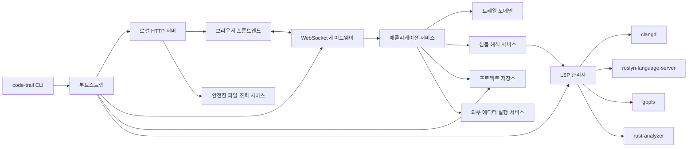
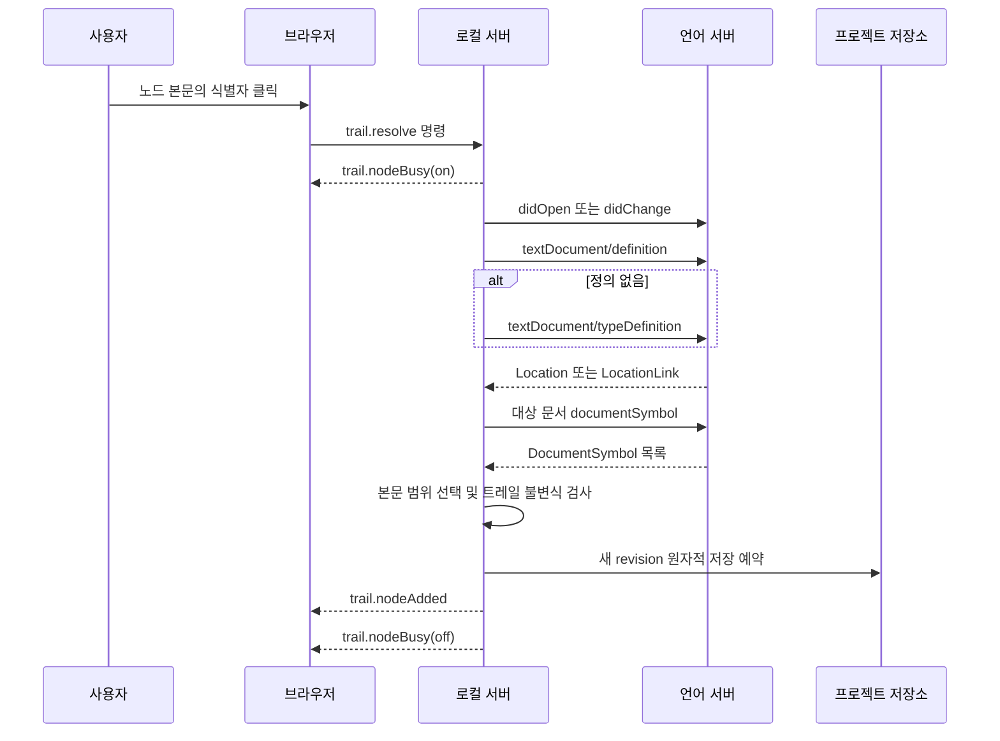

# Code Trail 독립 프로그램 전환 상세 구현서

## 0. 전체 구현 태스크 체크리스트

이 목록을 구현 진행의 정본으로 사용한다. 작업 코드만 작성한 상태에서는 체크하지 않고, 해당 항목의 테스트와 완료 조건까지 통과했을 때 `[ ]`를 `[x]`로 바꾼다. 하위 항목이 모두 끝나기 전에는 단계 완료 항목을 체크하지 않는다. 세부 구현 기준과 완료 조건은 [21. 구현 단계](#21-구현-단계)와 [23. 최종 인수 조건](#23-최종-인수-조건)을 함께 따른다.

### 0.1 단계 0 — 기존 확장 보존과 기준선

- [x] 현재 VS Code 확장의 마지막 커밋을 확정한다.
- [x] 마지막 확장 상태에 식별 가능한 git tag를 만든다.
- [x] `npm run compile` 기준 결과를 기록한다.
- [x] 토크나이저·셸·UI 테스트 기준 결과를 기록한다.
- [x] 트리 모드와 보드 모드의 기준 스크린샷을 남긴다.
- [x] 현재 `ResolvedSymbol`, `Trail`, 웹뷰 메시지 payload fixture를 만든다.
- [x] 현재 사용자 기능을 독립 프로그램 E2E 이식 목록과 연결한다.
- [x] 단계 0의 산출물과 기준선이 재현되는지 검증한다.
- [x] **단계 0 완료**

### 0.2 단계 1 — 모노레포와 공유 도메인

- [x] 루트 `package.json`을 npm workspaces 구조로 전환한다.
- [x] `tsconfig.base.json`과 workspace별 TypeScript 설정을 만든다.
- [x] `packages/shared`, `packages/server`, `packages/web`, `packages/cli`를 만든다.
- [x] 공유 protocol command·event 타입을 정의한다.
- [x] HTTP·WebSocket runtime schema 검증 구조를 만든다.
- [x] 새 `ResolvedSymbol` 타입을 VS Code 타입 없이 정의한다.
- [x] 새 `Trail`, `TrailNode`, `TrailOrigin`, `NodeUiState` 타입을 정의한다.
- [x] 노드와 트레일 ID를 UUID로 생성한다.
- [x] 트레일 revision 증가 규칙을 구현한다.
- [x] addRoot·addChild·remove·toggle·promoteToRoot를 이식한다.
- [x] 재귀·순환 판정 규칙을 이식한다.
- [x] 새 독립 프로그램 전용 저장 스키마를 정의한다.
- [x] Markdown 내보내기를 shared 패키지로 옮긴다.
- [x] 트리 불변식 단위 테스트를 작성한다.
- [x] 저장·로드 round trip 테스트를 작성한다.
- [x] shared 패키지가 `vscode` 의존성 없이 빌드되는지 확인한다.
- [x] **단계 1 완료**

### 0.3 단계 2 — CLI, 로컬 서버와 빈 웹 셸

- [x] `code-trail [project-directory]` CLI 인자를 구현한다.
- [x] `--port`, `--no-open`, `--trail`, `--log-level`, `--config`를 구현한다.
- [x] 프로젝트 경로 절대화와 실제 디렉터리 검증을 구현한다.
- [x] 프로젝트 루트의 심볼릭 링크 실제 경로를 고정한다.
- [x] Fastify 서버 부트스트랩을 구현한다.
- [x] Vite와 React 빈 애플리케이션을 만든다.
- [x] 빌드된 웹 자산을 Fastify에서 제공한다.
- [x] 서버가 `127.0.0.1`과 선택적 `::1`에만 바인딩되게 한다. — IPv4 만 연다. `::1` 리스너는 붙이지 않았다(선택 사항)
- [x] 빈 포트 자동 선택을 구현한다.
- [x] 256비트 세션 토큰을 생성한다.
- [x] fragment 토큰을 `sessionStorage`로 옮기고 URL에서 제거한다.
- [x] HTTP Bearer 인증 middleware를 구현한다.
- [x] WebSocket 인증과 Origin 검사를 구현한다.
- [x] 외부 CDN과 인라인 스크립트를 막는 CSP를 설정한다.
- [x] 기본 브라우저 자동 열기를 구현한다.
- [x] 동일 프로젝트의 살아 있는 서버 재사용을 구현한다.
- [x] SIGINT·SIGTERM·Windows 종료 신호 처리를 구현한다.
- [x] 토큰 없음·잘못된 Origin·외부 인터페이스 접속 거부 테스트를 작성한다.
- [ ] Windows, macOS, Linux에서 빈 웹 화면 실행을 확인한다. — **Windows 만 확인함.** macOS·Linux 는 그 환경에서 `npm run test:e2e` 를 돌려야 한다
- [ ] **단계 2 완료** — 위 한 줄(3개 OS 확인)만 남았다

### 0.4 단계 3 — 프로젝트 저장소와 파일 탐색

- [x] 프로젝트 루트에 `.code-trail/`을 생성한다.
- [x] `.code-trail/settings.json` 스키마와 기본값을 구현한다.
- [x] `.code-trail/index.json` 트레일 목록을 구현한다.
- [x] `.code-trail/trails/<trail-id>.json` 저장을 구현한다.
- [x] `.code-trail/runtime/.gitignore`를 생성한다.
- [x] 임시 파일과 rename을 이용한 원자적 저장을 구현한다.
- [x] revision 기반 debounce 저장을 구현한다.
- [x] 남은 임시 파일의 복구 후보 탐지를 구현한다.
- [x] 결정적인 JSON 키·배열 순서를 보장한다.
- [x] 프로젝트 루트 `.gitignore`를 자동 수정하지 않는지 검증한다.
- [x] 파일 탐색기 지연 조회 API를 구현한다.
- [x] 기본 제외 디렉터리 규칙을 구현한다.
- [x] 파일 이름 검색 API를 구현한다.
- [x] 클라이언트에 절대경로 대신 documentId를 발급한다.
- [x] 프로젝트 밖 경로와 `..` 경로를 거부한다.
- [x] 심볼릭 링크를 통한 프로젝트 경계 탈출을 거부한다.
- [x] 파일 감시와 변경 알림을 구현한다.
- [x] Monaco 읽기 전용 코드 화면을 만든다.
- [x] 원본 들여쓰기·탭·줄바꿈을 변형하지 않는지 테스트한다.
- [x] 설정과 빈 트레일이 서버 재시작 후 복원되는지 확인한다.
- [x] **단계 3 완료**

### 0.5 단계 4 — 공통 LSP 전송 계층

- [x] `vscode-jsonrpc` 기반 stdio transport를 구현한다.
- [x] `Content-Length` 프레이밍 parser를 구현한다.
- [x] stdout을 JSON-RPC 전용으로 처리한다.
- [x] stderr를 크기 제한 ring buffer로 분리한다.
- [x] LSP 요청 ID와 pending request map을 구현한다.
- [x] 요청별 timeout을 구현한다.
- [x] `$/cancelRequest` 전송을 구현한다.
- [x] `initialize` 요청과 `initialized` 알림을 구현한다.
- [x] `shutdown` 요청과 `exit` 알림을 구현한다.
- [x] 동적 capability 등록·해제를 구현한다.
- [x] `window/logMessage`, `window/showMessage`, `$/progress`를 수신한다.
- [x] UTF-16 position encoding capability를 명시한다.
- [x] 문서별 URI·languageId·version·hash 캐시를 구현한다.
- [x] `textDocument/didOpen`을 구현한다.
- [x] full-content `textDocument/didChange`를 구현한다.
- [x] `textDocument/didClose`를 구현한다.
- [x] 열린 문서 LRU와 서버 재시작 후 didOpen 복원을 구현한다.
- [x] LSP 상태 머신을 구현한다.
- [x] 1초·2초·5초의 최대 세 번 재시작 backoff를 구현한다.
- [x] 정상 종료 후 자식 LSP 프로세스가 남지 않게 한다.
- [x] 가짜 stdio LSP 서버를 테스트 fixture로 만든다.
- [x] 정상·지연·취소·프로토콜 오염·crash·재시작 테스트를 작성한다.
- [x] **단계 4 완료**

### 0.6 단계 5 — 심볼 해석 서비스

- [x] LSP `DocumentSymbol` 평탄화를 구현한다.
- [x] LSP `SymbolInformation` 평탄화를 구현한다.
- [x] `narrower` 정렬 규칙을 이식한다.
- [x] `pickEnclosing`을 이식한다.
- [x] `pickEnclosingBody`를 이식한다.
- [x] `pickByDeclaration`을 이식한다.
- [x] Location과 LocationLink 정규화를 구현한다.
- [x] definition 요청을 연결한다.
- [x] definition 실패 시 typeDefinition 폴백을 구현한다.
- [x] documentSymbol 요청을 연결한다.
- [x] implementation 요청을 연결한다.
- [x] references를 구현 찾기 폴백으로 사용하지 않는지 검증한다.
- [x] 복수 정의 후보 선택 명령과 응답을 구현한다.
- [x] 한 줄 range의 targetRange 폴백을 구현한다.
- [x] 다음 심볼 경계 기반 본문 끝 추정을 구현한다.
- [x] `contextLines` 최종 폴백을 구현한다.
- [x] 노드당 4,000줄 하드 캡을 구현한다.
- [x] 선언만 판정을 별도 휴리스틱으로 격리한다.
- [x] 동일 부모 아래 동일 심볼 중복 방지를 구현한다.
- [x] 구현 후보가 하나일 때만 자동으로 붙인다.
- [x] 구현 후보가 여러 개면 자동 선택하지 않는지 검증한다.
- [x] 선언 노드가 구현 추적 후에도 남는지 검증한다.
- [x] Roslyn 심볼 이름의 `(` 앞 표시 이름 처리를 이식한다.
- [x] 탭·한글·이모지·surrogate pair 좌표 테스트를 작성한다.
- [x] **단계 5 완료**

### 0.7 단계 6 — 언어별 LSP 어댑터

#### C/C++ — clangd

- [x] 설정 경로와 PATH 기반 clangd 탐지를 구현한다.
- [x] 플랫폼별 일반 LLVM 설치 위치 탐지를 구현한다.
- [x] `clangd --version` 진단을 구현한다.
- [x] `compile_commands.json` 탐지를 구현한다.
- [x] `compile_flags.txt` 폴백 진단을 구현한다.
- [x] 설정된 `--compile-commands-dir`와 `--query-driver` argv를 전달한다.
- [ ] C++ definition·documentSymbol·가상 함수 implementation fixture를 통과한다. — **clangd 미설치로 미확인.** `npm run test:lsp` 이 fixture 를 들고 있고, clangd 가 있는 기계에서 돌리면 검증된다

#### Go — gopls

- [x] 설정 경로, PATH, GOBIN, GOPATH/bin 탐지를 구현한다.
- [x] `gopls version`과 `go version` 진단을 구현한다.
- [x] `go.work`와 `go.mod` 탐지를 구현한다.
- [ ] Go definition·documentSymbol·interface implementation fixture를 통과한다. — **gopls 미설치로 미확인.** 같은 방법으로 검증한다

#### Rust — rust-analyzer

- [x] 설정 경로, PATH, rustup proxy 탐지를 구현한다.
- [x] 실제 선택된 rust-analyzer 경로를 표시한다.
- [x] rust-analyzer·rustc·cargo 버전 진단을 구현한다.
- [x] `Cargo.toml`, `rust-project.json`, `rust-src` 진단을 구현한다.
- [ ] Rust definition·documentSymbol·trait implementation fixture를 통과한다. — **rustup proxy 만 있고 rust-analyzer 본체가 없어 미확인.** `rustup component add rust-analyzer` 뒤 `npm run test:lsp`

#### C# — roslyn-language-server

- [ ] 독립 C# 언어 서버 선행 스파이크 환경을 만든다. — fixture 와 어댑터는 있으나 **roslyn-language-server 미설치로 실행 확인 못 함**
- [x] 설정의 명시 실행 경로를 우선하도록 구현한다.
- [x] PATH의 `roslyn-language-server` 탐지를 구현한다.
- [x] 실행 인자와 initializationOptions를 C# 어댑터에 격리한다.
- [x] `.sln`, `.slnx`, `.csproj` 후보 탐지를 구현한다.
- [x] 후보 하나를 제안하고 여러 후보는 사용자가 선택하게 한다.
- [x] 선택한 솔루션 경로를 프로젝트 상대경로로 저장한다.
- [ ] C# definition·documentSymbol·implementation·typeDefinition을 검증한다. — **미확인**
- [ ] 다중 프로젝트 간 정의 이동을 검증한다. — **미확인**
- [ ] 인터페이스 구현 하나와 여러 개 시나리오를 검증한다. — 가짜 LSP 로는 검증했으나 **실제 Roslyn 으로는 미확인**
- [x] 서버 배포 규약 변화가 공통 LSP 계층에 영향을 주지 않는지 확인한다. — 인자와 initializationOptions 를 어댑터 안에만 뒀다

#### 어댑터 단계 완료

- [x] 네 어댑터의 실행 파일 누락 안내를 구현한다.
- [x] capability 미지원 기능을 UI에서 비활성화한다.
- [x] 네 언어 실제 LSP 스모크 테스트를 별도 명령으로 분리한다. — `npm run test:lsp`. 설치된 언어만 돌고 나머지는 이유를 적고 건너뛴다
- [ ] **단계 6 완료** — 어댑터·탐지·진단은 끝났다. 위의 실제 언어 서버 fixture 검증만 남았다

### 0.8 단계 7 — 트레일 UI 이식

- [x] 기존 CSS 변수에서 VS Code 테마 의존성을 제거한다.
- [x] 시스템·밝은·어두운 테마를 구현한다.
- [x] `TrailNodeView`를 구현한다.
- [x] 헤더의 종류·이름·시그니처·경로·배지를 이식한다.
- [x] 원본 코드 본문 렌더링을 이식한다.
- [x] 토크나이저를 TypeScript 순수 함수로 이식한다.
- [x] 주석·문자열을 클릭 후보에서 제외한다.
- [x] 식별자 클릭과 Alt+클릭을 서버 명령에 연결한다.
- [x] Ctrl/Cmd+클릭을 외부 에디터 명령에 연결한다.
- [x] 호출부 순번과 자식 헤더 순번의 짝을 구현한다.
- [x] 트리 모드 부모 위·자식 아래 배치를 구현한다.
- [x] 트리 모드 연결선을 구현한다.
- [x] 형제 코드 순서·클릭 순서 전환을 구현한다.
- [x] 브레드크럼을 구현한다.
- [x] 진입 링크와 부모 호출부 왕복 포커스를 구현한다.
- [x] 노드 접기·펼치기를 구현한다.
- [x] 노드 삭제와 하위 노드 제거를 구현한다.
- [x] `⇱` 새 루트 승격을 구현한다.
- [x] 이름·경로 필터를 구현한다.
- [x] 전체 펼치기·전체 접기를 구현한다.
- [x] Markdown 다운로드를 구현한다.
- [x] JSON 저장·불러오기 버튼을 제거한다.
- [x] 새 트레일 생성·선택·이름 변경·삭제 UI를 구현한다.
- [x] 현재 트리 모드 E2E 시나리오를 모두 이식한다.
- [x] 새로고침 후 트리와 접힘 상태 복원을 확인한다.
- [x] **단계 7 완료**

### 0.9 단계 8 — 보드 모드와 UI 영속성

- [x] 보드 모드에서 모든 노드를 캔버스 바로 아래에 평평하게 렌더링한다.
- [x] 부모 오른쪽에서 자식 왼쪽으로 가는 연결선을 구현한다.
- [x] 헤더 pointer capture 기반 drag를 구현한다.
- [x] drag 중 임시 좌표와 drag 종료 저장 좌표를 분리한다.
- [x] 새 노드를 부모 근처에 배치한다.
- [x] 트리·보드 전환을 구현한다.
- [x] 보드 이동이 부모-자식 관계를 바꾸지 않는지 테스트한다.
- [x] 트리 복귀 후 원래 계층 배치를 확인한다.
- [x] 보드 재진입 후 좌표가 유지되는지 확인한다.
- [x] 서버 재시작 후 좌표가 복원되는지 확인한다.
- [x] 본문 높이 조절과 저장을 구현한다.
- [x] Ctrl+휠 노드별 코드 글자 크기와 저장을 구현한다.
- [x] 줄 번호 더블클릭 초기화를 구현한다.
- [x] ResizeObserver 기반 코드 폭 맞춤을 구현한다.
- [x] 코드 폭 맞춤이 헤더 글자를 줄이지 않는지 테스트한다.
- [x] 1,000개 노드 성능 측정과 병목 기록을 수행한다.
- [x] **단계 8 완료**

### 0.10 단계 9 — 외부 에디터와 진단 화면

- [x] 외부 에디터 설정 스키마를 구현한다.
- [x] `{path}`, `{line}`, `{column}`, `{project}` placeholder를 구현한다.
- [x] 실행 파일과 argv 배열을 `shell: false`로 실행한다.
- [x] 알려진 에디터 CLI 후보를 PATH에서 탐지한다.
- [x] 사용자 확정 전 자동 실행하지 않게 한다.
- [x] documentId에서 서버가 안전한 실제 경로를 역조회한다.
- [x] 프로젝트 밖 임의 경로 실행 요청을 거부한다.
- [x] 실행 실패 시 경로·줄 복사 폴백을 제공한다.
- [x] shell injection 테스트를 작성한다.
- [x] 언어별 실행 파일·버전·PID·capability 상태를 표시한다.
- [x] 언어별 프로젝트 인식 상태를 표시한다.
- [x] 마지막 요청 시간과 오류 요약을 표시한다.
- [x] 언어 서버 재시작 버튼을 구현한다.
- [x] 정제된 LSP 로그 보기와 다운로드를 구현한다.
- [x] 환경 변수·토큰·코드 본문이 로그에 노출되지 않는지 검사한다.
- [x] 실제 샘플 요청이 성공해야 `지원됨`으로 표시하게 한다.
- [x] **단계 9 완료**

### 0.11 단계 10 — 전체 보안과 회복성 검증

- [x] 모든 API가 인증을 요구하는지 목록 기반으로 검사한다.
- [x] 모든 WebSocket 명령이 runtime schema 검증을 거치는지 검사한다.
- [x] 다른 origin의 HTTP·WebSocket 요청을 거부한다.
- [x] 세션 토큰이 URL query·로그·파일에 남지 않는지 검사한다.
- [x] 절대경로와 코드 본문이 일반 오류 응답에 노출되지 않는지 검사한다.
- [x] 외부 LSP 정의 URI의 일시 documentId 권한을 구현한다.
- [x] 재시작 후 외부 파일 권한이 자동 복원되지 않는지 확인한다.
- [x] 여러 브라우저 탭의 revision 충돌 처리를 검증한다.
- [x] commandId 멱등 재전송을 검증한다.
- [x] WebSocket 재연결과 snapshot 재동기화를 검증한다.
- [x] 저장 중 강제 종료 후 임시 파일 복구를 검증한다.
- [x] LSP 세 번 연속 crash 후 자동 재시작이 멈추는지 검증한다.
- [x] 서버 종료 중 새 연결과 새 명령을 거부하는지 검증한다.
- [x] 보안·회복성 통합 테스트 묶음이 통과한다.
- [x] **단계 10 완료**

### 0.12 단계 11 — VS Code 확장 완전 제거와 문서 정리

- [x] 현재 확장의 최종 tag가 원격 저장소에 보존됐는지 확인한다.
- [x] `src/extension.ts`를 제거한다.
- [x] `src/panel.ts`를 제거한다.
- [x] VS Code 종속 옛 `src/symbols.ts`를 제거한다.
- [x] 확장 개발 호스트용 `.vscode/launch.json` 구성을 제거한다.
- [x] 확장 전용 `.vscode/tasks.json` 작업을 제거한다.
- [x] `test/preview.html`을 제거한다.
- [x] `test/shell.test.js`를 제거한다.
- [x] `@types/vscode` 의존성을 제거한다.
- [x] `engines.vscode`, `main`, `activationEvents`, `contributes`를 제거한다.
- [x] `vscode:prepublish`를 제거한다.
- [x] `.vscodeignore`를 제거한다.
- [x] 저장소의 `.vsix` 파일을 제거한다.
- [x] README를 CLI 설치·실행·언어 서버·웹 UI 기준으로 다시 작성한다.
- [x] `docs/terms.md`를 브라우저 앱 기준으로 갱신한다.
- [x] `docs/terms.svg`를 브라우저 앱 기준으로 갱신하고 눈으로 확인한다.
- [x] CHANGELOG에 독립 프로그램 전환 주 버전을 기록한다.
- [x] package version을 새 주 버전으로 올린다.
- [x] AGENTS.md의 명령·구조·용어·동기화 표를 갱신한다.
- [x] `import 'vscode'`가 저장소에서 검색되지 않는지 확인한다.
- [x] `acquireVsCodeApi`, `WebviewPanel`, `executeDefinitionProvider`가 검색되지 않는지 확인한다. 남은 것은 이 문서의 위 두 줄과 20.4의 확인 목록뿐이다 — 무엇을 찾아야 하는지 적어둔 자리라 지우면 확인 방법이 사라진다.
- [x] VS Code 없이 전체 빌드와 테스트가 통과하는지 확인한다.
- [x] **단계 11 완료**

### 0.13 단계 12 — 패키징과 릴리스

- [x] npm CLI 패키지의 `bin` 항목을 설정한다.
- [x] CLI·서버·shared·웹 정적 자산을 배포물에 포함한다.
- [x] 언어 서버 바이너리가 배포물에 포함되지 않는지 확인한다.
- [x] 개발 소스맵·fixture·로그·토큰을 배포물에서 제외한다.
- [x] `npm pack` 결과 파일 목록을 자동 검증한다. (`npm run test:pack`)
- [x] 깨끗한 Windows 환경에서 설치·실행한다. (`npm run test:install` — tarball 넷을 임시 폴더에 실제로 설치하고 서버를 띄워 확인)
- [ ] 깨끗한 macOS 환경에서 설치·실행한다. **못 했다** — 이 기계에 macOS 가 없다. 그 환경에서 `npm run test:install` 을 돌리면 확인된다.
- [ ] 깨끗한 Linux 환경에서 설치·실행한다. **못 했다** — 위와 같은 이유. 같은 방법으로 확인한다.
- [~] Windows x64·arm64 CI를 구성한다. — **하지 않기로 했다.** 저장소 주인이 CI 를 두지 않기로 정했다. 플랫폼별 확인은 그 환경에서 `npm test` · `npm run test:e2e` · `npm run test:install` 을 손으로 돌린다.
- [~] macOS x64·arm64 CI를 구성한다. — 위와 같다.
- [~] Linux x64·arm64 CI를 구성한다. — 위와 같다.
- [x] 라이선스와 외부 의존성 고지를 포함한다. (`THIRD-PARTY-NOTICES.md`)
- [x] 설치·업데이트·제거 문서를 작성한다. (README `## 설치와 실행`)
- [x] 첫 독립 프로그램 릴리스 후보를 만든다. `npm pack -w <각 패키지>` 가 네 tarball 을 만들고, `npm run test:install` 이 그것을 설치해 띄운다.
- [ ] 릴리스 후보로 네 언어 실제 프로젝트 스모크 테스트를 수행한다. **못 했다** — 이 기계에 clangd·gopls·roslyn 이 없고 rust-analyzer 는 rustup proxy 뿐이다. `npm run test:lsp` 이 fixture 를 들고 있으니 서버가 설치된 기계에서 돌리면 확인된다.
- [ ] npm 배포 또는 배포 아카이브 게시를 완료한다. **하지 않았다** — 배포는 되돌릴 수 없고 npm 자격 증명도 없다. 패키지 쪽 준비(이름, `bin`, `files`, `publishConfig`, 버전)는 끝났으므로 `npm publish --workspaces` 한 번이면 된다. 저장소 주인이 정할 일이다.
- [ ] **단계 12 완료** — 위 세 줄(macOS·Linux 설치, 실제 언어 서버 스모크, npm 배포)이 이 기계에서 못 하는 것이라 열어 둔다. CI 세 줄은 두지 않기로 정해 `[~]` 로 닫았다.

### 0.14 최종 인수 체크

- [x] VS Code가 없는 환경에서 실행된다. 저장소에 `vscode` 를 참조하는 코드가 하나도 없고, `npm run test:install` 이 워크스페이스 밖 폴더에서 서버를 띄운다.
- [x] 데스크톱 셸 없이 기본 브라우저에서 동작한다. Electron·Tauri 를 쓰지 않는다.
- [ ] Windows, macOS, Linux에서 프로젝트를 연다. **Windows 만 실제로 확인했다.** 나머지 둘은 그 환경에서 손으로 확인해야 한다.
- [ ] C/C++, C#, Go, Rust의 정의와 문서 심볼 탐색이 성공한다. **가짜 언어 서버로만 확인했다** — 이 기계에 네 서버가 없다. `npm run test:lsp` 이 실제 서버용 fixture 를 들고 있다.
- [ ] 지원 가능한 언어 서버에서 구현과 타입 정의 탐색이 성공한다. 위와 같은 이유. 프로토콜 수준의 동작은 `test/integration/lsp.test.mjs` 가 확인한다.
- [x] 심볼 해석이 네 표준 LSP 요청만 사용한다. 가짜 서버가 `references` 요청을 받으면 표시를 남기고 테스트가 그걸 잡는다.
- [x] 탭·한글·이모지·CRLF 코드의 원본과 좌표가 보존된다. (`test/unit/tokenizer-port.test.mjs`, `test/integration/security.test.mjs` 의 "원본 문자열을 한 글자도 바꾸지 않는다")
- [x] 트리의 부모-자식·형제·재귀 규칙이 유지된다.
- [x] 단일 구현만 자동 추적하고 복수 구현은 자동 선택하지 않는다.
- [x] 트리·보드·브레드크럼·진입 링크·순번·배지가 정상 동작한다. (`npm run test:e2e`)
- [x] 트레일·보드 좌표·노드 크기·설정이 `.code-trail/`에서 복원된다. E2E 가 서버를 실제로 껐다 켜서 확인한다.
- [x] 기존 확장 JSON을 읽거나 가져오는 기능이 없다. 가져오기 명령도 경로도 없다.
- [x] VS Code 확장 소스와 VSIX 흐름이 완전히 제거됐다.
- [x] 서버가 loopback 외 주소에서 접근되지 않는다. (`test/integration/security.test.mjs` 의 바인딩 검사)
- [x] 인증·Origin·경로 탈출·명령 주입 테스트가 통과한다. (`security` · `resilience` · `editor` 세 묶음)
- [x] 단위·통합·E2E·실제 LSP 스모크 테스트가 통과한다. 스모크는 네 언어 모두 "서버 없음" 을 이유로 적고 건너뛴다.
- [x] README·CHANGELOG·용어 문서·AGENTS.md·작업 로그가 일치한다.
- [ ] **독립 프로그램 전환 완료** — 코드와 문서는 끝났다. 남은 것은 이 기계에서 할 수 없는 셋이다: 다른 운영체제에서의 설치 확인, 실제 언어 서버 네 개로 하는 스모크, npm 배포.

## 1. 문서 상태

- 상태: 구현 기준안
- 대상: 현재 VS Code 확장인 Code Trail을 로컬 웹 서버와 브라우저 프론트엔드로 전환하는 작업
- 실행 형태: 데스크톱 셸 없이 CLI가 로컬 서버를 시작하고 기본 브라우저를 연다.
- 지원 플랫폼: Windows, macOS, Linux
- 지원 언어: C/C++, C#, Go, Rust
- 저장 위치: 탐색 대상 프로젝트 내부의 `.code-trail/`
- 기존 데이터: 현재 확장의 JSON 형식과 호환하지 않는다.
- VS Code 확장: 최종 결과물에서 완전히 제거한다.

이 문서는 구현자가 추가 제품 결정을 하지 않아도 작업을 시작할 수 있는 수준을 목표로 한다. 다만 C# 독립 언어 서버는 아직 배포 규약이 안정되지 않았으므로, C# 어댑터의 실행 명령은 설정 가능하게 두고 선행 검증을 통과한 뒤 본 구현에 들어간다.

## 2. 확정된 제품 결정

| 항목 | 결정 |
| --- | --- |
| 사용자 인터페이스 | 시스템 기본 브라우저에서 실행되는 웹 애플리케이션 |
| 서버 실행 | `code-trail <프로젝트 경로>` CLI |
| 데스크톱 패키지 | Electron과 Tauri를 포함해 별도 데스크톱 셸을 만들지 않음 |
| 코드 화면 | 파일 탐색기와 읽기 전용 코드 화면을 제공함 |
| 편집 | 웹에서는 편집하지 않으며 외부 에디터 열기를 제공함 |
| 심볼 해석 | 언어별 자체 파서를 만들지 않고 표준 LSP 요청만 사용함 |
| 언어 서버 배포 | 사용자 시스템에 설치된 실행 파일을 자동 탐지하고, 필요하면 설정에서 경로를 지정함 |
| 지원 언어 | C/C++, C#, Go, Rust를 모두 지원함 |
| 네트워크 | `127.0.0.1` 및 `::1`의 로컬 접속만 허용함 |
| 영속 저장 | 프로젝트 루트의 `.code-trail/`에 설정과 트레일을 저장함 |
| 기존 JSON | 가져오기와 변환 기능을 제공하지 않음 |
| 기존 확장 | 새 프로그램 완성 후 소스·매니페스트·VSIX 흐름을 모두 제거함 |

## 3. 목표와 비목표

### 3.1 목표

1. 사용자가 터미널에서 프로젝트 경로를 넘겨 Code Trail을 시작할 수 있어야 한다.
2. 브라우저에서 파일을 찾고 코드를 읽으며 임의의 함수·메서드·클래스 심볼을 루트로 펼칠 수 있어야 한다.
3. 노드 본문의 식별자를 클릭하면 언어 서버가 반환한 정의를 자식 노드로 붙여야 한다.
4. 정의, 문서 심볼, 구현, 타입 정의 기능은 모두 표준 LSP 요청으로 처리해야 한다.
5. 트리 모드, 보드 모드, 브레드크럼, 진입 링크, 호출부 순번, 배지, 내보내기 등 현재 핵심 경험을 유지해야 한다.
6. 트레일과 보드 배치, 노드별 본문 높이와 글자 크기, 사용자 설정을 프로젝트 안에 자동 저장해야 한다.
7. 언어 서버의 설치 누락, 기동 실패, 프로젝트 로드 실패를 사용자가 진단 화면에서 확인할 수 있어야 한다.
8. 브라우저에 임의의 로컬 파일 읽기나 명령 실행 권한을 주지 않아야 한다.
9. 서버와 프론트엔드의 계약을 런타임 스키마로 검증하고 자동 테스트해야 한다.

### 3.2 비목표

- 웹 기반 코드 편집기나 IDE를 만들지 않는다.
- 컴파일, 실행, 디버깅, 리팩터링, 자동 완성 기능을 만들지 않는다.
- 언어별 AST 파서, 타입 추론기, 호출 그래프 분석기를 자체 구현하지 않는다.
- 인터넷에 서버를 공개하거나 여러 사용자가 공동 편집하는 기능을 만들지 않는다.
- 기존 VS Code 확장과 동시 동작하거나 상태를 동기화하지 않는다.
- 현재 확장의 `version: 1` JSON을 읽지 않는다.
- 언어 서버 바이너리를 Code Trail 배포물에 포함하지 않는다.

## 4. 현재 코드의 재사용 경계

현재 코드는 도메인 모델과 화면 로직은 재사용 가능하지만, 호스트와 심볼 해석 계층은 VS Code API에 강하게 결합돼 있다.

| 현재 파일 | 현재 책임 | 전환 후 처리 |
| --- | --- | --- |
| `src/extension.ts` | 명령 등록, 활성 에디터와 커서 조회 | 제거하고 CLI 부트스트랩과 웹 명령으로 대체함 |
| `src/panel.ts` | 웹뷰 생성, 설정 조회, 메시지 처리, 파일 대화상자, 에디터 열기 | 제거하고 HTTP/WebSocket 컨트롤러와 외부 에디터 서비스로 분리함 |
| `src/symbols.ts` | VS Code provider 호출, 위치 정규화, 본문 범위 선택 | 알고리즘은 이식하되 VS Code 타입과 명령 호출은 LSP 클라이언트와 파일 저장소로 교체함 |
| `src/trail.ts` | 트레일 모델, 재귀 판정, JSON/Markdown 직렬화 | 공유 도메인 패키지로 이동하고 UUID, revision, 영속 UI 상태를 추가함 |
| `media/tokenizer.js` | 하이라이팅, 클릭 후보와 원본 좌표 생성 | TypeScript 모듈로 이식하고 역할을 그대로 제한함 |
| `media/main.js` | DOM 렌더링, 트리·보드 상호작용, 웹뷰 메시지 | 기능 단위 React 컴포넌트와 상태 모듈로 나누고 WebSocket 클라이언트로 교체함 |
| `media/style.css` | 패널과 노드 스타일 | CSS 변수와 레이아웃 규칙을 재사용하되 VS Code 테마 변수 의존을 제거함 |
| `test/preview.html` | 웹뷰 API 스텁 기반 UI 하네스 | Vite 개발 서버와 Playwright 픽스처로 대체함 |
| `test/shell.test.js` | `panel.ts` HTML과 preview 셸 동기화 | 삭제함. 정적 셸이 하나만 남으므로 필요하지 않음 |
| `test/tokenizer.test.js` | 좌표·주석·문자열 제외 검증 | TypeScript 단위 테스트로 이식함 |
| `test/ui.test.js` | 패널 UI 검증 | 실제 로컬 서버와 가짜 LSP를 사용하는 Playwright 테스트로 확장함 |
| `package.json`의 `contributes` | VS Code 명령·설정·키바인딩 | 전부 제거하고 CLI `bin`, npm workspaces, 서버·웹 빌드 스크립트로 교체함 |

### 4.1 반드시 유지할 도메인 규칙

- 부모는 클릭한 코드가 속한 노드로 결정한다.
- 보드에서 노드를 옮겨도 부모-자식 관계는 변하지 않는다.
- `⇱`만 부모 관계를 바꾸며 해당 노드를 새 루트로 승격한다.
- 원본 코드는 들여쓰기 제거, 탭 변환, 줄바꿈 정규화를 하지 않는다.
- 클릭 좌표는 원본 문서 기준 0-based 줄·UTF-16 컬럼으로 유지한다.
- 주석과 문자열 내부 식별자는 클릭 후보로 만들지 않는다.
- 구현 후보가 정확히 하나일 때만 자동으로 따라간다.
- 구현 후보가 둘 이상이면 사용자가 선택하게 하며 임의로 하나를 고르지 않는다.
- 선언 노드는 구현으로 따라간 뒤에도 삭제하지 않는다.
- 보드 모드의 노드는 캔버스 루트 바로 아래에 평평하게 렌더링한다.
- 코드 폭 맞춤은 본문 글자에만 적용하고 헤더 글자는 줄이지 않는다.

## 5. 목표 아키텍처



### 5.1 프로세스 구성

한 프로젝트를 열 때 다음 프로세스가 생긴다.

1. `code-trail` Node.js 프로세스 하나가 CLI, HTTP, WebSocket, 저장소를 함께 호스팅한다.
2. 브라우저 탭 하나 이상이 같은 서버에 연결할 수 있다.
3. 언어 서버는 실제로 해당 언어 파일을 처음 열 때 지연 기동한다.
4. 언어별로 기본 한 프로세스를 유지한다. 같은 언어의 요청은 동일 세션을 공유한다.
5. 서버 종료 시 LSP `shutdown` 요청과 `exit` 알림을 보낸 뒤 제한 시간 안에 끝나지 않는 자식 프로세스만 종료한다.

한 서버 프로세스는 프로젝트 하나만 연다. 여러 프로젝트를 보려면 CLI를 각각 실행한다. 이 제약은 경로 보안, LSP 루트, 프로젝트 내부 저장소, 종료 처리를 단순하게 만든다.

### 5.2 계층별 책임

| 계층 | 책임 | 금지 사항 |
| --- | --- | --- |
| CLI | 인자 해석, 프로젝트 검증, 포트 선택, 브라우저 열기, 종료 신호 처리 | 심볼 해석과 트레일 변경을 직접 하지 않음 |
| HTTP 서버 | 정적 파일, 부트스트랩, 파일 트리, 문서 본문, 내보내기 응답 | 클라이언트가 준 임의 절대경로를 읽지 않음 |
| WebSocket | 명령 수신, 이벤트 방송, 연결 인증, 재연결 동기화 | 도메인 규칙을 직접 구현하지 않음 |
| 애플리케이션 서비스 | 명령 검증, 트레일 mutation 직렬화, LSP와 저장소 조정 | DOM이나 브라우저 상태를 알지 않음 |
| 도메인 | 트리 불변식, 재귀 판정, 직렬화 가능한 상태 | 파일 시스템과 네트워크에 접근하지 않음 |
| LSP 관리자 | 실행 파일 탐지, 프로세스 수명주기, JSON-RPC, 문서 동기화 | 언어별 구문 분석을 하지 않음 |
| 심볼 해석 | LSP 결과 정규화, 범위 선택, 원문 추출 | 타입 추론이나 AST 분석을 하지 않음 |
| 프론트엔드 | 읽기 전용 코드 탐색, 트레일 렌더링, 사용자 입력 | 파일 시스템과 프로세스에 직접 접근하지 않음 |

## 6. 기술 스택과 저장소 구조

### 6.1 기술 스택

- 런타임: 지원 중인 Node.js LTS
- 언어: 서버, CLI, 공유 모델, 프론트엔드 모두 TypeScript strict mode
- 패키지 관리: npm workspaces
- HTTP: Fastify
- WebSocket: `@fastify/websocket`
- 정적 자산: `@fastify/static`
- 프론트엔드 빌드: Vite
- UI: React와 함수형 컴포넌트
- 코드 화면: Monaco Editor를 읽기 전용으로 사용함
- 프로토콜 런타임 검증: **Zod** 하나로 HTTP와 WebSocket에 공통 사용함 (단계 1에서 확정)
- LSP 타입: `vscode-languageserver-protocol`, `vscode-languageserver-types`, `vscode-uri`
- JSON-RPC: `vscode-jsonrpc`를 사용함
- 테스트: **Node 내장 test runner** 로 통일하고, E2E는 Playwright를 사용함 (단계 1에서 확정)

`vscode-languageclient`는 VS Code 확장 호스트를 전제로 하므로 사용하지 않는다. 독립 클라이언트는 `vscode-jsonrpc`와 LSP 프로토콜 타입 위에 필요한 기능만 얇게 구현한다.

React 도입은 기존 화면을 새 디자인으로 바꾸기 위한 결정이 아니다. 1,000줄이 넘는 단일 `main.js`를 파일 탐색기, 코드 화면, 트레일, 보드, 설정, 진단 화면으로 분리하고 상태 변경을 타입으로 제한하기 위한 결정이다.

### 6.2 목표 디렉터리

```text
code-trail/
├─ package.json
├─ package-lock.json
├─ tsconfig.base.json
├─ packages/
│  ├─ shared/
│  │  └─ src/
│  │     ├─ protocol/
│  │     │  ├─ commands.ts
│  │     │  ├─ events.ts
│  │     │  └─ schemas.ts
│  │     ├─ domain/
│  │     │  ├─ trail.ts
│  │     │  ├─ symbol.ts
│  │     │  ├─ settings.ts
│  │     │  └─ markdown.ts
│  │     └─ index.ts
│  ├─ server/
│  │  └─ src/
│  │     ├─ app.ts
│  │     ├─ bootstrap.ts
│  │     ├─ config/
│  │     ├─ http/
│  │     ├─ ws/
│  │     ├─ workspace/
│  │     ├─ persistence/
│  │     ├─ editor/
│  │     ├─ lsp/
│  │     │  ├─ client.ts
│  │     │  ├─ manager.ts
│  │     │  ├─ transport.ts
│  │     │  ├─ documents.ts
│  │     │  ├─ resolver.ts
│  │     │  └─ adapters/
│  │     │     ├─ clangd.ts
│  │     │     ├─ csharp.ts
│  │     │     ├─ gopls.ts
│  │     │     └─ rustAnalyzer.ts
│  │     └─ security/
│  ├─ web/
│  │  ├─ index.html
│  │  └─ src/
│  │     ├─ app/
│  │     ├─ api/
│  │     ├─ components/
│  │     ├─ features/
│  │     │  ├─ workspace/
│  │     │  ├─ source/
│  │     │  ├─ trail/
│  │     │  ├─ board/
│  │     │  ├─ diagnostics/
│  │     │  └─ settings/
│  │     ├─ tokenizer/
│  │     └─ styles/
│  └─ cli/
│     └─ src/
│        ├─ main.ts
│        ├─ args.ts
│        └─ openBrowser.ts
├─ test/
│  ├─ unit/
│  ├─ integration/
│  ├─ e2e/
│  ├─ fixtures/
│  └─ fake-lsp/
└─ docs/
```

### 6.3 루트 스크립트

최종 루트 `package.json`에는 최소한 다음 작업을 둔다.

```text
npm run dev             서버와 Vite 개발 서버를 함께 실행
npm run build           shared → server → web → cli 순으로 빌드
npm run typecheck       모든 workspace의 TypeScript 검사
npm run lint            정적 검사
npm run test            단위·통합 테스트
npm run test:e2e        Playwright E2E
npm run test:lsp        설치된 실제 언어 서버 스모크 테스트
npm run start -- <dir>  빌드 결과로 프로젝트 실행
npm pack                npm 배포물 검증
```

## 7. CLI와 부트스트랩

### 7.1 명령 형식

```text
code-trail [project-directory]
  --port <number>            기본값 0, 운영체제가 빈 포트를 선택함
  --no-open                  브라우저를 자동으로 열지 않음
  --trail <trail-id>         시작 후 특정 트레일을 선택함
  --log-level <level>        error|warn|info|debug
  --config <path>            테스트와 특수 환경에서만 설정 파일을 덮어씀
```

호스트 주소를 외부 주소로 바꾸는 옵션은 제공하지 않는다. 서버는 IPv4 `127.0.0.1`에 바인딩하고, IPv6 지원 시 별도의 `::1` 리스너만 허용한다.

### 7.2 시작 순서

1. 인자가 없으면 현재 작업 디렉터리를 사용한다.
2. 경로를 절대경로로 정규화하고 실제 디렉터리인지 확인한다.
3. 심볼릭 링크를 해석한 실제 프로젝트 루트를 고정한다.
4. `.code-trail/`을 만들 수 있는지 확인한다.
5. 기존 런타임 잠금 파일을 읽고 PID와 포트의 생존 여부를 확인한다.
6. 살아 있는 동일 프로젝트 서버가 있으면 새 프로세스를 만들지 않고 기존 URL을 연다.
7. 256비트 난수 세션 토큰을 생성한다.
8. HTTP와 WebSocket 서버를 빈 로컬 포트에 바인딩한다.
9. `.code-trail/runtime/server.json`에 PID, 포트, 시작 시간만 원자적으로 기록한다. 원문 토큰은 기록하지 않는다.
10. `http://127.0.0.1:<port>/#token=<token>`을 기본 브라우저로 연다.
11. 프론트엔드는 fragment의 토큰을 `sessionStorage`로 옮긴 뒤 주소에서 즉시 제거한다.
12. SIGINT, SIGTERM, Windows 콘솔 종료를 받아 정상 종료 절차를 수행한다.

### 7.3 종료 순서

1. 새 HTTP와 WebSocket 연결을 받지 않는다.
2. 프론트엔드에 `server.stopping` 이벤트를 보낸다.
3. 대기 중인 트레일 저장을 완료한다.
4. 언어 서버별 `shutdown` 요청을 보낸다.
5. 응답 후 `exit` 알림을 보낸다.
6. 제한 시간을 넘긴 자식 프로세스만 강제 종료한다.
7. 런타임 잠금 파일을 제거한다.

## 8. 로컬 서버 보안

브라우저 애플리케이션이라도 로컬 파일과 프로세스에 접근하므로 일반 웹 서비스와 같은 수준으로 경계를 둔다.

### 8.1 필수 통제

- 모든 API와 WebSocket 연결은 시작 시 생성한 Bearer 토큰을 요구한다.
- WebSocket은 `Origin`이 현재 로컬 서버의 정확한 origin과 일치해야 한다.
- CORS는 기본적으로 비활성화하고 다른 origin을 허용하지 않는다.
- 세션 토큰을 URL query, 로그, `.code-trail/`, 오류 메시지에 남기지 않는다.
- 정적 HTML에는 엄격한 CSP를 설정한다. 외부 CDN, 인라인 스크립트, 임의 `connect-src`를 허용하지 않는다.
- 서버가 읽을 수 있는 기본 범위는 실제 프로젝트 루트 아래로 제한한다.
- 클라이언트가 절대경로나 `..`를 보내 파일을 직접 지정하는 API를 만들지 않는다.
- 외부 에디터 실행은 shell 문자열이 아니라 실행 파일과 argv 배열로 호출한다.
- 프로젝트 설정의 실행 파일 경로와 인자는 스키마 검증 후 사용한다.
- 서버 로그에는 코드 본문, 토큰, 환경 변수 전체, 언어 서버 인증 관련 값을 기록하지 않는다.

### 8.2 외부 정의 파일 허용

표준 라이브러리나 패키지 캐시의 정의는 프로젝트 밖에 있을 수 있다. 이를 지원하면서 임의 파일 읽기를 막기 위해 서버가 문서 권한을 발급한다.

1. 프로젝트 내부 파일은 시작할 때 기본 허용한다.
2. LSP가 프로젝트 밖의 `file:` URI를 결과로 반환하면 서버가 해당 URI를 검증한다.
3. 검증된 URI에 임의의 `documentId`를 발급하고 서버 메모리의 허용 목록에 넣는다.
4. 브라우저에는 절대 URI 대신 `documentId`와 표시용 경로만 보낸다.
5. 파일 본문 API는 `documentId`만 받는다.
6. 재시작 후 외부 파일 권한은 자동 복원하지 않는다. 저장된 코드 스냅샷은 볼 수 있지만 다시 열기는 새 LSP 결과로 권한을 얻은 뒤 가능하다.

심볼릭 링크는 매 요청마다 실제 경로를 확인한다. 정규화된 실제 경로가 프로젝트 루트 또는 서버가 발급한 외부 문서 허용 목록에 없으면 403으로 거부한다.

## 9. 프로젝트 내부 저장소

### 9.1 디렉터리 형식

```text
.code-trail/
├─ settings.json
├─ index.json
├─ trails/
│  ├─ <trail-id>.json
│  └─ ...
└─ runtime/
   ├─ .gitignore
   ├─ server.json
   └─ lsp/
      ├─ clangd.log
      ├─ csharp.log
      ├─ gopls.log
      └─ rust-analyzer.log
```

`runtime/.gitignore`는 `*`를 포함해 실행 부산물이 커밋되지 않게 한다. 프로젝트 루트의 `.gitignore`는 자동 수정하지 않는다. `settings.json`, `index.json`, `trails/*.json`은 사용자가 원하면 형상 관리할 수 있는 결정적 형식으로 쓴다.

### 9.2 설정 스키마

```ts
interface ProjectSettings {
    schemaVersion: 1;
    ui: {
        theme: 'system' | 'light' | 'dark';
        clickTarget: 'allSymbols' | 'callsOnly';
        childOrder: 'source' | 'click';
        maxCodeLines: number;
        contextLines: number;
        fitToWidth: boolean;
        minFontSize: number;
        fontSize: number;
        autoFollowSingleImplementation: boolean;
        revealInExternalEditorOnAdd: boolean;
    };
    editor: {
        executable: string | null;
        args: string[];
    };
    languages: {
        cpp: LanguageServerSettings;
        csharp: LanguageServerSettings;
        go: LanguageServerSettings;
        rust: LanguageServerSettings;
    };
}

interface LanguageServerSettings {
    enabled: boolean;
    executable: string | null;
    args: string[];
    env: Record<string, string>;
    initializationOptions: unknown;
}
```

`env`는 명시한 키만 자식 프로세스 환경에 덮어쓴다. 설정을 저장할 때 비밀값 저장을 경고하고 로그에서는 값을 가린다.

### 9.3 트레일 스키마

기존 확장 형식과 호환하지 않는 새 스키마를 사용한다.

```ts
interface StoredTrail {
    schemaVersion: 1;
    id: string;
    title: string;
    createdAt: string;
    updatedAt: string;
    revision: number;
    activeNodeId: string | null;
    mode: 'tree' | 'board';
    roots: TrailNode[];
    nodeUi: Record<string, NodeUiState>;
}

interface TrailNode {
    id: string;
    parentId: string | null;
    symbol: ResolvedSymbol;
    origin: TrailOrigin | null;
    collapsed: boolean;
    recursive: boolean;
    children: TrailNode[];
}

interface NodeUiState {
    boardX?: number;
    boardY?: number;
    bodyHeight?: number;
    codeFontSize?: number;
}
```

노드 ID와 트레일 ID는 프로세스 전역 카운터가 아니라 UUID를 사용한다. 보드 좌표와 노드별 크기를 트레일에 저장하므로 현재 확장과 달리 재시작 후에도 배치가 유지된다.

### 9.4 심볼 저장 규칙

`ResolvedSymbol`은 표시용 코드 스냅샷과 원본 위치를 함께 가진다.

- 프로젝트 내부 파일은 OS 독립적인 `/` 구분 상대경로를 저장한다.
- 절대경로와 세션 `documentId`는 저장하지 않는다.
- 파일 내용의 SHA-256 해시와 저장 시 수정 시간을 기록한다.
- 트레일을 다시 열 때 현재 파일 해시가 다르면 노드에 `변경됨` 상태를 표시한다.
- 저장된 스냅샷은 그대로 보여주고, 사용자가 원할 때만 현재 정의를 다시 해석해 새 노드로 갱신한다.
- 프로젝트 외부 심볼은 표시용 경로와 코드 스냅샷만 저장하고 재시작 후 외부 에디터 열기를 비활성화한다.

### 9.5 원자적 저장

1. mutation마다 메모리 revision을 증가시킨다.
2. 300~500ms debounce 후 `<id>.json.tmp`에 전체 JSON을 쓴다.
3. 파일 flush 후 같은 디렉터리에서 최종 파일명으로 교체한다.
4. 저장 중 다시 변경되면 최신 revision을 한 번 더 저장한다.
5. 시작 시 남은 `.tmp`가 있고 최종 파일보다 새로우면 복구 후보로 진단 화면에 표시한다.
6. JSON 키와 배열 순서를 결정적으로 유지해 git diff가 불필요하게 흔들리지 않게 한다.

## 10. 워크스페이스와 읽기 전용 코드 화면

### 10.1 파일 탐색기

- 초기 응답에는 프로젝트 루트의 첫 단계만 반환한다.
- 디렉터리는 펼칠 때 지연 조회한다.
- `.git`, `node_modules`, `out`, `dist`, `target`, `bin`, `obj`, `.code-trail/runtime`은 기본 제외한다.
- 제외 목록은 설정에서 추가할 수 있지만 보안 허용 범위는 넓히지 않는다.
- 파일 확장자로 언어를 판정하되 어댑터가 최종 `languageId`를 반환한다.
- 대형 디렉터리는 항목 수 제한과 이름 검색을 제공한다.
- 파일 검색은 서버에서 수행하며 결과에 상대경로와 파일 ID만 반환한다.

### 10.2 읽기 전용 코드 화면

Monaco 모델은 다음 원칙으로 관리한다.

- `readOnly: true`와 `domReadOnly: true`를 설정한다.
- 서버에서 받은 원본 문자열을 그대로 모델에 넣는다.
- 줄바꿈을 클라이언트에서 변환하지 않는다.
- 탭 크기는 표시 설정일 뿐 원본 텍스트와 LSP 컬럼을 변경하지 않는다.
- 브라우저의 Monaco 위치는 1-based이므로 서버 명령을 만들 때 줄과 컬럼을 각각 1 빼서 보낸다.
- JavaScript와 LSP 기본 위치 인코딩이 맞도록 LSP 초기화에서 UTF-16을 명시한다.
- 코드 클릭 후보 판정은 토크나이저 모듈을 사용하고 주석·문자열이면 탐색 명령을 만들지 않는다.

### 10.3 루트 생성 흐름

루트를 만드는 방법은 두 가지를 제공한다.

1. 코드 화면에서 커서를 두고 `Ctrl+Alt+T`, macOS에서는 `Cmd+Alt+T`를 누른다.
2. 문서 심볼 사이드 목록에서 심볼 이름의 `새 루트` 버튼을 누른다.

첫 번째 방식은 현재 `resolveEnclosing` 알고리즘을 이식한다.

1. 커서가 식별자 위인지 확인한다.
2. 자신의 선언 위치가 아니라면 `textDocument/definition`을 먼저 시도한다.
3. 정의를 찾지 못했거나 자기 선언이면 `textDocument/documentSymbol` 결과에서 커서를 감싸는 몸통 심볼 중 가장 좁은 것을 고른다.
4. 몸통 심볼이 없으면 가장 좁은 심볼을 사용한다.
5. 문서 심볼 자체가 없으면 현재 줄부터 `contextLines`만큼을 근사 본문으로 만든다.

## 11. LSP 클라이언트 구현

### 11.1 사용 요청

심볼 해석에는 다음 네 요청만 사용한다.

| Code Trail 동작 | LSP 메서드 |
| --- | --- |
| 식별자 정의 | `textDocument/definition` |
| 심볼과 본문 범위 | `textDocument/documentSymbol` |
| 구현 찾기 | `textDocument/implementation` |
| 정의 폴백 | `textDocument/typeDefinition` |

참조 검색 결과에는 호출부가 섞일 수 있으므로 `textDocument/references`를 구현 찾기 폴백으로 사용하지 않는다. 서버가 구현 요청을 지원하지 않으면 기능을 비활성화하고 진단 화면에 명시한다.

### 11.2 JSON-RPC 전송

- 언어 서버는 기본적으로 stdio 자식 프로세스로 실행한다.
- stdout은 `Content-Length` 프레이밍을 해석하는 JSON-RPC 전용 스트림으로 사용한다.
- stderr는 줄 단위 진단 로그로 별도 수집한다.
- stdout에 프로토콜이 아닌 문자가 섞이면 해당 서버를 `protocolError` 상태로 전환한다.
- 요청 ID는 세션별 증가 정수로 관리한다.
- 요청별 timeout과 취소 토큰을 둔다.
- 브라우저 연결이 끊기거나 사용자가 취소하면 `$/cancelRequest`를 보낸다.
- 서버가 보낸 `window/logMessage`, `window/showMessage`, `$/progress`를 진단 이벤트로 변환한다.
- 동적 capability 등록과 해제를 반영한다.

### 11.3 초기화

각 어댑터는 공통 초기화 빌더에 다음 값을 제공한다.

```ts
interface LspAdapter {
    id: 'cpp' | 'csharp' | 'go' | 'rust';
    languageIds: string[];
    detectExecutable(settings: ProjectSettings): Promise<DetectionResult>;
    buildCommand(settings: ProjectSettings): SpawnCommand;
    buildInitializeParams(workspace: WorkspaceInfo): InitializeParams;
    classifyFile(path: string): string | null;
    healthChecks(workspace: WorkspaceInfo): Promise<HealthCheck[]>;
}
```

공통 `initialize`에는 다음을 넣는다.

- `processId`: Code Trail 서버 PID
- `clientInfo`: Code Trail 이름과 버전
- `rootUri`: 실제 프로젝트 루트의 file URI
- `workspaceFolders`: 프로젝트 하나
- `locale`: `ko`
- `capabilities.general.positionEncodings`: `['utf-16']`
- definition, documentSymbol, implementation, typeDefinition의 LocationLink 지원
- progress, workspace folders, watched files 지원 범위

`initialize` 응답을 받은 뒤 capability를 저장하고 `initialized` 알림을 보낸다. 필수 capability인 documentSymbol 또는 definition이 없으면 서버는 실행 중이어도 Code Trail 지원 상태를 `degraded`로 표시한다.

### 11.4 문서 동기화

언어 서버 요청 전에 대상 문서를 반드시 연다.

1. 파일 저장소에서 UTF-8 원문을 읽는다. BOM은 디코딩에서만 처리하고 본문 문자열에는 넣지 않는다.
2. 문서별 URI, 언어 ID, version, 내용 해시를 캐시한다.
3. 처음 요청하면 `textDocument/didOpen`을 보낸다.
4. 파일 감시기가 변경을 감지하면 다시 읽고 version을 증가시켜 full-content `didChange`를 보낸다.
5. 파일 삭제 시 `didClose`와 watched-files 알림을 보낸다.
6. 열린 문서는 LRU로 관리하되 언어 서버가 프로젝트 분석을 유지하는 데 방해되지 않는 넉넉한 상한을 둔다.
7. 서버 재시작 후 기존 열린 문서를 새 세션에 다시 `didOpen`한다.

웹이 읽기 전용이므로 incremental edit 계산은 필요하지 않다.

### 11.5 위치와 URI 정규화

- 내부 좌표는 `line`, `character` 모두 0-based UTF-16 code unit으로 통일한다.
- URI 파싱과 file path 변환은 `vscode-uri`를 사용한다.
- Windows 드라이브 문자 대소문자와 UNC 경로를 정규화하되 표시 문자열은 원래 경로를 보존한다.
- 같은 위치의 중복 결과는 정규화 URI와 시작 위치로 제거한다.
- Location과 LocationLink를 하나의 `NormalizedLocation`으로 바꾼다.
- LocationLink의 `targetSelectionRange`는 anchor로, `targetRange`는 본문 힌트로 사용한다.
- `file:`이 아닌 URI는 기본적으로 코드 본문을 읽지 못하는 외부 가상 문서로 표시한다.

### 11.6 장애와 재시작

LSP 상태는 다음 상태 머신으로 관리한다.

```text
stopped → detecting → starting → initializing → ready
                        │             │          │
                        └─────────────┴──────────┤
                                                ↓
                         failed ← backoff ← crashed
```

- 예상하지 못한 종료는 1초, 2초, 5초 간격으로 최대 세 번 자동 재시작한다.
- 세 번 실패하면 자동 재시작을 멈추고 사용자가 진단 화면에서 다시 시작하게 한다.
- 설정 변경으로 실행 파일이나 인자가 달라지면 기존 프로세스를 정상 종료한 뒤 새 설정으로 시작한다.
- 각 세션은 최근 stderr를 크기 제한 ring buffer에 보관한다.
- 브라우저에는 종료 코드, 마지막 오류 요약, 재시도 횟수만 기본 표시한다.
- 상세 로그 다운로드는 토큰 인증을 거치고 코드 본문이나 환경 변수 전체를 포함하지 않는다.

## 12. 언어별 어댑터

### 12.1 C/C++ — clangd

탐지 순서:

1. `.code-trail/settings.json`의 명시 경로
2. `PATH`의 `clangd`
3. 플랫폼별 일반 LLVM 설치 위치를 읽기 전용으로 확인

필수 진단:

- `clangd --version` 실행 성공 여부
- 프로젝트 또는 상위 빌드 디렉터리의 `compile_commands.json` 존재 여부
- 없으면 `compile_flags.txt` 존재 여부
- 컴파일 데이터베이스가 없을 때 정확도가 낮아질 수 있다는 안내

언어 서버에는 프로젝트 루트를 cwd로 넘긴다. 사용자가 설정한 `--compile-commands-dir`와 `--query-driver`는 argv 배열로만 전달한다. Code Trail이 C++ 빌드 플래그를 추측하거나 헤더 탐색 경로를 자체 계산하지 않는다.

### 12.2 C# — roslyn-language-server

C#은 전체 전환의 선행 위험 항목이다. 공식 서버는 지원되지만 명령줄과 배포 방식이 아직 실험적이므로 다음 구조를 지킨다.

1. 실행 파일 자동 다운로드나 확장 디렉터리 재사용을 구현하지 않는다.
2. 우선 프로젝트 설정의 명시 경로를 사용한다.
3. 다음으로 `PATH`의 `roslyn-language-server`를 확인한다.
4. 실행 인자와 initializationOptions를 어댑터 밖 공통 코드에 박지 않는다.
5. `.sln`, `.slnx`, `.csproj` 후보를 검색해 진단 화면에서 보여준다.
6. 후보가 하나면 기본 workspace 대상으로 제안한다.
7. 후보가 둘 이상이면 사용자가 설정 화면에서 하나를 선택하게 한다.
8. 선택한 솔루션 경로는 프로젝트 상대경로로 저장한다.

C# 본 구현 전에 별도 스파이크 테스트를 만든다. definition, documentSymbol, implementation, typeDefinition, 다중 프로젝트 정의 이동, 인터페이스 구현, 프로세스 종료가 모두 통과해야 한다. 실패하면 C# 어댑터만 실험 기능으로 남기고 공통 LSP 계층을 변경하지 않는다.

Roslyn 이름이 `Foo(string, int) : Task<T>`처럼 오면 표시 이름은 `(` 앞까지만 자르는 현재 규칙을 유지한다.

### 12.3 Go — gopls

탐지 순서:

1. 설정의 명시 경로
2. `PATH`의 `gopls`
3. `GOBIN`과 `GOPATH/bin`의 실행 파일

진단에는 `gopls version`, `go version`, `go.work`, `go.mod` 탐지 결과를 포함한다. 설치 안내는 공식 명령인 `go install golang.org/x/tools/gopls@latest`를 보여주되 사용자의 명시적 실행 없이 자동 설치하지 않는다.

### 12.4 Rust — rust-analyzer

탐지 순서:

1. 설정의 명시 경로
2. `PATH`의 `rust-analyzer`
3. rustup proxy가 가리키는 실행 파일

진단에는 `rust-analyzer --version`, `rustc --version`, `cargo --version`, `Cargo.toml`, `rust-project.json`, `rust-src` 사용 가능 여부를 포함한다. rustup proxy와 별도 설치 바이너리가 충돌할 수 있으므로 실제 선택된 경로를 항상 표시한다.

## 13. 심볼 해석 서비스 이식

### 13.1 문서 심볼 평탄화

LSP `DocumentSymbol[] | SymbolInformation[]`을 현재 `FlatSymbol`에 대응하는 내부 형식으로 바꾼다.

```ts
interface FlatSymbol {
    name: string;
    detail: string;
    container: string;
    kind: number;
    range: Range;
    selectionRange: Range;
    depth: number;
}
```

- DocumentSymbol은 children을 재귀적으로 평탄화하며 depth와 부모 이름을 기록한다.
- SymbolInformation은 `containerName`을 container로 사용한다.
- selectionRange가 없거나 잘못된 서버 응답은 range로 폴백한다.
- range가 문서 범위를 벗어나면 잘라 쓰지 않고 잘못된 응답으로 진단한 뒤 후보에서 제외한다.

### 13.2 심볼 선택

현재의 `narrower`, `pickEnclosing`, `pickEnclosingBody`, `pickByDeclaration` 규칙을 그대로 단위 테스트와 함께 이식한다.

정렬 우선순위는 다음과 같다.

1. 줄 범위가 더 좁은 심볼
2. 같은 범위면 depth가 더 깊은 심볼
3. 그래도 같으면 언어 서버 원래 순서

함수 시작은 몸통 종류를 우선하고 정의 위치 해석은 selectionRange 포함을 우선한다.

### 13.3 본문 범위

본문 범위는 다음 순서로 정한다.

1. 문서 심볼의 다중 행 range
2. LocationLink의 targetRange
3. 같은 depth 이하에서 다음에 시작하는 심볼의 바로 앞 줄
4. 현재 위치부터 `contextLines`

한 노드가 읽는 절대 상한을 설정한다. 현재 4,000줄 상한은 유지하되 상수와 설정의 관계를 테스트한다. 공통 들여쓰기 제거와 탭 변환은 하지 않는다.

### 13.4 선언만 판정

언어별 파서를 만들지 않는다. 현재처럼 callable 종류이면서 근사 본문이 아니고 코드에 몸통 시작 표지가 없는지를 보수적으로 판정한다. 이 휴리스틱은 별도 함수와 테스트로 격리해 잘못된 판정이 심볼 해석 전체에 퍼지지 않게 한다.

### 13.5 정의와 구현 흐름

정의 클릭:

1. definition을 요청한다.
2. 결과가 없으면 typeDefinition을 요청한다.
3. 후보가 여러 개면 브라우저 선택 대화상자에 모두 표시한다.
4. 선택된 문서에 documentSymbol을 요청한다.
5. `ResolvedSymbol`을 만들고 같은 부모의 중복 자식인지 확인한다.
6. 중복이면 기존 노드로 포커스한다.
7. 새 노드면 원래 클릭 위치를 origin으로 저장하고 붙인다.
8. 선언만이며 자동 추적 설정이 켜졌으면 implementation을 요청한다.
9. 몸통 있는 후보가 정확히 하나일 때만 그 구현을 선언 노드의 자식으로 붙인다.

구현 버튼:

1. implementation만 요청한다.
2. 선언 자기 자신과 중복 위치를 제거한다.
3. 최대 후보 수를 제한하고 잘린 사실을 UI에 표시한다.
4. 몸통 있는 결과를 먼저 정렬한다.
5. 각 구현을 같은 부모 아래 형제 자식으로 붙인다.

## 14. 도메인 모델과 동시성

### 14.1 서버 권위 모델

트레일의 정본은 서버 메모리에 둔다. 브라우저는 렌더링용 복사본을 가지며 모든 변경을 명령으로 보낸다.

- 서버는 트레일별 mutation queue를 둬 명령을 순서대로 실행한다.
- 모든 명령에 `commandId`, `trailId`, `baseRevision`을 넣는다.
- 성공 이벤트에는 새 `revision`을 넣는다.
- baseRevision이 오래됐으면 명령을 거부하고 최신 snapshot을 보낸다.
- 같은 commandId 재전송은 한 번만 처리한다.
- 여러 브라우저 탭은 같은 이벤트를 받아 동기화한다.
- 공동 편집이나 CRDT는 구현하지 않는다.

### 14.2 도메인 명령

```text
trail.create
trail.rename
trail.delete
trail.select
trail.addRootAt
trail.addRootFromSymbol
trail.resolve
trail.resolveImplementations
trail.chooseCandidate
trail.removeNode
trail.toggleNode
trail.promoteToRoot
trail.setMode
trail.setNodeUi
trail.setActiveNode
trail.clear
trail.exportMarkdown
workspace.openDocument
workspace.searchFiles
editor.openLocation
settings.update
lsp.restart
lsp.verify
```

`lsp.verify`는 단계 9에서 추가했다. 진단 화면의 `지원됨`은 프로세스가 떴다는 뜻이 아니라 실제 샘플 문서에서 `documentSymbol`과 `definition`이 응답했다는 뜻이고, 그 확인을 사용자가 눌러서 돌린다. HTTP가 아니라 명령인 이유는 언어 서버를 띄우고 요청을 보내는 상태 변경이기 때문이다.

`trail.toggleNode`는 단계 7에서 화면 명령으로 옮겼다. 접기는 트리 모양을 바꾸지 않고, 구조 명령으로 두면 "전체 접기"가 노드마다 명령을 보내면서 두 번째부터 전부 오래된 revision으로 거절된다. 같은 이유로 `trail.setMode`·`trail.setNodeUi`·`trail.setActiveNode`도 revision을 올리지 않는다.

`trail.chooseCandidate`는 단계 5에서 추가했다. 정의 후보가 여러 개일 때 서버가 하나를 고르지 않고 `trail.definitionChoice` 이벤트로 목록을 보내며, 사용자가 고르면 이 명령으로 돌아온다. 서버가 응답을 붙들고 사용자를 기다리면 그 사이 같은 트레일의 다른 명령이 전부 막히므로 왕복을 둘로 나눴다.

트리 구조를 바꾸는 명령과 순수 UI 상태 명령을 타입으로 구분한다. `trail.setNodeUi`는 드래그 중 매 pointer event마다 보내지 않고 클라이언트에서 프레임 단위로 그린 뒤 drag end에 최종 좌표만 보낸다.

## 15. HTTP와 WebSocket 계약

### 15.1 HTTP API

| 메서드 | 경로 | 용도 |
| --- | --- | --- |
| GET | `/api/bootstrap` | 프로젝트 표시 정보, 설정, 트레일 목록, 서버 capability |
| GET | `/api/workspace/children?id=...` | 파일 탐색기 하위 항목 |
| GET | `/api/workspace/search?q=...` | 파일 이름 검색 |
| GET | `/api/documents/:documentId` | 허용된 원문과 언어 ID 조회 |
| GET | `/api/trails/:trailId/export.md` | Markdown 다운로드 |
| GET | `/api/diagnostics` | LSP 상태와 안전하게 정제한 진단 정보 |
| GET | `/api/health` | 현재 프로세스의 단순 생존 확인 |

상태 변경은 WebSocket 명령으로만 처리한다. 파일 저장 대화상자 대신 브라우저 다운로드를 사용한다. JSON 저장·불러오기 버튼은 제거하고 트레일 자동 저장과 목록 관리를 제공한다.

### 15.2 WebSocket envelope

클라이언트 명령:

```ts
interface ClientCommand<TPayload> {
    protocolVersion: 1;
    type: string;
    commandId: string;
    trailId?: string;
    baseRevision?: number;
    payload: TPayload;
}
```

서버 이벤트:

```ts
interface ServerEvent<TPayload> {
    protocolVersion: 1;
    type: string;
    eventId: string;
    commandId?: string;
    trailId?: string;
    revision?: number;
    payload: TPayload;
}
```

공통 오류:

```ts
interface CommandError {
    code:
        | 'INVALID_COMMAND'
        | 'UNAUTHORIZED'
        | 'STALE_REVISION'
        | 'NOT_FOUND'
        | 'LSP_UNAVAILABLE'
        | 'LSP_TIMEOUT'
        | 'PATH_DENIED'
        | 'PERSISTENCE_FAILED'
        | 'SERVER_STOPPING'
        | 'INTERNAL_ERROR';
    message: string;
    retryable: boolean;
    details?: Record<string, unknown>;
}
```

`details`에는 stack, 절대경로, 코드 본문, 환경 변수, 원문 LSP payload를 넣지 않는다.

`SERVER_STOPPING`은 단계 10에서 추가했다. 종료 절차는 저장을 끝낸 뒤 언어 서버를 내리는데, 그 사이에 들어온 명령을 처리하면 트레일이 또 바뀌고 그 변경은 어디에도 남지 않는다. 그래서 종료가 시작된 순간부터 새 WebSocket 연결과 새 명령을 모두 거절하고, 왜 거절했는지 이 코드로 알린다.

### 15.3 정의 클릭 시퀀스



## 16. 프론트엔드 구현

### 16.1 화면 구조

```text
┌─────────────────────────────────────────────────────────────┐
│ 상단 앱 바: 프로젝트·트레일 선택·언어 서버 상태·설정       │
├───────────────┬─────────────────────────────────────────────┤
│ 파일 탐색기   │ 코드 화면 또는 트레일 화면                  │
│ 문서 심볼     │                                             │
│ 검색          │ 트레일 툴바                                 │
│               │ 브레드크럼                                  │
│               │ 트리/보드 캔버스                            │
└───────────────┴─────────────────────────────────────────────┘
```

코드 화면과 트레일 화면은 탭 또는 분할 화면으로 전환한다. 작은 화면에서는 파일 탐색기를 접을 수 있게 한다. 기존 `⧉ 새 창`은 데스크톱 셸이 없으므로 제거한다. 브라우저 탭 복제와 새 창은 브라우저 자체 기능을 사용한다.

### 16.2 상태 분리

- 서버 상태: 프로젝트, 설정, 트레일 snapshot, LSP 상태
- 문서 상태: 열린 문서, 커서, 문서 심볼, 검색 결과
- 트레일 UI 상태: 활성 노드, 필터, 모드, 임시 드래그 좌표
- 연결 상태: WebSocket 연결, 재연결, 마지막 eventId, 처리 중 명령

서버에서 영속할 값과 한 탭에서만 필요한 임시 값을 타입으로 구분한다. 필터 문자열, 열린 사이드바 폭, hover 등은 서버에 저장하지 않는다.

### 16.3 현재 UI 이식 순서

1. 기존 CSS 변수와 노드 마크업을 React `TrailNodeView`로 옮긴다.
2. `renderCode`와 토크나이저를 순수 함수로 옮긴다.
3. 호출부의 `data-idx`와 자식 헤더의 순번 계산을 selector로 옮긴다.
4. 브레드크럼과 진입 링크 포커스 이동을 DOM ref 레지스트리로 구현한다.
5. 트리 연결선 계산을 독립 훅으로 옮긴다.
6. 보드 모드에서 노드를 캔버스 바로 아래 평면 목록으로 렌더링한다.
7. 보드 연결선과 drag pointer capture를 이식한다.
8. 노드별 높이와 글자 크기를 서버 명령에 연결한다.
9. 자동 폭 맞춤은 `ResizeObserver` 기반으로 이식하되 코드 본문만 조정한다.
10. 접근성 이름, 키보드 포커스, reduced motion을 추가한다.

### 16.4 네트워크 연결

- 초기 snapshot은 `/api/bootstrap`에서 받는다.
- 이후 변경은 WebSocket 이벤트로 받는다.
- 연결이 끊기면 지수 backoff로 재접속한다.
- 재접속 시 마지막 eventId와 알고 있는 revision을 보낸다.
- 이벤트 이력이 남아 있으면 차이만 받고, 없으면 전체 snapshot을 다시 받는다.
- 처리 중 명령은 commandId를 유지해 재전송한다.
- LSP 요청이 오래 걸리면 노드 단위 busy 표시와 취소 버튼을 보여준다.

## 17. 외부 에디터 연동

### 17.1 설정 형식

```json
{
  "editor": {
    "executable": "code",
    "args": ["-g", "{path}:{line}:{column}"]
  }
}
```

지원 placeholder는 `{path}`, `{line}`, `{column}`, `{project}`만 허용한다. line과 column은 외부 에디터 관례에 맞게 1-based로 전달한다.

### 17.2 탐지와 실행

1. 사용자가 설정한 실행 파일을 우선한다.
2. 설정이 없으면 VS Code, Cursor 등 알려진 CLI를 PATH에서 탐지한다.
3. 후보가 하나면 진단 화면에 제안하되 사용자 설정으로 확정하기 전에는 자동 실행하지 않는다.
4. 실행 시 `shell: false`로 자식 프로세스를 생성한다.
5. 경로는 서버가 발급한 문서 ID에서 역조회하며 브라우저가 보낸 path를 사용하지 않는다.
6. 실행 실패 시 경로와 줄을 복사하는 대체 동작을 제공한다.

## 18. 진단 화면

진단 화면은 언어별로 다음 항목을 표로 보여준다.

- 선택된 실행 파일의 정규화 경로
- 버전 명령 결과
- 프로세스 상태와 PID
- 초기화 시간
- 서버가 광고한 네 필수 capability
- 마지막 성공 요청과 응답 시간
- 마지막 종료 코드 또는 오류 요약
- 프로젝트 인식 정보
  - C/C++: compile_commands 또는 compile_flags
  - C#: 선택된 solution/project
  - Go: go.work/go.mod
  - Rust: Cargo.toml/rust-project.json/rust-src
- 재시작 버튼
- 정제된 로그 보기와 다운로드

`지원됨`은 프로세스가 떴다는 뜻이 아니라 documentSymbol과 definition 요청이 실제 샘플 문서에서 응답했다는 뜻으로 표시한다.

단계 9에서 정한 것 두 가지.

- **실행 파일은 정규화 경로가 아니라 이름만 내보낸다.** 위 목록의 첫 줄은 8.1("로그와 오류에 절대경로를 남기지 않는다")과 정면으로 부딪힌다. 진단 화면은 브라우저에서 열리고 그 내용은 사용자가 붙여 넣어 공유하기 쉬우므로 8.1을 우선했다. 어느 실행 파일인지는 `detectionSource`(설정 / PATH / 설치 위치 / GOBIN / rustup)와 버전 명령 결과로 구분된다. 예외는 rust-analyzer 뿐이고, rustup proxy와 별도 설치를 구분할 방법이 경로밖에 없어 어댑터가 점검 항목에 담는다.
- **확인은 사용자가 누른다.** `lsp.verify` 명령이 샘플 문서 하나를 골라 documentSymbol과 definition을 실제로 보낸다. 진단 화면을 여는 것만으로 네 언어 서버를 전부 띄우지 않는다 — 쓰지도 않을 서버가 CPU와 메모리를 먹는다(5.1의 지연 기동과 같은 이유).

## 19. 성능과 자원 제한

초기 목표치를 다음과 같이 둔다.

| 항목 | 목표 |
| --- | --- |
| 서버 시작에서 정적 화면 표시 | 일반 개발 PC에서 2초 이내 |
| 저장된 트레일 열기 | 1,000개 노드에서 1초 이내 첫 화면 |
| UI 상호작용 | 드래그와 스크롤 60fps 지향 |
| 트레일 저장 | 사용자 입력을 막지 않는 비동기 저장 |
| 파일 트리 | 전체 사전 스캔 없이 지연 로드 |
| LSP 요청 | 종류별 timeout과 사용자 취소 제공 |
| 로그 | 언어 서버별 크기 제한과 rotation |

대형 트레일은 화면 밖 서브트리를 접거나 가상화한다. 다만 연결선과 보드 좌표가 있으므로 일반 리스트 가상화를 바로 적용하지 말고 1,000개 노드 성능 측정 뒤 병목 구간에만 적용한다.

단계 8에서 실제로 쟀다. `node test/perf/board-1000.mjs` 로 다시 잴 수 있고 결과와 병목은 [`docs/perf-1000-nodes.md`](perf-1000-nodes.md) 에 있다. 요약하면 1,000개 노드 첫 화면이 660ms 로 목표(1초) 안이고, 배치 계산은 넷을 합쳐 8ms 라 병목이 아니다. 시간은 노드마다 도는 토크나이저와 그 결과를 span 으로 펴는 DOM 생성에 들어간다. **그래서 지금은 가상화를 넣지 않는다** — 화면 밖 노드의 크기를 모르게 되면 자동 배치와 연결선이 함께 망가지는데, 얻는 것보다 잃는 것이 크다.

## 20. 테스트 전략

### 20.1 단위 테스트

- 트레일 add/remove/promote/recursive 불변식
- UUID 중복 방지
- 저장과 로드 round trip
- Markdown 내보내기
- 경로 정규화와 프로젝트 경계 검사
- 심볼릭 링크 탈출 차단
- Location과 LocationLink 정규화
- 문서 심볼 평탄화와 좁은 범위 선택
- 한 줄 range 본문 추정
- Roslyn 짧은 이름 처리
- 선언만 판정
- 토크나이저의 주석·문자열 제외
- 탭, 비ASCII, surrogate pair가 있는 줄의 UTF-16 좌표
- WebSocket 명령 스키마와 revision 충돌
- 설정 placeholder 치환과 shell 미사용

### 20.2 가짜 LSP 통합 테스트

`test/fake-lsp`는 stdio JSON-RPC 서버로 만들고 다음 동작을 제어 가능하게 한다.

- 정상 initialize와 capability 응답
- DocumentSymbol과 SymbolInformation 두 형식
- Location과 LocationLink 두 형식
- 복수 정의 후보
- 구현 0개, 1개, 여러 개
- 응답 지연과 취소
- 잘못된 범위
- stdout 프로토콜 오염
- 비정상 종료와 재시작
- 동적 capability 등록

서버 통합 테스트는 실제 브라우저 없이 WebSocket 명령을 보내 트레일 이벤트와 저장 파일을 검증한다.

### 20.3 프론트엔드 테스트

- 파일 탐색기 지연 로드와 검색
- 코드 화면에서 루트 생성
- 식별자 클릭, Alt+클릭, Ctrl/Cmd+클릭
- 트리 부모-자식과 형제 배치
- 호출부와 자식 순번의 짝
- 진입 링크와 브레드크럼 이동
- 접기, 삭제, 승격
- 트리·보드 전환
- 보드 평탄화와 연결선
- 드래그 좌표 저장 후 새로고침 복원
- 본문 높이와 글자 크기 복원
- 폭 맞춤이 헤더를 줄이지 않는지 확인
- 다중 브라우저 탭 revision 동기화
- 서버 재시작과 WebSocket 재연결
- 토큰 없는 API와 잘못된 Origin 거부

### 20.4 실제 언어 서버 스모크 테스트

각 언어별 작은 fixture 프로젝트를 저장소에 둔다.

| 언어 | 필수 시나리오 |
| --- | --- |
| C++ | compile_commands 기반 함수 정의, 헤더 이동, 가상 함수 구현 |
| C# | 솔루션 간 정의, 인터페이스 선언, 구현 하나와 여러 개 |
| Go | 모듈 내부와 다른 패키지 정의, 인터페이스 구현 |
| Rust | 모듈 이동, trait 선언, impl 구현 |

스모크 테스트는 언어 서버가 설치된 언어만 돌고 나머지는 이유를 적고 건너뛴다. 일반 단위·통합 테스트는 외부 언어 서버가 없어도 항상 결정적으로 통과해야 한다.

## 21. 구현 단계

각 단계는 이전 단계의 완료 조건을 만족해야 다음 단계로 넘어간다.

### 단계 0. 보존점과 기준선

작업:

1. 현재 확장의 마지막 상태에 식별 가능한 git tag를 만든다.
2. 현재 컴파일과 세 테스트 결과를 기록한다.
3. 기존 주요 동작의 스크린샷과 용어 문서를 기준 자료로 남긴다.
4. 현재 `ResolvedSymbol`, `Trail`, 웹뷰 메시지를 fixtures로 추출한다.

완료 조건:

- 독립 프로그램 전환 중 필요하면 마지막 확장 코드를 tag에서 확인할 수 있다.
- 현재 핵심 UI 동작 목록이 E2E 이식 체크리스트로 존재한다.

### 단계 1. 모노레포 뼈대와 공유 도메인

작업:

1. npm workspaces와 공통 TypeScript 설정을 만든다.
2. `packages/shared`에 새 도메인 타입과 프로토콜 스키마를 만든다.
3. `src/trail.ts`의 알고리즘을 UUID와 revision 기반으로 이식한다.
4. 새 영속 스키마와 Markdown 출력을 구현한다.
5. 현재 트레일 단위 테스트를 추가한다.

완료 조건:

- VS Code 타입 없이 shared 패키지가 빌드된다.
- 트리 불변식과 저장 round trip 테스트가 통과한다.

### 단계 2. 로컬 서버와 빈 웹 셸

작업:

1. CLI 인자, 프로젝트 검증, 포트 선택을 구현한다.
2. Fastify, 정적 자산, 인증 middleware, CSP를 구현한다.
3. Vite와 React 앱을 연결한다.
4. 토큰 fragment 부트스트랩과 WebSocket 인증을 구현한다.
5. 동일 프로젝트 중복 서버 감지를 구현한다.

완료 조건:

- Windows, macOS, Linux에서 CLI가 로컬 URL을 연다.
- 토큰이 없거나 Origin이 다르면 API와 WebSocket이 거부된다.
- 네트워크 인터페이스 검사에서 loopback 외 주소에 listen하지 않는다.

### 단계 3. 프로젝트 저장소와 파일 탐색

작업:

1. `.code-trail/` 생성과 원자적 JSON 저장을 구현한다.
2. 파일 트리, 검색, documentId 발급을 구현한다.
3. Monaco 읽기 전용 코드 화면과 문서 심볼 패널의 빈 상태를 만든다.
4. 파일 감시와 변경 상태를 구현한다.

완료 조건:

- 프로젝트 밖 경로 요청과 symlink 탈출이 테스트에서 거부된다.
- 파일을 열어 원문과 좌표를 변형 없이 표시한다.
- 설정과 빈 트레일이 재시작 후 복원된다.

### 단계 4. 공통 LSP 전송 계층

작업:

1. stdio JSON-RPC transport를 구현한다.
2. initialize, shutdown, exit, timeout, cancel을 구현한다.
3. didOpen, didChange, didClose 문서 저장소를 구현한다.
4. capability 레지스트리와 상태 머신을 구현한다.
5. 가짜 LSP 서버와 장애 테스트를 만든다.

완료 조건:

- 가짜 서버에서 정상 요청, 취소, crash, 재시작, 종료가 모두 검증된다.
- stdout과 stderr가 섞이지 않는다.
- 서버 종료 후 자식 LSP 프로세스가 남지 않는다.

### 단계 5. 심볼 해석 이식

작업:

1. `src/symbols.ts`의 VS Code 독립 알고리즘을 resolver로 이식한다.
2. 네 LSP 요청을 연결한다.
3. 복수 후보 선택 프로토콜을 만든다.
4. declarationOnly와 단일 구현 자동 추적을 구현한다.
5. 현재 언어 서버별 함정 테스트를 이식한다.

완료 조건:

- 가짜 LSP로 정의, 타입 정의 폴백, 문서 심볼, 구현 흐름이 모두 통과한다.
- 참조 검색 없이 동작한다.
- 좌표가 비ASCII와 탭이 있는 코드에서도 맞는다.

### 단계 6. 언어별 어댑터

작업 순서:

1. clangd
2. gopls
3. rust-analyzer
4. C# 선행 스파이크
5. C# 정식 어댑터

각 어댑터마다 실행 파일 탐지, 버전, 프로젝트 인식, 초기화 옵션, fixture 스모크 테스트를 만든다.

완료 조건:

- 네 언어에서 definition과 documentSymbol이 통과한다.
- 지원 서버에서는 implementation과 typeDefinition도 통과한다.
- C# 다중 프로젝트와 인터페이스 시나리오가 통과한다.

### 단계 7. 트레일 UI 이식

작업:

1. 노드, 헤더, 본문, 배지, 호출부, 순번을 이식한다.
2. 트리 배치와 연결선을 이식한다.
3. 브레드크럼과 진입 링크를 이식한다.
4. 구현 버튼, 삭제, 승격, 접기, 필터, 정렬을 연결한다.
5. Markdown 다운로드를 연결한다.

완료 조건:

- 현재 트리 모드 UI E2E가 모두 통과한다.
- 같은 부모의 여러 클릭이 형제 노드를 만든다.
- 새로고침 뒤 트레일 구조와 접힘 상태가 복원된다.

### 단계 8. 보드와 UI 영속성

작업:

1. 평면 보드 렌더링과 연결선을 이식한다.
2. drag와 좌표 저장을 구현한다.
3. 노드별 높이와 글자 크기 저장을 구현한다.
4. 본문 폭 맞춤을 이식한다.

완료 조건:

- 보드 이동이 트리 부모 관계를 바꾸지 않는다.
- 트리 복귀와 보드 재진입 후 위치가 유지된다.
- 서버 재시작 후에도 보드와 노드 UI 상태가 유지된다.

### 단계 9. 외부 에디터와 진단

작업:

1. 에디터 CLI 탐지와 안전한 argv 실행을 구현한다.
2. 경로 복사 폴백을 구현한다.
3. 언어 서버 진단 화면과 재시작을 구현한다.
4. 정제된 로그 다운로드를 구현한다.

완료 조건:

- shell injection 테스트가 통과한다.
- 프로젝트 밖 임의 파일을 에디터로 열 수 없다.
- 언어 서버 누락과 프로젝트 설정 문제를 UI에서 구분할 수 있다.

### 단계 10. VS Code 확장 완전 제거

제거 대상:

- `src/extension.ts`
- `src/panel.ts`
- VS Code에 종속된 옛 `src/symbols.ts`
- `.vscode/launch.json`의 확장 개발 호스트 구성
- `.vscode/tasks.json`의 확장 전용 작업
- `test/preview.html`
- `test/shell.test.js`
- `@types/vscode`
- `engines.vscode`, `main`, `activationEvents`, `contributes`
- `vscode:prepublish`
- `.vscodeignore`
- 저장소에 남은 `.vsix`
- README의 설치, F5, 확장 명령, 패널 새 창 설명

수정 대상:

- README를 CLI 설치·실행·언어 서버 준비·웹 UI 사용법으로 다시 작성한다.
- `docs/terms.md`와 `docs/terms.svg`를 브라우저 앱 기준으로 갱신한다.
- CHANGELOG에 확장에서 독립 프로그램으로 전환된 새 주 버전을 기록한다.
- AGENTS.md의 구조, 명령, 동기화 표, 용어를 새 구조에 맞춘다.

완료 조건:

- 저장소에서 `import 'vscode'`, `acquireVsCodeApi`, `WebviewPanel`, `executeDefinitionProvider`가 검색되지 않는다.
- 빌드와 테스트가 VS Code 설치 없이 통과한다.
- 결과 npm 패키지와 배포 아카이브에 VSIX 관련 파일이 없다.

### 단계 11. 패키징과 릴리스

1차 배포는 npm CLI 패키지로 한다.

```text
npm install -g code-trail
code-trail /path/to/project
```

패키지에는 빌드된 CLI, 서버, 공유 코드, 프론트엔드 정적 자산을 포함한다. 설치 후 네트워크 다운로드 없이 UI가 떠야 한다. 언어 서버는 포함하지 않는다.

그 다음 선택 단계로 Node 단일 실행 파일 또는 플랫폼별 런타임 포함 아카이브를 평가한다. 이 단계에서도 데스크톱 셸은 추가하지 않는다. Windows x64/arm64, macOS x64/arm64, Linux x64/arm64를 각 환경에서 빌드하고 실제 OS 스모크 테스트를 통과한 형식만 제공한다.

**CI 는 두지 않는다.** 저장소 주인의 결정이다. 플랫폼별 확인은 그 환경에서 `npm test` · `npm run test:e2e` · `npm run test:install` 을 손으로 돌리는 것으로 한다. 앞으로 이 문서에 CI 항목을 새로 넣지 않는다.

완료 조건:

- 깨끗한 환경에서 npm 설치 후 `code-trail <fixture>`가 실행된다.
- 배포물에 개발 소스맵, 테스트 fixture, 로그, 토큰이 포함되지 않는다.
- 라이선스 고지와 외부 의존성 고지가 포함된다.

## 22. 위험 목록과 대응

| 위험 | 영향 | 대응 |
| --- | --- | --- |
| C# 공식 독립 서버의 초기 단계 배포 규약 | C# 지원 지연 또는 실행 방식 변경 | 어댑터 격리, 명시 경로 우선, 선행 스파이크, 공통 계층과 분리 |
| 언어 서버별 capability 차이 | 구현·타입 정의 일부 미지원 | initialize capability 기반 기능 비활성화와 진단 표시 |
| 프로젝트 설정 불완전 | 정의가 없거나 잘못된 결과 | C++ compile DB, C# solution, Go module, Rust project 진단 |
| 대형 저장소의 초기 인덱싱 | 긴 대기와 높은 메모리 | LSP 지연 기동, 진행률 표시, 취소, 언어별 한 프로세스 |
| 브라우저에서 로컬 서버 공격 | 파일 노출 또는 명령 실행 | loopback 고정, 난수 토큰, Origin 검사, documentId, shell 금지 |
| 다중 탭의 동시 변경 | 저장 덮어쓰기와 UI 불일치 | 서버 권위 revision, mutation queue, commandId 멱등성 |
| 파일 변경으로 저장 노드가 낡음 | 예전 코드와 현재 위치 혼동 | 내용 해시, 변경됨 표시, 명시적 재해석 |
| UTF-16 좌표와 OS 경로 차이 | 엉뚱한 정의 요청 | 내부 좌표 규약 고정, URI 라이브러리, 비ASCII·Windows 테스트 |
| React 이식 중 UI 회귀 | 트리·보드 동작 손상 | 현재 E2E를 먼저 목록화하고 기능 단위로 이식 |
| 프로젝트 내부 저장 파일의 git noise | 불필요한 diff | 결정적 JSON, runtime만 자체 ignore, debounce와 원자 저장 |

## 23. 최종 인수 조건

다음 조건을 모두 만족해야 독립 프로그램 전환을 완료로 본다.

1. VS Code를 설치하지 않은 환경에서 CLI와 웹 UI가 실행된다.
2. Windows, macOS, Linux에서 프로젝트를 열 수 있다.
3. C/C++, C#, Go, Rust fixture에서 정의와 문서 심볼 탐색이 성공한다.
4. 지원되는 fixture에서 구현과 타입 정의 탐색이 성공한다.
5. 언어별 자체 파서 없이 네 표준 LSP 요청으로만 심볼을 해석한다.
6. 원본 코드와 좌표가 탭, 한글, 이모지, CRLF 파일에서 어긋나지 않는다.
7. 트리의 부모-자식 규칙과 단일 구현 자동 추적 규칙이 유지된다.
8. 트리 모드와 보드 모드가 현재 기능을 보존한다.
9. 트레일, 보드 좌표, 노드 크기, 설정이 `.code-trail/`에서 복원된다.
10. 기존 확장 JSON은 지원하지 않으며 UI에도 가져오기 기능이 없다.
11. VS Code 확장 소스, 매니페스트 기여, VSIX 산출물이 저장소와 배포물에서 제거된다.
12. loopback 외 주소에서 서버에 접속할 수 없다.
13. 토큰·Origin·경로 탈출·명령 주입 보안 테스트가 통과한다.
14. 단위, 통합, E2E, 실제 LSP 스모크 테스트가 통과한다.
15. README, CHANGELOG, 용어 문서, 작업 로그가 독립 프로그램 기준으로 일치한다.

## 24. 구현 시작 시 첫 작업 묶음

실제 코딩을 시작할 때 첫 PR 또는 첫 작업 묶음은 다음 범위로 제한한다.

1. 현재 확장 기준선 tag와 회귀 체크리스트 작성
2. npm workspaces와 `packages/shared` 생성
3. 새 `ResolvedSymbol`, `Trail`, 저장 스키마 정의
4. `Trail` 도메인 이식과 단위 테스트
5. CLI가 프로젝트를 검증하고 인증된 빈 웹 화면을 여는 최소 수직 조각
6. `.code-trail/settings.json`과 빈 트레일의 원자 저장

이 첫 묶음에서는 실제 언어 서버와 기존 트레일 UI를 아직 연결하지 않는다. 먼저 VS Code 없는 실행·보안·저장·도메인 경계를 고정한 뒤 LSP와 UI를 각각 붙인다.

## 25. 공식 참고 자료

- [Language Server Protocol 3.17 명세](https://microsoft.github.io/language-server-protocol/specifications/lsp/3.17/specification/)
- [Microsoft vscode-languageserver-node 저장소](https://github.com/microsoft/vscode-languageserver-node)
- [Node.js 릴리스와 LTS 정책](https://nodejs.org/en/about/previous-releases)
- [Vite 백엔드 통합](https://vite.dev/guide/backend-integration.html)
- [Fastify TypeScript 문서](https://fastify.dev/docs/latest/Reference/TypeScript/)
- [clangd 설치와 프로젝트 설정](https://clangd.llvm.org/installation)
- [gopls 공식 문서](https://go.dev/gopls/)
- [rust-analyzer 바이너리 설치](https://rust-analyzer.github.io/book/rust_analyzer_binary.html)
- [Roslyn 공식 저장소](https://github.com/dotnet/roslyn)
