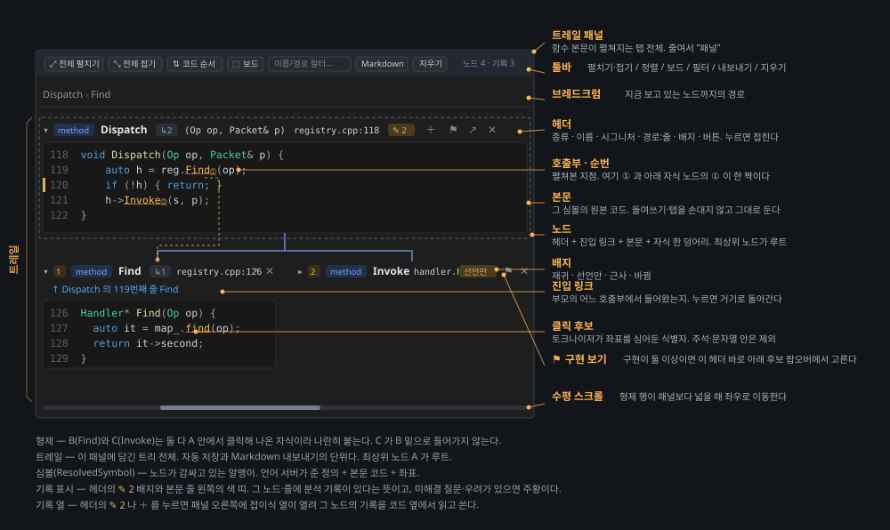

# 용어 지도

용어의 **정의**는 [`CLAUDE.md`](../CLAUDE.md) 의 `## 용어` 절에 표로 있다.
이 문서는 그 이름들이 **화면 어디를 가리키는지**만 보여준다.



## 트리에서의 관계

같은 그림을 트리로만 다시 그리면 이렇다.

```
트레일 ─ 이 패널에 담긴 것 전체 (자동 저장과 Markdown 내보내기의 단위)
└─ 노드 A (Dispatch)                                     ← 최상위 노드 = 루트
   헤더  ▾ [method] Dispatch ↳2 … registry.cpp:118
   본문  119  auto h = reg.Find①(op);                    ← 호출부 ①
         121  h->Invoke②(s, p);                          ← 호출부 ②
                         │
              ┌──────────┴──────────┐
       노드 B ① (Find)       노드 C ② (Invoke) [선언만] ⚑
       진입 링크 ↑ Dispatch…  ← 둘 다 A의 자식이며 같은 행에 놓인다
       본문 126 Handler*…
               │
          노드 D ① (…)        ← B의 자식은 그 아래 행에 놓인다
```

읽는 법 셋.

- **부모는 "클릭한 코드가 어느 노드의 본문에 있었나"로만 정해진다.** A 본문에서 `Find` 와
  `Invoke` 를 클릭했으니 B와 C는 둘 다 A의 자식이고 서로 형제다. C가 B 밑으로 들어가지 않는다.
- **호출부의 ① 과 자식 노드 헤더의 ① 은 한 짝이다.** 부모 코드의 `Find①` 을 누르면 아래 ① 노드로
  가고, ① 노드의 진입 링크를 누르면 부모의 그 호출부로 돌아온다.
- **접힌 노드(C)는 본문과 자식이 숨는다.** 헤더만 남는다. 헤더를 누르면 다시 펼쳐진다.

## 트리 모드 · 보드 모드

위 그림은 기본인 **트리 모드**다. 툴바의 `⬚ 보드` 를 누르면 **보드 모드**로 바뀐다.

```
[트리 모드]                  [보드 모드]

        노드 A                ┌ 노드 A ┐       ┌ 노드 B ┐
       ┌──┴──┐                │  코드  │──┬───▶│  코드  │
① 노드 B  ② 노드 C           └────────┘  │    └────────┘
    │                                     │    ┌ 노드 C ┐
① 노드 D                                  └───▶│  코드  │
부모는 위, 형제는 같은 행                      └────────┘

                              헤더를 끌어 아무 자리로나 옮긴다
```

트리가 패널 폭보다 넓어지면 **패널 아래에 수평 스크롤바가 생긴다.** 트리 모드의 배치가
화면 밖으로 이어질 뿐 부모-자식 관계는 바뀌지 않는다.

**보드에서 옮겨도 부모-자식 관계는 바뀌지 않는다.** 화면 배치일 뿐이라 트리로 돌아가면
원래 모양 그대로다. 관계를 실제로 바꾸는 것은 헤더의 `⇱`(새 루트로 떼어내기) 하나뿐이다.
보드에서 잡아둔 자리는 트레일과 함께 저장되므로 새로고침해도, 서버를 다시 띄워도 그대로다.

## 트레일 패널 밖

트레일 패널은 브라우저 화면의 한 탭이다. 나머지는 이렇게 부른다.

```
┌────────────────────────────────────────────────────────────┐
│ 앱 바 — 프로젝트 이름 · 트레일 고르기 · 연결 상태          │
├──────────────┬─────────────────────────────────────────────┤
│ 파일 탐색기  │ [코드] [트레일] [진단]                      │
│ (검색 + 트리)│                                             │
│              │  코드 화면 / 트레일 패널 / 진단 화면        │
└──────────────┴─────────────────────────────────────────────┘
```

- **파일 탐색기** — 왼쪽의 파일 목록과 이름 검색.
- **코드 화면** — 파일 전체를 보여주는 읽기 전용 탭. 여기서 `Ctrl+Alt+T` 를 누른다.
- **진단 화면** — 언어 서버 상태·점검 결과·로그와 외부 에디터 설정.

이 셋은 확장 시절에는 없던 화면이라 위 그림에는 안 나온다.

## 그림 고치기

`terms.svg` 는 손으로 쓴 SVG다. 빌드 단계도, 외부 폰트·CDN도 없다. 브라우저나
VS Code 미리보기로 그냥 열린다.

**트레일 패널 UI를 바꾸면 이 그림도 같이 고친다.** 툴바 버튼이 늘거나, 헤더에 붙는 것의
순서가 바뀌거나, 배지가 추가되면 그림이 먼저 낡는다. 좌표는 전부 상수로 박혀 있으니
`<!-- 노드 A 헤더 -->` 같은 주석을 찾아 그 근처만 손대면 된다.
고친 뒤에는 브라우저로 열어 글자가 겹치지 않는지 눈으로 확인한다.

무엇을 고쳤을 때 어디를 같이 고쳐야 하는지는
[`CLAUDE.md`](../CLAUDE.md) 의 `## 바꾸면 같이 고칠 것` 표에 정리해 두었다.
